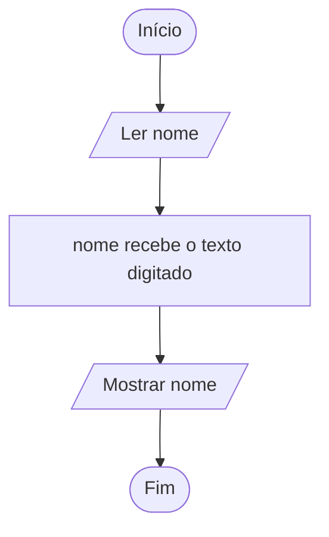

# 0001 · Entrada de dados (input)

> Um programa que só fala e nunca escuta é igual àquele colega que manda áudio de
> 5 minutos e não lê a resposta. Hoje o programa aprende a ouvir.

## A ideia

Entrada é o momento em que o programa para, faz uma pergunta e espera você
digitar. Pense no caixa da cantina: ele pergunta "vai querer o quê?" e só segue
depois que você responde.

No nosso projeto quem faz isso é a função `input`, que mora em `#core/input.ts`.
Ela mostra a pergunta, espera o Enter e devolve o que foi digitado.

Guarde uma coisa desde já: o `input` **sempre devolve texto (`string`)**. Você
digitou 17? Para ele é o texto `'17'`, igual a uma placa escrita "17". Fazer
conta com isso fica para a pasta de conversão.

Para rodar qualquer arquivo desta pasta:

```bash
pnpm tsx 15102026/0001-input/exemplo-1.ts
```

## Fluxograma

O caminho é curto: pergunta, guarda, mostra.



Legenda: **oval** = início/fim, **paralelogramo** = entrada ou saída, **retângulo** = processamento, **losango** = decisão.

## Exemplos

### Exemplo 1 - Perguntar o nome

Arquivo: `exemplo-1.ts`

```ts
import { input } from '#core/input.ts'

const nome = input('Qual é o seu nome? ')
console.log(nome)
```

Repare no espaço depois do `?` na pergunta. Sem ele, o que você digita fica
grudado no texto.

### Exemplo 2 - Perguntar duas coisas

Arquivo: `exemplo-2.ts`

```ts
import { input } from '#core/input.ts'

const cidade = input('Em qual cidade você mora? ')
const bairro = input('E o bairro? ')

console.log(cidade)
console.log(bairro)
```

Cada `input` é uma pergunta. O programa espera a primeira resposta antes de
fazer a segunda.

### Exemplo 3 - O input devolve texto

Arquivo: `exemplo-3.ts`

```ts
import { input } from '#core/input.ts'

const idade = input('Quantos anos você tem? ')

console.log(typeof idade) // string (mesmo digitando 17)
```

Rode e digite um número. O `typeof` vai insistir que é `string`. Ele tem razão.

## Pegadinha

Esquecer de guardar a resposta numa variável:

```ts
input('Qual é o seu nome? ')
console.log(nome) // erro: quem é "nome"?
```

O usuário respondeu, mas a resposta foi para o lixo. Sempre guarde:
`const nome = input(...)`.

## Adivinhe a saída

Imagine que o `input` devolveu `'17'` e o resultado foi guardado assim:

```ts
const resposta = '17'
console.log(typeof resposta)
console.log(resposta + 1)
```

<details><summary>Ver resposta</summary>

```
string
171
```

Não é 18. Texto mais número junta os dois, como colar adesivo: `'17'` e `1`
viram `'171'`.

</details>

## Exercícios

Responda dentro dos arquivos `exercicio-1.ts` a `exercicio-4.ts` desta pasta.

1. Pergunte o nome da sua escola e mostre a resposta na tela.
2. Pergunte o nome de um colega e a comida preferida dele (vale tambaqui, vale
   açaí, vale miojo). Mostre as duas respostas, uma em cada linha.
3. Peça um número qualquer e mostre o `typeof` do que foi digitado. Num
   comentário, explique por que apareceu `string` se você digitou um número.
4. Escalação do time da sala: pergunte o nome de três colegas e mostre os três,
   um em cada linha.
