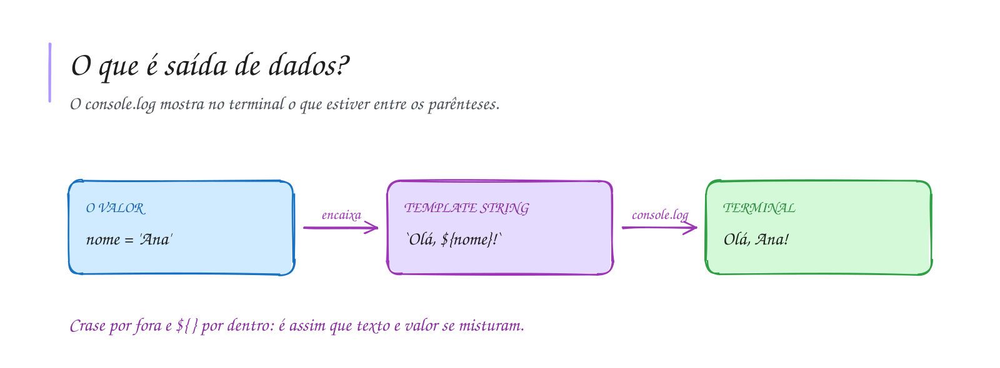

# 0002 · Saída de dados (output)

> Se o programa calcula a média e não mostra, calculou para quem?

## A ideia

Saída é o programa mostrando alguma coisa para você. No terminal quem faz isso é
o `console.log`. Tudo que estiver entre os parênteses aparece na tela.

Para misturar texto com valores existe a **template string**. Em vez de aspas
você usa crases (`` ` ``) e coloca o valor dentro de `${ }`. É como um bilhete
com espaço em branco: `Olá, ${nome}!` vira `Olá, Ana!` quando `nome` é `'Ana'`.

A crase fica perto do Enter na maioria dos teclados, às vezes junto com o til.
Ache ela agora: você vai usar muito.

## Diagrama

## Exercícios

Os enunciados e as dicas estão nos comentários de `exercicio-1.ts` e `exercicio-2.ts`, aqui nesta pasta. Responda dentro do próprio arquivo.

## Para ler mais

- MANZANO, J. A. N. G.; OLIVEIRA, J. F. *Algoritmos: lógica para desenvolvimento de programação de computadores*. São Paulo: Érica.
- HAVERBEKE, M. *Eloquent JavaScript*. 3. ed. San Francisco: No Starch Press, 2018. Disponível em: <https://eloquentjavascript.net>.
- MDN WEB DOCS. *Template strings*. Disponível em: <https://developer.mozilla.org/pt-BR/docs/Web/JavaScript/Reference/Template_literals>.
