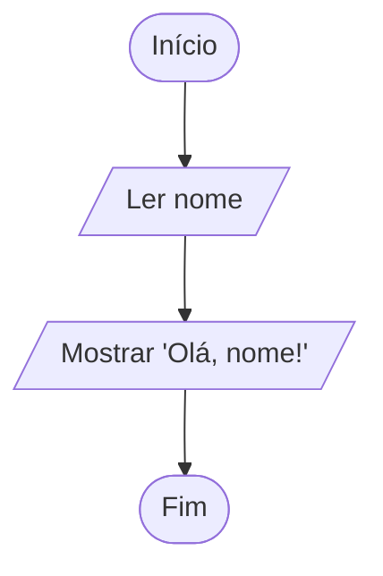

# 0002 · Saída de dados (output)

> Se o programa calcula a média e não mostra, calculou para quem? Hoje ele
> aprende a falar.

## A ideia

Saída é o programa mostrando alguma coisa para você. No terminal quem faz isso é
o `console.log`. Tudo que estiver entre os parênteses aparece na tela.

Para misturar texto com valores existe a **template string**. Em vez de aspas
você usa crases (`` ` ``) e coloca o valor dentro de `${ }`. É como um bilhete
com espaço em branco: `Olá, ${nome}!` vira `Olá, Ana!` quando `nome` é `'Ana'`.

A crase fica perto do Enter na maioria dos teclados (às vezes junto com o til).
Vale achar ela agora, porque você vai usar muito.

## Fluxograma

Ler o nome e devolver um "oi" personalizado.



Legenda: **oval** = início/fim, **paralelogramo** = entrada ou saída, **retângulo** = processamento, **losango** = decisão.

## Exemplos

### Exemplo 1 - Mostrar uma mensagem

Arquivo: `exemplo-1.ts`

```ts
console.log('Bem-vindo à aula de TypeScript!')
```

O mais simples possível: texto fixo, entre aspas, direto na tela.

### Exemplo 2 - Mostrar um valor dentro do texto

Arquivo: `exemplo-2.ts`

```ts
const cidade = 'Benjamin Constant'

console.log(`Eu moro em ${cidade}`)
// Eu moro em Benjamin Constant
```

Troque o valor de `cidade` para `'Atalaia do Norte'` e rode de novo. A frase se
ajusta sozinha.

### Exemplo 3 - Entrada e saída juntas

Arquivo: `exemplo-3.ts`

```ts
import { input } from '#core/input.ts'

const nome = input('Seu nome: ')
const curso = input('Seu curso: ')

console.log(`Olá, ${nome}! Você estuda ${curso}.`)
```

Aqui o programa pergunta, guarda e responde. Isso já é um programa de verdade.

## Pegadinha

Usar aspas no lugar da crase:

```ts
const nome = 'Ana'
console.log('Olá, ${nome}!') // mostra: Olá, ${nome}!
```

Com aspas o `${}` vira texto comum e aparece na tela do jeito que está. Só a
crase faz a troca pelo valor.

## Adivinhe a saída

```ts
const fruta = 'açaí'
console.log('Eu quero ${fruta}')
console.log(`Eu quero ${fruta}`)
console.log('Barco sai às', 6, 'h')
```

<details><summary>Ver resposta</summary>

```
Eu quero ${fruta}
Eu quero açaí
Barco sai às 6 h
```

A primeira linha caiu na pegadinha das aspas. E na última, quando você separa
valores com vírgula, o `console.log` coloca um espaço entre eles.

</details>

## Exercícios

Responda dentro dos arquivos `exercicio-1.ts` a `exercicio-4.ts` desta pasta.

1. Faça o programa se apresentar por você: mostre três linhas com seu nome, sua
   idade e sua cidade.
2. Pergunte o nome da pessoa e dê as boas-vindas: `Seja bem-vindo(a), NOME!`.
3. Pergunte o nome de uma fruta e uma cor. Mostre `A fruta FRUTA é COR.` usando
   template string. Vale `O cupuaçu é marrom`, vale `A banana é azul`, o
   programa não julga.
4. Pergunte nome e idade e mostre numa única template string:
   `NOME tem IDADE anos e estuda no CETAM.`
