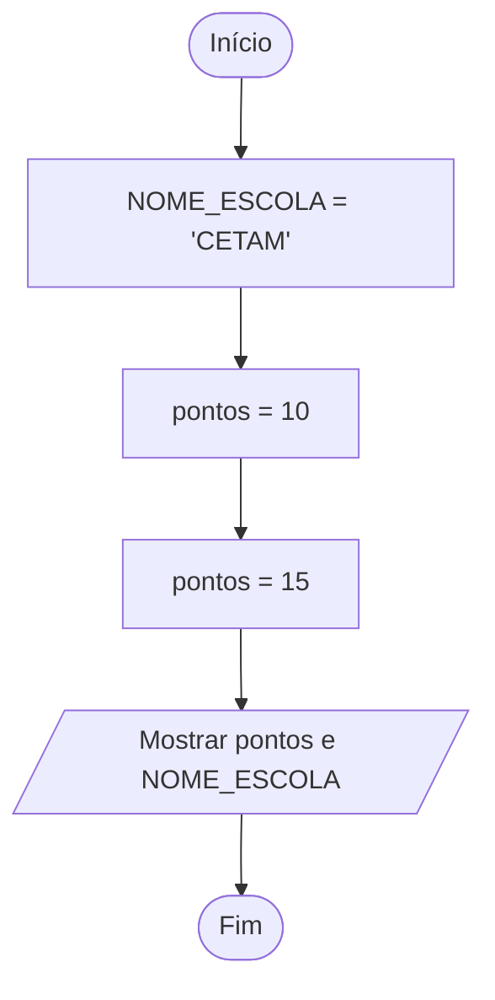

# 0003 · Variáveis e constantes

> O placar do jogo muda a cada gol. O nome do estádio não muda. Como o programa
> sabe a diferença?

## A ideia

Uma **variável** é uma caixinha com etiqueta. A etiqueta é o nome, e dentro fica
um valor guardado na memória.

- `let`: caixa que pode trocar o conteúdo. Serve para o placar.
- `const`: caixa lacrada. Colocou o valor, acabou. Serve para o nome do estádio.
- `var`: o jeito antigo. A gente não usa, porque ele se comporta de um jeito
  confuso e causa bug difícil de achar.

Na dúvida, comece com `const`. Se precisar mudar depois, troque para `let`.

O TypeScript quer saber o que tem dentro de cada caixa. Você pode dizer
(`let idade: number = 17`, isso é **anotação de tipo**) ou deixar ele descobrir
pelo valor (`let idade = 17`, isso é **inferência**). Nos dois casos ele não
deixa colocar texto numa caixa de número.

Sobre os nomes: `camelCase` para variáveis (`nomeCompleto`, `notaFinal`) e
`UPPER_CASE` para constantes fixas do programa (`MEDIA_APROVACAO`).

## Fluxograma

O placar troca de valor no meio do caminho. O nome da escola fica igual.



Legenda: **oval** = início/fim, **paralelogramo** = entrada ou saída, **retângulo** = processamento, **losango** = decisão.

## Exemplos

### Exemplo 1 - let pode mudar, const não

Arquivo: `exemplo-1.ts`

```ts
let pontos = 10
pontos = 15 // pode

const NOME_ESCOLA = 'CETAM'
// NOME_ESCOLA = 'Outra' // erro: não pode mudar uma const

console.log(pontos, NOME_ESCOLA)
```

Tire o `//` da linha comentada e veja o editor sublinhar de vermelho. Depois
coloque de volta.

### Exemplo 2 - Anotação de tipo

Arquivo: `exemplo-2.ts`

```ts
let nome: string = 'Ana'
let idade: number = 17
let matriculado: boolean = true

console.log(nome, idade, matriculado)
```

Os `: string`, `: number` e `: boolean` são as etiquetas dizendo o que cabe em
cada caixa.

### Exemplo 3 - Inferência de tipo

Arquivo: `exemplo-3.ts`

```ts
let cidade = 'Benjamin Constant' // o TS entende que é string

// cidade = 10 // erro: Type 'number' is not assignable to type 'string'

console.log(cidade)
```

Ninguém escreveu `: string`, e mesmo assim o TypeScript sabe. Passe o mouse em
cima de `cidade` no VS Code para conferir.

## Pegadinha

Achar que `const` não pode nada e que `let` pode tudo:

```ts
let idade = 17
idade = 'dezoito' // erro! let muda o valor, não o tipo
```

O `let` deixa trocar o valor por outro do mesmo tipo. Número continua número.

## Adivinhe a saída

```ts
let placar = 0
placar = 2
placar = placar + 1
const TIME = 'Nacional'
console.log(TIME, placar)
```

<details><summary>Ver resposta</summary>

```
Nacional 3
```

A caixa `placar` foi 0, depois 2, depois pegou o 2 e somou 1. Só o último valor
fica guardado.

</details>

## Exercícios

Responda dentro dos arquivos `exercicio-1.ts` a `exercicio-4.ts` desta pasta.

1. Crie a constante `NOME_CURSO` e a variável `turma`. Mude o valor de `turma`
   (alguém trocou de sala) e mostre as duas.
2. Monte sua ficha com anotação de tipo: seu nome (`string`), sua idade
   (`number`) e se você gosta de programar (`boolean`, seja sincero). Mostre
   tudo.
3. Crie `let preco = 10` e logo depois tente `preco = 'dez'`. Copie a mensagem
   de erro do editor para um comentário e explique com suas palavras o que ele
   está reclamando.
4. Crie a constante `MEDIA_APROVACAO` com valor 6 e a variável `nota`. Mostre as
   duas, mude a nota (o professor revisou a prova) e mostre de novo. Num
   comentário, diga qual das duas o TypeScript não deixaria mudar e por quê.
