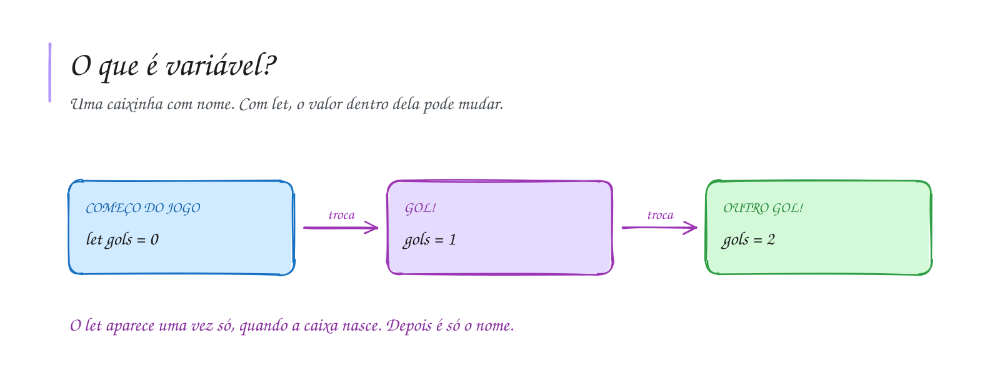

# 0003 · Variáveis

> O placar do jogo muda a cada gol. Onde o programa guarda esse número enquanto
> ele vai mudando?

## A ideia

Pense numa caixinha com etiqueta. A etiqueta é o nome, e dentro fica um valor
guardado na memória. Com `let`, dá para tirar o valor e colocar outro quantas
vezes precisar. É assim que o placar sai de 0 para 1 e de 1 para 2.

Para trocar o valor, você escreve só o nome e o novo valor: `gols = 2`. O `let`
aparece uma vez só, quando a caixa é criada.

O TypeScript quer saber o que cabe em cada caixa. Você pode dizer
(`let idade: number = 17`, isso é **anotação de tipo**) ou deixar ele descobrir
pelo valor (`let idade = 17`, isso é **inferência**). Nos dois casos ele não
deixa colocar texto numa caixa de número.

E o `var`? É o jeito antigo, e causa bug difícil de achar. A gente não usa.

Nome de variável vai em `camelCase`: `nomeCompleto`, `notaFinal`, `golsBrasil`.

## Diagrama

## Exercícios

Os enunciados e as dicas estão nos comentários de `exercicio-1.ts` e `exercicio-2.ts`, aqui nesta pasta. Responda dentro do próprio arquivo.

## Para ler mais

- FORBELLONE, A. L. V.; EBERSPÄCHER, H. F. *Lógica de programação: a construção de algoritmos e estruturas de dados*. 3. ed. São Paulo: Pearson Prentice Hall, 2005.
- HAVERBEKE, M. *Eloquent JavaScript*. 3. ed. San Francisco: No Starch Press, 2018. Disponível em: <https://eloquentjavascript.net>.
- MICROSOFT. *TypeScript Handbook*: Everyday Types. Disponível em: <https://www.typescriptlang.org/docs/handbook/2/everyday-types.html>.
- MDN WEB DOCS. *let*. Disponível em: <https://developer.mozilla.org/pt-BR/docs/Web/JavaScript/Reference/Statements/let>.
