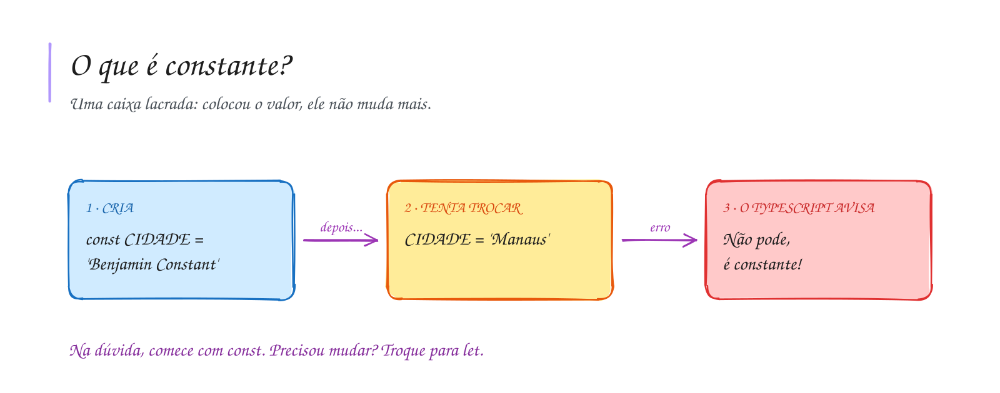

# 0004 · Constantes

> O nome da escola não muda no meio da aula. A média para passar também não.
> Como avisar o programa de que um valor é fixo?

## A ideia

Se a variável é uma caixa que troca de conteúdo, a constante é uma caixa
lacrada. Colocou o valor, acabou. Se alguém tentar trocar, o TypeScript avisa na
hora: `Cannot assign to 'NOME_ESCOLA' because it is a constant`.

Parece limitação, mas ajuda. Um valor que não pode mudar é um bug a menos para
caçar. Por isso a regra da turma é: na dúvida, comece com `const`. Se precisar
mudar depois, troque para `let`.

Sobre os nomes:

- valores fixos do programa vão em `UPPER_CASE`: `MEDIA_APROVACAO`,
  `NOME_ESCOLA`, `CIDADE`;
- uma `const` comum, como a resposta de um `input`, continua em `camelCase`:
  `const nome = input('Seu nome: ')`.

## Diagrama

## Exercícios

Os enunciados e as dicas estão nos comentários de `exercicio-1.ts` e `exercicio-2.ts`, aqui nesta pasta. Responda dentro do próprio arquivo.

## Para ler mais

- FORBELLONE, A. L. V.; EBERSPÄCHER, H. F. *Lógica de programação: a construção de algoritmos e estruturas de dados*. 3. ed. São Paulo: Pearson Prentice Hall, 2005.
- MDN WEB DOCS. *const*. Disponível em: <https://developer.mozilla.org/pt-BR/docs/Web/JavaScript/Reference/Statements/const>.
- GOOGLE. *Google JavaScript Style Guide*. Disponível em: <https://google.github.io/styleguide/jsguide.html>.
