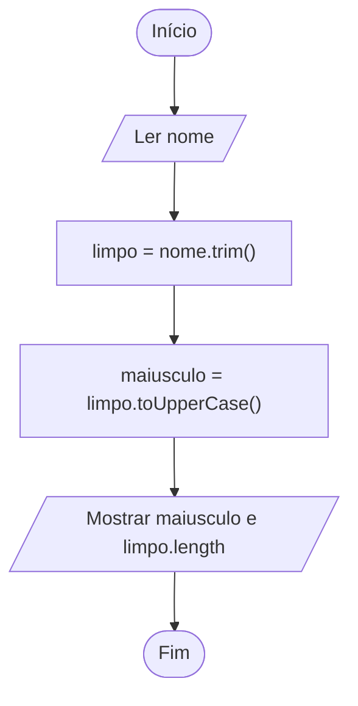

# 0004 · Texto (string)

> Seu nome, sua senha do Wi-Fi, a legenda daquela foto no rio. Para o computador
> tudo isso é a mesma coisa: string.

## A ideia

`string` é o tipo para texto. Você escreve entre aspas simples `'...'`, aspas
duplas `"..."` ou crases `` `...` ``. No nosso projeto a gente prefere aspas
simples, e crase quando tem `${}` no meio.

Toda string já vem com ferramentas prontas. Pense num canivete: você não
precisa fabricar a tesoura, é só puxar.

| Uso                 | O que faz                           |
| ------------------- | ----------------------------------- |
| `texto.length`      | quantidade de caracteres            |
| `texto.toUpperCase()` | tudo em MAIÚSCULAS                |
| `texto.toLowerCase()` | tudo em minúsculas                |
| `texto.trim()`      | tira espaços do começo e do fim     |
| `texto.includes('x')` | `true` se o texto contém `'x'`    |
| `texto.split(' ')`  | quebra o texto em pedaços           |

Uma coisa que pega muita gente: com texto, o `+` não soma, ele cola. `'5' + 3`
vira `'53'`.

## Fluxograma

Recebe o nome do jeito que vier, limpa e deixa em maiúsculas.



Legenda: **oval** = início/fim, **paralelogramo** = entrada ou saída, **retângulo** = processamento, **losango** = decisão.

## Exemplos

### Exemplo 1 - Tamanho e maiúsculas

Arquivo: `exemplo-1.ts`

```ts
const nome = 'Maria'

console.log(nome.length) // 5
console.log(nome.toUpperCase()) // MARIA
```

O `length` não tem parênteses no final. Ele é uma informação, não uma ação.

### Exemplo 2 - Limpar espaços e procurar

Arquivo: `exemplo-2.ts`

```ts
const frase = '   Eu gosto de TypeScript   '

console.log(frase.trim()) // 'Eu gosto de TypeScript'
console.log(frase.includes('TypeScript')) // true
```

O `trim` é ótimo para quando a pessoa digita com espaço sobrando sem perceber.

### Exemplo 3 - Concatenação

Arquivo: `exemplo-3.ts`

```ts
const primeiro = 'Benjamin'
const segundo = 'Constant'

console.log(primeiro + ' ' + segundo) // Benjamin Constant
console.log('5' + 3) // 53 (juntou, não somou!)
```

Sem o `' '` do meio sairia `BenjaminConstant`, tudo grudado.

## Pegadinha

Maiúscula e minúscula fazem diferença:

```ts
const frase = 'Eu moro em Tabatinga'
console.log(frase.includes('tabatinga')) // false
```

Para o computador `T` e `t` são letras diferentes. Se não importa, passe tudo
para minúsculas antes de procurar.

## Adivinhe a saída

```ts
const cidade = '  Tabatinga '
console.log(cidade.length)
console.log(cidade.trim().length)
console.log(cidade.trim().toUpperCase().includes('TABA'))
```

<details><summary>Ver resposta</summary>

```
12
9
true
```

Espaço também é caractere, por isso 12. Depois do `trim` sobram as 9 letras de
Tabatinga. E dá para encadear ferramentas: limpa, passa para maiúsculas,
procura.

</details>

## Exercícios

Responda dentro dos arquivos `exercicio-1.ts` a `exercicio-4.ts` desta pasta.

1. Pergunte o nome do usuário e mostre quantas letras ele tem. Quem tem o maior
   nome da turma?
2. Pergunte uma palavra e mostre ela GRITANDO (maiúsculas) e depois sussurrando
   (minúsculas).
3. Pergunte uma frase e mostre `true` ou `false` dizendo se ela contém a palavra
   `escola`.
4. Pergunte uma frase. Mostre a frase sem espaços nas pontas e em minúsculas, e
   depois o resultado de `split(' ')`. Repare no que o `split` devolve.
