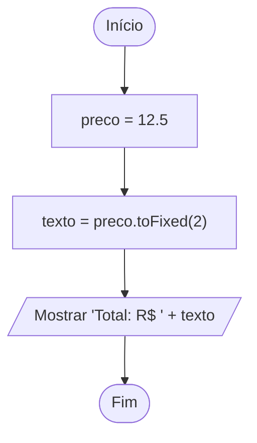

# 0005 · Número (number)

> Quanto custa o açaí? Quantos km até Tabatinga? Qual sua nota? Tudo isso é
> número, e o computador adora número.

## A ideia

`number` é o tipo para números. No TypeScript não tem um tipo para inteiro e
outro para decimal: `10`, `-3` e `7.5` são todos `number`. Uma caixa só para
todos.

Três coisas para guardar:

- O decimal usa ponto, igual à calculadora do celular: `7.5`, não `7,5`.
- `toFixed(n)` mostra o número com `n` casas depois do ponto. Bom para dinheiro.
  Ele devolve texto, pronto para mostrar.
- `NaN` quer dizer "Not a Number", não é um número. Aparece quando você pede uma
  conta que não faz sentido, tipo transformar `'abc'` em número.

## Fluxograma

Guarda o preço e mostra bonitinho, com centavos.



Legenda: **oval** = início/fim, **paralelogramo** = entrada ou saída, **retângulo** = processamento, **losango** = decisão.

## Exemplos

### Exemplo 1 - Inteiros e decimais

Arquivo: `exemplo-1.ts`

```ts
const idade: number = 17
const altura: number = 1.68

console.log(idade, altura)
console.log(typeof altura) // number
```

Inteiro ou quebrado, o `typeof` responde a mesma coisa.

### Exemplo 2 - Casas decimais com toFixed

Arquivo: `exemplo-2.ts`

```ts
const preco = 12.5

console.log(preco.toFixed(2)) // 12.50
console.log(`Total: R$ ${preco.toFixed(2)}`)
```

`12.5` na plaquinha da feira fica estranho. `12.50` parece preço de verdade.

### Exemplo 3 - NaN

Arquivo: `exemplo-3.ts`

```ts
const resultado = Number('abc')

console.log(resultado) // NaN
console.log(Number.isNaN(resultado)) // true
```

O `Number.isNaN` é o jeito de perguntar "deu ruim na conversão?".

## Pegadinha

Escrever decimal com vírgula:

```ts
const preco = 7,5 // erro! o TypeScript não entende assim
const certo = 7.5
```

No código, vírgula separa coisas. Para decimal é sempre ponto.

## Adivinhe a saída

```ts
console.log(0.1 + 0.2)
console.log((0.1 + 0.2).toFixed(2))
console.log(7 / 0)
```

<details><summary>Ver resposta</summary>

```
0.30000000000000004
0.30
Infinity
```

O computador guarda decimal de um jeito que às vezes sobra um restinho. Por
isso o `toFixed` é seu amigo na hora de mostrar dinheiro. E dividir por zero
não trava o programa: dá `Infinity`.

</details>

## Exercícios

Responda dentro dos arquivos `exercicio-1.ts` a `exercicio-4.ts` desta pasta.

1. Crie variáveis para sua idade e sua altura (em metros, com ponto) e mostre as
   duas.
2. Crie uma variável com o valor `3.14159` (o famoso pi) e mostre com só 2 casas
   decimais.
3. Mostre o resultado de `Number('dez')` e de `Number('10')`. Num comentário,
   explique por que um deu certo e o outro não.
4. Crie uma variável com o resultado de `10 / 3`. Mostre o valor sem
   formatação, com 2 casas e com 0 casas decimais. Qual ficou mais fácil de ler?
