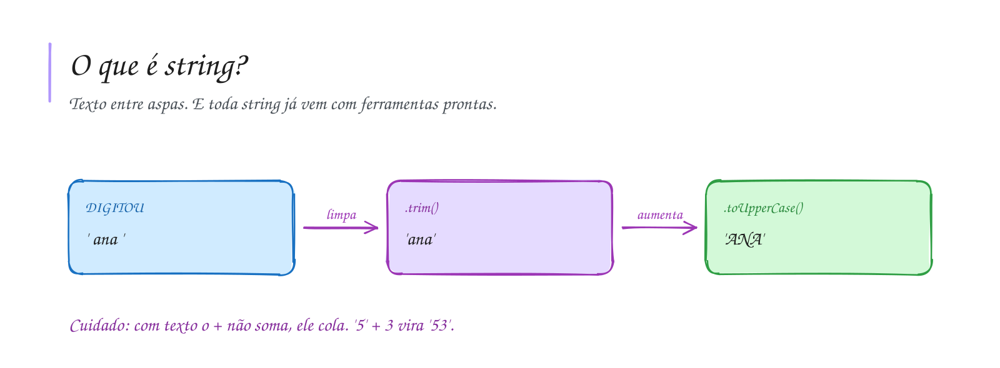

# 0005 · Texto (string)

> Seu nome, sua senha do Wi-Fi, a legenda daquela foto no rio. Para o computador
> tudo isso é a mesma coisa: string.

## A ideia

`string` é o tipo para texto. Você escreve entre aspas simples `'...'`, aspas
duplas `"..."` ou crases `` `...` ``. No nosso projeto a gente prefere aspas
simples, e crase quando tem `${}` no meio.

Toda string já vem com ferramentas prontas. Pense num canivete: você não
precisa fabricar a tesoura, é só puxar.

| Uso                 | O que faz                           |
| ------------------- | ----------------------------------- |
| `texto.length`      | quantidade de caracteres            |
| `texto.toUpperCase()` | tudo em MAIÚSCULAS                |
| `texto.toLowerCase()` | tudo em minúsculas                |
| `texto.trim()`      | tira espaços do começo e do fim     |
| `texto.includes('x')` | `true` se o texto contém `'x'`    |
| `texto.split(' ')`  | quebra o texto em pedaços           |

Cuidado: com texto, o `+` não soma, ele cola. `'5' + 3` vira `'53'`.

## Diagrama

## Exercícios

Os enunciados e as dicas estão nos comentários de `exercicio-1.ts` e `exercicio-2.ts`, aqui nesta pasta. Responda dentro do próprio arquivo.

## Para ler mais

- ECMA INTERNATIONAL. *ECMA-262: ECMAScript language specification*. Disponível em: <https://tc39.es/ecma262/>.
- HAVERBEKE, M. *Eloquent JavaScript*. 3. ed. San Francisco: No Starch Press, 2018. Disponível em: <https://eloquentjavascript.net>.
- MDN WEB DOCS. *String*. Disponível em: <https://developer.mozilla.org/pt-BR/docs/Web/JavaScript/Reference/Global_Objects/String>.
