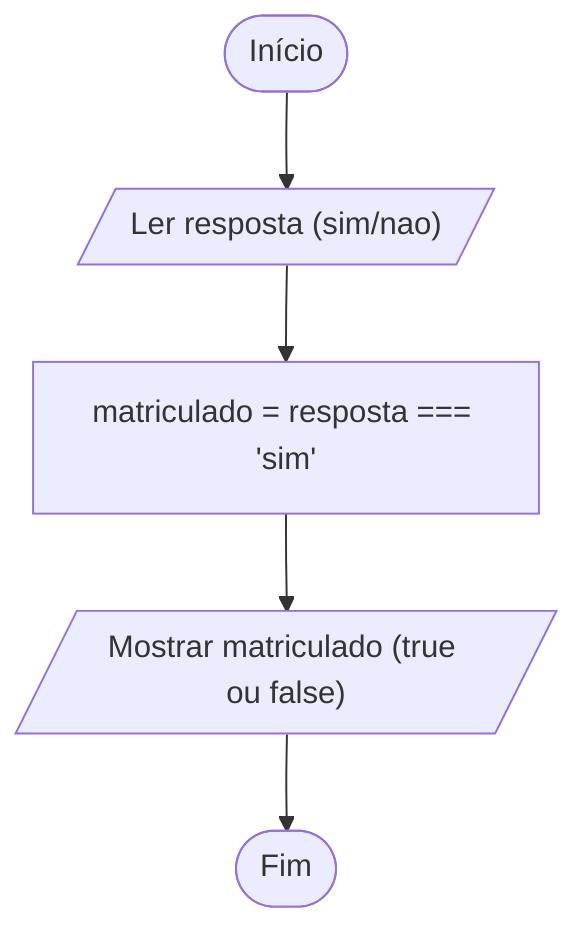

# 0006 · Booleano (boolean), typeof, null e undefined

> Está chovendo? Tem aula hoje? O recreio já saiu? Pergunta de sim ou não tem um
> tipo só para ela.

## A ideia

`boolean` é o tipo mais simples que existe: só tem dois valores, `true`
(verdadeiro) e `false` (falso). É um interruptor de luz. Ligado ou desligado,
não tem meio termo.

O `typeof` é o fofoqueiro do programa: você aponta para um valor e ele conta o
tipo, na hora em que o programa está rodando.

E tem dois valores especiais que representam "nada":

- `undefined`: a caixa existe, mas ninguém colocou nada nela ainda. Cadeira
  reservada que o aluno ainda não chegou.
- `null`: alguém colocou "nada" de propósito. É o aluno avisando "pode marcar
  que eu não vou".

## Fluxograma

A resposta "sim" ou "nao" vira um `true` ou `false`.



Legenda: **oval** = início/fim, **paralelogramo** = entrada ou saída, **retângulo** = processamento, **losango** = decisão.

## Exemplos

### Exemplo 1 - Valores booleanos

Arquivo: `exemplo-1.ts`

```ts
const estaChovendo: boolean = true
const temAula: boolean = false

console.log(estaChovendo, temAula)
```

Repare que `true` e `false` aparecem sem aspas. São valores, não texto.

### Exemplo 2 - Descobrindo o tipo com typeof

Arquivo: `exemplo-2.ts`

```ts
console.log(typeof 'oi') // string
console.log(typeof 42) // number
console.log(typeof true) // boolean
```

Bom para tirar dúvida quando você não sabe o que tem dentro de uma variável.

### Exemplo 3 - null e undefined

Arquivo: `exemplo-3.ts`

```ts
let apelido: string | undefined
console.log(apelido) // undefined

const telefone: string | null = null
console.log(telefone) // null
```

O `|` quer dizer "ou". `string | undefined` é "pode ser texto ou pode não ter
nada".

## Pegadinha

Colocar o booleano entre aspas:

```ts
const aprovado = 'true'
console.log(typeof aprovado) // string
```

Com aspas virou texto que só parece booleano. O interruptor de verdade é
`true`, sem aspas.

## Adivinhe a saída

```ts
console.log(typeof 'true')
console.log(typeof true)
console.log(typeof null)
```

<details><summary>Ver resposta</summary>

```
string
boolean
object
```

A última é estranha mesmo. É um erro antigo do JavaScript que nunca foi
corrigido, para não quebrar sites que já existiam. Só lembre que `null` dá
`object` no `typeof`.

</details>

## Exercícios

Responda dentro dos arquivos `exercicio-1.ts` a `exercicio-4.ts` desta pasta.

1. Crie duas variáveis booleanas: `gostaDeCafe` e `temCelular`. Mostre as duas.
2. Mostre o `typeof` de quatro valores diferentes: um texto, um número, um
   booleano e `undefined`.
3. Crie `let cor: string | undefined` sem valor e mostre. Depois dê uma cor para
   ela e mostre de novo.
4. Crie `const aprovado = true` e `const pagouMatricula = false`. Mostre o
   `typeof` de cada uma e depois uma frase com template string usando as duas.
