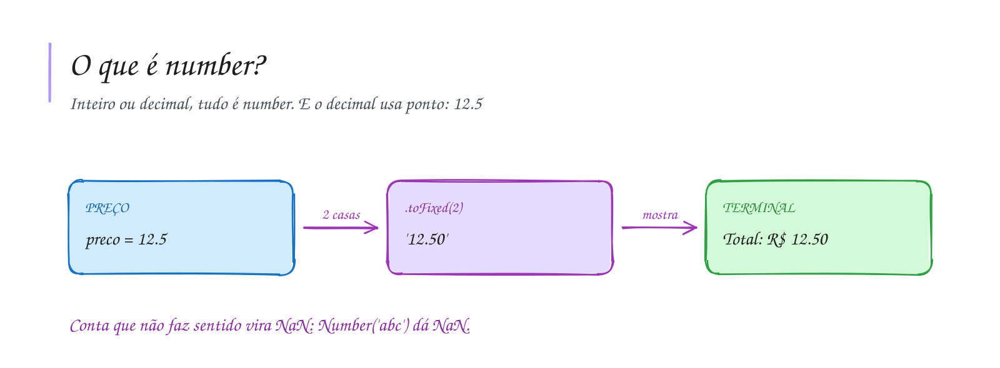

# 0006 · Número (number)

> Quanto custa o açaí? Quantos km até Tabatinga? Qual sua nota? Tudo isso é
> número.

## A ideia

`number` é o tipo para números. No TypeScript não tem um tipo para inteiro e
outro para decimal: `10`, `-3` e `7.5` são todos `number`.

Três coisas para guardar:

- O decimal usa ponto, igual à calculadora do celular: `7.5`, não `7,5`.
- `toFixed(n)` mostra o número com `n` casas depois do ponto. Bom para dinheiro.
  Ele devolve texto, pronto para mostrar.
- `NaN` quer dizer "Not a Number". Aparece quando você pede uma conta que não
  faz sentido, tipo transformar `'abc'` em número.

## Diagrama

## Exercícios

Os enunciados e as dicas estão nos comentários de `exercicio-1.ts` e `exercicio-2.ts`, aqui nesta pasta. Responda dentro do próprio arquivo.

## Para ler mais

- GOLDBERG, D. What every computer scientist should know about floating-point arithmetic. *ACM Computing Surveys*, v. 23, n. 1, p. 5-48, 1991.
- IEEE. *IEEE standard for floating-point arithmetic*: IEEE 754-2019. New York: IEEE, 2019.
- MDN WEB DOCS. *Number*. Disponível em: <https://developer.mozilla.org/pt-BR/docs/Web/JavaScript/Reference/Global_Objects/Number>.
