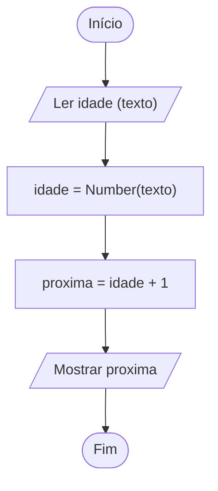

# 0007 · Conversão de tipos

> Você digitou 17, pediu para somar 1 e o programa respondeu 171. Hoje a gente
> resolve isso de vez.

## A ideia

Converter é trocar o tipo de um valor. Lembra que o `input` sempre devolve
texto? Pois é: para fazer conta, primeiro a gente transforma o texto em número.
É como trocar real por peso na fronteira. O dinheiro é o mesmo, mas agora dá
para usar do outro lado.

| Função          | O que faz                                    |
| --------------- | -------------------------------------------- |
| `Number('7.5')` | texto para número (aceita decimais)          |
| `parseInt('7')` | texto para número inteiro (corta o decimal)  |
| `parseFloat('7.5')` | texto para número decimal                |
| `String(10)`    | número para texto                            |

Se a conversão não dá certo, o resultado é `NaN`. Na prática você vai usar muito
`Number(input('...'))`, tudo numa linha.

## Fluxograma

Chega texto, vira número, aí sim faz a conta.



Legenda: **oval** = início/fim, **paralelogramo** = entrada ou saída, **retângulo** = processamento, **losango** = decisão.

## Exemplos

### Exemplo 1 - Number

Arquivo: `exemplo-1.ts`

```ts
import { input } from '#core/input.ts'

const idade = Number(input('Sua idade: '))

console.log(idade + 1) // soma de verdade
```

Digite 17. Agora sai 18, não 171.

### Exemplo 2 - parseInt e parseFloat

Arquivo: `exemplo-2.ts`

```ts
console.log(parseInt('8.9')) // 8
console.log(parseFloat('8.9')) // 8.9
console.log(Number('8.9')) // 8.9
```

O `parseInt` não arredonda, ele corta. 8.9 vira 8, sem dó.

### Exemplo 3 - String e conversão que falha

Arquivo: `exemplo-3.ts`

```ts
const ano = 2026
const texto = String(ano)

console.log(typeof texto) // string
console.log(Number('oito')) // NaN
```

O caminho de volta também existe: número para texto com `String`.

## Pegadinha

Converter só depois de somar:

```ts
const a = input('Primeiro número: ') // digitou 2
const b = input('Segundo número: ') // digitou 3
console.log(Number(a + b)) // 23, não 5
```

O `a + b` colou os textos antes (`'23'`), e só depois virou número. Converta
cada um primeiro: `Number(a) + Number(b)`.

## Adivinhe a saída

```ts
console.log('10' + 5)
console.log(Number('10') + 5)
console.log(parseInt('3 cocos'))
console.log(Number('3 cocos'))
```

<details><summary>Ver resposta</summary>

```
105
15
3
NaN
```

O `parseInt` lê do começo e para quando acha algo que não é número, então pega
o 3 e ignora os cocos. O `Number` é exigente: se tem qualquer coisa estranha no
texto, ele devolve `NaN`.

</details>

## Exercícios

Responda dentro dos arquivos `exercicio-1.ts` a `exercicio-4.ts` desta pasta.

1. Pergunte dois números com `input`, converta com `Number` e mostre a soma de
   verdade.
2. Mostre o resultado de `parseInt('15.7')` e `parseFloat('15.7')`. Num
   comentário, explique a diferença.
3. Pergunte um número e mostre a soma dele com 10 sem converter e depois
   convertendo. Explique num comentário por que deu diferente.
4. Pergunte a altura em metros (por exemplo 1.75), converta com `parseFloat` e
   mostre a altura em centímetros.
