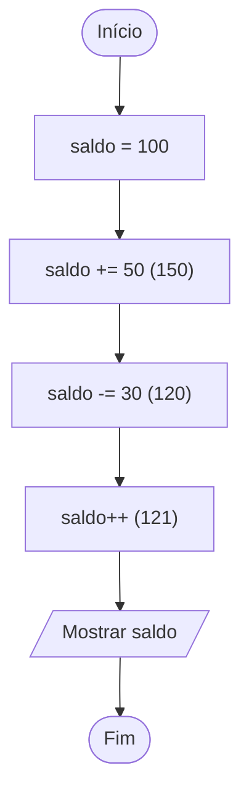

# 0008 · Operadores de atribuição

> Você tem 100 reais de crédito no celular. Gastou 30 no pacote de dados e
> ganhou 50 de recarga. Quanto ficou? O programa precisa ir atualizando esse
> valor, e é disso que essa pasta trata.

## A ideia

Atribuir é guardar um valor dentro de uma variável. Quem faz isso é o `=`. Ele
não pergunta nada, ele manda: "a partir de agora, `saldo` vale 100". Para
perguntar se dois valores são iguais existe outro operador, o `===`, que fica
para a pasta `0012`.

Muitas vezes o novo valor depende do valor antigo. Escrever `saldo = saldo + 50`
funciona, mas cansa. Por isso existe o atalho: `saldo += 50`. Lê assim: "pega o
que já tem e soma 50".

| Escrito    | É o mesmo que   |
| ---------- | --------------- |
| `x += 5`   | `x = x + 5`     |
| `x -= 5`   | `x = x - 5`     |
| `x *= 2`   | `x = x * 2`     |
| `x /= 2`   | `x = x / 2`     |
| `x %= 3`   | `x = x % 3`     |
| `x++`      | `x = x + 1`     |
| `x--`      | `x = x - 1`     |

Sobre `++x` e `x++`: os dois somam 1. A diferença é a hora. `++x` soma e depois
entrega o valor. `x++` entrega o valor antigo e só depois soma. Na maioria das
vezes você vai usar `x++` sozinho na linha, e aí tanto faz.

## Fluxograma

Acompanhe o saldo mudando a cada caixinha. A variável é a mesma, o valor é que
vai trocando.



Legenda: **oval** = início/fim, **paralelogramo** = entrada ou saída, **retângulo** = processamento, **losango** = decisão.

## Exemplos

### Exemplo 1 - Atribuição simples e composta

Arquivo: `exemplo-1.ts`

```ts
let saldo = 100

saldo += 50 // 150
saldo -= 30 // 120

console.log(saldo) // 120
```

Repare no `let`. Com `const` o TypeScript não deixaria o saldo mudar.

### Exemplo 2 - Incremento e decremento

Arquivo: `exemplo-2.ts`

```ts
let alunos = 20

alunos++ // chegou um aluno
alunos-- // saiu um aluno
alunos++ // chegou outro

console.log(alunos) // 21
```

É a chamada da turma: entra um, sai um, entra outro.

### Exemplo 3 - Pré e pós incremento

Arquivo: `exemplo-3.ts`

```ts
let a = 5
console.log(a++) // 5 (mostra e depois soma)
console.log(a) // 6

let b = 5
console.log(++b) // 6 (soma e depois mostra)
```

Rode e compare a primeira linha com a última. Os dois começaram em 5.

## Pegadinha

Achar que `x + 1` muda a variável:

```ts
let gols = 2
gols + 1
console.log(gols) // continua 2
```

A conta foi feita e jogada fora. Para guardar o resultado, use `gols += 1` ou
`gols++`.

## Adivinhe a saída

```ts
let vidas = 3
vidas--
vidas += 2
vidas *= 2
console.log(vidas)
```

<details><summary>Ver resposta</summary>

`8`. Começa com 3, perde uma (2), ganha duas (4) e dobra (8).

</details>

## Exercícios

Responda dentro dos arquivos `exercicio-1.ts` a `exercicio-4.ts` desta pasta.

1. Placar do Free Fire: comece com `let pontos = 0`. Você ganhou 10 pontos,
   depois mais 5, e perdeu 3 por cair do mapa. Use `+=` e `-=` e mostre o
   placar final.
2. Crie `let valor = 8`. Use `*=` para dobrar e depois `/=` para dividir por 4.
   Mostre o valor depois de cada passo.
3. Crie `let x = 10`. Mostre `x++`, depois `x`, depois `++x`. Em comentário,
   explique por que cada linha mostrou o que mostrou.
4. A cantina abriu o dia com `let estoque = 50` coxinhas. Vendeu 12, chegaram
   mais 30 e no fim da tarde o estoque caiu pela metade. Use atribuição
   composta e mostre o estoque depois de cada passo.
