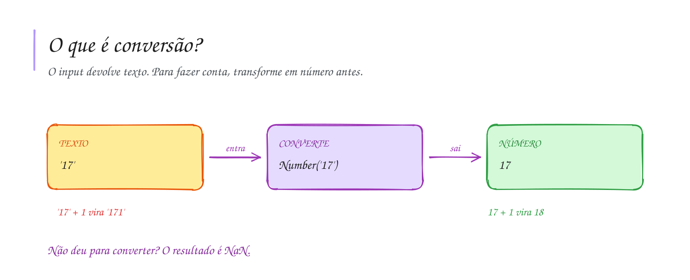

# 0008 · Conversão de tipos

> Você digitou 17, pediu para somar 1 e o programa respondeu 171. Hoje a gente
> resolve isso de vez.

## A ideia

Lembra que o `input` sempre devolve texto? Para fazer conta, primeiro a gente
transforma esse texto em número. É como trocar real por peso na fronteira: o
dinheiro é o mesmo, mas agora dá para usar do outro lado.

| Função          | O que faz                                    |
| --------------- | -------------------------------------------- |
| `Number('7.5')` | texto para número (aceita decimais)          |
| `parseInt('7')` | texto para número inteiro (corta o decimal)  |
| `parseFloat('7.5')` | texto para número decimal                |
| `String(10)`    | número para texto                            |

Se a conversão não dá certo, o resultado é `NaN`. Na prática você vai usar muito
`Number(input('...'))`, tudo numa linha.

## Diagrama

## Exercícios

Os enunciados e as dicas estão nos comentários de `exercicio-1.ts` e `exercicio-2.ts`, aqui nesta pasta. Responda dentro do próprio arquivo.

## Para ler mais

- HAVERBEKE, M. *Eloquent JavaScript*. 3. ed. San Francisco: No Starch Press, 2018. Disponível em: <https://eloquentjavascript.net>.
- MICROSOFT. *TypeScript Handbook*: The Basics. Disponível em: <https://www.typescriptlang.org/docs/handbook/2/basic-types.html>.
- MDN WEB DOCS. *parseInt()*. Disponível em: <https://developer.mozilla.org/pt-BR/docs/Web/JavaScript/Reference/Global_Objects/parseInt>.
