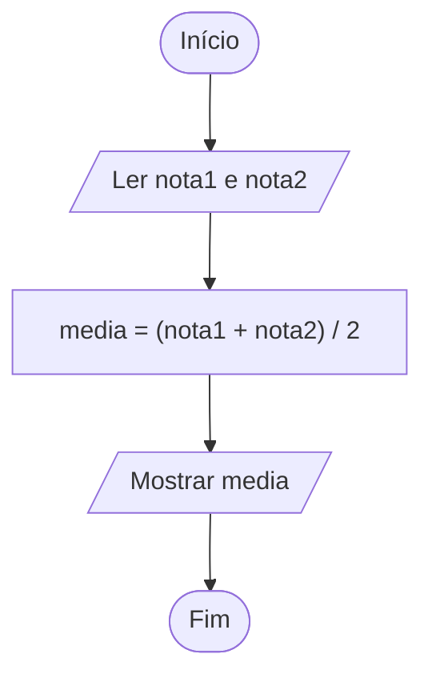

# 0009 · Operadores aritméticos

> Três amigos dividiram um açaí de 25 reais. Quanto cada um paga? E quanto sobra
> se ninguém tiver moeda? O computador faz as duas contas num piscar de olhos.

## A ideia

São as contas da escola, com dois símbolos novos. A multiplicação é `*` (o `x`
não serve, o computador acharia que é uma variável) e a divisão é `/`.

| Operador | Conta          | Exemplo  | Resultado |
| -------- | -------------- | -------- | --------- |
| `+`      | soma           | `7 + 2`  | `9`       |
| `-`      | subtração      | `7 - 2`  | `5`       |
| `*`      | multiplicação  | `7 * 2`  | `14`      |
| `/`      | divisão        | `7 / 2`  | `3.5`     |
| `%`      | resto          | `7 % 2`  | `1`       |
| `**`     | potência       | `7 ** 2` | `49`      |

O `%` é o que mais assusta e o que mais aparece em prova. Ele não tem nada a ver
com porcentagem. Ele devolve o resto da divisão: 7 alunos em duplas formam 3
duplas e sobra 1, então `7 % 2` é `1`.

A ordem é a da matemática: primeiro `**`, depois `*`, `/` e `%`, por último `+`
e `-`. Quer outra ordem? Coloque parênteses.

## Fluxograma

A média de duas notas. Os parênteses estão ali por um motivo, e o Exemplo 3
mostra qual.



Legenda: **oval** = início/fim, **paralelogramo** = entrada ou saída, **retângulo** = processamento, **losango** = decisão.

## Exemplos

### Exemplo 1 - As quatro operações

Arquivo: `exemplo-1.ts`

```ts
const a = 10
const b = 4

console.log(a + b) // 14
console.log(a - b) // 6
console.log(a * b) // 40
console.log(a / b) // 2.5
```

Dez dividido por quatro deu 2.5, com decimal. No TypeScript a divisão não corta
nada.

### Exemplo 2 - Resto e potência

Arquivo: `exemplo-2.ts`

```ts
console.log(10 % 3) // 1 (10 dividido por 3 sobra 1)
console.log(2 ** 3) // 8 (2 x 2 x 2)
```

Dica de ouro: se `numero % 2` dá 0, o número é par.

### Exemplo 3 - Parênteses mudam o resultado

Arquivo: `exemplo-3.ts`

```ts
const nota1 = 8
const nota2 = 6

console.log(nota1 + nota2 / 2) // 11 (errado para média)
console.log((nota1 + nota2) / 2) // 7 (média certa)
```

Média 11 numa prova que vale 10. Bom demais para ser verdade.

## Pegadinha

Somar o que veio do `input` sem converter:

```ts
const n1 = '8' // o input sempre devolve texto
const n2 = '6'
console.log(n1 + n2) // 86
```

O `+` com texto cola um no outro. Use `Number(input(...))` antes de fazer conta.

## Adivinhe a saída

```ts
console.log(2 + 3 * 4)
console.log((2 + 3) * 4)
console.log(17 % 5)
```

<details><summary>Ver resposta</summary>

`14`, `20` e `2`. Na primeira a multiplicação vem antes. Na segunda os
parênteses mandam. Na terceira, 17 dividido por 5 dá 3 e sobra 2.

</details>

## Exercícios

Responda dentro dos arquivos `exercicio-1.ts` a `exercicio-4.ts` desta pasta.

1. Calculadora de bolso: peça dois números e mostre a soma, a subtração, a
   multiplicação e a divisão, uma por linha.
2. Peça um número e mostre o resto da divisão dele por 2. Rode com um número
   par e com um ímpar e veja a diferença.
3. Boletim: peça três notas e mostre a média. Cuidado com os parênteses, senão
   alguém vai tirar média 17.
4. Tríplice Fronteira: peça um valor em reais e mostre quanto ele vale em peso
   colombiano e em sol peruano. Guarde as cotações em constantes e mostre os
   resultados com 2 casas decimais.
