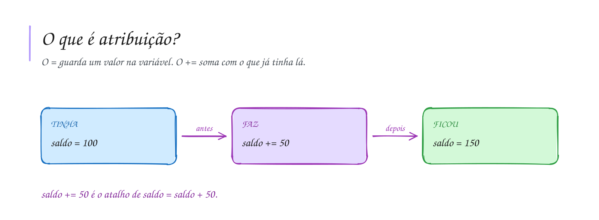

# 0009 · Operadores de atribuição

> Você tem 100 reais de crédito no celular. Gastou 30 no pacote de dados e
> ganhou 50 de recarga. Quanto ficou? O programa precisa ir atualizando esse
> valor a cada movimento.

## A ideia

Quem guarda o valor na variável é o `=`. Ele não pergunta nada, ele manda: "a
partir de agora, `saldo` vale 100". Perguntar se dois valores são iguais é
trabalho do `===`, que fica para a pasta `0013`.

Muitas vezes o novo valor depende do valor antigo. Escrever `saldo = saldo + 50`
funciona, mas cansa. Por isso existe o atalho: `saldo += 50`. Lê assim: "pega o
que já tem e soma 50".

| Escrito    | É o mesmo que   |
| ---------- | --------------- |
| `x += 5`   | `x = x + 5`     |
| `x -= 5`   | `x = x - 5`     |
| `x *= 2`   | `x = x * 2`     |
| `x /= 2`   | `x = x / 2`     |
| `x %= 3`   | `x = x % 3`     |
| `x++`      | `x = x + 1`     |
| `x--`      | `x = x - 1`     |

O `x++` aparece muito sozinho na linha, contando coisas: um aluno a mais, um
gol a mais.

## Diagrama

## Exercícios

Os enunciados e as dicas estão nos comentários de `exercicio-1.ts` e `exercicio-2.ts`, aqui nesta pasta. Responda dentro do próprio arquivo.

## Para ler mais

- FORBELLONE, A. L. V.; EBERSPÄCHER, H. F. *Lógica de programação: a construção de algoritmos e estruturas de dados*. 3. ed. São Paulo: Pearson Prentice Hall, 2005.
- MDN WEB DOCS. *Expressões e operadores*. Disponível em: <https://developer.mozilla.org/pt-BR/docs/Web/JavaScript/Guide/Expressions_and_operators>.
