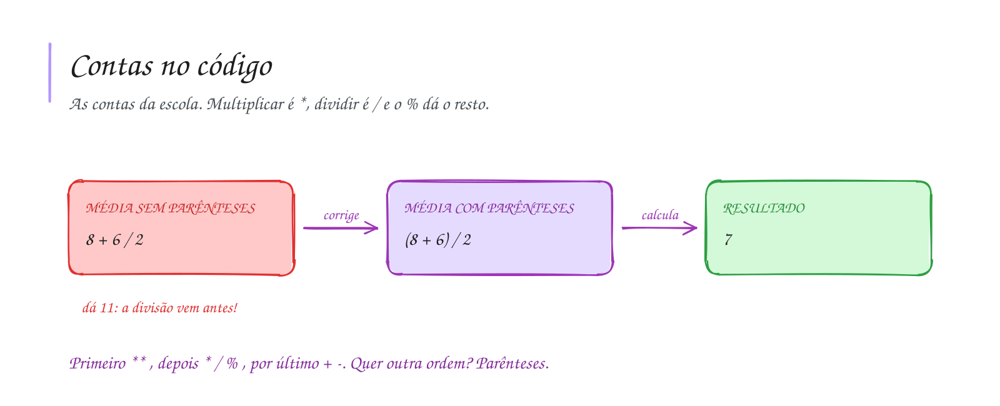

# 0010 · Operadores aritméticos

> Três amigos dividiram um açaí de 25 reais. Quanto cada um paga? E quanto sobra
> se ninguém tiver moeda? São duas contas, e cada uma tem seu operador.

## A ideia

São as contas da escola, com dois símbolos novos. A multiplicação é `*` (o `x`
não serve, o computador acharia que é uma variável) e a divisão é `/`.

| Operador | Conta          | Exemplo  | Resultado |
| -------- | -------------- | -------- | --------- |
| `+`      | soma           | `7 + 2`  | `9`       |
| `-`      | subtração      | `7 - 2`  | `5`       |
| `*`      | multiplicação  | `7 * 2`  | `14`      |
| `/`      | divisão        | `7 / 2`  | `3.5`     |
| `%`      | resto          | `7 % 2`  | `1`       |
| `**`     | potência       | `7 ** 2` | `49`      |

O `%` não tem nada a ver com porcentagem. Ele devolve o resto da divisão: 7
alunos em duplas formam 3 duplas e sobra 1, então `7 % 2` é `1`.

A ordem é a da matemática: primeiro `**`, depois `*`, `/` e `%`, por último `+`
e `-`. Quer outra ordem? Coloque parênteses.

## Diagrama

## Exercícios

Os enunciados e as dicas estão nos comentários de `exercicio-1.ts` e `exercicio-2.ts`, aqui nesta pasta. Responda dentro do próprio arquivo.

## Para ler mais

- ASCENCIO, A. F. G.; CAMPOS, E. A. V. *Fundamentos da programação de computadores: algoritmos, Pascal, C/C++ e Java*. 3. ed. São Paulo: Pearson, 2012.
- MDN WEB DOCS. *Precedência de operadores*. Disponível em: <https://developer.mozilla.org/pt-BR/docs/Web/JavaScript/Reference/Operators/Operator_precedence>.
