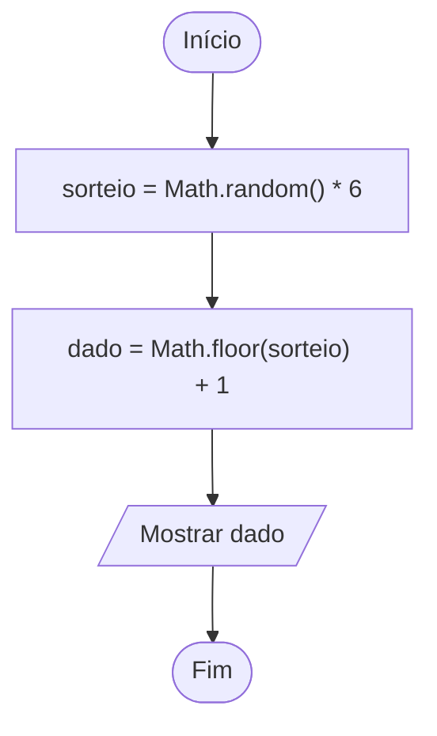

# 0010 · Objeto Math

> A van da excursão leva 15 pessoas e a turma tem 32. Quantas vans? Se você
> respondeu 2,13 vans, o motorista vai querer conversar com você.

## A ideia

`Math` é uma caixa de ferramentas que já vem pronta no TypeScript. Não precisa
instalar nem importar nada: escreve `Math.` e o editor mostra tudo o que tem lá
dentro.

| Função              | O que faz                       | Exemplo               |
| ------------------- | ------------------------------- | --------------------- |
| `Math.round(x)`     | arredonda para o mais próximo   | `Math.round(4.6)` → 5 |
| `Math.floor(x)`     | arredonda para baixo            | `Math.floor(4.9)` → 4 |
| `Math.ceil(x)`      | arredonda para cima             | `Math.ceil(4.1)` → 5  |
| `Math.max(a, b)`    | o maior valor                   | `Math.max(3, 9)` → 9  |
| `Math.min(a, b)`    | o menor valor                   | `Math.min(3, 9)` → 3  |
| `Math.random()`     | número sorteado entre 0 e 1     | `0.7312...`           |

Para lembrar: floor é "chão" em inglês, então vai para baixo. Ceil vem de
ceiling, "teto", então vai para cima. No caso da van, `Math.ceil(32 / 15)` dá 3,
porque ninguém fica para trás.

## Fluxograma

Como transformar o `Math.random()`, que sorteia números quebrados entre 0 e 1,
num dado de verdade.



Legenda: **oval** = início/fim, **paralelogramo** = entrada ou saída, **retângulo** = processamento, **losango** = decisão.

## Exemplos

### Exemplo 1 - Arredondamentos

Arquivo: `exemplo-1.ts`

```ts
const nota = 6.5

console.log(Math.round(nota)) // 7
console.log(Math.floor(nota)) // 6
console.log(Math.ceil(nota)) // 7
```

O mesmo 6.5 virou três respostas diferentes. Cada função tem seu jeito.

### Exemplo 2 - Maior e menor

Arquivo: `exemplo-2.ts`

```ts
console.log(Math.max(8, 3, 10)) // 10
console.log(Math.min(8, 3, 10)) // 3
```

Cabem quantos números você quiser dentro dos parênteses.

### Exemplo 3 - Sortear um dado de 1 a 6

Arquivo: `exemplo-3.ts`

```ts
const dado = Math.floor(Math.random() * 6) + 1

console.log(`Saiu o número ${dado}`)
```

Rode várias vezes. Cada execução é uma jogada.

## Pegadinha

Esquecer o `+ 1` no sorteio:

```ts
const dado = Math.floor(Math.random() * 6)
```

Esse "dado" vai de 0 a 5. Já viu dado com face zero? O `+ 1` empurra tudo para
1 a 6.

## Adivinhe a saída

```ts
console.log(Math.round(2.5))
console.log(Math.floor(-2.5))
console.log(Math.ceil(7.01))
```

<details><summary>Ver resposta</summary>

`3`, `-3` e `8`. A do meio engana muita gente: arredondar para baixo um número
negativo deixa ele mais negativo.

</details>

## Exercícios

Responda dentro dos arquivos `exercicio-1.ts` a `exercicio-4.ts` desta pasta.

1. Peça um número com vírgula (digitado com ponto, tipo 7.6) e mostre ele
   arredondado com `round`, `floor` e `ceil`.
2. Peça a pontuação de três jogadores e mostre a maior e a menor.
3. Sorteio da rifa: sorteie e mostre um número de 1 a 10.
4. Peça o preço de um lanche com centavos (ex.: 12.40) e mostre o valor
   arredondado para cima e para baixo, em reais inteiros.
