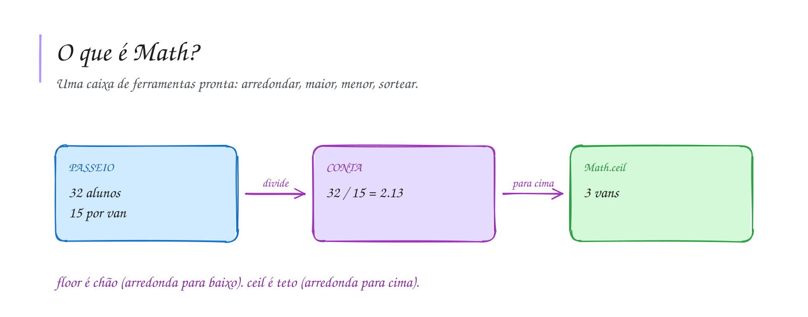

# 0011 · Objeto Math

> A van da excursão leva 15 pessoas e a turma tem 32. Quantas vans? Se você
> respondeu 2,13 vans, o motorista vai querer conversar com você.

## A ideia

`Math` é uma caixa de ferramentas que já vem pronta no TypeScript. Não precisa
instalar nem importar nada: escreve `Math.` e o editor mostra tudo o que tem lá
dentro.

| Função              | O que faz                       | Exemplo               |
| ------------------- | ------------------------------- | --------------------- |
| `Math.round(x)`     | arredonda para o mais próximo   | `Math.round(4.6)` → 5 |
| `Math.floor(x)`     | arredonda para baixo            | `Math.floor(4.9)` → 4 |
| `Math.ceil(x)`      | arredonda para cima             | `Math.ceil(4.1)` → 5  |
| `Math.max(a, b)`    | o maior valor                   | `Math.max(3, 9)` → 9  |
| `Math.min(a, b)`    | o menor valor                   | `Math.min(3, 9)` → 3  |
| `Math.random()`     | número sorteado entre 0 e 1     | `0.7312...`           |

Para lembrar: floor é "chão" em inglês, então vai para baixo. Ceil vem de
ceiling, "teto", então vai para cima. No caso da van, `Math.ceil(32 / 15)` dá 3,
porque ninguém fica para trás.

## Diagrama

## Exercícios

Os enunciados e as dicas estão nos comentários de `exercicio-1.ts` e `exercicio-2.ts`, aqui nesta pasta. Responda dentro do próprio arquivo.

## Para ler mais

- KNUTH, D. E. *The art of computer programming*, v. 2: Seminumerical algorithms. 3. ed. Reading: Addison-Wesley, 1997.
- MDN WEB DOCS. *Math*. Disponível em: <https://developer.mozilla.org/pt-BR/docs/Web/JavaScript/Reference/Global_Objects/Math>.
