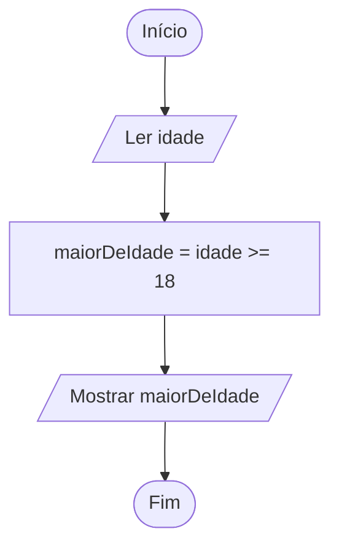

# 0011 · Operadores relacionais

> Na entrada do show tem um segurança que faz uma pergunta só: "tem 18 anos ou
> mais?". A resposta é sim ou não. O computador funciona igualzinho.

## A ideia

Operador relacional compara dois valores e responde com um `boolean`: `true`
(verdade) ou `false` (mentira). Ele não faz conta, ele julga.

| Operador | Pergunta               | Exemplo   | Resultado |
| -------- | ---------------------- | --------- | --------- |
| `>`      | é maior que?           | `8 > 5`   | `true`    |
| `<`      | é menor que?           | `8 < 5`   | `false`   |
| `>=`     | é maior ou igual a?    | `6 >= 6`  | `true`    |
| `<=`     | é menor ou igual a?    | `4 <= 3`  | `false`   |

Truque para não confundir `>` com `<`: a boca aberta fica virada para o maior,
como um jacaré que quer comer o número grande.

A pergunta "é igual?" (`===`) e "é diferente?" (`!==`) mora na próxima pasta,
`0012-comparacao`.

## Fluxograma

Repare que ainda não tem losango. A comparação aqui só produz um valor
`true` ou `false`, que guardamos numa variável. Decidir caminhos fica para o
`if`, mais adiante.



Legenda: **oval** = início/fim, **paralelogramo** = entrada ou saída, **retângulo** = processamento, **losango** = decisão.

## Exemplos

### Exemplo 1 - Comparando números

Arquivo: `exemplo-1.ts`

```ts
console.log(10 > 3) // true
console.log(10 < 3) // false
```

O resultado não é um número. É uma resposta.

### Exemplo 2 - Maior ou igual

Arquivo: `exemplo-2.ts`

```ts
const media = 6

console.log(media >= 6) // true (passou)
console.log(media > 6) // false
```

Com média 6 você passa no `>=` e não passa no `>`. Um sinalzinho de `=` decide
a sua recuperação.

### Exemplo 3 - Guardando o resultado

Arquivo: `exemplo-3.ts`

```ts
import { input } from '#core/input.ts'

const idade = Number(input('Sua idade: '))
const maiorDeIdade = idade >= 18

console.log(`Maior de idade? ${maiorDeIdade}`)
```

Passe o mouse em cima de `maiorDeIdade` no VS Code: o tipo é `boolean`.

## Pegadinha

Escrever o sinal ao contrário:

```ts
const idade = 20
console.log(idade => 18)
```

Não existe `=>` como comparação. Isso é outra coisa do TypeScript (que vamos ver
na Aula 02) e o resultado não vai ser `true` nem `false`. O certo é `>=`: o
sinal de maior vem primeiro, igual se lê, "maior ou igual".

## Adivinhe a saída

```ts
const nota = 6
console.log(nota > 6)
console.log(nota >= 6)
console.log(10 < 9)
```

<details><summary>Ver resposta</summary>

`false`, `true` e `false`. 6 não é maior que 6, mas é maior ou igual. E 10
continua não sendo menor que 9.

</details>

## Exercícios

Responda dentro dos arquivos `exercicio-1.ts` a `exercicio-4.ts` desta pasta.

1. Antes de rodar, escreva num comentário o que você acha que sai em
   `15 > 20`, `15 < 20`, `15 >= 15` e `15 <= 14`. Depois mostre com
   `console.log` e confira quantas você acertou.
2. Peça a nota da prova e mostre `true` ou `false` dizendo se ela é maior ou
   igual a 6.
3. Peça dois números e mostre se o primeiro é maior que o segundo.
4. Peça a idade de duas pessoas. Mostre se a primeira é mais velha que a
   segunda e se a segunda já tem pelo menos 18 anos.
