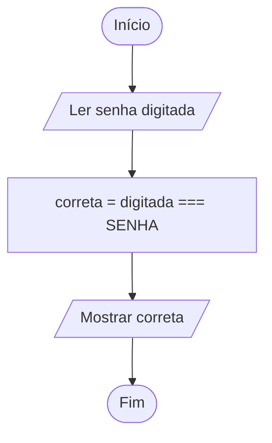

# 0012 · Comparação de igualdade

> Você digita a senha do Wi-Fi da escola e o celular diz "senha incorreta".
> Faltou uma letra maiúscula. Para o computador, "Cetam" e "cetam" são coisas
> diferentes.

## A ideia

Para perguntar se dois valores são iguais ou diferentes usamos dois operadores:

| Operador | Pergunta          | Exemplo        | Resultado |
| -------- | ----------------- | -------------- | --------- |
| `===`    | é igual?          | `5 === 5`      | `true`    |
| `!==`    | é diferente?      | `5 !== 5`      | `false`   |

Por que três sinais de igual? Porque existe um primo mais velho, o `==`, que é
bonzinho demais. Ele tenta converter os tipos antes de comparar, então no
JavaScript `5 == '5'` dá `true`. Parece útil, mas esconde erro. O `===` é
exigente: compara o valor e o tipo. `5 === '5'` dá `false`, e o TypeScript ainda
reclama antes de rodar. Aqui na disciplina é sempre `===` e `!==`.

Para não misturar:

- `=` guarda um valor ("a nota agora é 7")
- `===` pergunta ("a nota é 7?")

## Fluxograma

O sistema de login mais simples do mundo: compara o que foi digitado com a
senha guardada.



Legenda: **oval** = início/fim, **paralelogramo** = entrada ou saída, **retângulo** = processamento, **losango** = decisão.

## Exemplos

### Exemplo 1 - Igual e diferente

Arquivo: `exemplo-1.ts`

```ts
const resposta = 42

console.log(resposta === 42) // true
console.log(resposta !== 42) // false
```

Uma é o contrário da outra. Se é igual, não é diferente.

### Exemplo 2 - Comparando texto

Arquivo: `exemplo-2.ts`

```ts
const cidade: string = 'Tabatinga'

console.log(cidade === 'Tabatinga') // true
console.log(cidade === 'tabatinga') // false (maiúscula importa)
```

Uma letra minúscula e a comparação já falha.

### Exemplo 3 - Senha

Arquivo: `exemplo-3.ts`

```ts
import { input } from '#core/input.ts'

const SENHA = '1234'
const digitada = input('Senha: ')

console.log(`Senha correta? ${digitada === SENHA}`)
```

A senha está entre aspas de propósito. O `input` devolve texto, então a gente
compara texto com texto.

## Pegadinha

Comparar o `input` direto com número:

```ts
const resposta = input('Quanto é 2 + 2? ')
console.log(resposta === 4) // o TypeScript sublinha de vermelho
```

`resposta` é texto e `4` é número, então nunca vão ser iguais. Converta antes
(`Number(resposta) === 4`) ou compare com texto (`resposta === '4'`).

## Adivinhe a saída

```ts
const fruta: string = 'açaí'
console.log(fruta === 'Açaí')
console.log(fruta !== 'cupuaçu')
console.log(fruta.toUpperCase() === 'AÇAÍ')
```

<details><summary>Ver resposta</summary>

`false`, `true` e `true`. A primeira falha pela maiúscula. A terceira dá certo
porque o `toUpperCase()` deixou as duas do mesmo jeito.

</details>

## Exercícios

Responda dentro dos arquivos `exercicio-1.ts` a `exercicio-4.ts` desta pasta.

1. Crie `const resposta: number = 10` e `const time: string = 'Flamengo'`. Mostre se
   `resposta` é igual a 10, se é diferente de 5 e se `time` é igual a
   `flamengo`, tudo minúsculo.
2. Adivinhação: peça um número e mostre se ele é igual a 7, o número da sorte
   do professor.
3. Peça a cor preferida da pessoa e mostre se ela é diferente de `azul`.
4. Peça duas palavras e mostre se elas são iguais (`===`) e se são diferentes
   (`!==`).
