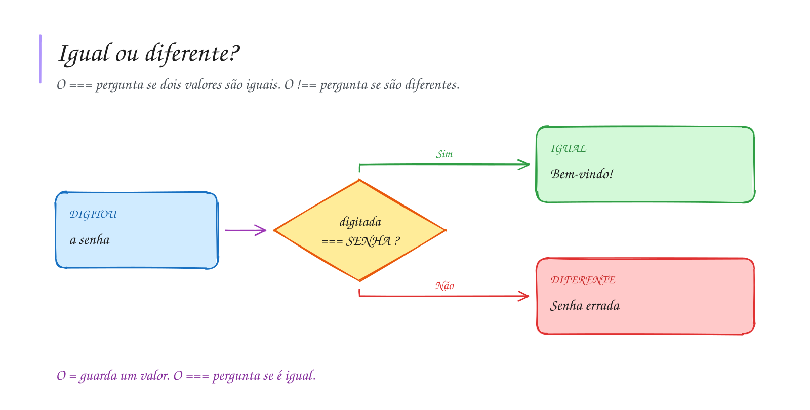

# 0013 · Comparação de igualdade

> Você digita a senha do Wi-Fi da escola e o celular diz "senha incorreta".
> Faltou uma letra maiúscula. Para o computador, "Cetam" e "cetam" são coisas
> diferentes.

## A ideia

Para perguntar se dois valores são iguais ou diferentes usamos dois operadores:

| Operador | Pergunta          | Exemplo        | Resultado |
| -------- | ----------------- | -------------- | --------- |
| `===`    | é igual?          | `5 === 5`      | `true`    |
| `!==`    | é diferente?      | `5 !== 5`      | `false`   |

Por que três sinais? Existe o `==`, que converte os tipos antes de comparar: no
JavaScript, `5 == '5'` dá `true` e o erro passa batido. O `===` compara valor e
tipo, então `5 === '5'` dá `false`. Aqui é sempre `===` e `!==`.

Para não misturar:

- `=` guarda um valor ("a nota agora é 7")
- `===` pergunta ("a nota é 7?")

## Diagrama

## Exercícios

Os enunciados e as dicas estão nos comentários de `exercicio-1.ts` e `exercicio-2.ts`, aqui nesta pasta. Responda dentro do próprio arquivo.

## Para ler mais

- CROCKFORD, D. *JavaScript: the good parts*. Sebastopol: O'Reilly, 2008.
- ECMA INTERNATIONAL. *ECMA-262: ECMAScript language specification*. Disponível em: <https://tc39.es/ecma262/>.
- MDN WEB DOCS. *Comparações de igualdade e uniformidade*. Disponível em: <https://developer.mozilla.org/pt-BR/docs/Web/JavaScript/Equality_comparisons_and_sameness>.
