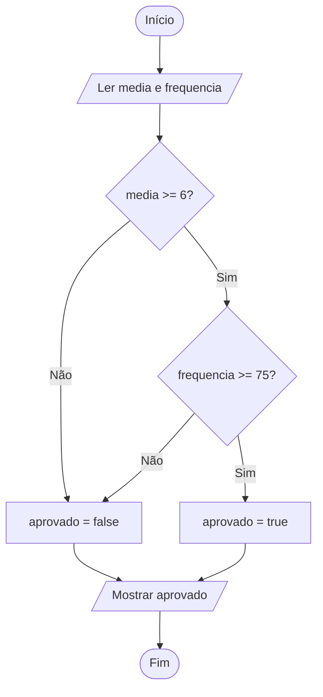

# 0013 · Operadores lógicos

> Para passar de ano não basta tirar nota boa. Também precisa ter frequência.
> Uma coisa E a outra. É assim que os operadores lógicos pensam.

## A ideia

Os relacionais respondem uma pergunta de cada vez. Os lógicos juntam várias
respostas numa só, ou invertem uma resposta.

| Operador | Nome | Dá `true` quando...                  |
| -------- | ---- | ------------------------------------ |
| `&&`     | E    | os **dois** lados são `true`         |
| `\|\|`   | OU   | **pelo menos um** lado é `true`      |
| `!`      | NÃO  | inverte: `!true` é `false`           |

Pense numa mãe exigente e numa avó boazinha. A mãe diz: "só sai se arrumar o
quarto E lavar a louça". Fez só um? Fica em casa. Isso é o `&&`. A avó diz:
"pode sair se arrumar o quarto OU lavar a louça". Fez qualquer um, já pode ir.
Isso é o `||`. E o `!` é o irmão do contra: tudo o que você diz, ele diz o
oposto.

A tabela verdade mostra todas as combinações possíveis:

| A       | B       | A && B  | A \|\| B |
| ------- | ------- | ------- | -------- |
| `true`  | `true`  | `true`  | `true`   |
| `true`  | `false` | `false` | `true`   |
| `false` | `true`  | `false` | `true`   |
| `false` | `false` | `false` | `false`  |

## Fluxograma

A aprovação com `&&`: são duas portas, e o aluno precisa passar pelas duas. Se
travar em qualquer uma, cai no `false`.



Legenda: **oval** = início/fim, **paralelogramo** = entrada ou saída, **retângulo** = processamento, **losango** = decisão.

## Exemplos

### Exemplo 1 - E (&&)

Arquivo: `exemplo-1.ts`

```ts
const media = 7
const frequencia = 80

console.log(media >= 6 && frequencia >= 75) // true
```

Troque a frequência para 70 e rode de novo. A média boa não salva ninguém.

### Exemplo 2 - OU (||)

Arquivo: `exemplo-2.ts`

```ts
const dia = 'sábado'

console.log(dia === 'sábado' || dia === 'domingo') // true (fim de semana)
```

Basta um dos lados ser verdade para o fim de semana começar.

### Exemplo 3 - NÃO (!)

Arquivo: `exemplo-3.ts`

```ts
const estaChovendo = false

console.log(!estaChovendo) // true
```

Leia em voz alta: "não está chovendo". Verdade.

## Pegadinha

Escrever a faixa de valores como na matemática:

```ts
const nota = 15
console.log(0 <= nota <= 10) // o TypeScript reclama
```

O computador não entende a comparação dupla. Separe em duas perguntas e junte
com `&&`: `nota >= 0 && nota <= 10`.

## Adivinhe a saída

```ts
const temDinheiro = true
const temFome = false
console.log(temDinheiro && temFome)
console.log(temDinheiro || temFome)
console.log(!temFome && temDinheiro)
```

<details><summary>Ver resposta</summary>

`false`, `true` e `true`. Na primeira falta a fome. Na segunda basta o
dinheiro. Na terceira, "não tem fome" vira `true` e dinheiro também é `true`.

</details>

## Exercícios

Responda dentro dos arquivos `exercicio-1.ts` a `exercicio-4.ts` desta pasta.

1. Monte a tabela verdade do `&&` e do `||` no código: mostre com `console.log`
   as quatro combinações de `true` e `false` para cada operador.
2. Autoescola: peça a idade e se a pessoa tem habilitação (`sim`/`nao`). Mostre
   se ela pode dirigir, ou seja, 18 anos ou mais e habilitação.
3. Peça um número e mostre se ele está fora da faixa de 1 a 10.
4. Peça se está chovendo (`sim`/`nao`) e se a pessoa tem guarda-chuva
   (`sim`/`nao`). Mostre `true` se ela vai chegar molhada na aula, ou seja, se
   está chovendo e ela não tem guarda-chuva.
