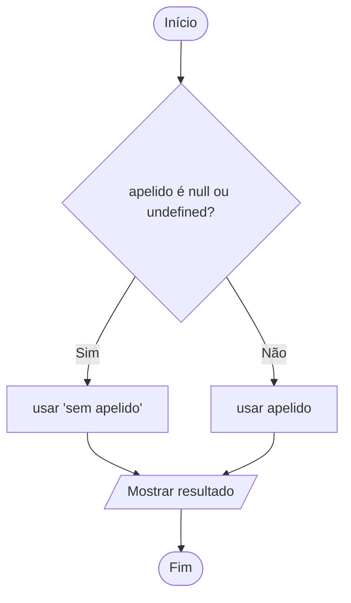

# 0014 · Truthy, falsy, ?? e ?.

> O aluno apertou Enter sem digitar o apelido. E agora, o programa chama ele de
> quê?

## A ideia

Num `if`, o TypeScript espera `true` ou `false`. Mas você pode colocar qualquer
valor ali, e ele vai "achar" se aquilo conta como verdadeiro ou falso. É como
fiscal de barco olhando a mochila: vazia, pode passar direto; com alguma coisa
dentro, ele para.

Os valores que contam como falso são poucos, dá para decorar. São os **falsy**:
`false`, `0`, `''` (texto vazio), `null`, `undefined` e `NaN`. Todo o resto é
**truthy**: `'oi'`, `5`, `-1`, até `' '` (um espaço).

E quando a variável pode nem ter valor? Para isso existem dois operadores:

- `??` coloca um valor padrão quando a variável é `null` ou `undefined`.
- `?.` só acessa a propriedade se a variável existir. Se não existir, devolve
  `undefined` em vez de quebrar o programa.

No TypeScript, `string | undefined` quer dizer "pode ser texto, pode não ter
nada ainda".

## Fluxograma

O `??` é uma perguntinha só: tem valor ou não tem?



Legenda: **oval** = início/fim, **paralelogramo** = entrada ou saída, **retângulo** = processamento, **losango** = decisão.

## Exemplos

### Exemplo 1 - Convertendo para boolean

Arquivo: `exemplo-1.ts`

```ts
console.log(Boolean('')) // false
console.log(Boolean('Ana')) // true
console.log(Boolean(0)) // false
console.log(Boolean(10)) // true
```

`Boolean()` mostra o que o `if` "enxerga" quando recebe esse valor.

### Exemplo 2 - Valor padrão com ??

Arquivo: `exemplo-2.ts`

```ts
let apelido: string | undefined

console.log(apelido ?? 'sem apelido') // sem apelido

apelido = 'Juju'
console.log(apelido ?? 'sem apelido') // Juju
```

Repare que o padrão só aparece enquanto `apelido` está vazio de verdade.

### Exemplo 3 - Acesso opcional com ?.

Arquivo: `exemplo-3.ts`

```ts
let nome: string | undefined

console.log(nome?.toUpperCase()) // undefined (sem erro)

nome = 'carlos'
console.log(nome?.toUpperCase()) // CARLOS
```

Tire o `?` da primeira linha e veja o editor reclamar.

## Pegadinha

O `input` nunca devolve `undefined`. Se a pessoa só aperta Enter, chega um texto
vazio `''`. E o `??` não liga para texto vazio:

```ts
const apelido = ''
console.log(apelido ?? 'visitante') // mostra uma linha em branco
console.log(apelido || 'visitante') // visitante
```

Para resposta de `input`, quem resolve é o `||`.

## Adivinhe a saída

```ts
const nota = 0
console.log(nota || 10)
console.log(nota ?? 10)
```

<details><summary>Ver resposta</summary>

```
10
0
```

O `||` acha que `0` é "nada" e troca por 10. O `??` só troca `null` e
`undefined`, então o zero fica.

</details>

## Exercícios

Responda dentro dos arquivos `exercicio-1.ts` a `exercicio-4.ts` desta pasta.

1. Use `Boolean()` para descobrir quem é truthy e quem é falsy: `'0'`, `0`,
   `' '`, `''` e `null`. Antes de rodar, chute a resposta em um comentário.
2. Crie `let cidade: string | undefined` sem valor e mostre `cidade ?? 'Não
   informada'`. Depois coloque `'Tabatinga'` e mostre de novo.
3. Crie `let email: string | undefined` e mostre `email?.length`. Depois coloque
   o seu e-mail e mostre de novo. O que mudou?
4. Peça a cidade com `input`. Se a pessoa só apertar Enter, use `Benjamin
   Constant` como padrão (`cidade || 'Benjamin Constant'`) e mostre o
   resultado. Em um comentário, explique por que o `??` não daria certo aqui.
