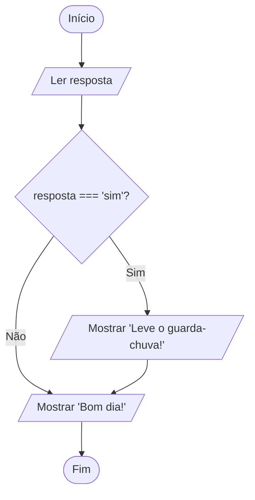

# 0015 · Condicional simples (if)

> Você só leva o guarda-chuva se o céu estiver feio. Sol? Sai de mãos vazias.
> Seu programa também pode pensar assim.

## A ideia

Até agora todo programa rodava linha por linha, do começo ao fim, sem pular
nada. Com o `if` (se), ele passa a tomar decisões.

O bloco entre `{ }` só roda se a condição for verdadeira. Se for falsa, o
programa pula o bloco e segue a vida. É a catraca do ônibus: cartão válido,
passa; cartão sem saldo, nada acontece e a fila continua.

```ts
if (condição) {
  // só roda se a condição for true
}
```

## Fluxograma

Só o caminho do "Sim" tem uma tarefa extra. O "Não" segue reto.



Legenda: **oval** = início/fim, **paralelogramo** = entrada ou saída, **retângulo** = processamento, **losango** = decisão.

## Exemplos

### Exemplo 1 - Aprovado

Arquivo: `exemplo-1.ts`

```ts
const media = 7

if (media >= 6) {
  console.log('Aprovado!')
}
```

Troque a média para 5 e rode de novo. A tela fica vazia, e está certo.

### Exemplo 2 - Aviso de chuva

Arquivo: `exemplo-2.ts`

```ts
import { input } from '#core/input.ts'

const resposta = input('Está chovendo? (sim/nao) ')

if (resposta === 'sim') {
  console.log('Leve o guarda-chuva!')
}
console.log('Bom dia!')
```

O `Bom dia!` está fora do `if`, então aparece sempre, chova ou não.

### Exemplo 3 - Número negativo

Arquivo: `exemplo-3.ts`

```ts
import { input } from '#core/input.ts'

const numero = Number(input('Digite um número: '))

if (numero < 0) {
  console.log('O número é negativo')
}
```

Sem o `Number()`, o TypeScript reclamaria de comparar texto com número.

## Pegadinha

Um `=` sozinho guarda valor. Para comparar são três: `===`.

```ts
let resposta = input('Está chovendo? ')

if (resposta = 'sim') { // errado: isso guarda 'sim' na variável
  console.log('Leve o guarda-chuva!')
}
```

Esse `if` sempre entra, mesmo se a pessoa digitar `nao`. Quando bater a dúvida,
leia em voz alta: "se resposta **é igual** a sim" pede `===`.

## Adivinhe a saída

```ts
const pontos = 15
if (pontos > 10) {
  console.log('Passou de fase')
}
if (pontos > 20) {
  console.log('Ganhou bônus')
}
console.log('Fim do jogo')
```

<details><summary>Ver resposta</summary>

```
Passou de fase
Fim do jogo
```

15 é maior que 10, mas não é maior que 20. Cada `if` decide sozinho.

</details>

## Exercícios

Responda dentro dos arquivos `exercicio-1.ts` a `exercicio-4.ts` desta pasta.

1. Peça a idade e, se for 18 ou mais, mostre `Pode entrar na festa de
   formatura sem autorização dos pais`.
2. Peça a senha do Wi-Fi da escola e, se for igual a `cetam`, mostre `Conectado!`.
3. Peça um número e, se ele for par, mostre `É par`. Dica: lembra do `%`?
4. Peça uma nota. Use dois `if` separados: um mostra `Nota inválida` se a nota
   for maior que 10, o outro mostra `Nota máxima!` se for igual a 10.
