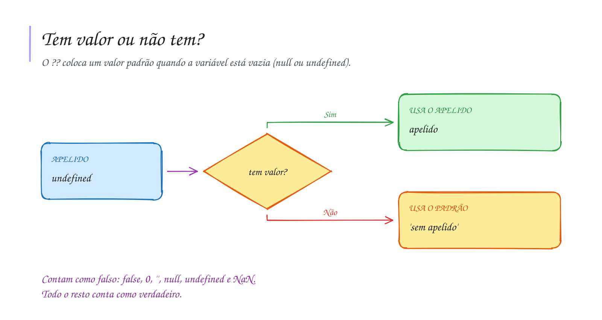

# 0015 · Truthy, falsy, ?? e ?.

> O aluno apertou Enter sem digitar o apelido. E agora, o programa chama ele de
> quê?

## A ideia

Num `if`, o TypeScript espera `true` ou `false`. Mas você pode colocar qualquer
valor ali, e ele vai "achar" se aquilo conta como verdadeiro ou falso. É o
fiscal do porto olhando a mochila: vazia, ele nem abre; com alguma coisa dentro,
ele para e confere.

Os valores que contam como falso são poucos e dá para decorar. São os **falsy**:
`false`, `0`, `''` (texto vazio), `null`, `undefined` e `NaN`. Todo o resto é
**truthy**: `'oi'`, `5`, `-1`, até `' '` (um espaço).

E quando a variável pode nem ter valor? Para isso existem dois operadores:

- `??` coloca um valor padrão quando a variável é `null` ou `undefined`.
- `?.` só acessa a propriedade se a variável existir. Se não existir, devolve
  `undefined` em vez de quebrar o programa.

No TypeScript, `string | undefined` quer dizer "pode ser texto, pode não ter
nada ainda".

## Diagrama

## Exercícios

Os enunciados e as dicas estão nos comentários de `exercicio-1.ts` e `exercicio-2.ts`, aqui nesta pasta. Responda dentro do próprio arquivo.

## Para ler mais

- MDN WEB DOCS. *Falsy*. Disponível em: <https://developer.mozilla.org/pt-BR/docs/Glossary/Falsy>.
- MDN WEB DOCS. *Operador de coalescência nula (??)*. Disponível em: <https://developer.mozilla.org/pt-BR/docs/Web/JavaScript/Reference/Operators/Nullish_coalescing>.
- MICROSOFT. *TypeScript Handbook*: Narrowing. Disponível em: <https://www.typescriptlang.org/docs/handbook/2/narrowing.html>.
