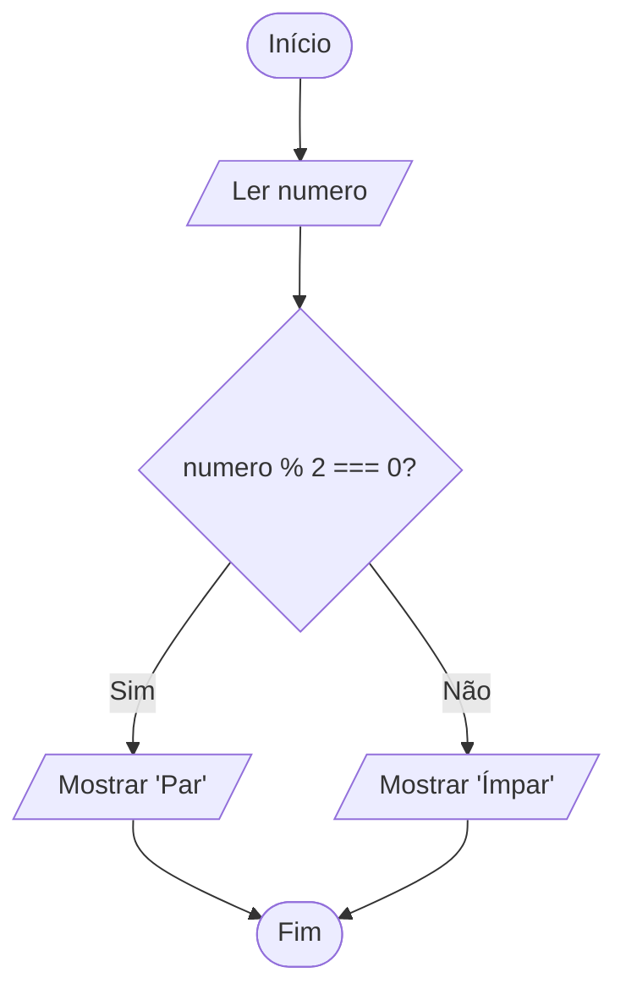

# 0016 · Condicional composta (if / else)

> Ou o recreio sai às 6h para Tabatinga e você está no porto, ou você fica.
> Não tem meio-termo.

## A ideia

O `if` sozinho só sabe fazer uma coisa extra quando a condição é verdadeira.
Com o `else` (senão), o programa ganha um plano B.

Pense numa encruzilhada: ou vai pela esquerda, ou pela direita. Sempre um dos
dois caminhos roda. Nunca os dois juntos, nunca nenhum.

```ts
if (condição) {
  // condição true
} else {
  // condição false
}
```

## Fluxograma

Dois caminhos, e o programa passa por exatamente um.



Legenda: **oval** = início/fim, **paralelogramo** = entrada ou saída, **retângulo** = processamento, **losango** = decisão.

## Exemplos

### Exemplo 1 - Aprovado ou reprovado

Arquivo: `exemplo-1.ts`

```ts
const media = 5

if (media >= 6) {
  console.log('Aprovado')
} else {
  console.log('Reprovado')
}
```

Com média 5, quem fala é o `else`. Mude para 6 e veja o outro lado.

### Exemplo 2 - Par ou ímpar

Arquivo: `exemplo-2.ts`

```ts
import { input } from '#core/input.ts'

const numero = Number(input('Número: '))

if (numero % 2 === 0) {
  console.log('Par')
} else {
  console.log('Ímpar')
}
```

O resto da divisão por 2 só pode ser 0 ou 1. Por isso dois caminhos bastam.

### Exemplo 3 - Pode votar?

Arquivo: `exemplo-3.ts`

```ts
import { input } from '#core/input.ts'

const idade = Number(input('Idade: '))

if (idade >= 16) {
  console.log('Pode votar')
} else {
  console.log(`Ainda não pode votar. Faltam ${16 - idade} ano(s).`)
}
```

Dentro do `else` dá para fazer conta também, não só mostrar texto pronto.

## Pegadinha

O `else` não tem condição. Ele é "todo o resto".

```ts
if (idade >= 18) {
  console.log('Maior de idade')
} else (idade < 18) { // erro: else não recebe condição
  console.log('Menor de idade')
}
```

Se você sentiu vontade de escrever uma condição depois do `else`, ou ela é
desnecessária, ou você precisa do `else if` da próxima pasta.

## Adivinhe a saída

```ts
const saldo = 30
const passagem = 45
if (saldo >= passagem) {
  console.log('Embarcou no recreio')
} else {
  console.log(`Faltam R$ ${passagem - saldo}`)
}
```

<details><summary>Ver resposta</summary>

```
Faltam R$ 15
```

30 não é maior nem igual a 45, então roda o `else`, que calcula 45 - 30.

</details>

## Exercícios

Responda dentro dos arquivos `exercicio-1.ts` a `exercicio-4.ts` desta pasta.

1. Peça a idade e mostre `Maior de idade` ou `Menor de idade`.
2. Peça a senha do celular e mostre `Desbloqueado` ou `Senha incorreta`.
   Invente a senha certa e guarde numa constante.
3. Peça os gols de dois times numa partida (considere que não houve empate) e
   mostre qual time venceu.
4. Peça o ano de nascimento e mostre `Pode tirar habilitação` (18 anos ou mais
   em 2026) ou `Ainda não pode tirar habilitação`.
