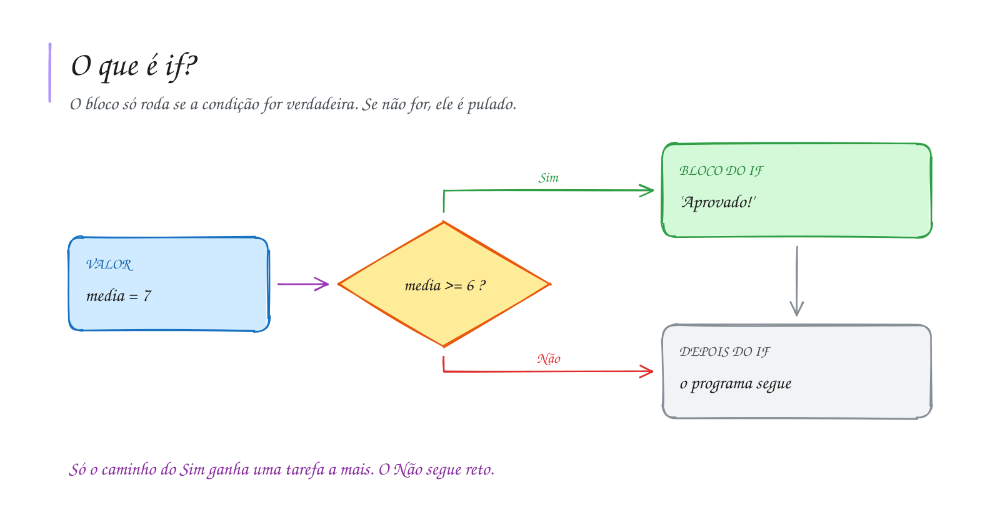

# 0016 · Condicional simples (if)

> Você só leva o guarda-chuva se o céu estiver feio. Sol? Sai de mãos vazias.
> Seu programa também pode pensar assim.

## A ideia

Até agora todo programa rodava linha por linha, do começo ao fim, sem pular
nada. Com o `if` (se), ele passa a tomar decisões.

O bloco entre `{ }` só roda se a condição for verdadeira. Se for falsa, o
programa pula o bloco e segue a vida. É a catraca do ônibus: cartão válido,
passa; cartão sem saldo, nada acontece e a fila continua.

```ts
if (condição) {
  // só roda se a condição for true
}
```

## Diagrama



## Exercícios

Os enunciados e as dicas estão nos comentários de `exercicio-1.ts` e `exercicio-2.ts`, aqui nesta pasta. Responda dentro do próprio arquivo.

## Para ler mais

- BÖHM, C.; JACOPINI, G. Flow diagrams, Turing machines and languages with only two formation rules. *Communications of the ACM*, v. 9, n. 5, p. 366-371, 1966.
- DIJKSTRA, E. W. Go to statement considered harmful. *Communications of the ACM*, v. 11, n. 3, p. 147-148, 1968.
- FORBELLONE, A. L. V.; EBERSPÄCHER, H. F. *Lógica de programação: a construção de algoritmos e estruturas de dados*. 3. ed. São Paulo: Pearson Prentice Hall, 2005.
