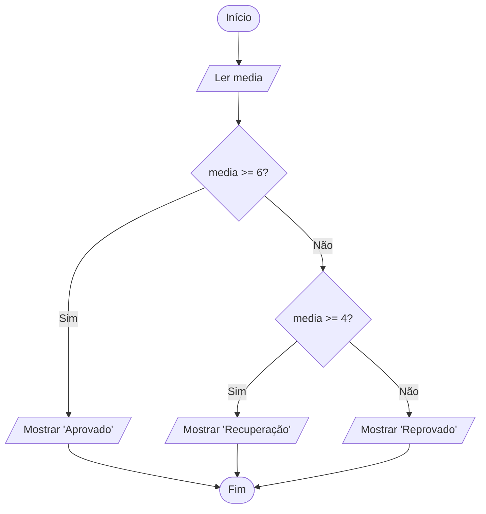

# 0017 · Condicional aninhada (else if e if dentro de if)

> No boletim não existe só "passou" ou "não passou". Tem a tal da recuperação no
> meio. Como o programa lida com três saídas?

## A ideia

Quando tem mais de dois caminhos, entra o `else if` (senão se). O programa testa
as condições de cima para baixo e para na primeira que for verdadeira. O `else`
do final pega quem sobrou.

É fila de cantina com placa: "lanche natural, lado esquerdo; salgado, no meio;
o resto, no caixa". Você entra na primeira placa que serve para você e não olha
as outras.

Também dá para colocar um `if` dentro de outro. Isso faz sentido quando uma
pergunta só importa depois da primeira resposta. Não adianta perguntar se tem
habilitação para quem tem 12 anos.

## Fluxograma

Testes em sequência. O primeiro "Sim" decide e o resto nem é olhado.



Legenda: **oval** = início/fim, **paralelogramo** = entrada ou saída, **retângulo** = processamento, **losango** = decisão.

## Exemplos

### Exemplo 1 - Aprovado, recuperação ou reprovado

Arquivo: `exemplo-1.ts`

```ts
const media = 5

if (media >= 6) {
  console.log('Aprovado')
} else if (media >= 4) {
  console.log('Recuperação')
} else {
  console.log('Reprovado')
}
```

No `else if` não precisa testar `media < 6`. Se chegou ali, já não passou no
primeiro teste.

### Exemplo 2 - Positivo, negativo ou zero

Arquivo: `exemplo-2.ts`

```ts
import { input } from '#core/input.ts'

const n = Number(input('Número: '))

if (n > 0) {
  console.log('Positivo')
} else if (n < 0) {
  console.log('Negativo')
} else {
  console.log('Zero')
}
```

O `else` final nem precisa de pergunta: se não é maior nem menor que zero, só
sobra o zero.

### Exemplo 3 - if dentro de if

Arquivo: `exemplo-3.ts`

```ts
import { input } from '#core/input.ts'

const idade = Number(input('Idade: '))

if (idade >= 18) {
  const habilitacao = input('Tem habilitação? (sim/nao) ')
  if (habilitacao === 'sim') {
    console.log('Pode dirigir')
  } else {
    console.log('Precisa tirar a habilitação')
  }
} else {
  console.log('Ainda não pode dirigir')
}
```

Rode com idade 15: o programa nem pergunta da habilitação.

## Pegadinha

A ordem das condições muda tudo. Olha esse boletim com a ordem trocada:

```ts
if (media >= 4) {
  console.log('Recuperação')
} else if (media >= 6) {
  console.log('Aprovado')
}
```

Quem tirou 9 vai para a recuperação, porque 9 já é maior ou igual a 4 e o
programa para ali. A regra é começar pela condição mais exigente.

## Adivinhe a saída

```ts
const hora = 12
if (hora < 12) {
  console.log('Bom dia')
} else if (hora < 18) {
  console.log('Boa tarde')
} else {
  console.log('Boa noite')
}
```

<details><summary>Ver resposta</summary>

```
Boa tarde
```

12 não é menor que 12, então o primeiro teste falha. No segundo, 12 é menor que
18, e para por aí.

</details>

## Exercícios

Responda dentro dos arquivos `exercicio-1.ts` a `exercicio-4.ts` desta pasta.

1. Peça a altura de dois jogadores do time de vôlei e mostre quem é o mais alto,
   ou `Mesma altura`.
2. Peça a idade e mostre `Criança` (até 11), `Adolescente` (12 a 17) ou
   `Adulto` (18 ou mais).
3. Peça a temperatura e mostre `Frio` (abaixo de 20), `Agradável` (20 a 28) ou
   `Quente` (acima de 28). Spoiler: em Benjamin Constant quase sempre dá a
   terceira.
4. Peça a hora (0 a 23) e mostre `Bom dia` (5 a 11), `Boa tarde` (12 a 17) ou
   `Boa noite` (no resto).
