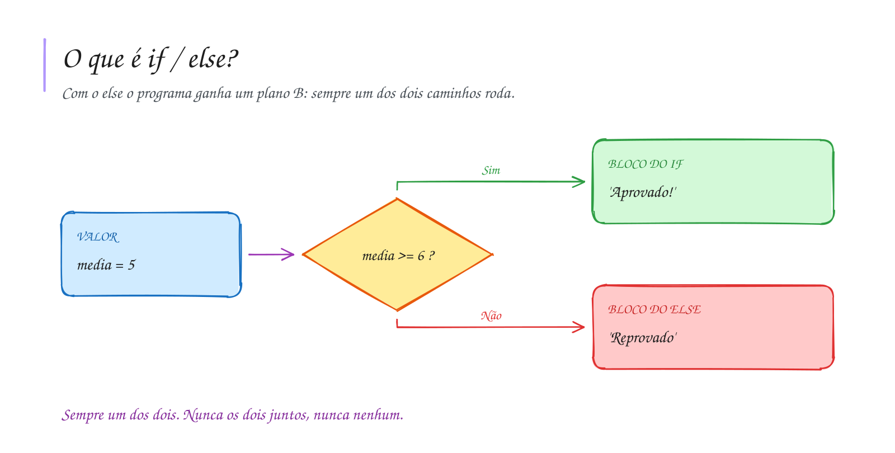

# 0017 · Condicional composta (if / else)

> Ou o recreio sai às 6h para Tabatinga e você está no porto, ou você fica.
> Não tem meio-termo.

## A ideia

O `if` sozinho só sabe fazer uma coisa extra quando a condição é verdadeira.
Com o `else` (senão), o programa ganha um plano B.

Pense numa encruzilhada: ou vai pela esquerda, ou pela direita. Sempre um dos
dois caminhos roda. Nunca os dois juntos, nunca nenhum.

```ts
if (condição) {
  // condição true
} else {
  // condição false
}
```

## Diagrama



## Exercícios

Os enunciados e as dicas estão nos comentários de `exercicio-1.ts` e `exercicio-2.ts`, aqui nesta pasta. Responda dentro do próprio arquivo.

## Para ler mais

- FORBELLONE, A. L. V.; EBERSPÄCHER, H. F. *Lógica de programação: a construção de algoritmos e estruturas de dados*. 3. ed. São Paulo: Pearson Prentice Hall, 2005.
- BÖHM, C.; JACOPINI, G. Flow diagrams, Turing machines and languages with only two formation rules. *Communications of the ACM*, v. 9, n. 5, p. 366-371, 1966.
- MDN WEB DOCS. *if...else*. Disponível em: <https://developer.mozilla.org/pt-BR/docs/Web/JavaScript/Reference/Statements/if...else>.
