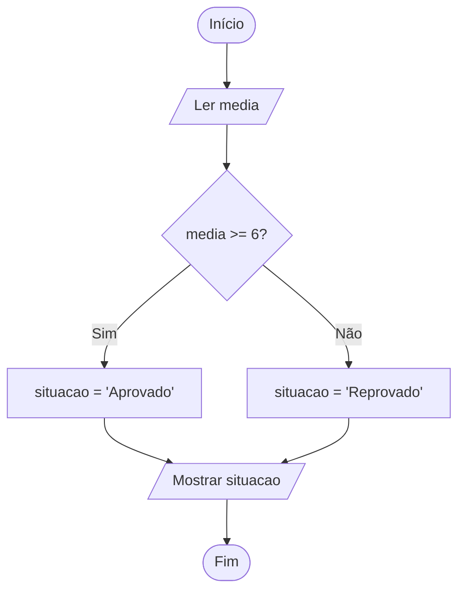

# 0018 · Operador ternário

> Dá para escrever um if/else inteiro numa linha só? Dá. E às vezes até fica
> mais bonito.

## A ideia

O ternário é o if/else de bolso. Ele faz uma pergunta e devolve um de dois
valores:

```ts
condição ? valorSeVerdadeiro : valorSeFalso
```

Lê assim: "a condição é verdadeira? então isso, senão aquilo". A diferença para
o `if` é que o ternário vira um valor, então você pode guardar numa variável ou
colocar direto dentro de uma template string.

Serve para escolhas pequenas: singular ou plural, par ou ímpar, aprovado ou
reprovado. Se a decisão tem várias etapas, volte para o `if`.

## Fluxograma

É o mesmo desenho do if/else. A diferença é que no final sai um valor.



Legenda: **oval** = início/fim, **paralelogramo** = entrada ou saída, **retângulo** = processamento, **losango** = decisão.

## Exemplos

### Exemplo 1 - Aprovado ou reprovado

Arquivo: `exemplo-1.ts`

```ts
const media = 8
const situacao = media >= 6 ? 'Aprovado' : 'Reprovado'

console.log(situacao) // Aprovado
```

Compare com o exemplo 1 da pasta `0016`: mesma lógica, quatro linhas a menos.

### Exemplo 2 - Par ou ímpar

Arquivo: `exemplo-2.ts`

```ts
import { input } from '#core/input.ts'

const n = Number(input('Número: '))

console.log(n % 2 === 0 ? 'Par' : 'Ímpar')
```

Aqui o resultado nem vai para variável, vai direto para o `console.log`.

### Exemplo 3 - Dentro da template string

Arquivo: `exemplo-3.ts`

```ts
const quantidade = 1

console.log(`Você tem ${quantidade} ${quantidade === 1 ? 'mensagem' : 'mensagens'}`)
```

É o truque do WhatsApp para não escrever "1 mensagens".

## Pegadinha

Dá para colocar um ternário dentro do outro. Funciona, mas vira um nó:

```ts
const resultado = golsA > golsB ? 'Time A' : golsA < golsB ? 'Time B' : 'Empate'
```

Se você precisou ler duas vezes, o colega vai precisar ler cinco. Com três
caminhos ou mais, use `if` / `else if`.

## Adivinhe a saída

```ts
const gols: number = 0
console.log(`Placar: ${gols} ${gols === 1 ? 'gol' : 'gols'}`)
```

<details><summary>Ver resposta</summary>

```
Placar: 0 gols
```

0 não é igual a 1, então vem o plural. Em português, zero também pede plural.

</details>

## Exercícios

Responda dentro dos arquivos `exercicio-1.ts` a `exercicio-4.ts` desta pasta.

1. Peça a idade e use ternário para mostrar `Maior de idade` ou `Menor de
   idade`.
2. Peça o preço do açaí em duas barracas da feira e use ternário para guardar o
   menor preço numa constante. Mostre `Compre o de R$ X`.
3. Reescreva com ternário:

   ```ts
   let mensagem = ''
   if (temperatura > 30) {
     mensagem = 'Quente'
   } else {
     mensagem = 'Agradável'
   }
   ```
4. Peça uma nota e mostre `Nota X: aprovado` ou `Nota X: reprovado` usando o
   ternário dentro da template string.
