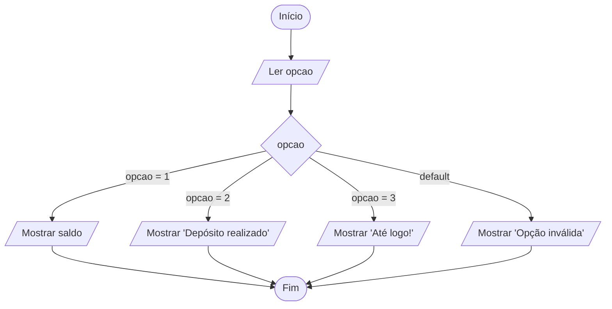

# 0019 · Estrutura de escolha (switch)

> Caixa eletrônico: "digite 1 para saldo, 2 para depósito, 3 para sair". Quem
> programou isso provavelmente usou um `switch`.

## A ideia

O `switch` pega um valor e compara com uma lista de opções. Achou uma igual (com
`===`), roda o que está ali. É o cardápio da lanchonete: você fala o número do
combo e a atendente já sabe o que montar.

- `case`: uma opção do cardápio.
- `break`: "pronto, pedido feito". Sem ele, o programa continua descendo e
  executa os próximos `case` também.
- `default`: quando nenhuma opção bateu. Faz o papel do `else`.

Use `switch` quando a pergunta é "qual destes valores?". Para faixas (maior que,
menor que), o `if` / `else if` continua sendo o certo.

## Fluxograma

Um valor só, comparado com cada opção. O `default` pega o que sobrar.



Legenda: **oval** = início/fim, **paralelogramo** = entrada ou saída, **retângulo** = processamento, **losango** = decisão.

## Exemplos

### Exemplo 1 - Dia da semana

Arquivo: `exemplo-1.ts`

```ts
import { input } from '#core/input.ts'

const dia = Number(input('Dia (1 a 7): '))

switch (dia) {
  case 1:
    console.log('Domingo')
    break
  case 7:
    console.log('Sábado')
    break
  default:
    console.log('Dia útil')
}
```

Os dias de 2 a 6 não têm `case` próprio. Todos caem no `default`.

### Exemplo 2 - Menu de opções

Arquivo: `exemplo-2.ts`

```ts
import { input } from '#core/input.ts'

console.log('1 - Ver saldo')
console.log('2 - Depositar')
console.log('3 - Sair')
const opcao = input('Escolha: ')

switch (opcao) {
  case '1':
    console.log('Seu saldo é R$ 100,00')
    break
  case '2':
    console.log('Depósito realizado')
    break
  case '3':
    console.log('Até logo!')
    break
  default:
    console.log('Opção inválida')
}
```

Os `case` estão entre aspas porque `opcao` é texto. Sem `Number()`, `'1'` não é
igual a `1`.

### Exemplo 3 - Vários case com a mesma resposta

Arquivo: `exemplo-3.ts`

```ts
const fruta: string = 'açaí'

switch (fruta) {
  case 'açaí':
  case 'cupuaçu':
  case 'buriti':
    console.log('Fruta da Amazônia!')
    break
  default:
    console.log('Outra fruta')
}
```

Vários `case` grudados dividem a mesma resposta. É o "tanto faz, dá a mesma
coisa".

## Pegadinha

Esquecer o `break`. O programa não para no `case` certo, ele vai descendo:

```ts
switch (opcao) {
  case 1:
    console.log('Açaí')
  case 2:
    console.log('Tapioca') // com opcao = 1, aparece Açaí E Tapioca
    break
}
```

O nosso projeto tem a regra `noFallthroughCasesInSwitch` ligada, então o `tsc`
avisa quando falta `break`. Mesmo assim, crie o hábito de escrever o `break`
logo depois do `case`.

## Adivinhe a saída

```ts
const turma: string = 'b'
switch (turma) {
  case 'A':
  case 'B':
    console.log('Turma da manhã')
    break
  case 'C':
    console.log('Turma da noite')
    break
  default:
    console.log('Turma desconhecida')
}
```

<details><summary>Ver resposta</summary>

```
Turma desconhecida
```

O `switch` compara com `===`, e `'b'` minúsculo não é igual a `'B'`. Um
`toUpperCase()` antes resolveria.

</details>

## Exercícios

Responda dentro dos arquivos `exercicio-1.ts` a `exercicio-4.ts` desta pasta.

1. Peça a posição de chegada na corrida dos jogos escolares (1 a 3) e mostre
   `Ouro`, `Prata` ou `Bronze`. Para qualquer outro número mostre `Sem medalha,
   mas valeu a participação`.
2. Faça uma calculadora com menu de 4 operações (+, -, \*, /). Peça a operação e
   dois números e mostre o resultado.
3. Peça o número do mês (1 a 12) e mostre quantos dias ele tem. Use vários
   `case` juntos e considere fevereiro com 28.
4. Peça um conceito (`A`, `B`, `C` ou `D`) e mostre `Excelente`, `Bom`,
   `Regular` ou `Insuficiente`. Para qualquer outra letra mostre `Conceito
   inválido`.
