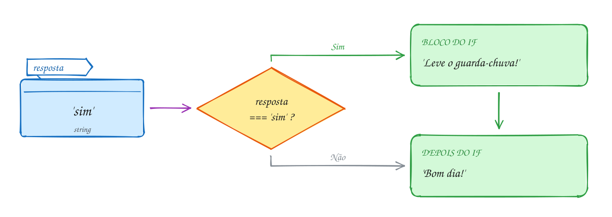
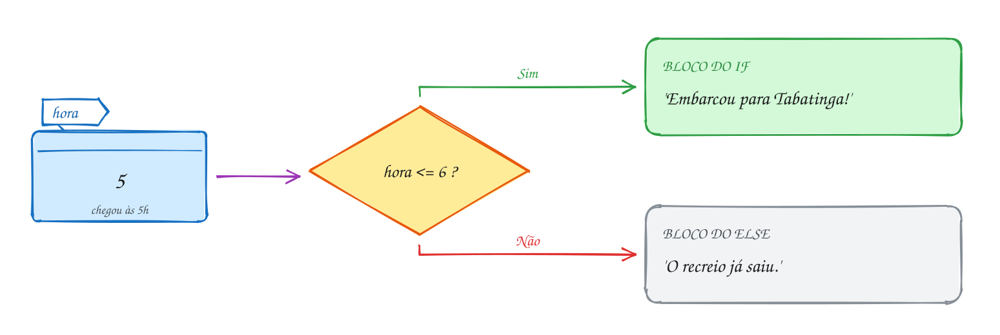
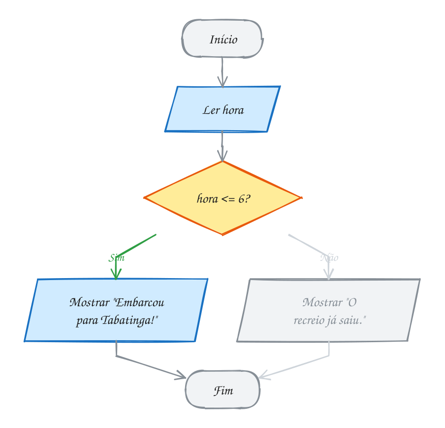
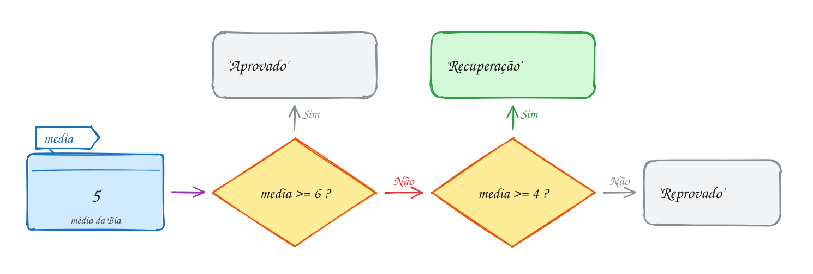
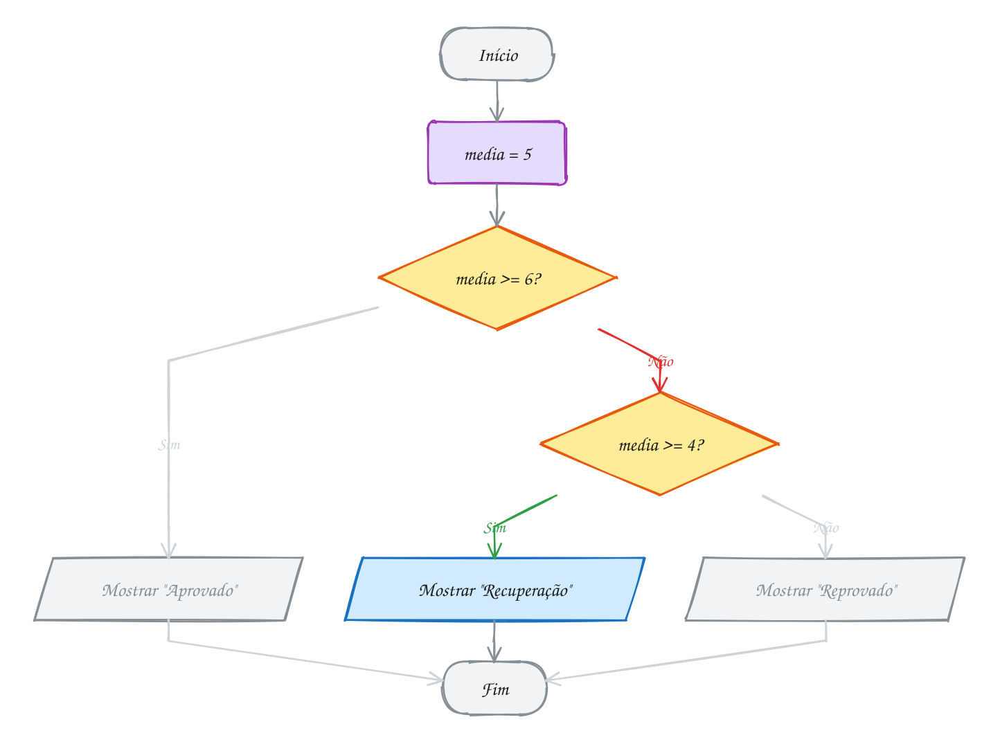
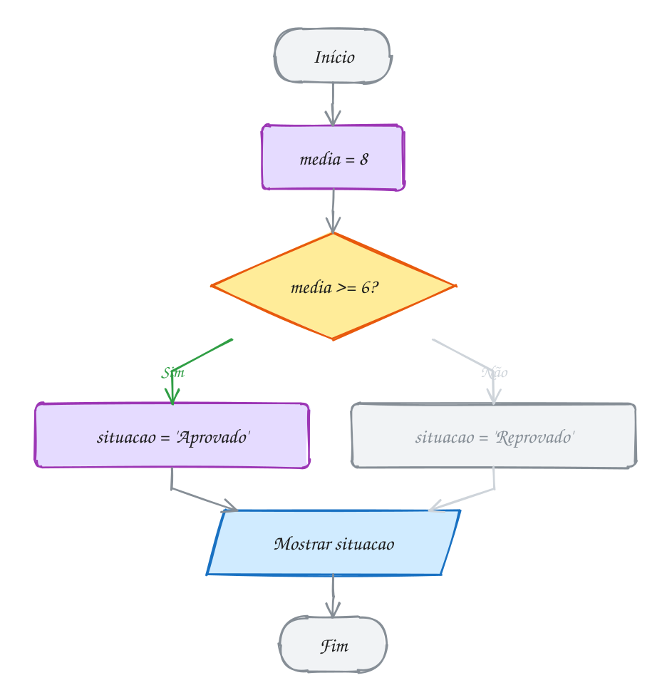
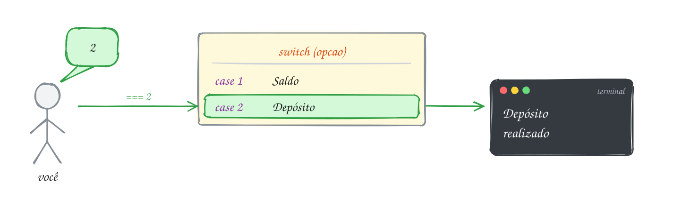
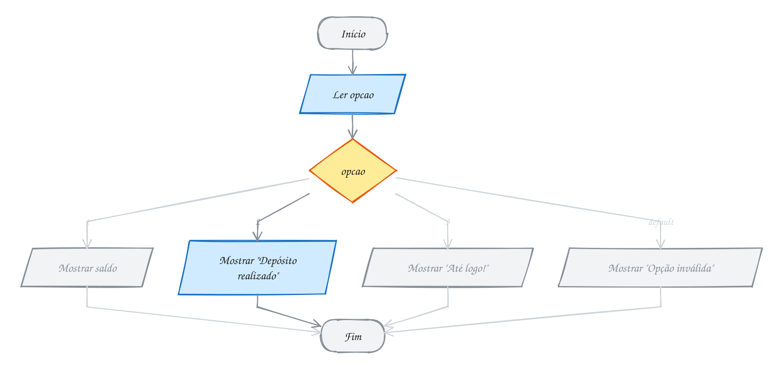

<!-- Gerado por _gerador. Para mudar este arquivo, edite _gerador/aulas/15102026/ e rode: cd _gerador && npm run gerar -->

# Aula 01 · 15/10 · Revisão de lógica I

Olha só: quase todo programa faz as mesmas cinco coisas. Lê o que a pessoa
digita, guarda, faz conta, compara e decide.

Hoje você vai praticar cada uma delas, escrevendo em TypeScript.

## O que você vai aprender

- ler dados do teclado e mostrar o resultado na tela
- guardar valores em variáveis e constantes
- trabalhar com texto, número e verdadeiro ou falso
- fazer contas e comparar valores
- escolher o caminho do programa com `if`, ternário e `switch`

## Como a gente vai estudar cada assunto

1. Primeiro, o texto e o **diagrama da ideia**: é o exemplo desenhado.
2. Depois, o código. Repara que é o mesmo exemplo, com os mesmos valores.
3. Aí você segue o **fluxograma** com o dedo: é o caminho que o programa faz.
4. Hora de rodar os exemplos da pasta. Mude alguma coisa e rode de novo.
5. Por fim, os exercícios. Travou? As dicas estão no próprio arquivo.

No meio de cada assunto tem uma **Pergunta para a turma**. Tente responder
antes de rodar o código.

Guarda isso: cada assunto conta **um exemplo só**. Se a Bia tem média 5 no
texto, ela tem média 5 no desenho, no código e no fluxograma.

## As cores e as formas

Os dois desenhos usam as mesmas cores. Caixa azul é dado entrando ou saindo.
Roxa é o programa fazendo alguma coisa. Amarela é pergunta.

<p align="center"></p>

No diagrama da ideia, o caminho que o exemplo segue aparece em verde, e os
outros ficam cinza. Erro é vermelho. No fluxograma vale a mesma regra: o
caminho do exemplo fica colorido e o resto fica apagado.

---

## 0001 · Entrada de dados (input)

Pensa na cantina. O caixa olha pra você e pergunta: "vai querer o
quê?". E aí ele **para**. Fica esperando. Só segue depois que você responde.

Entrada de dados é exatamente isso: o programa faz uma pergunta, para e espera
você digitar.

Olha o que acontece quando a Ana roda o programa. Aparece `Seu nome:`, ela
digita `Ana`, aperta Enter, e o programa guarda a resposta numa caixinha
chamada `nome`:

<p align="center"></p>

Quem faz a pergunta é o `input`. Ele mostra o texto, espera o Enter e devolve o
que a pessoa digitou. O `const` cria a caixinha que guarda a resposta (você vai
ver ela de perto na 0003 e na 0004):

```ts
import { input } from '#core/input.ts'

const nome = input('Seu nome: ') // a Ana digita: Ana
console.log(nome) // Ana
```

O `console.log` mostra o valor na tela. Ele é o assunto da 0002.

Repara no fluxograma: ler e mostrar são paralelogramos azuis. Azul é sempre
dado entrando ou saindo.

<p align="center"></p>

> [!IMPORTANT]
> Guarda isso: o `input` **sempre devolve texto**. Se a Ana digitar `17`, o
> programa guarda `'17'`, com aspas. E conta com texto dá confusão. A gente
> resolve isso na [0008](#0008--conversão-de-tipos).

> [!NOTE]
> **Pergunta para a turma:** se a Ana apertar Enter sem digitar nada, o que
> fica guardado em `nome`? Rode o exemplo e confira.

### Hora de praticar

Os arquivos ficam em [`0001-input/`](0001-input/). Os comandos funcionam de qualquer pasta do terminal. Nos exemplos, rode, mude, quebre e rode de novo. Nos exercícios, a resposta vai dentro do próprio arquivo.

**Exemplo A001 · Perguntar o time do coração**

```ts
import { input } from '#core/input.ts'

const time = input('Qual é o seu time do coração? ')
console.log(time)
```

```bash
tsx ~/LPPOO/15102026/0001-input/A001.ts
```

**Exemplo A002 · Perguntar duas coisas**

```ts
import { input } from '#core/input.ts'

const cidade = input('Em qual cidade você mora? ')
const bairro = input('E o bairro? ')

console.log(cidade)
console.log(bairro)
```

```bash
tsx ~/LPPOO/15102026/0001-input/A002.ts
```

**Exercício E001**

Pergunte o nome da sua escola e mostre a resposta na tela.

<details><summary>Dicas</summary>

1. Primeiro pergunte, depois mostre: duas linhas de código bastam.
2. Guarde a resposta numa `const` antes de mostrar.
3. Não esqueça o espaço no fim da pergunta, depois do `?`.

</details>

```bash
tsx ~/LPPOO/15102026/0001-input/E001.ts
```

**Exercício E002**

Pergunte o nome de um colega e a comida preferida dele (vale tambaqui, vale
açaí, vale miojo). Mostre as duas respostas, uma em cada linha.

<details><summary>Dicas</summary>

1. São duas perguntas, então dois `input` e duas variáveis.
2. Dê nomes que digam o que guardam, tipo `colega` e `comida`.
3. Um `console.log` para cada resposta deixa uma em cada linha.

</details>

```bash
tsx ~/LPPOO/15102026/0001-input/E002.ts
```

---

## 0002 · Saída de dados (output)

No assunto anterior, o programa perguntou e esperou. Agora é a vez dele responder.

Saída é o programa mostrando alguma coisa para você. No terminal, quem faz isso
é o `console.log`. O que estiver entre os parênteses aparece na tela.

Olha só o exemplo. A média já está guardada: `media` vale `7.5`. A gente quer
mostrar uma frase inteira, com o número encaixado no meio.

Para isso existe a **template string**. É um texto entre crases, com um espaço
`${ }` onde o valor entra:

<p align="center"></p>

```ts
const media = 7.5
console.log(`Sua média é ${media}`) // Sua média é 7.5
```

Repara no fluxograma. Guardar a média é o programa fazendo algo, então vira
retângulo roxo. Mostrar a frase é saída: paralelogramo azul.

<p align="center"></p>

> [!TIP]
> A crase (`` ` ``) fica perto do Enter na maioria dos teclados, às vezes junto
> com o til. Procura ela agora no seu teclado, porque você vai usar muito.

> [!NOTE]
> **Pergunta para a turma:** e se você trocar as crases por aspas simples
> (`'`)? O que aparece na tela? Rode e confira. (Dica: o `${media}` só
> funciona entre crases.)

### Hora de praticar

Os arquivos ficam em [`0002-output/`](0002-output/). Os comandos funcionam de qualquer pasta do terminal. Nos exemplos, rode, mude, quebre e rode de novo. Nos exercícios, a resposta vai dentro do próprio arquivo.

**Exemplo A003 · Mostrar uma mensagem**

```ts
console.log('Bem-vindo à aula de TypeScript!')
```

```bash
tsx ~/LPPOO/15102026/0002-output/A003.ts
```

**Exemplo A004 · Mostrar um valor dentro do texto**

```ts
const comida = 'tacacá'

console.log(`Minha comida preferida é ${comida}`)
// Minha comida preferida é tacacá
```

```bash
tsx ~/LPPOO/15102026/0002-output/A004.ts
```

**Exercício E003**

Faça o programa se apresentar por você: mostre três linhas com seu nome, sua
idade e sua cidade.

<details><summary>Dicas</summary>

1. Aqui não precisa de `input`: os valores podem ir direto no código.
2. Três linhas na tela pedem três `console.log`.
3. Texto vai entre aspas; número pode ir sem.

</details>

```bash
tsx ~/LPPOO/15102026/0002-output/E003.ts
```

**Exercício E004**

Pergunte o nome da pessoa e dê as boas-vindas: `Seja bem-vindo(a), NOME!`.

<details><summary>Dicas</summary>

1. Pergunte o nome e guarde numa variável.
2. A frase usa crases, não aspas: `` `Seja bem-vindo(a), ${...}!` ``.
3. Confira se a exclamação ficou dentro da template string.

</details>

```bash
tsx ~/LPPOO/15102026/0002-output/E004.ts
```

---

## 0003 · Variáveis

Pensa no placar do jogo. Ele muda a cada gol. O programa precisa guardar esse
número em algum lugar enquanto o jogo rola.

Esse lugar é a **variável**. Pensa numa caixinha com nome: o nome fica na
etiqueta e o valor fica dentro.

Com `let`, você pode tirar o valor e colocar outro quantas vezes precisar.

Vamos ver na prática. O jogo começa 0 a 0. Saiu gol: a caixa `gols` passa a
guardar 1. Outro gol: 2. A caixa é sempre a mesma, só o que tem dentro muda:

<p align="center"></p>

```ts
let gols = 0 // o let aparece uma vez só, quando a caixa nasce
gols = 1 // gol!
gols = 2 // outro gol!
console.log(gols) // 2
```

No fluxograma, cada troca de valor vira um retângulo roxo, um embaixo do outro:

<p align="center"></p>

Guarda isso: nome de variável vai em `camelCase`. Por exemplo: `nomeCompleto`,
`notaFinal`, `golsBrasil`.

E o `var`? É o jeito antigo, e causa bug difícil de achar. Aqui a gente não usa.

> [!NOTE]
> **Pergunta para a turma:** se você apagar a linha `gols = 2`, o que aparece
> na tela? Rode e confira.

### Hora de praticar

Os arquivos ficam em [`0003-variaveis/`](0003-variaveis/). Os comandos funcionam de qualquer pasta do terminal. Nos exemplos, rode, mude, quebre e rode de novo. Nos exercícios, a resposta vai dentro do próprio arquivo.

**Exemplo A005 · O nível do rio subindo**

```ts
let nivelRio = 26 // metros, em março
console.log(nivelRio) // 26

nivelRio = 28 // abril: o rio encheu
console.log(nivelRio) // 28

nivelRio = 29 // maio: cheia!
console.log(`Nível do rio em maio: ${nivelRio} m`) // Nível do rio em maio: 29 m
```

```bash
tsx ~/LPPOO/15102026/0003-variaveis/A005.ts
```

**Exemplo A006 · Várias variáveis mudando de valor**

```ts
let nome = 'Ana'
let idade = 17
let cidade = 'Tabatinga'

console.log(nome, idade, cidade) // Ana 17 Tabatinga

nome = 'Ana Clara' // corrigiu o nome no cadastro
idade = 18 // fez aniversário
cidade = 'Benjamin Constant' // mudou de cidade

console.log(nome, idade, cidade) // Ana Clara 18 Benjamin Constant
```

```bash
tsx ~/LPPOO/15102026/0003-variaveis/A006.ts
```

**Exercício E005**

Placar ao vivo: crie a variável `golsBrasil` começando em 0. Mostre o placar,
simule dois gols trocando o valor e mostre de novo.

<details><summary>Dicas</summary>

1. O valor vai mudar, então a palavra é `let`.
2. Para trocar o valor, escreva só `golsBrasil = 1`, sem `let` de novo.
3. Use um `console.log` antes dos gols e outro depois.

</details>

```bash
tsx ~/LPPOO/15102026/0003-variaveis/E005.ts
```

**Exercício E006**

Monte sua ficha com `let`: seu nome, sua idade e sua comida preferida. Mostre
tudo. Depois mude a idade para a que você vai ter no ano que vem e mostre de
novo.

<details><summary>Dicas</summary>

1. Texto vai entre aspas. Número vai sem aspas.
2. Para mudar o valor, escreva só `idade = ...`, sem o `let`.
3. Um `console.log` aceita vários valores separados por vírgula.

</details>

```bash
tsx ~/LPPOO/15102026/0003-variaveis/E006.ts
```

---

## 0004 · Constantes

Tem coisa que não muda no meio do programa. O nome da escola é uma delas.

Se a variável é uma caixa que troca de conteúdo, a **constante** é uma caixa
lacrada. Colocou o valor, acabou. Ela nasce com `const`.

Olha só. O nome da escola é `'CETAM'`. Se alguém tentar trocar, o TypeScript
reclama na hora, antes mesmo de o programa rodar:

<p align="center"></p>

```ts
import { input } from '#core/input.ts'

const NOME_ESCOLA = 'CETAM'
const nome = input('Seu nome: ') // a Ana digita: Ana
console.log(`${nome} estuda no ${NOME_ESCOLA}`) // Ana estuda no CETAM

// NOME_ESCOLA = 'Outra escola'
// erro: Cannot assign to 'NOME_ESCOLA' because it is a constant.
```

Repara que `nome` também é `const`. A resposta do `input` chega uma vez e não
muda mais.

E repara no fluxograma: a constante é guardada antes da pergunta.

<p align="center"></p>

> [!TIP]
> Na dúvida, comece com `const`. Precisou mudar depois? Troque para `let`.
> Valor fixo do programa vai em `UPPER_CASE` (`NOME_ESCOLA`, `MEDIA_APROVACAO`).
> O resto continua em `camelCase` (`nome`).

> [!NOTE]
> **Pergunta para a turma:** tire as `//` da linha `NOME_ESCOLA = 'Outra escola'`.
> O editor reclama? E quando você roda, a frase da Ana aparece antes do erro?
> Rode e descubra.

### Hora de praticar

Os arquivos ficam em [`0004-constantes/`](0004-constantes/). Os comandos funcionam de qualquer pasta do terminal. Nos exemplos, rode, mude, quebre e rode de novo. Nos exercícios, a resposta vai dentro do próprio arquivo.

**Exemplo A007 · let muda, const não**

```ts
const ANO_FORMATURA = 2027
let turma = 'Turma A'
console.log(`A ${turma} se forma em ${ANO_FORMATURA}`) // A Turma A se forma em 2027

turma = 'Turma B' // com let, pode trocar
console.log(`A ${turma} se forma em ${ANO_FORMATURA}`) // A Turma B se forma em 2027

// ANO_FORMATURA = 2028
// erro: Cannot assign to 'ANO_FORMATURA' because it is a constant.
```

```bash
tsx ~/LPPOO/15102026/0004-constantes/A007.ts
```

**Exemplo A008 · Constante com valor fixo do programa**

```ts
const MEDIA_APROVACAO = 6
const nota = 7.5

console.log(`Média para passar: ${MEDIA_APROVACAO}`)
console.log(`Sua nota: ${nota}`)
```

```bash
tsx ~/LPPOO/15102026/0004-constantes/A008.ts
```

**Exercício E007**

Endereço fixo: crie uma constante com o nome da sua cidade e mostre
`Eu moro em CIDADE`.

<details><summary>Dicas</summary>

1. Valor fixo do programa: `const` e nome em maiúsculas, tipo `CIDADE`.
2. Texto vai entre aspas: `'Benjamin Constant'`.
3. Template string junta texto e valor: `Eu moro em ${CIDADE}`.

</details>

```bash
tsx ~/LPPOO/15102026/0004-constantes/E007.ts
```

**Exercício E008**

Crie a constante `NOME_CURSO` e, na linha de baixo, tente trocar o valor dela.
Copie a mensagem de erro para um comentário e explique com suas palavras por
que o TypeScript não deixou.

<details><summary>Dicas</summary>

1. Passe o mouse em cima do sublinhado vermelho para ler o erro inteiro.
2. Procure a palavra "constant" na mensagem.
3. Depois de copiar o erro, comente a linha que tenta trocar o valor.

</details>

```bash
tsx ~/LPPOO/15102026/0004-constantes/E008.ts
```

---

## 0005 · Texto (string)

Seu nome, a senha do Wi-Fi, a legenda daquela foto. Para o computador, tudo
isso é a mesma coisa: texto.

No TypeScript, texto se chama **string**. É uma sequência de letras entre
aspas.

E toda string já vem com ferramentas prontas, como um canivete. É só puxar a
que você precisa.

Vamos ver na prática. A Maria digitou o nome com uns espaços sobrando:
`'  maria  '`. O `.trim()` tira os espaços das pontas. O `.toUpperCase()` deixa
tudo em maiúsculas:

<p align="center"></p>

```ts
import { input } from '#core/input.ts'

const nome = input('Seu nome: ') // a Maria digita: '  maria  '
const limpo = nome.trim() // 'maria'
console.log(limpo.toUpperCase()) // MARIA
```

Repara: cada ferramenta devolve um texto novo. A variável `nome` continua com
os espaços. Quem está limpo é o `limpo`.

No fluxograma, usar uma ferramenta é o programa fazendo algo. Então vira passo
roxo:

<p align="center"></p>

> [!WARNING]
> Cuidado: com texto, o `+` cola em vez de somar. `'Ana' + 'Clara'` vira
> `'AnaClara'`. E `'5' + '3'` vira `'53'`, e não 8.

<details>
<summary>As ferramentas que mais aparecem</summary>

| Uso                   | O que faz                          | Com `'maria'`        |
| --------------------- | ---------------------------------- | -------------------- |
| `texto.length`        | quantidade de letras               | `5`                  |
| `texto.toUpperCase()` | tudo em MAIÚSCULAS                 | `'MARIA'`            |
| `texto.toLowerCase()` | tudo em minúsculas                 | `'maria'`            |
| `texto.trim()`        | tira os espaços das pontas         | `'maria'`            |

</details>

> [!NOTE]
> **Pergunta para a turma:** quanto dá `nome.length`? E `limpo.length`?
> Mostre os dois com `console.log` e compare. (Dica: espaço também conta.)

### Hora de praticar

Os arquivos ficam em [`0005-texto/`](0005-texto/). Os comandos funcionam de qualquer pasta do terminal. Nos exemplos, rode, mude, quebre e rode de novo. Nos exercícios, a resposta vai dentro do próprio arquivo.

**Exemplo A009 · Tamanho, maiúsculas e minúsculas**

```ts
const cidade = 'Manaus'

console.log(cidade.length) // 6
console.log(cidade.toUpperCase()) // MANAUS
console.log(cidade.toLowerCase()) // manaus
```

```bash
tsx ~/LPPOO/15102026/0005-texto/A009.ts
```

**Exemplo A010 · Colar textos com +**

```ts
const nome = 'Ana'
const sobrenome = 'Souza'

console.log(nome + sobrenome) // AnaSouza
console.log(nome + ' ' + sobrenome) // Ana Souza (o espaço também é texto)
```

```bash
tsx ~/LPPOO/15102026/0005-texto/A010.ts
```

**Exercício E009**

Pergunte o nome do usuário e mostre quantas letras ele tem. Quem tem o maior
nome da turma?

<details><summary>Dicas</summary>

1. Guarde o nome que a pessoa digitou.
2. Toda string tem a propriedade `length`, sem parênteses.
3. Teste com e sem sobrenome: o espaço também conta.

</details>

```bash
tsx ~/LPPOO/15102026/0005-texto/E009.ts
```

**Exercício E010**

Pergunte uma palavra e mostre ela GRITANDO (maiúsculas) e depois sussurrando
(minúsculas).

<details><summary>Dicas</summary>

1. Um `input` só, e a mesma palavra é usada duas vezes.
2. Os métodos são `toUpperCase()` e `toLowerCase()`, com parênteses.
3. O método não muda a variável: ele devolve uma string nova.

</details>

```bash
tsx ~/LPPOO/15102026/0005-texto/E010.ts
```

---

## 0006 · Número (number)

Quanto custa o açaí? Qual a sua nota? Tudo isso é número. E o programa precisa
saber fazer conta com eles.

No TypeScript, número se chama **number**. Não tem um tipo para inteiro e outro
para decimal: `17`, `-3` e `12.5` são todos `number`.

Guarda isso: o decimal usa ponto, igual à calculadora do celular. É `12.5`, e
não `12,5`.

Olha só o exemplo. O açaí custa `12.5`. Para mostrar como dinheiro, com dois
números depois do ponto, o `.toFixed(2)` transforma `12.5` em `'12.50'`:

<p align="center"></p>

```ts
const preco = 12.5
const texto = preco.toFixed(2) // '12.50'
console.log(`Açaí: R$ ${texto}`) // Açaí: R$ 12.50
```

<p align="center"></p>

> [!TIP]
> Repara: o `.toFixed` devolve texto, pronto para mostrar. Para fazer mais
> contas, continue usando o `preco`.

> [!NOTE]
> **Pergunta para a turma:** troque o `toFixed(2)` por `toFixed(0)`. Qual preço
> aparece agora? Rode e confira. (Dica: ele arredonda.)

### Hora de praticar

Os arquivos ficam em [`0006-numero/`](0006-numero/). Os comandos funcionam de qualquer pasta do terminal. Nos exemplos, rode, mude, quebre e rode de novo. Nos exercícios, a resposta vai dentro do próprio arquivo.

**Exemplo A011 · Inteiros, decimais e negativos**

```ts
const idade = 17
const altura = 1.68
const temperatura = -3

console.log(idade, altura, temperatura) // 17 1.68 -3
```

```bash
tsx ~/LPPOO/15102026/0006-numero/A011.ts
```

**Exemplo A012 · Escolhendo as casas decimais**

```ts
const altura = 1.756

console.log(altura.toFixed(2)) // 1.76 (arredondou)
console.log(altura.toFixed(1)) // 1.8
console.log(`Altura: ${altura.toFixed(2)} m`) // Altura: 1.76 m
```

```bash
tsx ~/LPPOO/15102026/0006-numero/A012.ts
```

**Exercício E011**

Crie uma variável com a quantidade de alunos da sua turma e outra com a
temperatura de hoje (com ponto, tipo 31.5). Mostre as duas numa frase:
`Somos 25 alunos e está fazendo 31.5 graus`.

<details><summary>Dicas</summary>

1. Número vai sem aspas.
2. O separador decimal é o ponto: `31.5`, não `31,5`.
3. A frase é uma template string, com crases e `${ }`.

</details>

```bash
tsx ~/LPPOO/15102026/0006-numero/E011.ts
```

**Exercício E012**

Crie uma variável com o valor `3.14159` (o famoso pi). Mostre ele com 2 casas
decimais e depois com 3.

<details><summary>Dicas</summary>

1. O método que controla as casas decimais é o `toFixed`.
2. O número de casas vai entre os parênteses.
3. Com 3 casas, confira: deu `3.141` (cortou) ou `3.142` (arredondou)?

</details>

```bash
tsx ~/LPPOO/15102026/0006-numero/E012.ts
```

---

## 0007 · Booleano (boolean), typeof, null e undefined

Está chovendo? Tem aula hoje? Pergunta de sim ou não tem um tipo só para ela.

O **boolean** tem só dois valores: `true` (verdadeiro) e `false` (falso).
Pensa num interruptor de luz: ou está ligado, ou está desligado.

Lembra das ferramentas da string? Uma delas responde sim ou não: o
`.includes`. Ele diz se um texto tem outro dentro dele.

Vamos ver na prática. Todo e-mail tem `@`. A Ana digita `ana@gmail.com`. A
pergunta `email.includes('@')` responde `true`, e esse `true` fica guardado em
`temArroba`:

<p align="center"></p>

```ts
import { input } from '#core/input.ts'

const email = input('Seu e-mail: ') // a Ana digita: ana@gmail.com
const temArroba = email.includes('@') // true
console.log(temArroba) // true
```

Repara que ainda não tem losango no fluxograma. O programa só guarda o `true`
e mostra.

Escolher um caminho com ele é trabalho do `if`, lá na
[0015](#0015--condicional-simples-if).

<p align="center"></p>

> [!TIP]
> O `typeof` diz o tipo de um valor: `typeof temArroba` dá `'boolean'`.

E tem dois valores especiais que querem dizer "nada":

- `undefined`: a caixa existe, mas ninguém colocou nada nela ainda. É a cadeira
  reservada de um aluno que ainda não chegou.
- `null`: alguém colocou "nada" de propósito. É o aluno avisando "pode marcar
  que eu não vou".

```ts
let recado
console.log(recado) // undefined
recado = null
console.log(recado) // null
```

### Cada valor tem um tipo

Junta os três últimos assuntos: texto é `string`, número é `number` e sim ou
não é `boolean`. São esses nomes que o `typeof` mostra.

Dá para escrever o tipo junto da variável, depois de dois-pontos:

```ts
const nome: string = 'Ana'
const idade: number = 17
const matriculada: boolean = true
```

Nesta aula você não precisa escrever: o TypeScript olha o valor e descobre o
tipo sozinho. Mas guarda esse jeito de escrever, porque na aula 02 ele aparece
bastante.

> [!NOTE]
> **Pergunta para a turma:** rode e digite só `@`, mais nada. Aparece `true` ou
> `false`? E `@` sozinho é um e-mail de verdade?

### Hora de praticar

Os arquivos ficam em [`0007-booleano/`](0007-booleano/). Os comandos funcionam de qualquer pasta do terminal. Nos exemplos, rode, mude, quebre e rode de novo. Nos exercícios, a resposta vai dentro do próprio arquivo.

**Exemplo A013 · Valores booleanos**

```ts
const estaChovendo = true
const temAula = false

console.log(estaChovendo, temAula)
```

```bash
tsx ~/LPPOO/15102026/0007-booleano/A013.ts
```

**Exemplo A014 · Descobrindo o tipo com typeof**

```ts
console.log(typeof 'oi') // string
console.log(typeof 42) // number
console.log(typeof true) // boolean
```

```bash
tsx ~/LPPOO/15102026/0007-booleano/A014.ts
```

**Exercício E013**

Crie duas variáveis booleanas: `gostaDeCafe` e `temCelular`. Mostre as duas.

<details><summary>Dicas</summary>

1. Boolean só tem dois valores: `true` e `false`.
2. Sem aspas: `'true'` com aspas é texto.
3. Mostre cada uma num `console.log` ou as duas no mesmo, separadas por
   vírgula.

</details>

```bash
tsx ~/LPPOO/15102026/0007-booleano/E013.ts
```

**Exercício E014**

Mostre o `typeof` de quatro valores diferentes: um texto, um número, um
booleano e `undefined`.

<details><summary>Dicas</summary>

1. Escolha um valor de cada tipo e coloque direto no `typeof`.
2. Quatro valores, quatro `console.log`.
3. Antes de rodar, escreva num comentário o que você acha que vai sair.

</details>

```bash
tsx ~/LPPOO/15102026/0007-booleano/E014.ts
```

---

## 0008 · Conversão de tipos

Você digita 17, pede para somar 1, e o programa responde 171. Estranho, né?
Vamos entender por quê.

Lembra que o `input` sempre devolve texto? Você digitou `17`, mas o programa
guardou `'17'`.

E com texto o `+` cola. Então `'17' + 1` vira `'171'`.

O jeito é converter: transformar o texto em número antes da conta. O
`Number('17')` faz isso e devolve `17`, um número de verdade:

<p align="center"></p>

```ts
import { input } from '#core/input.ts'

const texto = input('Sua idade: ') // você digita: 17
const idade = Number(texto) // 17
console.log(idade + 1) // 18
```

No dia a dia, a gente faz tudo numa linha só: `Number(input('Sua idade: '))`.

O fluxograma separa em passos para você enxergar melhor: chega texto, vira
número, e aí sim faz a conta.

<p align="center"></p>

> [!WARNING]
> Não deu para converter? O resultado é `NaN`. Por exemplo,
> `Number('dezessete')` dá `NaN`.

<details>
<summary>Outras formas de converter</summary>

| Função              | O que faz                                   |
| ------------------- | ------------------------------------------- |
| `Number('7.5')`     | texto para número (aceita decimais)         |
| `parseInt('7.9')`   | texto para número inteiro (corta: dá `7`)   |
| `parseFloat('7.5')` | texto para número decimal                   |
| `String(10)`        | número para texto                           |

</details>

> [!NOTE]
> **Pergunta para a turma:** troque `idade + 1` por `texto + 1` e digite `17`.
> O que aparece na tela? Rode e confira.

### Hora de praticar

Os arquivos ficam em [`0008-conversao/`](0008-conversao/). Os comandos funcionam de qualquer pasta do terminal. Nos exemplos, rode, mude, quebre e rode de novo. Nos exercícios, a resposta vai dentro do próprio arquivo.

**Exemplo A015 · Contar a família**

```ts
import { input } from '#core/input.ts'

const irmaos = Number(input('Quantos irmãos você tem? ')) // digite: 2

console.log(`Com você, são ${irmaos + 1} filhos`) // Com você, são 3 filhos
```

```bash
tsx ~/LPPOO/15102026/0008-conversao/A015.ts
```

**Exemplo A016 · parseInt e parseFloat**

```ts
console.log(parseInt('8.9')) // 8
console.log(parseFloat('8.9')) // 8.9
console.log(Number('8.9')) // 8.9
```

```bash
tsx ~/LPPOO/15102026/0008-conversao/A016.ts
```

**Exercício E015**

Pergunte dois números com `input`, converta com `Number` e mostre a soma de
verdade.

<details><summary>Dicas</summary>

1. Converta logo na hora de guardar: `Number(input(...))`.
2. Depois some as duas variáveis numa terceira.
3. Teste com `2` e `3`: se aparecer `23`, faltou converter algum.

</details>

```bash
tsx ~/LPPOO/15102026/0008-conversao/E015.ts
```

**Exercício E016**

Mostre o resultado de `parseInt('15.7')` e `parseFloat('15.7')`. Num
comentário, explique a diferença.

<details><summary>Dicas</summary>

1. Mostre cada resultado num `console.log`.
2. Um dos dois ignora tudo depois do ponto.
3. Pense em qual nome tem `Int` (inteiro) e qual tem `Float` (decimal).

</details>

```bash
tsx ~/LPPOO/15102026/0008-conversao/E016.ts
```

---

## 0009 · Operadores de atribuição

Você tem 100 reais de crédito no celular. Gastou 30 no pacote de dados e
recarregou 20. Quanto sobrou?

Quem guarda um valor na variável é o `=`. Ele dá uma ordem: "a partir de agora,
`saldo` vale 100".

Agora repara: quando o valor novo depende do antigo, existe um atalho.

Gastou 30? `saldo -= 30`. Lê assim: "pega o que já tem e tira 30".
Recarregou 20? `saldo += 20`:

<p align="center"></p>

```ts
let saldo = 100
saldo -= 30 // gastou no pacote: 70
saldo += 20 // recarregou: 90
console.log(saldo) // 90
```

A variável é a mesma do começo ao fim. Só o valor dentro dela muda.

No fluxograma, cada atribuição é um retângulo roxo:

<p align="center"></p>

<details>
<summary>Os atalhos</summary>

| Escrito  | É o mesmo que |
| -------- | ------------- |
| `x += 5` | `x = x + 5`   |
| `x -= 5` | `x = x - 5`   |
| `x++`    | `x = x + 1`   |
| `x--`    | `x = x - 1`   |

</details>

> [!TIP]
> O `x++` aparece muito sozinho na linha, contando coisas: um aluno a mais, um
> gol a mais.

> [!NOTE]
> **Pergunta para a turma:** troque `saldo -= 30` por `saldo = 30`, sem o
> sinal de menos. Quanto aparece no fim? Rode e descubra.

### Hora de praticar

Os arquivos ficam em [`0009-atribuicao/`](0009-atribuicao/). Os comandos funcionam de qualquer pasta do terminal. Nos exemplos, rode, mude, quebre e rode de novo. Nos exercícios, a resposta vai dentro do próprio arquivo.

**Exemplo A017 · A conta do açaí**

```ts
let conta = 12 // açaí de 500 ml

conta += 3 // granola: 15
conta += 2 // leite em pó: 17
conta -= 4 // cupom de desconto: 13

console.log(`Total: R$ ${conta}`) // Total: R$ 13
```

```bash
tsx ~/LPPOO/15102026/0009-atribuicao/A017.ts
```

**Exemplo A018 · Incremento e decremento**

```ts
let alunos = 20

alunos++ // chegou um aluno
alunos-- // saiu um aluno
alunos++ // chegou outro

console.log(alunos) // 21
```

```bash
tsx ~/LPPOO/15102026/0009-atribuicao/A018.ts
```

**Exercício E017**

Placar do Free Fire: comece com `let pontos = 0`. Você ganhou 10 pontos,
depois mais 5, e perdeu 3 por cair do mapa. Use `+=` e `-=` e mostre o
placar final.

<details><summary>Dicas</summary>

1. Comece com `let`, porque `pontos` vai mudar várias vezes.
2. `pontos += 10` é o mesmo que `pontos = pontos + 10`.
3. Perder pontos é com `-=`.
4. Faça a conta de cabeça antes e confira: deve dar 12.

</details>

```bash
tsx ~/LPPOO/15102026/0009-atribuicao/E017.ts
```

**Exercício E018**

Fila da cantina: crie `let fila = 5`. Chegaram 3 pessoas de uma vez, depois
uma foi atendida e depois chegou mais uma. Mostre a fila depois de cada passo.

<details><summary>Dicas</summary>

1. Chegar 3 de uma vez é `fila += 3`.
2. Uma pessoa a menos é `fila--`. Uma a mais é `fila++`.
3. Ponha um `console.log(fila)` logo depois de cada linha que muda o valor.
4. Confira: tem que aparecer 8, 7 e 8.

</details>

```bash
tsx ~/LPPOO/15102026/0009-atribuicao/E018.ts
```

---

## 0010 · Operadores aritméticos

Você tirou 8 na primeira prova e 6 na segunda. A média é 7... ou 11? Depende de
onde você coloca os parênteses.

As contas são as mesmas da escola, com dois símbolos novos: multiplicar é `*` e
dividir é `/`.

E a ordem também é a da escola: primeiro `*` e `/`, depois `+` e `-`.

Olha só: por isso `8 + 6 / 2` dá 11. O programa divide `6 / 2` primeiro e só
depois soma o 8.

Para somar as notas antes de dividir, coloque parênteses:

<p align="center"></p>

```ts
const nota1 = 8
const nota2 = 6
const media = (nota1 + nota2) / 2 // 7
console.log(media) // 7
```

<p align="center"></p>

<details>
<summary>Todos os operadores</summary>

| Operador | Conta         | Exemplo  | Resultado |
| -------- | ------------- | -------- | --------- |
| `+`      | soma          | `7 + 2`  | `9`       |
| `-`      | subtração     | `7 - 2`  | `5`       |
| `*`      | multiplicação | `7 * 2`  | `14`      |
| `/`      | divisão       | `7 / 2`  | `3.5`     |
| `%`      | resto         | `7 % 2`  | `1`       |
| `**`     | potência      | `7 ** 2` | `49`      |

</details>

Os atalhos da [0009](#0009--operadores-de-atribuição) também valem aqui:
`x *= 2` é o mesmo que `x = x * 2`, e `x /= 2` é o mesmo que `x = x / 2`.

> [!TIP]
> O `%` não tem nada a ver com porcentagem. Ele dá o resto da divisão: 7
> alunos em duplas formam 3 duplas e sobra 1. Então `7 % 2` é `1`.

> [!NOTE]
> **Pergunta para a turma:** mude a `nota2` para `7`. Quanto dá a média? E se
> você tirar os parênteses? Rode as duas versões e compare.

### Hora de praticar

Os arquivos ficam em [`0010-aritmetica/`](0010-aritmetica/). Os comandos funcionam de qualquer pasta do terminal. Nos exemplos, rode, mude, quebre e rode de novo. Nos exercícios, a resposta vai dentro do próprio arquivo.

**Exemplo A019 · As quatro operações**

```ts
const a = 10
const b = 4

console.log(a + b) // 14
console.log(a - b) // 6
console.log(a * b) // 40
console.log(a / b) // 2.5
```

```bash
tsx ~/LPPOO/15102026/0010-aritmetica/A019.ts
```

**Exemplo A020 · Resto e potência**

```ts
console.log(10 % 3) // 1 (10 dividido por 3 sobra 1)
console.log(2 ** 3) // 8 (2 x 2 x 2)
```

```bash
tsx ~/LPPOO/15102026/0010-aritmetica/A020.ts
```

**Exercício E019**

Calculadora de bolso: peça dois números e mostre a soma, a subtração, a
multiplicação e a divisão, uma por linha.

<details><summary>Dicas</summary>

1. O `input` devolve texto: converta cada número com `Number(...)`.
2. Guarde os dois números em constantes antes de fazer as contas.
3. Os operadores são `+`, `-`, `*` e `/`.
4. Teste com 10 e 4: a divisão tem que dar 2.5.

</details>

```bash
tsx ~/LPPOO/15102026/0010-aritmetica/E019.ts
```

**Exercício E020**

Peça um número e mostre o resto da divisão dele por 2. Rode com um número
par e com um ímpar e veja a diferença.

<details><summary>Dicas</summary>

1. O resto da divisão é o operador `%`.
2. Lembre de converter o que foi digitado com `Number`.
3. Número par sempre deixa resto 0 na divisão por 2.

</details>

```bash
tsx ~/LPPOO/15102026/0010-aritmetica/E020.ts
```

---

## 0011 · Objeto Math

A van da excursão leva 15 pessoas e a turma tem 32. Quantas vans? Se você
respondeu 2, alguém ficou na escola.

O `Math` é uma caixa de ferramentas que já vem pronta no TypeScript. Não precisa
instalar nada.

Experimenta: escreva `Math.` no editor e ele mostra o que tem lá dentro.

Agora a conta da excursão. `32 / 15` dá `2.13`. Duas vans não bastam, porque
sobram 2 alunos.

A conta certa é arredondar para cima. Quem faz isso é o `Math.ceil`:

<p align="center"></p>

```ts
const alunos = 32
const porVan = 15
const vans = Math.ceil(alunos / porVan) // 2.13 vira 3
console.log(vans) // 3
```

<p align="center"></p>

> [!TIP]
> Para não confundir: *floor* é "chão" em inglês, então arredonda para baixo.
> *ceil* vem de *ceiling*, "teto", então arredonda para cima.

<details>
<summary>As ferramentas do Math</summary>

| Função           | O que faz                     | Exemplo               |
| ---------------- | ----------------------------- | --------------------- |
| `Math.round(x)`  | arredonda para o mais próximo | `Math.round(2.13)` → 2 |
| `Math.floor(x)`  | arredonda para baixo          | `Math.floor(2.13)` → 2 |
| `Math.ceil(x)`   | arredonda para cima           | `Math.ceil(2.13)` → 3  |
| `Math.max(a, b)` | o maior valor                 | `Math.max(3, 9)` → 9   |
| `Math.min(a, b)` | o menor valor                 | `Math.min(3, 9)` → 3   |
| `Math.random()`  | número sorteado entre 0 e 1   | `0.7312...`            |

</details>

> [!NOTE]
> **Pergunta para a turma:** e se a turma tiver 30 alunos? Quantas vans o
> programa pede? Mude o `alunos` e rode. (Dica: quanto dá `30 / 15`?)

### Hora de praticar

Os arquivos ficam em [`0011-math/`](0011-math/). Os comandos funcionam de qualquer pasta do terminal. Nos exemplos, rode, mude, quebre e rode de novo. Nos exercícios, a resposta vai dentro do próprio arquivo.

**Exemplo A021 · Arredondamentos**

```ts
const nota = 6.5

console.log(Math.round(nota)) // 7
console.log(Math.floor(nota)) // 6
console.log(Math.ceil(nota)) // 7
```

```bash
tsx ~/LPPOO/15102026/0011-math/A021.ts
```

**Exemplo A022 · Maior e menor**

```ts
console.log(Math.max(8, 3, 10)) // 10
console.log(Math.min(8, 3, 10)) // 3
```

```bash
tsx ~/LPPOO/15102026/0011-math/A022.ts
```

**Exercício E021**

Peça um número decimal (com ponto, tipo 7.6) e mostre ele arredondado com
`round`, `floor` e `ceil`.

<details><summary>Dicas</summary>

1. Converta o que foi digitado com `Number`.
2. `Math.round` vai para o mais próximo, `Math.floor` para baixo e
   `Math.ceil` para cima.
3. Teste com 7.6 e depois com 7.2 e compare os resultados.

</details>

```bash
tsx ~/LPPOO/15102026/0011-math/E021.ts
```

**Exercício E022**

Peça a pontuação de três jogadores e mostre a maior e a menor.

<details><summary>Dicas</summary>

1. Converta as três pontuações com `Number`.
2. `Math.max` e `Math.min` aceitam vários números separados por vírgula.
3. Teste com valores repetidos para ver o que acontece.

</details>

```bash
tsx ~/LPPOO/15102026/0011-math/E022.ts
```

---

## 0012 · Operadores relacionais

Pensa na entrada do show. Tem um segurança na porta que faz uma pergunta só:
"tem 18 anos ou mais?"

Os operadores relacionais fazem o papel desse segurança. Eles comparam dois
valores e respondem com um boolean: `true` ou `false`.

Vamos ver na prática. O João tem 17 anos. A pergunta do segurança, em código, é
`idade >= 18`.

Como 17 não é maior nem igual a 18, a resposta é `false`:

<p align="center"></p>

```ts
import { input } from '#core/input.ts'

const idade = Number(input('Sua idade: ')) // o João digita: 17
const maiorDeIdade = idade >= 18 // false
console.log(maiorDeIdade) // false
```

Repara que, igual ao boolean da [0007](#0007--booleano-boolean-typeof-null-e-undefined),
ainda não tem losango. A comparação só gera o `true` ou `false` e guarda.

<p align="center"></p>

| Operador | Pergunta            | Com `idade = 17` |
| -------- | ------------------- | ---------------- |
| `>`      | é maior que?        | `idade > 18` → `false`  |
| `<`      | é menor que?        | `idade < 18` → `true`   |
| `>=`     | é maior ou igual?   | `idade >= 18` → `false` |
| `<=`     | é menor ou igual?   | `idade <= 18` → `true`  |

> [!TIP]
> A boca aberta do `>` fica virada para o maior, igual a um jacaré com fome.

> [!NOTE]
> **Pergunta para a turma:** qual é a menor idade que o João precisa digitar
> para aparecer `true`? Teste e confira.

### Hora de praticar

Os arquivos ficam em [`0012-relacional/`](0012-relacional/). Os comandos funcionam de qualquer pasta do terminal. Nos exemplos, rode, mude, quebre e rode de novo. Nos exercícios, a resposta vai dentro do próprio arquivo.

**Exemplo A023 · Comparando números**

```ts
console.log(10 > 3) // true
console.log(10 < 3) // false
```

```bash
tsx ~/LPPOO/15102026/0012-relacional/A023.ts
```

**Exemplo A024 · Maior ou igual**

```ts
const media = 6

console.log(media >= 6) // true (passou)
console.log(media > 6) // false
```

```bash
tsx ~/LPPOO/15102026/0012-relacional/A024.ts
```

**Exercício E023**

Antes de rodar, escreva num comentário o que você acha que sai em
`15 > 20`, `15 < 20`, `15 >= 15` e `15 <= 14`. Depois mostre com
`console.log` e confira quantas você acertou.

<details><summary>Dicas</summary>

1. Cada comparação responde só `true` ou `false`.
2. `>=` dá `true` também quando os dois lados são iguais.

</details>

```bash
tsx ~/LPPOO/15102026/0012-relacional/E023.ts
```

**Exercício E024**

Peça a nota da prova e mostre `true` ou `false` dizendo se ela é maior ou
igual a 6.

<details><summary>Dicas</summary>

1. Converta a nota com `Number`, senão você compara texto com número.
2. O operador de "maior ou igual" é `>=`.
3. Teste com 6 exatamente: tem que dar `true`.

</details>

```bash
tsx ~/LPPOO/15102026/0012-relacional/E024.ts
```

---

## 0013 · Comparação de igualdade

Você digita a senha do Wi-Fi da escola e o celular diz "senha incorreta". Por
trás disso, alguém comparou o que você digitou com a senha certa.

Para perguntar se dois valores são iguais, o TypeScript usa `===`. Para
perguntar se são diferentes, usa `!==`.

A resposta, de novo, é `true` ou `false`.

Olha só o exemplo. A senha do Wi-Fi é `'cetam2026'`. Você digitou certinho,
então `digitada === SENHA` dá `true`:

<p align="center"></p>

```ts
import { input } from '#core/input.ts'

const SENHA = 'cetam2026'
const digitada = input('Senha do Wi-Fi: ') // você digita: cetam2026
const acertou = digitada === SENHA // true
console.log(acertou) // true
```

<p align="center"></p>

> [!IMPORTANT]
> Por que três sinais? Existe também o `==`, que converte os tipos antes de
> comparar. Com ele, `5 == '5'` dá `true` e o erro passa batido.
> O `===` compara o valor e o tipo, então `5 === '5'` dá `false`.
> Guarda isso: aqui é sempre `===` e `!==`.

> [!TIP]
> `=` guarda um valor ("a senha agora é essa"). `===` pergunta ("a senha é
> essa?").

> [!NOTE]
> **Pergunta para a turma:** digite a senha certinha, mas com um espaço no fim.
> O que aparece? Rode e descubra. (Dica: espaço também é letra para o `===`.)

### Hora de praticar

Os arquivos ficam em [`0013-comparacao/`](0013-comparacao/). Os comandos funcionam de qualquer pasta do terminal. Nos exemplos, rode, mude, quebre e rode de novo. Nos exercícios, a resposta vai dentro do próprio arquivo.

**Exemplo A025 · Igual e diferente**

```ts
const resposta = 42

console.log(resposta === 42) // true
console.log(resposta !== 42) // false
```

```bash
tsx ~/LPPOO/15102026/0013-comparacao/A025.ts
```

**Exemplo A026 · Comparando texto**

```ts
import { input } from '#core/input.ts'

const cidade = input('Sua cidade: ') // digite: Tabatinga

console.log(cidade === 'Tabatinga') // true
console.log(cidade === 'tabatinga') // false (maiúscula importa)
```

```bash
tsx ~/LPPOO/15102026/0013-comparacao/A026.ts
```

**Exercício E025**

Peça um número e o nome de um time. Mostre se o número é igual a 10, se é
diferente de 5 e se o time é igual a `flamengo`, tudo minúsculo. Teste
digitando 10 e Flamengo.

<details><summary>Dicas</summary>

1. Converta o número com `Number`. Igual é `===` e diferente é `!==`.
2. Maiúscula e minúscula contam: `F` e `f` são letras diferentes.
3. Antes de rodar, escreva em comentário o que você acha que vai sair.

</details>

```bash
tsx ~/LPPOO/15102026/0013-comparacao/E025.ts
```

**Exercício E026**

Adivinhação: peça um número e mostre se ele é igual a 7, o número da sorte
do professor.

<details><summary>Dicas</summary>

1. O `input` devolve texto. Converta com `Number` antes de comparar com 7.
2. Se não converter, o TypeScript reclama da comparação. Leia o erro.
3. Teste com 7 e com outro número.

</details>

```bash
tsx ~/LPPOO/15102026/0013-comparacao/E026.ts
```

---

## 0014 · Operadores lógicos

Para passar de ano, nota boa sozinha não basta. Também precisa ter frequência.

Os operadores lógicos juntam várias respostas `true`/`false` numa só:

- `&&` (E): dá `true` só quando os dois lados são `true`.
- `||` (OU): dá `true` quando pelo menos um lado é `true`.
- `!` (NÃO): inverte. `!true` é `false`.

Vamos ver na prática. O Pedro tem média 7 (boa: `true`). Mas a frequência dele
é 60% (ruim: `false`).

Com `&&`, que precisa das duas, ele não passa. Com `||`, que se contenta com
uma, ele passaria:

<p align="center"></p>

```ts
const media = 7
const frequencia = 60

const aprovado = media >= 6 && frequencia >= 75 // true && false → false
console.log(aprovado) // false
console.log(media >= 6 || frequencia >= 75) // true || false → true
```

<p align="center"></p>

<details>
<summary>A tabela verdade</summary>

| A       | B       | A && B  | A \|\| B |
| ------- | ------- | ------- | -------- |
| `true`  | `true`  | `true`  | `true`   |
| `true`  | `false` | `false` | `true`   |
| `false` | `true`  | `false` | `true`   |
| `false` | `false` | `false` | `false`  |

</details>

> [!TIP]
> A mãe diz "só sai se arrumar o quarto **E** lavar a louça": é o `&&`. A avó
> diz "sai se arrumar o quarto **OU** lavar a louça": é o `||`.

> [!NOTE]
> **Pergunta para a turma:** qual é a menor frequência que o Pedro precisa ter
> para `aprovado` dar `true`? Mude o valor e rode.

### Hora de praticar

Os arquivos ficam em [`0014-logico/`](0014-logico/). Os comandos funcionam de qualquer pasta do terminal. Nos exemplos, rode, mude, quebre e rode de novo. Nos exercícios, a resposta vai dentro do próprio arquivo.

**Exemplo A027 · E (&&)**

```ts
const media = 7
const frequencia = 80

console.log(media >= 6 && frequencia >= 75) // true
```

```bash
tsx ~/LPPOO/15102026/0014-logico/A027.ts
```

**Exemplo A028 · OU (||)**

```ts
const dia = 'sábado'

console.log(dia === 'sábado' || dia === 'domingo') // true (fim de semana)
```

```bash
tsx ~/LPPOO/15102026/0014-logico/A028.ts
```

**Exercício E027**

Monte a tabela verdade do `&&` e do `||` no código: mostre com `console.log`
as quatro combinações de `true` e `false` para cada operador.

<details><summary>Dicas</summary>

1. São 4 combinações: `true` e `true`, `true` e `false`, `false` e `true`,
   `false` e `false`.
2. Faça um `console.log` para cada combinação, primeiro com `&&`, depois com
   `||`.
3. Confira com a tabela verdade do README.

</details>

```bash
tsx ~/LPPOO/15102026/0014-logico/E027.ts
```

**Exercício E028**

Autoescola: peça a idade e se a pessoa tem habilitação (`sim`/`nao`). Mostre
se ela pode dirigir, ou seja, 18 anos ou mais e habilitação.

<details><summary>Dicas</summary>

1. Converta a idade com `Number`.
2. Transforme a resposta em boolean comparando: `resposta === 'sim'`.
3. As duas coisas precisam ser verdade ao mesmo tempo: `&&`.

</details>

```bash
tsx ~/LPPOO/15102026/0014-logico/E028.ts
```

---

## 0015 · Condicional simples (if)

Até agora, nossos programas rodaram de cima para baixo, linha por linha, sem
pular nada. Agora isso muda: o programa vai **decidir**.

Quem decide é o `if` (em português, "se"). Funciona assim: **se** a condição
for verdadeira, o bloco entre `{ }` roda. Se for falsa, o programa pula o
bloco e segue a vida.

Vamos ver na prática. O programa pergunta "Vai chover?". Você responde `sim`,
a condição dá `true`, e aparece o aviso do guarda-chuva. Depois, chovendo ou
não, ele dá bom dia:

<p align="center"></p>

```ts
import { input } from '#core/input.ts'

const resposta = input('Vai chover? (sim/nao) ') // você digita: sim

if (resposta === 'sim') {
  console.log('Leve o guarda-chuva!') // só roda no Sim
}

console.log('Bom dia!') // roda sempre
```

No fluxograma, o `if` vira o losango. Olha só: o caminho do Sim tem uma tarefa
a mais, e o Não vai direto para o "Bom dia!".

<p align="center"></p>

> [!NOTE]
> **Pergunta para a turma:** e se você digitar `Sim`, com S maiúsculo? Aparece
> o aviso? Rode e descubra. (Dica: o `===` compara letra por letra.)

### Hora de praticar

Os arquivos ficam em [`0015-condicional-simples/`](0015-condicional-simples/). Os comandos funcionam de qualquer pasta do terminal. Nos exemplos, rode, mude, quebre e rode de novo. Nos exercícios, a resposta vai dentro do próprio arquivo.

**Exemplo A029 · Aprovado**

```ts
const media = 7

if (media >= 6) {
  console.log('Aprovado!')
}
```

```bash
tsx ~/LPPOO/15102026/0015-condicional-simples/A029.ts
```

**Exemplo A030 · Dá para o lanche?**

```ts
import { input } from '#core/input.ts'

const dinheiro = Number(input('Quantos reais você tem? ')) // digite: 10

if (dinheiro >= 8) {
  console.log('Dá para o salgado com suco!') // só roda se tiver 8 ou mais
}

console.log('Bom intervalo!') // roda sempre
```

```bash
tsx ~/LPPOO/15102026/0015-condicional-simples/A030.ts
```

**Exercício E029**

Peça a idade e, se for 18 ou mais, mostre `Pode entrar na festa de
formatura sem autorização dos pais`.

<details><summary>Dicas</summary>

1. O `input` devolve texto. Converta com `Number` antes de comparar.
2. "18 ou mais" se escreve com `>=`.
3. Teste com 17, 18 e 19 para ver a divisa.

</details>

```bash
tsx ~/LPPOO/15102026/0015-condicional-simples/E029.ts
```

**Exercício E030**

Peça a senha do Wi-Fi da escola e, se for igual a `cetam`, mostre
`Conectado!`.

<details><summary>Dicas</summary>

1. Comparar texto com texto é com `===`.
2. Guarde a senha certa numa constante.
3. Teste digitando `CETAM` em maiúsculo. O que acontece?

</details>

```bash
tsx ~/LPPOO/15102026/0015-condicional-simples/E030.ts
```

---

## 0016 · Condicional composta (if / else)

No assunto anterior, o `if` sozinho só fazia uma coisa a mais. Agora ele ganha
um plano B: o `else` (em português, "senão").

Funciona assim: **se** a condição for verdadeira, roda o bloco do `if`.
**Senão**, roda o bloco do `else`.

Guarda isso: um dos dois sempre roda. E só um.

Vamos ver na prática. O recreio para Tabatinga sai do porto às 6h. Você chegou
às 5h. `5 <= 6` dá `true`, então o caminho é o do `if`: embarcou!

<p align="center"></p>

```ts
import { input } from '#core/input.ts'

const hora = Number(input('Que horas você chegou ao porto? ')) // você digita: 5

if (hora <= 6) {
  console.log('Embarcou para Tabatinga!')
} else {
  console.log('O recreio já saiu.')
}
```

Repara no fluxograma: os dois caminhos saem do mesmo losango e se encontram de
novo no fim. O programa passa por um deles, nunca pelos dois:

<p align="center"></p>

> [!NOTE]
> **Pergunta para a turma:** e se você chegar às 6h em ponto? Embarca ou perde
> o barco? E às 7h? Rode e confira. (Dica: olhe o sinal `<=`.)

### Hora de praticar

Os arquivos ficam em [`0016-condicional-composta/`](0016-condicional-composta/). Os comandos funcionam de qualquer pasta do terminal. Nos exemplos, rode, mude, quebre e rode de novo. Nos exercícios, a resposta vai dentro do próprio arquivo.

**Exemplo A031 · Aprovado ou reprovado**

```ts
const media = 5

if (media >= 6) {
  console.log('Aprovado')
} else {
  console.log('Reprovado')
}
```

```bash
tsx ~/LPPOO/15102026/0016-condicional-composta/A031.ts
```

**Exemplo A032 · Par ou ímpar**

```ts
import { input } from '#core/input.ts'

const numero = Number(input('Número: '))

if (numero % 2 === 0) {
  console.log('Par')
} else {
  console.log('Ímpar')
}
```

```bash
tsx ~/LPPOO/15102026/0016-condicional-composta/A032.ts
```

**Exercício E031**

Peça a idade e mostre `Maior de idade` ou `Menor de idade`.

<details><summary>Dicas</summary>

1. Converta a idade com `Number`.
2. Um teste só resolve: se for 18 ou mais, maior; senão, menor.
3. Teste com 17 e com 18.

</details>

```bash
tsx ~/LPPOO/15102026/0016-condicional-composta/E031.ts
```

**Exercício E032**

Peça a senha do celular e mostre `Desbloqueado` ou `Senha incorreta`.
Invente a senha certa e guarde numa constante.

<details><summary>Dicas</summary>

1. Crie a constante com a senha antes do `input`.
2. Compare a senha digitada com a constante usando `===`.
3. O `else` cuida de todo o resto, não precisa de outra condição.

</details>

```bash
tsx ~/LPPOO/15102026/0016-condicional-composta/E032.ts
```

---

## 0017 · Condicional aninhada (else if e if dentro de if)

Até agora, a gente tinha só dois caminhos: o do `if` e o do `else`. Mas no
boletim não existe só "passou" ou "não passou". Tem a recuperação no meio.

Quando tem mais de dois caminhos, entra o `else if` (em português, "senão se").

O programa testa as condições de cima para baixo e para na primeira que der
verdadeira. O `else` do final pega quem sobrou.

Olha só a média da Bia, que é 5. Primeira pergunta: `5 >= 6`? Não. Segunda:
`5 >= 4`? Sim: recuperação. A terceira opção nem chega a ser olhada:

<p align="center"></p>

```ts
const media = 5

if (media >= 6) {
  console.log('Aprovado')
} else if (media >= 4) {
  console.log('Recuperação') // a Bia cai aqui
} else {
  console.log('Reprovado')
}
```

No fluxograma, cada `else if` é mais um losango, pendurado no Não do anterior:

<p align="center"></p>

> [!TIP]
> Também dá para colocar um `if` dentro de outro. Você usa isso quando uma
> pergunta só faz sentido depois da primeira. Não adianta perguntar se tem
> habilitação para quem tem 12 anos.

> [!NOTE]
> **Pergunta para a turma:** se a média da Bia for exatamente 4, o que aparece?
> Troque o 5 por 4 e rode. (Dica: o `>=` também aceita o igual.)

### Hora de praticar

Os arquivos ficam em [`0017-condicional-aninhada/`](0017-condicional-aninhada/). Os comandos funcionam de qualquer pasta do terminal. Nos exemplos, rode, mude, quebre e rode de novo. Nos exercícios, a resposta vai dentro do próprio arquivo.

**Exemplo A033 · Bateria do celular**

```ts
const bateria = 15

if (bateria >= 50) {
  console.log('Tranquilo, dá para o dia todo')
} else if (bateria >= 20) {
  console.log('Bom carregar no intervalo')
} else {
  console.log('Bateria fraca! Procure uma tomada') // 15 cai aqui
}
```

```bash
tsx ~/LPPOO/15102026/0017-condicional-aninhada/A033.ts
```

**Exemplo A034 · Um if dentro de outro**

```ts
import { input } from '#core/input.ts'

const idade = Number(input('Sua idade: ')) // digite: 20

if (idade >= 18) {
  // essa pergunta só faz sentido para quem tem 18 ou mais
  const resposta = input('Tem habilitação? (sim/nao) ') // digite: sim
  if (resposta === 'sim') {
    console.log('Pode dirigir!')
  }
} else {
  console.log('Ainda não tem idade para dirigir.')
}
```

```bash
tsx ~/LPPOO/15102026/0017-condicional-aninhada/A034.ts
```

**Exercício E033**

Peça a altura de dois jogadores do time de vôlei e mostre quem é o mais alto,
ou `Mesma altura`.

<details><summary>Dicas</summary>

1. São três resultados possíveis: o primeiro mais alto, o segundo ou empate.
2. Teste um caso com `>`, outro com `<` e deixe o empate para o `else`.
3. Altura tem ponto: `1.85`. Converta com `Number`.

</details>

```bash
tsx ~/LPPOO/15102026/0017-condicional-aninhada/E033.ts
```

**Exercício E034**

Peça a idade e mostre `Criança` (até 11), `Adolescente` (12 a 17) ou
`Adulto` (18 ou mais).

<details><summary>Dicas</summary>

1. Comece testando a menor faixa: até 11.
2. Se não caiu na primeira, o `else if` só precisa testar até 17.
3. O que sobrar é adulto, então fica no `else`.
4. Teste os valores da divisa: 11, 12, 17 e 18.

</details>

```bash
tsx ~/LPPOO/15102026/0017-condicional-aninhada/E034.ts
```

---

## 0018 · Operador ternário

Dá para escrever um if/else inteiro numa linha só? Dá. É o ternário.

Pensa nele como o if/else de bolso. Ele faz uma pergunta e devolve um de dois
valores:

```ts
condição ? valorSeSim : valorSeNão
```

Lê assim: "a condição é verdadeira? Então isso. Senão, aquilo."

Vamos ver na prática. A média do Lucas é 8. `media >= 6` dá `true`, então o
ternário devolve `'Aprovado'`:

<p align="center"></p>

```ts
const media = 8
const situacao = media >= 6 ? 'Aprovado' : 'Reprovado'
console.log(situacao) // Aprovado
```

O fluxograma é o mesmo desenho do if/else da
[0016](#0016--condicional-composta-if--else).

Repara na diferença: os dois caminhos não mostram nada. Eles só guardam um
valor em `situacao`. Quem mostra é o fim do programa:

<p align="center"></p>

> [!TIP]
> Use o ternário para escolhas pequenas: singular ou plural, par ou ímpar,
> aprovado ou reprovado. Se a decisão tem várias etapas, volte para o `if`.

> [!NOTE]
> **Pergunta para a turma:** troque a média do Lucas para 6. Aparece
> `Aprovado` ou `Reprovado`? E com 5,9 (no código, `5.9`)? Rode e confira.

### Hora de praticar

Os arquivos ficam em [`0018-ternario/`](0018-ternario/). Os comandos funcionam de qualquer pasta do terminal. Nos exemplos, rode, mude, quebre e rode de novo. Nos exercícios, a resposta vai dentro do próprio arquivo.

**Exemplo A035 · Singular ou plural na fila**

```ts
const pessoas = 1
const palavra = pessoas === 1 ? 'pessoa' : 'pessoas'

console.log(`Tem ${pessoas} ${palavra} na fila da cantina`) // Tem 1 pessoa na fila da cantina
```

```bash
tsx ~/LPPOO/15102026/0018-ternario/A035.ts
```

**Exemplo A036 · Par ou ímpar**

```ts
import { input } from '#core/input.ts'

const n = Number(input('Número: '))

console.log(n % 2 === 0 ? 'Par' : 'Ímpar')
```

```bash
tsx ~/LPPOO/15102026/0018-ternario/A036.ts
```

**Exercício E035**

Peça a idade e use ternário para mostrar `Maior de idade` ou `Menor de
idade`.

<details><summary>Dicas</summary>

1. Converta a idade com `Number`.
2. O formato é `condição ? valorSeSim : valorSeNao`.
3. Dá para guardar o resultado numa constante ou mostrar direto no
   `console.log`.

</details>

```bash
tsx ~/LPPOO/15102026/0018-ternario/E035.ts
```

**Exercício E036**

Peça o preço do açaí em duas barracas da feira e use ternário para guardar o
menor preço numa constante. Mostre `Compre o de R$ X`.

<details><summary>Dicas</summary>

1. Converta os dois preços com `Number`.
2. A condição é qual preço é menor: `preco1 < preco2`.
3. O ternário devolve o próprio preço, não um texto.
4. Use `toFixed(2)` para mostrar os centavos.

</details>

```bash
tsx ~/LPPOO/15102026/0018-ternario/E036.ts
```

---

## 0019 · Estrutura de escolha (switch)

Pensa no caixa eletrônico: "digite 1 para saldo, 2 para depósito". Cada número
leva para um caminho diferente.

Quem faz isso no programa é o `switch`. Ele pega um valor e procura a opção
igual numa lista. Achou (com `===`), roda o que está ali.

É o cardápio da lanchonete: você fala o número do combo e a atendente já sabe
o que montar.

Três palavras para guardar:

- `case`: uma opção da lista.
- `break`: "pronto, terminei". Sem ele, o programa continua descendo e roda os
  próximos `case` também.
- `default`: quando nenhuma opção bateu. Faz o papel do `else`. Ele aparece
  nos exemplos lá embaixo.

Vamos ver na prática. Você digita `2`. O `switch` compara com cada `case` e
para no `case 2`:

<p align="center"></p>

```ts
import { input } from '#core/input.ts'

const opcao = Number(input('1 saldo, 2 depósito: ')) // você digita: 2

switch (opcao) {
  case 1:
    console.log('Seu saldo é R$ 100')
    break
  case 2:
    console.log('Depósito realizado') // você cai aqui
    break
}
```

No fluxograma, o `switch` vira um losango com uma saída para cada `case`:

<p align="center"></p>

> [!TIP]
> Use o `switch` quando a pergunta é "qual destes valores?". Para faixas (maior
> que, menor que), o certo continua sendo o `if` / `else if`.

> [!NOTE]
> **Pergunta para a turma:** apague o `break` do `case 1` e digite `1`. O que
> aparece agora? (Dica: sem o `break`, o programa continua descendo.)

### Hora de praticar

Os arquivos ficam em [`0019-escolha/`](0019-escolha/). Os comandos funcionam de qualquer pasta do terminal. Nos exemplos, rode, mude, quebre e rode de novo. Nos exercícios, a resposta vai dentro do próprio arquivo.

**Exemplo A037 · O default pega o resto**

```ts
import { input } from '#core/input.ts'

const cor = input('Cor do semáforo: ') // digite: amarelo

switch (cor) {
  case 'verde':
    console.log('Pode seguir')
    break
  default:
    console.log('Atenção: pare o carro') // amarelo, vermelho ou outra cor
}
```

```bash
tsx ~/LPPOO/15102026/0019-escolha/A037.ts
```

**Exemplo A038 · Tamanho do açaí**

```ts
import { input } from '#core/input.ts'

const tamanho = input('Tamanho (P ou G): ').toUpperCase() // digite: g

switch (tamanho) {
  case 'P':
    console.log('Açaí pequeno: R$ 10')
    break
  case 'G':
    console.log('Açaí grande: R$ 18') // o g virou G e caiu aqui
    break
}
```

```bash
tsx ~/LPPOO/15102026/0019-escolha/A038.ts
```

**Exercício E037**

Peça a posição de chegada na corrida dos jogos escolares (1 a 3) e mostre
`Ouro`, `Prata` ou `Bronze`. Para qualquer outro número mostre `Sem medalha,
mas valeu a participação`.

<details><summary>Dicas</summary>

1. Converta a posição com `Number`, porque o `case 1` compara com número.
2. Cada `case` termina com `break`.
3. A mensagem de quem não ganhou medalha vai no `default`.

</details>

```bash
tsx ~/LPPOO/15102026/0019-escolha/E037.ts
```

**Exercício E038**

Faça uma calculadora com menu de 4 operações (+, -, *, /). Peça a operação e
dois números e mostre o resultado.

<details><summary>Dicas</summary>

1. O `switch` é sobre a operação digitada, que é texto: `case '+'`.
2. Converta os dois números com `Number` antes das contas.
3. Coloque um `default` para operação inválida.
4. Teste a divisão por zero e veja o que aparece.

</details>

```bash
tsx ~/LPPOO/15102026/0019-escolha/E038.ts
```

---

## Prática em sala

Os enunciados ficam em [`pratica/`](pratica/). Cada um junta vários assuntos da
aula num programa só.

| Arquivo                                                    | O que fazer                                          |
| ---------------------------------------------------------- | ---------------------------------------------------- |
| [`ficha-de-cadastro.ts`](pratica/ficha-de-cadastro.ts)     | ler dados, converter e mostrar com template string   |
| [`boletim.ts`](pratica/boletim.ts)                         | média com duas casas e situação com `else if`        |
| [`cantina.ts`](pratica/cantina.ts)                         | cardápio com `switch` e total em reais               |
| [`desafio-ingresso.ts`](pratica/desafio-ingresso.ts)       | desafio: `&&`, `\|\|`, `else if` e ternário             |

```bash
tsx ~/LPPOO/15102026/pratica/ficha-de-cadastro.ts
tsx ~/LPPOO/15102026/pratica/boletim.ts
tsx ~/LPPOO/15102026/pratica/cantina.ts
tsx ~/LPPOO/15102026/pratica/desafio-ingresso.ts
```

---

## Para ler mais

- FORBELLONE, A. L. V.; EBERSPÄCHER, H. F. *Lógica de programação: a construção de algoritmos e estruturas de dados*. 3. ed. São Paulo: Pearson Prentice Hall, 2005.
- ISO 5807:1985. *Information processing: documentation symbols and conventions for data, program and system flowcharts, program network charts and system resources charts*. Genebra: ISO, 1985.
- MANZANO, J. A. N. G.; OLIVEIRA, J. F. *Algoritmos: lógica para desenvolvimento de programação de computadores*. São Paulo: Érica.
- HAVERBEKE, M. *Eloquent JavaScript*. 3. ed. San Francisco: No Starch Press, 2018. Disponível em: <https://eloquentjavascript.net>.
- MDN WEB DOCS. *Template strings*. Disponível em: <https://developer.mozilla.org/pt-BR/docs/Web/JavaScript/Reference/Template_literals>.
- MICROSOFT. *TypeScript Handbook*: Everyday Types. Disponível em: <https://www.typescriptlang.org/docs/handbook/2/everyday-types.html>.
- MDN WEB DOCS. *let*. Disponível em: <https://developer.mozilla.org/pt-BR/docs/Web/JavaScript/Reference/Statements/let>.
- MDN WEB DOCS. *const*. Disponível em: <https://developer.mozilla.org/pt-BR/docs/Web/JavaScript/Reference/Statements/const>.
- GOOGLE. *Google JavaScript Style Guide*. Disponível em: <https://google.github.io/styleguide/jsguide.html>.
- ECMA INTERNATIONAL. *ECMA-262: ECMAScript language specification*. Disponível em: <https://tc39.es/ecma262/>.
- MDN WEB DOCS. *String*. Disponível em: <https://developer.mozilla.org/pt-BR/docs/Web/JavaScript/Reference/Global_Objects/String>.
- GOLDBERG, D. What every computer scientist should know about floating-point arithmetic. *ACM Computing Surveys*, v. 23, n. 1, p. 5-48, 1991.
- IEEE. *IEEE standard for floating-point arithmetic*: IEEE 754-2019. New York: IEEE, 2019.
- MDN WEB DOCS. *Number*. Disponível em: <https://developer.mozilla.org/pt-BR/docs/Web/JavaScript/Reference/Global_Objects/Number>.
- BOOLE, G. *An investigation of the laws of thought*. London: Walton and Maberly, 1854.
- HOARE, T. *Null references: the billion dollar mistake*. Palestra na QCon London, 2009.
- MICROSOFT. *TypeScript Handbook*: The Basics. Disponível em: <https://www.typescriptlang.org/docs/handbook/2/basic-types.html>.
- MDN WEB DOCS. *parseInt()*. Disponível em: <https://developer.mozilla.org/pt-BR/docs/Web/JavaScript/Reference/Global_Objects/parseInt>.
- MDN WEB DOCS. *Expressões e operadores*. Disponível em: <https://developer.mozilla.org/pt-BR/docs/Web/JavaScript/Guide/Expressions_and_operators>.
- ASCENCIO, A. F. G.; CAMPOS, E. A. V. *Fundamentos da programação de computadores: algoritmos, Pascal, C/C++ e Java*. 3. ed. São Paulo: Pearson, 2012.
- MDN WEB DOCS. *Precedência de operadores*. Disponível em: <https://developer.mozilla.org/pt-BR/docs/Web/JavaScript/Reference/Operators/Operator_precedence>.
- KNUTH, D. E. *The art of computer programming*, v. 2: Seminumerical algorithms. 3. ed. Reading: Addison-Wesley, 1997.
- MDN WEB DOCS. *Math*. Disponível em: <https://developer.mozilla.org/pt-BR/docs/Web/JavaScript/Reference/Global_Objects/Math>.
- MDN WEB DOCS. *Expressões e operadores: operadores de comparação*. Disponível em: <https://developer.mozilla.org/pt-BR/docs/Web/JavaScript/Guide/Expressions_and_operators>.
- CROCKFORD, D. *JavaScript: the good parts*. Sebastopol: O'Reilly, 2008.
- MDN WEB DOCS. *Comparações de igualdade e uniformidade*. Disponível em: <https://developer.mozilla.org/pt-BR/docs/Web/JavaScript/Equality_comparisons_and_sameness>.
- MDN WEB DOCS. *Operador AND lógico (&&)*. Disponível em: <https://developer.mozilla.org/pt-BR/docs/Web/JavaScript/Reference/Operators/Logical_AND>.
- MICROSOFT. *TypeScript Handbook*: Narrowing. Disponível em: <https://www.typescriptlang.org/docs/handbook/2/narrowing.html>.
- BÖHM, C.; JACOPINI, G. Flow diagrams, Turing machines and languages with only two formation rules. *Communications of the ACM*, v. 9, n. 5, p. 366-371, 1966.
- DIJKSTRA, E. W. Go to statement considered harmful. *Communications of the ACM*, v. 11, n. 3, p. 147-148, 1968.
- MDN WEB DOCS. *if...else*. Disponível em: <https://developer.mozilla.org/pt-BR/docs/Web/JavaScript/Reference/Statements/if...else>.
- KERNIGHAN, B. W.; RITCHIE, D. M. *The C programming language*. 2. ed. Englewood Cliffs: Prentice Hall, 1988.
- MDN WEB DOCS. *Operador condicional (ternário)*. Disponível em: <https://developer.mozilla.org/pt-BR/docs/Web/JavaScript/Reference/Operators/Conditional_operator>.
- MDN WEB DOCS. *switch*. Disponível em: <https://developer.mozilla.org/pt-BR/docs/Web/JavaScript/Reference/Statements/switch>.
- MICROSOFT. *TypeScript Handbook*: TSConfig noFallthroughCasesInSwitch. Disponível em: <https://www.typescriptlang.org/tsconfig#noFallthroughCasesInSwitch>.
