<!-- Gerado por _gerador. Para mudar este arquivo, edite _gerador/aulas/15102026/ e rode: cd _gerador && npm run gerar -->

# Aula 01 · 15/10 · Revisão de lógica I

Hoje a gente relembra o básico que quase todo programa usa: ler o que a pessoa
digita, guardar, fazer conta, comparar e decidir. São 20 assuntos curtos, e
cada um aproveita o anterior.

Cada assunto gira em torno de um exemplo só. Primeiro vem o texto, depois um
**diagrama da ideia** com esse exemplo em caixas, o código em TypeScript e, por
fim, o **fluxograma** com o caminho que o código percorre. Se a Bia tem média 5
no texto, ela tem média 5 no desenho e no código também.

## As cores e as formas

Os dois desenhos usam as mesmas cores. Caixa azul é dado entrando ou saindo.
Roxa é o programa fazendo alguma coisa. Amarela é pergunta.

<p align="center">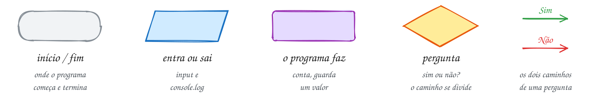</p>

No diagrama da ideia, o caminho que o exemplo segue aparece em verde, e os
outros ficam cinza. Erro é vermelho. No fluxograma vale a mesma regra: o
caminho do exemplo fica colorido e o resto fica apagado.

## A memória

Todo assunto termina com um terceiro desenho: o programa rodando linha por
linha, com a memória RAM ao lado. Pense na RAM como um armário de gavetas:

- cada variável ganha uma **gaveta**, com o nome na etiqueta e o valor dentro;
- o número no canto (`#1000`, `#1008`...) é o **endereço**, que é como o
  computador acha a gaveta de novo;
- embaixo do valor vem o tipo (`string`, `number`, `boolean`...);
- a gaveta **verde** é a que acabou de mudar, e quando o valor troca aparece
  também o que ela guardava antes;
- gaveta de `const` tem **cadeado**;
- a caixa **amarela** é uma conta que o processador faz na hora, como
  `5 >= 6`. O resultado é usado e descartado, sem ganhar gaveta.

Os endereços são de mentirinha (os de verdade são números enormes), mas a ideia
é essa: o nome da variável é só um apelido para um lugar na memória.

## Os assuntos

Leia na ordem. Em cada um, depois de ler, abra a pasta e rode os exemplos.

| # | Assunto | Pasta |
| --- | --- | --- |
| [0001](#0001--entrada-de-dados-input) | Entrada de dados (input) | [`0001-input/`](0001-input/) |
| [0002](#0002--saída-de-dados-output) | Saída de dados (output) | [`0002-output/`](0002-output/) |
| [0003](#0003--variáveis) | Variáveis | [`0003-variaveis/`](0003-variaveis/) |
| [0004](#0004--constantes) | Constantes | [`0004-constantes/`](0004-constantes/) |
| [0005](#0005--texto-string) | Texto (string) | [`0005-texto/`](0005-texto/) |
| [0006](#0006--número-number) | Número (number) | [`0006-numero/`](0006-numero/) |
| [0007](#0007--booleano-boolean-typeof-null-e-undefined) | Booleano (boolean), typeof, null e undefined | [`0007-booleano/`](0007-booleano/) |
| [0008](#0008--conversão-de-tipos) | Conversão de tipos | [`0008-conversao/`](0008-conversao/) |
| [0009](#0009--operadores-de-atribuição) | Operadores de atribuição | [`0009-atribuicao/`](0009-atribuicao/) |
| [0010](#0010--operadores-aritméticos) | Operadores aritméticos | [`0010-aritmetica/`](0010-aritmetica/) |
| [0011](#0011--objeto-math) | Objeto Math | [`0011-math/`](0011-math/) |
| [0012](#0012--operadores-relacionais) | Operadores relacionais | [`0012-relacional/`](0012-relacional/) |
| [0013](#0013--comparação-de-igualdade) | Comparação de igualdade | [`0013-comparacao/`](0013-comparacao/) |
| [0014](#0014--operadores-lógicos) | Operadores lógicos | [`0014-logico/`](0014-logico/) |
| [0015](#0015--truthy-falsy--e-) | Truthy, falsy, ?? e ?. | [`0015-truthy-falsy/`](0015-truthy-falsy/) |
| [0016](#0016--condicional-simples-if) | Condicional simples (if) | [`0016-condicional-simples/`](0016-condicional-simples/) |
| [0017](#0017--condicional-composta-if--else) | Condicional composta (if / else) | [`0017-condicional-composta/`](0017-condicional-composta/) |
| [0018](#0018--condicional-aninhada-else-if-e-if-dentro-de-if) | Condicional aninhada (else if e if dentro de if) | [`0018-condicional-aninhada/`](0018-condicional-aninhada/) |
| [0019](#0019--operador-ternário) | Operador ternário | [`0019-ternario/`](0019-ternario/) |
| [0020](#0020--estrutura-de-escolha-switch) | Estrutura de escolha (switch) | [`0020-escolha/`](0020-escolha/) |

---

## 0001 · Entrada de dados (input)

> Um programa que só fala e nunca escuta é igual àquele colega que manda áudio de
> 5 minutos e não lê a resposta. Hoje o programa aprende a ouvir.

Entrada é quando o programa para, faz uma pergunta e espera. Pense no
caixa da cantina: ele pergunta "vai querer o quê?" e só segue depois que você
responde.

A Ana roda o programa. Aparece a pergunta `Seu nome:`, ela digita `Ana`, aperta
Enter, e o programa guarda essa resposta numa caixinha chamada `nome`:

<p align="center"></p>

Quem faz a pergunta é a função `input`. Ela mostra o texto, espera o Enter e
devolve o que foi digitado:

```ts
import { input } from '#core/input.ts'

const nome = input('Seu nome: ') // a Ana digita: Ana
console.log(nome) // Ana
```

O fluxograma é curtinho. Ler e mostrar são paralelogramos azuis, porque é dado
entrando e saindo.

<p align="center"></p>

E dentro do computador? Quando a Ana aperta Enter, o que ela digitou vai para
uma gaveta da memória RAM com a etiqueta `nome`. Cada gaveta tem um endereço
(o `#1000`), que é como o computador acha ela de novo. A gaveta verde é a que
acabou de mudar:

<p align="center">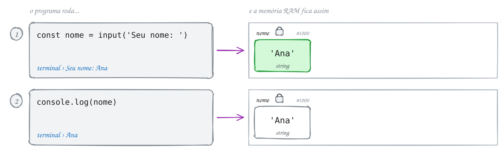</p>

> [!IMPORTANT]
> O `input` sempre devolve texto. Se a Ana digitar `17`, o programa guarda
> `'17'`, entre aspas. Fazer conta com isso é assunto da [0008](#0008--conversão-de-tipos).

> [!NOTE]
> **Hora de praticar:** os exemplos e os exercícios deste assunto estão em [`0001-input/`](0001-input/).
>
> ```bash
> pnpm tsx 15102026/0001-input/exemplo-1.ts
> ```

---

## 0002 · Saída de dados (output)

> Se o programa calcula a média e não mostra, calculou para quem?

Saída é o programa mostrando alguma coisa para você. No terminal, quem faz isso
é o `console.log`: o que estiver entre os parênteses aparece na tela.

A média já está guardada: `media` vale `7.5`. Agora a gente quer mostrar uma
frase inteira, com o número encaixado no meio. Para isso existe a **template
string**: um texto entre crases com um espaço `${ }` onde o valor entra.

<p align="center"></p>

```ts
const media = 7.5
console.log(`Sua média é ${media}`) // Sua média é 7.5
```

Guardar a média é o programa fazendo algo, então vira retângulo roxo. Mostrar a
frase é saída: paralelogramo azul.

<p align="center"></p>

Na memória só existe a gaveta `media`. A frase é montada na hora, com o valor
que está lá dentro, e vai direto para o terminal sem ganhar gaveta:

<p align="center">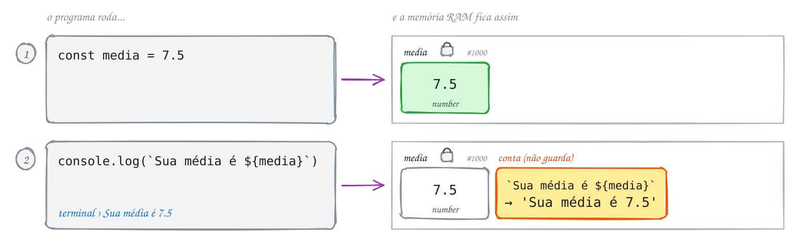</p>

> [!TIP]
> A crase (`` ` ``) fica perto do Enter na maioria dos teclados, às vezes junto
> com o til. Ache ela agora: você vai usar muito.

> [!NOTE]
> **Hora de praticar:** os exemplos e os exercícios deste assunto estão em [`0002-output/`](0002-output/).
>
> ```bash
> pnpm tsx 15102026/0002-output/exemplo-1.ts
> ```

---

## 0003 · Variáveis

> O placar do jogo muda a cada gol. Onde o programa guarda esse número enquanto
> o jogo rola?

Numa **variável**: uma caixinha com nome. O nome fica na etiqueta e o valor fica
dentro. Com `let`, dá para tirar o valor e colocar outro quantas vezes precisar.

O jogo começa 0 a 0. Saiu gol: a caixa `gols` passa a guardar 1. Outro gol: 2.
A caixa é sempre a mesma, só o que tem dentro muda:

<p align="center"></p>

```ts
let gols = 0 // o let aparece uma vez só, quando a caixa nasce
gols = 1 // gol!
gols = 2 // outro gol!
console.log(gols) // 2
```

Cada troca de valor vira um retângulo roxo, um embaixo do outro:

<p align="center"></p>

Na memória dá para ver que a caixa é a mesma o jogo inteiro: o endereço não
muda. Só o número lá dentro troca:

<p align="center"></p>

> [!TIP]
> O TypeScript descobre sozinho que `gols` guarda número, porque começou com
> `0`. Isso se chama **inferência**. Se quiser, dá para dizer na mão:
> `let gols: number = 0`. Nos dois casos, ele não deixa colocar texto ali.

Nome de variável vai em `camelCase`: `nomeCompleto`, `notaFinal`, `golsBrasil`.
E o `var`? É o jeito antigo, e causa bug difícil de achar. A gente não usa.

> [!NOTE]
> **Hora de praticar:** os exemplos e os exercícios deste assunto estão em [`0003-variaveis/`](0003-variaveis/).
>
> ```bash
> pnpm tsx 15102026/0003-variaveis/exemplo-1.ts
> ```

---

## 0004 · Constantes

> O nome da escola não muda no meio da aula. A média para passar também não.

Se a variável é uma caixa que troca de conteúdo, a **constante** é uma caixa
lacrada. Colocou o valor, acabou. Ela nasce com `const`.

O nome da escola é `'CETAM'`. Se alguém tentar trocar, o TypeScript reclama
na hora, antes mesmo de o programa rodar:

<p align="center"></p>

```ts
import { input } from '#core/input.ts'

const NOME_ESCOLA = 'CETAM'
const nome = input('Seu nome: ') // a Ana digita: Ana
console.log(`${nome} estuda no ${NOME_ESCOLA}`) // Ana estuda no CETAM

// NOME_ESCOLA = 'Outra escola'
// erro: Cannot assign to 'NOME_ESCOLA' because it is a constant.
```

Repare que `nome` também é `const`: a resposta do `input` chega uma vez e não
muda mais. Repare também que a constante é guardada antes da pergunta:

<p align="center"></p>

Na memória, as gavetas de `const` ganham um cadeado. A tentativa de troca do
último passo nem chega a rodar:

<p align="center">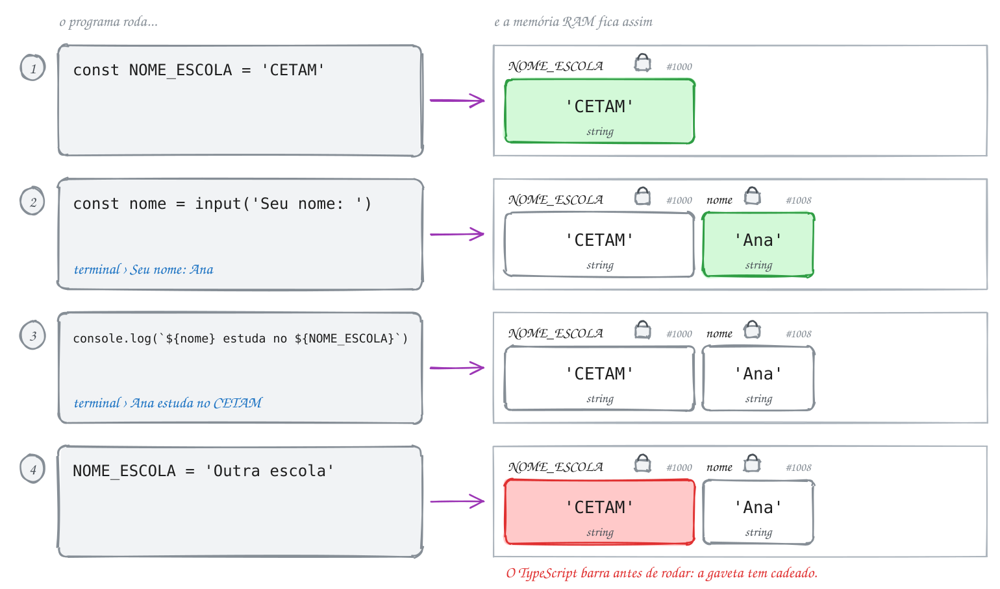</p>

> [!TIP]
> Na dúvida, comece com `const`. Precisou mudar depois? Troque para `let`.
> Valor fixo do programa vai em `UPPER_CASE` (`NOME_ESCOLA`, `MEDIA_APROVACAO`);
> o resto continua em `camelCase` (`nome`).

> [!NOTE]
> **Hora de praticar:** os exemplos e os exercícios deste assunto estão em [`0004-constantes/`](0004-constantes/).
>
> ```bash
> pnpm tsx 15102026/0004-constantes/exemplo-1.ts
> ```

---

## 0005 · Texto (string)

> Seu nome, sua senha do Wi-Fi, a legenda daquela foto no rio. Para o computador
> tudo isso é a mesma coisa: texto.

Texto, no TypeScript, se chama **string**: uma sequência de letras entre aspas.
E toda string já vem com ferramentas prontas, como um canivete: é só puxar.

A Maria digitou o nome com uns espaços sobrando: `'  maria  '`. O `.trim()` tira
os espaços das pontas e o `.toUpperCase()` deixa tudo em maiúsculas:

<p align="center"></p>

```ts
import { input } from '#core/input.ts'

const nome = input('Seu nome: ') // a Maria digita: '  maria  '
const limpo = nome.trim() // 'maria'
console.log(limpo.toUpperCase()) // MARIA
```

Cada ferramenta devolve um texto novo. A variável `nome` continua com os
espaços; quem está limpo é o `limpo`. Usar uma ferramenta é o programa fazendo
algo, então vira passo roxo:

<p align="center"></p>

A memória mostra por que `nome` continua com os espaços: o `.trim()` não mexe
nessa gaveta. Ele cria um texto novo, e esse texto vai para uma gaveta nova:

<p align="center">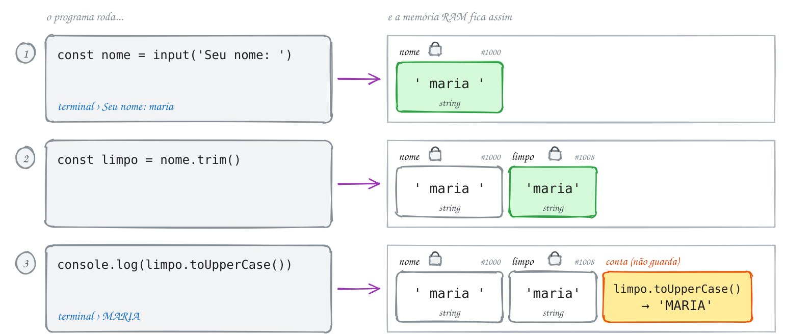</p>

> [!WARNING]
> Com texto, o `+` cola em vez de somar: `'5' + 3` vira `'53'`.

<details>
<summary>As ferramentas que mais aparecem</summary>

| Uso                   | O que faz                          | Com `'maria'`        |
| --------------------- | ---------------------------------- | -------------------- |
| `texto.length`        | quantidade de letras               | `5`                  |
| `texto.toUpperCase()` | tudo em MAIÚSCULAS                 | `'MARIA'`            |
| `texto.toLowerCase()` | tudo em minúsculas                 | `'maria'`            |
| `texto.trim()`        | tira os espaços das pontas         | `'maria'`            |
| `texto.includes('ar')`| `true` se o texto contém `'ar'`    | `true`               |
| `texto.split('')`     | quebra o texto em pedaços          | `['m','a','r','i','a']` |

</details>

> [!NOTE]
> **Hora de praticar:** os exemplos e os exercícios deste assunto estão em [`0005-texto/`](0005-texto/).
>
> ```bash
> pnpm tsx 15102026/0005-texto/exemplo-1.ts
> ```

---

## 0006 · Número (number)

> Quanto custa o açaí? Quantos km até Tabatinga? Qual sua nota? Tudo isso é
> número, e o programa precisa saber fazer conta com eles.

Número, no TypeScript, se chama **number**. Não tem um tipo para inteiro e outro
para decimal: `17`, `-3` e `12.5` são todos `number`. E o decimal usa ponto,
igual à calculadora do celular: `12.5`, não `12,5`.

O açaí custa `12.5`. Para mostrar como dinheiro, com dois números depois do
ponto, o `.toFixed(2)` transforma `12.5` em `'12.50'`:

<p align="center"></p>

```ts
const preco = 12.5
const texto = preco.toFixed(2) // '12.50'
console.log(`Açaí: R$ ${texto}`) // Açaí: R$ 12.50
```

<p align="center"></p>

Na memória ficam duas gavetas de tipos diferentes: `preco` guarda o número
`12.5` e `texto` guarda o texto `'12.50'`:

<p align="center">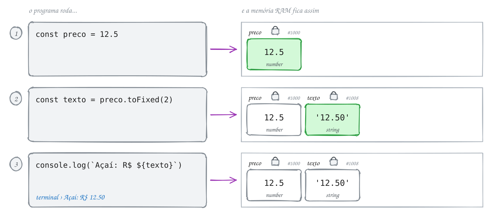</p>

> [!NOTE]
> O `.toFixed` devolve texto, pronto para mostrar. Para fazer mais contas,
> continue usando o `preco`.

> [!WARNING]
> Conta que não faz sentido vira `NaN` ("Not a Number"). Por exemplo,
> `Number('abc')` dá `NaN`.

> [!NOTE]
> **Hora de praticar:** os exemplos e os exercícios deste assunto estão em [`0006-numero/`](0006-numero/).
>
> ```bash
> pnpm tsx 15102026/0006-numero/exemplo-1.ts
> ```

---

## 0007 · Booleano (boolean), typeof, null e undefined

> Está chovendo? Tem aula hoje? O recreio já saiu? Pergunta de sim ou não tem um
> tipo só para ela.

O **boolean** tem só dois valores: `true` (verdadeiro) e `false` (falso). É um
interruptor de luz: ou está ligado, ou está desligado.

O programa pergunta "Tem aula hoje?". Você digita `sim`. A comparação
`resposta === 'sim'` vira `true`, e é esse `true` que fica guardado em `temAula`:

<p align="center"></p>

```ts
import { input } from '#core/input.ts'

const resposta = input('Tem aula hoje? (sim/nao) ') // você digita: sim
const temAula = resposta === 'sim' // true

let recado // undefined: a gaveta existe, mas está vazia
recado = null // null: "nada", colocado de propósito
```

Ainda não tem losango no fluxograma. A comparação só gera o `true` ou o `false`
e guarda. Escolher um caminho com ele é trabalho do `if`, na
[0016](#0016--condicional-simples-if).

<p align="center"></p>

Na memória, o `true` ocupa uma gaveta como qualquer outro valor. E aqui dá
para ver a diferença entre os dois "nadas": com `let recado` a gaveta já existe,
mas ninguém pôs nada nela (`undefined`). Depois alguém coloca `null` de
propósito:

<p align="center">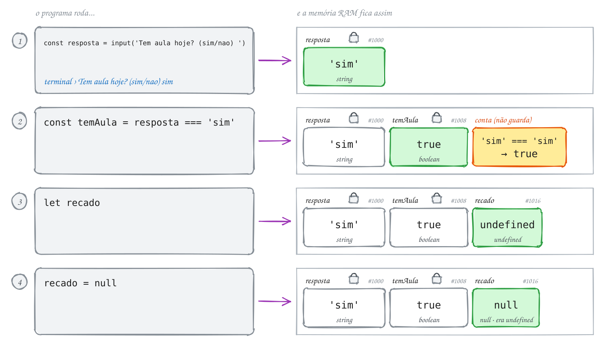</p>

> [!TIP]
> O `typeof` conta o tipo de um valor: `typeof temAula` dá `'boolean'`.

E tem dois valores especiais que querem dizer "nada":

- `undefined`: a caixa existe, mas ninguém colocou nada nela ainda. É a cadeira
  reservada de um aluno que ainda não chegou.
- `null`: alguém colocou "nada" de propósito. É o aluno avisando "pode marcar
  que eu não vou".

> [!NOTE]
> **Hora de praticar:** os exemplos e os exercícios deste assunto estão em [`0007-booleano/`](0007-booleano/).
>
> ```bash
> pnpm tsx 15102026/0007-booleano/exemplo-1.ts
> ```

---

## 0008 · Conversão de tipos

> Você digitou 17, pediu para somar 1 e o programa respondeu 171. Hoje a gente
> descobre por quê.

Lembra que o `input` sempre devolve texto? Você digitou `17`, mas o programa
guardou `'17'`. E com texto o `+` cola: `'17' + 1` vira `'171'`.

O jeito é converter: transformar o texto em número antes da conta. O
`Number('17')` faz isso e devolve `17`, um número de verdade:

<p align="center"></p>

```ts
import { input } from '#core/input.ts'

const texto = input('Sua idade: ') // você digita: 17
const idade = Number(texto) // 17
console.log(idade + 1) // 18
```

Na prática a gente faz tudo numa linha só: `Number(input('Sua idade: '))`. O
fluxograma separa em passos para dar para ver: chega texto, vira número, aí sim
faz a conta.

<p align="center"></p>

Na memória, `texto` e `idade` parecem iguais, mas o tipo embaixo de cada gaveta
conta outra história. A conta do último passo usa a gaveta `idade`, a de
número:

<p align="center">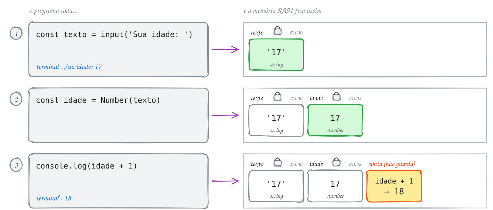</p>

> [!WARNING]
> Não deu para converter? O resultado é `NaN`: `Number('dezessete')` dá `NaN`.

<details>
<summary>Outras formas de converter</summary>

| Função              | O que faz                                   |
| ------------------- | ------------------------------------------- |
| `Number('7.5')`     | texto para número (aceita decimais)         |
| `parseInt('7.9')`   | texto para número inteiro (corta: dá `7`)   |
| `parseFloat('7.5')` | texto para número decimal                   |
| `String(10)`        | número para texto                           |

</details>

> [!NOTE]
> **Hora de praticar:** os exemplos e os exercícios deste assunto estão em [`0008-conversao/`](0008-conversao/).
>
> ```bash
> pnpm tsx 15102026/0008-conversao/exemplo-1.ts
> ```

---

## 0009 · Operadores de atribuição

> Você tem 100 reais de crédito no celular. Gastou 30 no pacote de dados e
> recarregou 20. Quanto sobrou?

Quem guarda um valor na variável é o `=`. Ele dá uma ordem: "a partir de agora,
`saldo` vale 100".

Quando o valor novo depende do antigo, existe atalho. Gastou 30? `saldo -= 30`,
que lê assim: "pega o que já tem e tira 30". Recarregou 20? `saldo += 20`:

<p align="center"></p>

```ts
let saldo = 100
saldo -= 30 // gastou no pacote: 70
saldo += 20 // recarregou: 90
console.log(saldo) // 90
```

A variável é a mesma do começo ao fim, só o valor dentro dela muda. Cada
atribuição é um retângulo roxo:

<p align="center"></p>

Na memória, a gaveta `saldo` é a mesma do começo ao fim (o endereço não muda). A
cada linha, o valor antigo sai e o novo entra:

<p align="center">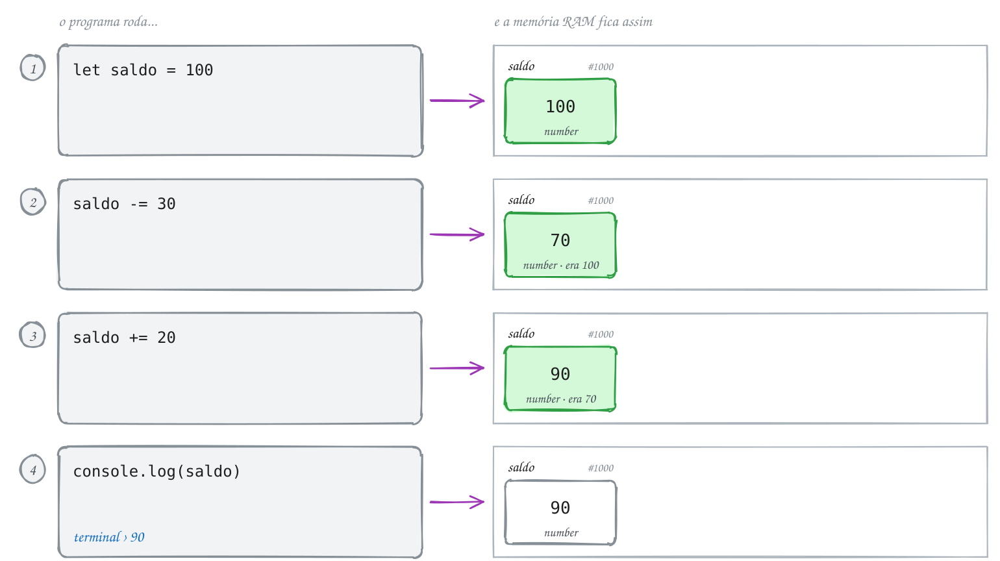</p>

<details>
<summary>Todos os atalhos</summary>

| Escrito  | É o mesmo que |
| -------- | ------------- |
| `x += 5` | `x = x + 5`   |
| `x -= 5` | `x = x - 5`   |
| `x *= 2` | `x = x * 2`   |
| `x /= 2` | `x = x / 2`   |
| `x %= 3` | `x = x % 3`   |
| `x++`    | `x = x + 1`   |
| `x--`    | `x = x - 1`   |

</details>

> [!TIP]
> O `x++` aparece muito sozinho na linha, contando coisas: um aluno a mais, um
> gol a mais.

> [!NOTE]
> **Hora de praticar:** os exemplos e os exercícios deste assunto estão em [`0009-atribuicao/`](0009-atribuicao/).
>
> ```bash
> pnpm tsx 15102026/0009-atribuicao/exemplo-1.ts
> ```

---

## 0010 · Operadores aritméticos

> Tirou 8 na primeira prova e 6 na segunda. A média é 7... ou 11? Depende de
> onde você coloca os parênteses.

São as contas da escola, com dois símbolos novos: multiplicar é `*` e dividir é
`/`. E a ordem também é a da escola: primeiro `*` e `/`, depois `+` e `-`.

Por isso `8 + 6 / 2` dá 11: o programa divide `6 / 2` primeiro e só depois
soma o 8. Para somar as notas antes de dividir, coloque parênteses:

<p align="center"></p>

```ts
const nota1 = 8
const nota2 = 6
const media = (nota1 + nota2) / 2 // 7
console.log(media) // 7
```

<p align="center"></p>

Na memória, o processador pega os valores das gavetas, faz a conta e só guarda
o resultado final. O `14` do meio do caminho não ganha gaveta:

<p align="center">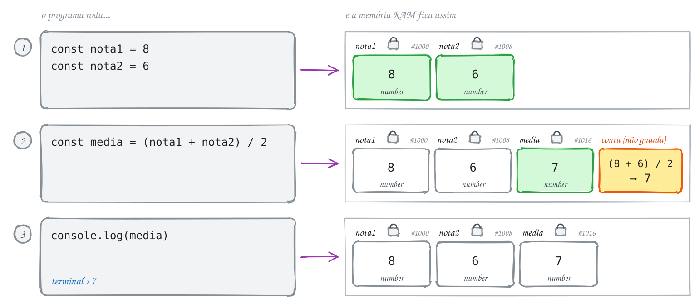</p>

<details>
<summary>Todos os operadores</summary>

| Operador | Conta         | Exemplo  | Resultado |
| -------- | ------------- | -------- | --------- |
| `+`      | soma          | `7 + 2`  | `9`       |
| `-`      | subtração     | `7 - 2`  | `5`       |
| `*`      | multiplicação | `7 * 2`  | `14`      |
| `/`      | divisão       | `7 / 2`  | `3.5`     |
| `%`      | resto         | `7 % 2`  | `1`       |
| `**`     | potência      | `7 ** 2` | `49`      |

</details>

> [!TIP]
> O `%` não tem a ver com porcentagem. Ele dá o resto da divisão: 7
> alunos em duplas formam 3 duplas e sobra 1, então `7 % 2` é `1`.

> [!NOTE]
> **Hora de praticar:** os exemplos e os exercícios deste assunto estão em [`0010-aritmetica/`](0010-aritmetica/).
>
> ```bash
> pnpm tsx 15102026/0010-aritmetica/exemplo-1.ts
> ```

---

## 0011 · Objeto Math

> A van da excursão leva 15 pessoas e a turma tem 32. Quantas vans? Se você
> respondeu 2, alguém ficou na escola.

O `Math` é uma caixa de ferramentas que já vem pronta no TypeScript. Não precisa
instalar nada: escreva `Math.` no editor e ele mostra o que tem lá dentro.

`32 / 15` dá `2.13`. Duas vans não bastam, porque sobram 2 alunos. A conta certa
é arredondar para cima, e quem faz isso é o `Math.ceil`:

<p align="center"></p>

```ts
const alunos = 32
const porVan = 15
const vans = Math.ceil(alunos / porVan) // 2.13 vira 3
console.log(vans) // 3
```

<p align="center"></p>

Na memória, o `2.13` aparece só durante a conta. Quem fica guardado é o `3`
que o `Math.ceil` devolve:

<p align="center">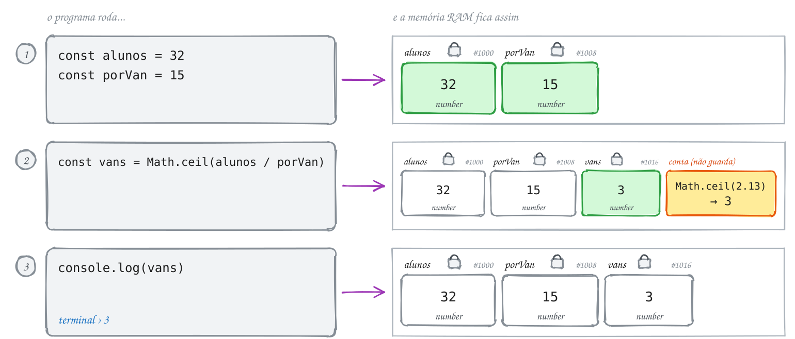</p>

> [!TIP]
> Para não confundir: *floor* é "chão" em inglês, então arredonda para baixo.
> *ceil* vem de *ceiling*, "teto", então arredonda para cima.

<details>
<summary>As ferramentas do Math</summary>

| Função           | O que faz                     | Exemplo               |
| ---------------- | ----------------------------- | --------------------- |
| `Math.round(x)`  | arredonda para o mais próximo | `Math.round(2.13)` → 2 |
| `Math.floor(x)`  | arredonda para baixo          | `Math.floor(2.13)` → 2 |
| `Math.ceil(x)`   | arredonda para cima           | `Math.ceil(2.13)` → 3  |
| `Math.max(a, b)` | o maior valor                 | `Math.max(3, 9)` → 9   |
| `Math.min(a, b)` | o menor valor                 | `Math.min(3, 9)` → 3   |
| `Math.random()`  | número sorteado entre 0 e 1   | `0.7312...`            |

</details>

> [!NOTE]
> **Hora de praticar:** os exemplos e os exercícios deste assunto estão em [`0011-math/`](0011-math/).
>
> ```bash
> pnpm tsx 15102026/0011-math/exemplo-1.ts
> ```

---

## 0012 · Operadores relacionais

> Na entrada do show tem um segurança que faz uma pergunta só: "tem 18 anos ou
> mais?"

Os operadores relacionais comparam dois valores e respondem com um boolean,
`true` ou `false`. Fazem o papel do segurança.

O João tem 17 anos. A pergunta do segurança, em código, é `idade >= 18`. Como 17
não é maior nem igual a 18, a resposta é `false`:

<p align="center"></p>

```ts
import { input } from '#core/input.ts'

const idade = Number(input('Sua idade: ')) // o João digita: 17
const maiorDeIdade = idade >= 18 // false
console.log(maiorDeIdade) // false
```

Igual ao boolean da [0007](#0007--booleano-boolean-typeof-null-e-undefined),
ainda não tem losango: a comparação só gera o `true` ou `false` e guarda.

<p align="center"></p>

Na memória, a comparação é calculada com o valor da gaveta `idade`, e a
resposta vai para uma gaveta nova:

<p align="center">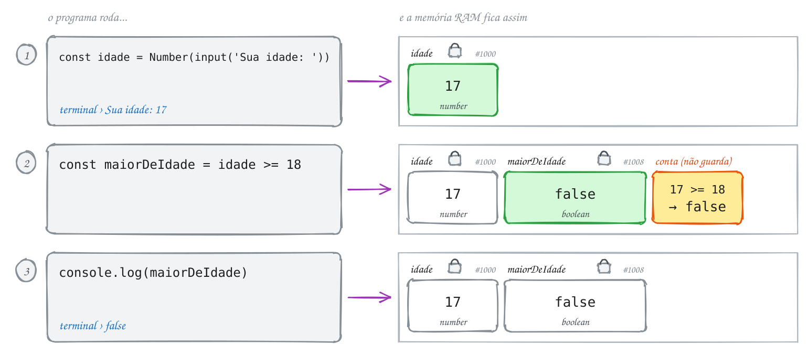</p>

| Operador | Pergunta            | Com `idade = 17` |
| -------- | ------------------- | ---------------- |
| `>`      | é maior que?        | `idade > 18` → `false`  |
| `<`      | é menor que?        | `idade < 18` → `true`   |
| `>=`     | é maior ou igual?   | `idade >= 18` → `false` |
| `<=`     | é menor ou igual?   | `idade <= 18` → `true`  |

> [!TIP]
> A boca aberta do `>` fica virada para o maior, igual a um jacaré com fome.

> [!NOTE]
> **Hora de praticar:** os exemplos e os exercícios deste assunto estão em [`0012-relacional/`](0012-relacional/).
>
> ```bash
> pnpm tsx 15102026/0012-relacional/exemplo-1.ts
> ```

---

## 0013 · Comparação de igualdade

> Você digita a senha do Wi-Fi da escola e o celular diz "senha incorreta".
> Alguém comparou o que você digitou com a senha certa.

Para perguntar se dois valores são iguais, o TypeScript usa `===`. Para
perguntar se são diferentes, `!==`. A resposta, de novo, é `true` ou
`false`.

A senha do Wi-Fi é `'cetam2026'`. Você digitou certinho, então
`digitada === SENHA` dá `true`:

<p align="center"></p>

```ts
import { input } from '#core/input.ts'

const SENHA = 'cetam2026'
const digitada = input('Senha do Wi-Fi: ') // você digita: cetam2026
const acertou = digitada === SENHA // true
console.log(acertou) // true
```

<p align="center"></p>

Na memória são duas gavetas diferentes, com endereços diferentes. O `===`
compara o que tem dentro delas:

<p align="center">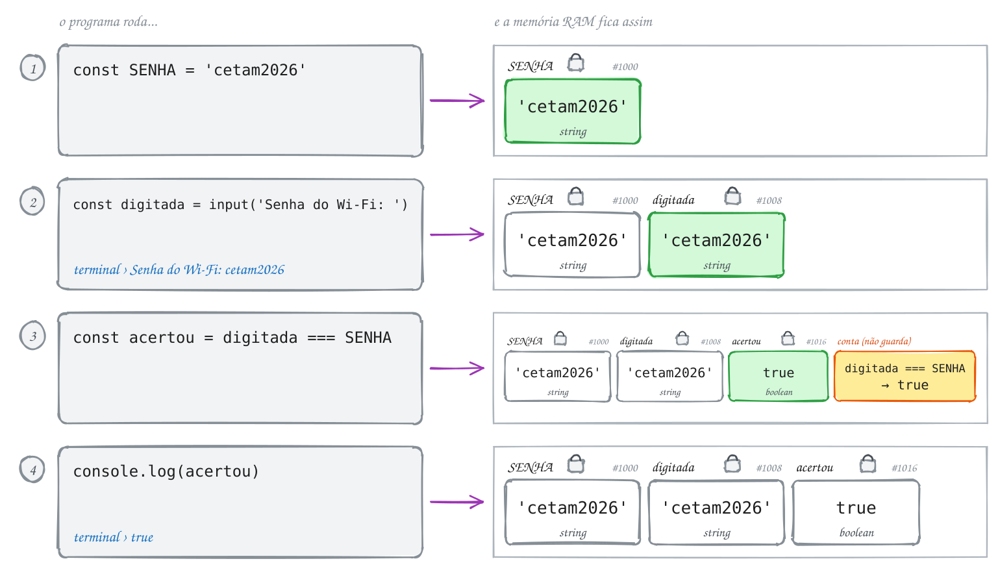</p>

> [!IMPORTANT]
> Por que três sinais? Existe o `==`, que converte os tipos antes de comparar:
> `5 == '5'` dá `true` e o erro passa batido. O `===` compara o valor e o
> tipo, então `5 === '5'` dá `false`. Aqui é sempre `===` e `!==`.

> [!TIP]
> `=` guarda um valor ("a senha agora é essa"). `===` pergunta ("a senha é
> essa?").

> [!NOTE]
> **Hora de praticar:** os exemplos e os exercícios deste assunto estão em [`0013-comparacao/`](0013-comparacao/).
>
> ```bash
> pnpm tsx 15102026/0013-comparacao/exemplo-1.ts
> ```

---

## 0014 · Operadores lógicos

> Para passar de ano não basta tirar nota boa. Também precisa ter frequência.

Os operadores lógicos juntam várias respostas `true`/`false` numa só:

- `&&` (E): dá `true` só quando os dois lados são `true`.
- `||` (OU): dá `true` quando pelo menos um lado é `true`.
- `!` (NÃO): inverte. `!true` é `false`.

O Pedro tem média 7 (boa: `true`) mas frequência 60% (ruim: `false`). Com `&&`,
que precisa das duas, ele não passa. Com `||`, que se contenta com uma, passaria:

<p align="center"></p>

```ts
const media = 7
const frequencia = 60

const aprovado = media >= 6 && frequencia >= 75 // true && false → false
console.log(aprovado) // false
console.log(media >= 6 || frequencia >= 75) // true || false → true
```

<p align="center"></p>

Na memória, cada lado da conta vira `true` ou `false` antes de juntar. Repare
que o último passo calcula o `||` e mostra, mas não guarda em lugar nenhum:

<p align="center">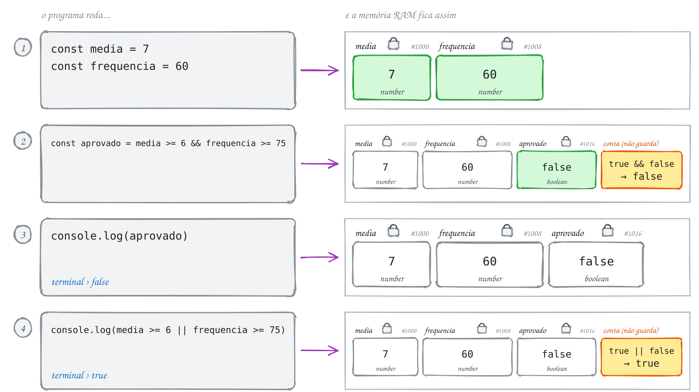</p>

<details>
<summary>A tabela verdade</summary>

| A       | B       | A && B  | A \|\| B |
| ------- | ------- | ------- | -------- |
| `true`  | `true`  | `true`  | `true`   |
| `true`  | `false` | `false` | `true`   |
| `false` | `true`  | `false` | `true`   |
| `false` | `false` | `false` | `false`  |

</details>

> [!TIP]
> A mãe diz "só sai se arrumar o quarto **E** lavar a louça": é o `&&`. A avó
> diz "sai se arrumar o quarto **OU** lavar a louça": é o `||`.

> [!NOTE]
> **Hora de praticar:** os exemplos e os exercícios deste assunto estão em [`0014-logico/`](0014-logico/).
>
> ```bash
> pnpm tsx 15102026/0014-logico/exemplo-1.ts
> ```

---

## 0015 · Truthy, falsy, ?? e ?.

> O aluno apertou Enter sem digitar o apelido. E agora, o programa chama ele de
> quê?

Num `if`, o TypeScript espera `true` ou `false`. Mas você pode colocar qualquer
valor ali, e ele "acha" se aquilo conta como verdadeiro ou falso. É o fiscal do
porto olhando a mochila: vazia, ele nem abre; com alguma coisa, ele confere.

Os que contam como falso são só seis, e dá para decorar: `false`, `0`, `''`
(texto vazio), `null`, `undefined` e `NaN`. Esses são os **falsy**. Todo o resto
é **truthy**.

O aluno apertou Enter direto, então `apelido` é `''`, um texto vazio: falsy. O
`||` percebe isso e usa o valor padrão:

<p align="center"></p>

```ts
import { input } from '#core/input.ts'

const apelido = input('Seu apelido: ') // o aluno só aperta Enter: ''
const chamar = apelido || 'sem apelido' // '' é falsy, então usa o padrão
console.log(`Oi, ${chamar}!`) // Oi, sem apelido!
```

Aqui aparece o primeiro losango amarelo da aula, a primeira pergunta de sim ou
não:

<p align="center"></p>

Na memória, a gaveta `apelido` existe e tem um texto dentro, só que vazio. É
por isso que o `??` não trocaria: para ele, `''` é um valor de verdade:

<p align="center">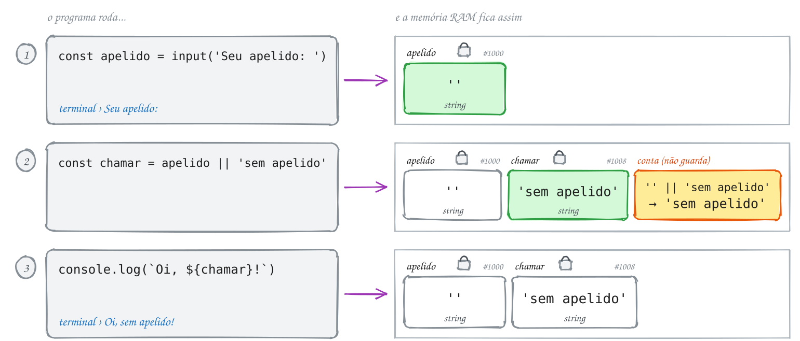</p>

> [!IMPORTANT]
> O `??` é parecido, mas só troca quando o valor é `null` ou `undefined`. Com
> texto vazio ele não faz nada: `'' ?? 'sem apelido'` continua `''`.

> [!TIP]
> O `?.` acessa uma propriedade só se a variável existir:
> `aluno?.nome` devolve `undefined` em vez de quebrar quando `aluno` é `null`.
> E `string | undefined` quer dizer "pode ser texto, pode não ter nada ainda".

> [!NOTE]
> **Hora de praticar:** os exemplos e os exercícios deste assunto estão em [`0015-truthy-falsy/`](0015-truthy-falsy/).
>
> ```bash
> pnpm tsx 15102026/0015-truthy-falsy/exemplo-1.ts
> ```

---

## 0016 · Condicional simples (if)

> Você só leva o guarda-chuva se o céu estiver feio. Sol? Sai de mãos vazias.

Até agora todo programa rodava linha por linha, do começo ao fim, sem pular
nada. Com o `if` (se), ele passa a decidir: o bloco entre `{ }` só roda se a
condição for verdadeira. Se for falsa, o programa pula o bloco e segue a vida.

O programa pergunta "Vai chover?". Você responde `sim`, a condição dá `true` e
aparece o aviso do guarda-chuva. Depois, chovendo ou não, ele dá bom dia:

<p align="center"></p>

```ts
import { input } from '#core/input.ts'

const resposta = input('Vai chover? (sim/nao) ') // você digita: sim

if (resposta === 'sim') {
  console.log('Leve o guarda-chuva!') // só roda no Sim
}

console.log('Bom dia!') // roda sempre
```

O `if` vira o losango. Só o caminho do Sim tem uma tarefa a mais; o Não vai
direto para o "Bom dia!":

<p align="center"></p>

Na memória, a comparação do `if` é calculada e jogada fora logo depois: ela não
ganha gaveta. Serve só para escolher o caminho:

<p align="center">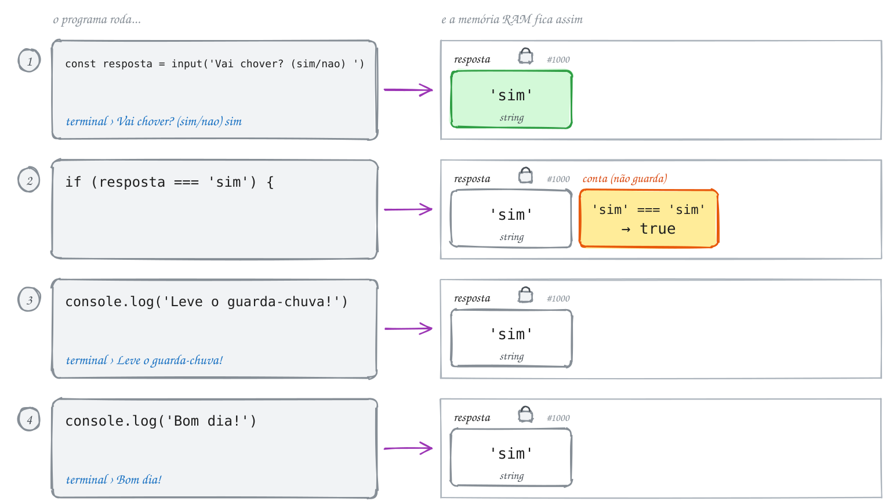</p>

> [!NOTE]
> **Hora de praticar:** os exemplos e os exercícios deste assunto estão em [`0016-condicional-simples/`](0016-condicional-simples/).
>
> ```bash
> pnpm tsx 15102026/0016-condicional-simples/exemplo-1.ts
> ```

---

## 0017 · Condicional composta (if / else)

> Ou você está no porto às 6h e embarca no recreio para Tabatinga, ou fica em
> terra vendo o barco sair.

O `if` sozinho só sabe fazer uma coisa a mais. Com o `else` (senão), o programa
ganha um plano B: se a condição for verdadeira, roda o bloco do `if`; se for
falsa, roda o bloco do `else`. Um dos dois sempre roda, e só um.

Você chegou ao porto às 5h. `5 <= 6` é `true`, então o caminho é o do `if`:
embarcou!

<p align="center"></p>

```ts
import { input } from '#core/input.ts'

const hora = Number(input('Que horas você chegou ao porto? ')) // você digita: 5

if (hora <= 6) {
  console.log('Embarcou para Tabatinga!')
} else {
  console.log('O recreio já saiu.')
}
```

Os dois caminhos saem do mesmo losango e se encontram de novo no fim. O
programa passa por um deles:

<p align="center"></p>

Na memória, nada novo é guardado depois da leitura da hora. O `else` é pulado
inteiro, como se não estivesse ali:

<p align="center">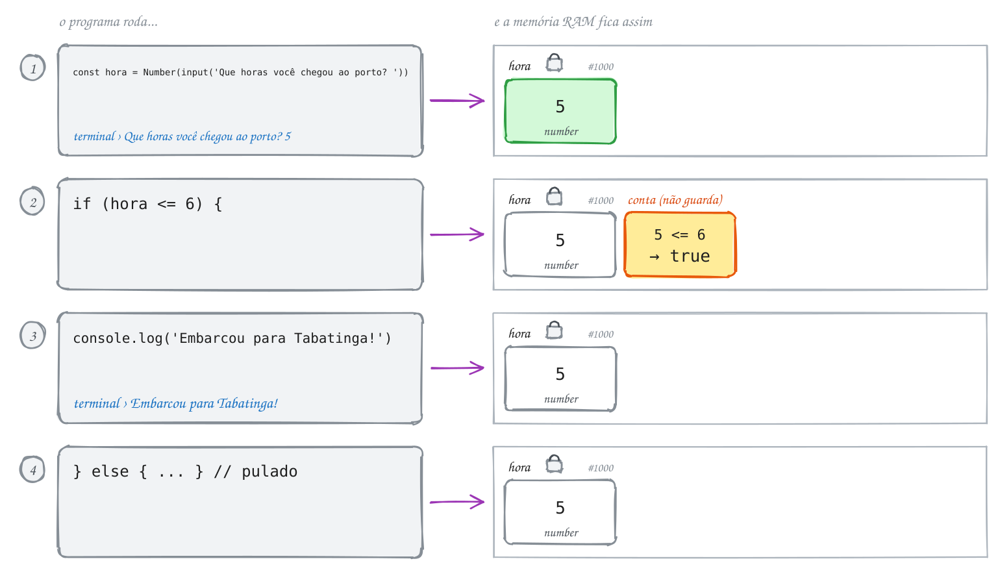</p>

> [!NOTE]
> **Hora de praticar:** os exemplos e os exercícios deste assunto estão em [`0017-condicional-composta/`](0017-condicional-composta/).
>
> ```bash
> pnpm tsx 15102026/0017-condicional-composta/exemplo-1.ts
> ```

---

## 0018 · Condicional aninhada (else if e if dentro de if)

> No boletim não existe só "passou" ou "não passou". Tem a tal da recuperação no
> meio do caminho.

Quando tem mais de dois caminhos, entra o `else if` (senão se). O programa testa
as condições de cima para baixo e para na primeira que for verdadeira. O
`else` do final pega quem sobrou.

A média da Bia é 5. Primeira pergunta: `5 >= 6`? Não. Segunda: `5 >= 4`? Sim:
recuperação. A terceira opção nem chega a ser olhada:

<p align="center"></p>

```ts
const media = 5

if (media >= 6) {
  console.log('Aprovado')
} else if (media >= 4) {
  console.log('Recuperação') // a Bia cai aqui
} else {
  console.log('Reprovado')
}
```

Cada `else if` é mais um losango, pendurado no Não do anterior:

<p align="center"></p>

Na memória, cada pergunta é uma conta nova com o mesmo valor da gaveta `media`.
A terceira opção nem chega a ser calculada:

<p align="center">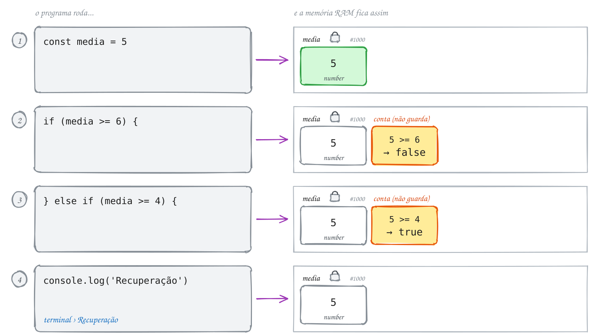</p>

> [!TIP]
> Também dá para colocar um `if` dentro de outro, quando uma pergunta só faz
> sentido depois da primeira. Não adianta perguntar se tem habilitação para
> quem tem 12 anos.

> [!NOTE]
> **Hora de praticar:** os exemplos e os exercícios deste assunto estão em [`0018-condicional-aninhada/`](0018-condicional-aninhada/).
>
> ```bash
> pnpm tsx 15102026/0018-condicional-aninhada/exemplo-1.ts
> ```

---

## 0019 · Operador ternário

> Dá para escrever um if/else inteiro numa linha só? Dá.

O ternário é o if/else de bolso. Ele faz uma pergunta e devolve um de dois
valores:

```ts
condição ? valorSeSim : valorSeNão
```

Lê assim: "a condição é verdadeira? então isso, senão aquilo". A média do Lucas
é 8, então `media >= 6` é `true` e o ternário devolve `'Aprovado'`:

<p align="center"></p>

```ts
const media = 8
const situacao = media >= 6 ? 'Aprovado' : 'Reprovado'
console.log(situacao) // Aprovado
```

O fluxograma é o mesmo desenho do if/else da
[0017](#0017--condicional-composta-if--else). A diferença é que os dois
caminhos não mostram nada. Eles guardam um valor em `situacao`, e só no fim
o programa mostra:

<p align="center"></p>

Na memória aparece a diferença para o `if`: o ternário vira um valor, e esse
valor ganha gaveta:

<p align="center">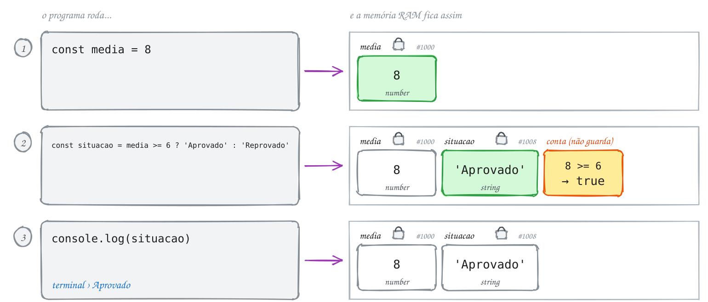</p>

> [!TIP]
> Use o ternário para escolhas pequenas: singular ou plural, par ou ímpar,
> aprovado ou reprovado. Se a decisão tem várias etapas, volte para o `if`.

> [!NOTE]
> **Hora de praticar:** os exemplos e os exercícios deste assunto estão em [`0019-ternario/`](0019-ternario/).
>
> ```bash
> pnpm tsx 15102026/0019-ternario/exemplo-1.ts
> ```

---

## 0020 · Estrutura de escolha (switch)

> Caixa eletrônico: "digite 1 para saldo, 2 para depósito, 3 para sair". Quem
> decide o que acontece depois de cada número?

O `switch` pega um valor e procura a opção igual numa lista. Achou (com
`===`), roda o que está ali. É o cardápio da lanchonete: você fala o número do
combo e a atendente já sabe o que montar.

- `case`: uma opção da lista.
- `break`: "pronto, terminei". Sem ele, o programa continua descendo e roda os
  próximos `case` também.
- `default`: quando nenhuma opção bateu. Faz o papel do `else`.

Você digitou `2`. O `switch` compara com cada `case` e para no `case 2`:

<p align="center"></p>

```ts
import { input } from '#core/input.ts'

const opcao = Number(input('1 saldo, 2 depósito, 3 sair: ')) // você digita: 2

switch (opcao) {
  case 1:
    console.log('Seu saldo é R$ 100')
    break
  case 2:
    console.log('Depósito realizado') // você cai aqui
    break
  case 3:
    console.log('Até logo!')
    break
  default:
    console.log('Opção inválida')
}
```

O `switch` vira um losango com uma saída para cada `case`, mais uma para o
`default`:

<p align="center"></p>

Na memória, o `switch` faz uma comparação com `===` para cada `case`, sempre
com o mesmo valor da gaveta `opcao`, até achar o igual:

<p align="center">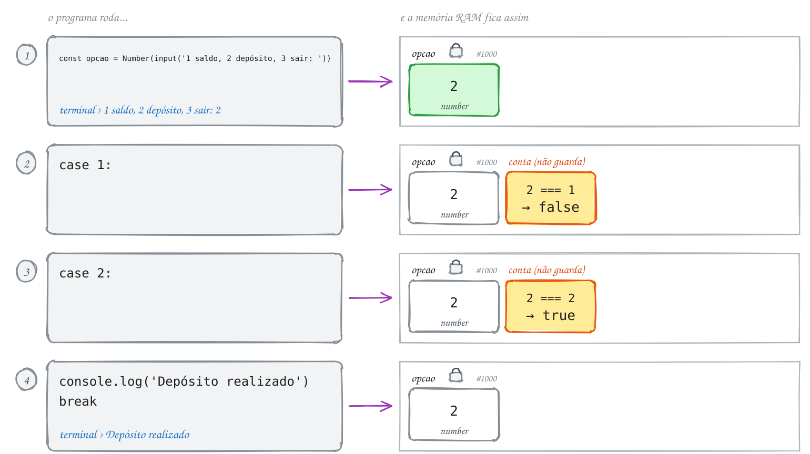</p>

> [!TIP]
> Use `switch` quando a pergunta é "qual destes valores?". Para faixas (maior
> que, menor que), o `if` / `else if` continua sendo o certo.

> [!NOTE]
> **Hora de praticar:** os exemplos e os exercícios deste assunto estão em [`0020-escolha/`](0020-escolha/).
>
> ```bash
> pnpm tsx 15102026/0020-escolha/exemplo-1.ts
> ```

---

## Para ler mais

- FORBELLONE, A. L. V.; EBERSPÄCHER, H. F. *Lógica de programação: a construção de algoritmos e estruturas de dados*. 3. ed. São Paulo: Pearson Prentice Hall, 2005.
- ISO 5807:1985. *Information processing: documentation symbols and conventions for data, program and system flowcharts, program network charts and system resources charts*. Genebra: ISO, 1985.
- MANZANO, J. A. N. G.; OLIVEIRA, J. F. *Algoritmos: lógica para desenvolvimento de programação de computadores*. São Paulo: Érica.
- HAVERBEKE, M. *Eloquent JavaScript*. 3. ed. San Francisco: No Starch Press, 2018. Disponível em: <https://eloquentjavascript.net>.
- MDN WEB DOCS. *Template strings*. Disponível em: <https://developer.mozilla.org/pt-BR/docs/Web/JavaScript/Reference/Template_literals>.
- MICROSOFT. *TypeScript Handbook*: Everyday Types. Disponível em: <https://www.typescriptlang.org/docs/handbook/2/everyday-types.html>.
- MDN WEB DOCS. *let*. Disponível em: <https://developer.mozilla.org/pt-BR/docs/Web/JavaScript/Reference/Statements/let>.
- MDN WEB DOCS. *const*. Disponível em: <https://developer.mozilla.org/pt-BR/docs/Web/JavaScript/Reference/Statements/const>.
- GOOGLE. *Google JavaScript Style Guide*. Disponível em: <https://google.github.io/styleguide/jsguide.html>.
- ECMA INTERNATIONAL. *ECMA-262: ECMAScript language specification*. Disponível em: <https://tc39.es/ecma262/>.
- MDN WEB DOCS. *String*. Disponível em: <https://developer.mozilla.org/pt-BR/docs/Web/JavaScript/Reference/Global_Objects/String>.
- GOLDBERG, D. What every computer scientist should know about floating-point arithmetic. *ACM Computing Surveys*, v. 23, n. 1, p. 5-48, 1991.
- IEEE. *IEEE standard for floating-point arithmetic*: IEEE 754-2019. New York: IEEE, 2019.
- MDN WEB DOCS. *Number*. Disponível em: <https://developer.mozilla.org/pt-BR/docs/Web/JavaScript/Reference/Global_Objects/Number>.
- BOOLE, G. *An investigation of the laws of thought*. London: Walton and Maberly, 1854.
- HOARE, T. *Null references: the billion dollar mistake*. Palestra na QCon London, 2009.
- MICROSOFT. *TypeScript Handbook*: The Basics. Disponível em: <https://www.typescriptlang.org/docs/handbook/2/basic-types.html>.
- MDN WEB DOCS. *parseInt()*. Disponível em: <https://developer.mozilla.org/pt-BR/docs/Web/JavaScript/Reference/Global_Objects/parseInt>.
- MDN WEB DOCS. *Expressões e operadores*. Disponível em: <https://developer.mozilla.org/pt-BR/docs/Web/JavaScript/Guide/Expressions_and_operators>.
- ASCENCIO, A. F. G.; CAMPOS, E. A. V. *Fundamentos da programação de computadores: algoritmos, Pascal, C/C++ e Java*. 3. ed. São Paulo: Pearson, 2012.
- MDN WEB DOCS. *Precedência de operadores*. Disponível em: <https://developer.mozilla.org/pt-BR/docs/Web/JavaScript/Reference/Operators/Operator_precedence>.
- KNUTH, D. E. *The art of computer programming*, v. 2: Seminumerical algorithms. 3. ed. Reading: Addison-Wesley, 1997.
- MDN WEB DOCS. *Math*. Disponível em: <https://developer.mozilla.org/pt-BR/docs/Web/JavaScript/Reference/Global_Objects/Math>.
- MDN WEB DOCS. *Expressões e operadores: operadores de comparação*. Disponível em: <https://developer.mozilla.org/pt-BR/docs/Web/JavaScript/Guide/Expressions_and_operators>.
- CROCKFORD, D. *JavaScript: the good parts*. Sebastopol: O'Reilly, 2008.
- MDN WEB DOCS. *Comparações de igualdade e uniformidade*. Disponível em: <https://developer.mozilla.org/pt-BR/docs/Web/JavaScript/Equality_comparisons_and_sameness>.
- MDN WEB DOCS. *Operador AND lógico (&&)*. Disponível em: <https://developer.mozilla.org/pt-BR/docs/Web/JavaScript/Reference/Operators/Logical_AND>.
- MDN WEB DOCS. *Falsy*. Disponível em: <https://developer.mozilla.org/pt-BR/docs/Glossary/Falsy>.
- MDN WEB DOCS. *Operador de coalescência nula (??)*. Disponível em: <https://developer.mozilla.org/pt-BR/docs/Web/JavaScript/Reference/Operators/Nullish_coalescing>.
- MICROSOFT. *TypeScript Handbook*: Narrowing. Disponível em: <https://www.typescriptlang.org/docs/handbook/2/narrowing.html>.
- BÖHM, C.; JACOPINI, G. Flow diagrams, Turing machines and languages with only two formation rules. *Communications of the ACM*, v. 9, n. 5, p. 366-371, 1966.
- DIJKSTRA, E. W. Go to statement considered harmful. *Communications of the ACM*, v. 11, n. 3, p. 147-148, 1968.
- MDN WEB DOCS. *if...else*. Disponível em: <https://developer.mozilla.org/pt-BR/docs/Web/JavaScript/Reference/Statements/if...else>.
- KERNIGHAN, B. W.; RITCHIE, D. M. *The C programming language*. 2. ed. Englewood Cliffs: Prentice Hall, 1988.
- MDN WEB DOCS. *Operador condicional (ternário)*. Disponível em: <https://developer.mozilla.org/pt-BR/docs/Web/JavaScript/Reference/Operators/Conditional_operator>.
- MDN WEB DOCS. *switch*. Disponível em: <https://developer.mozilla.org/pt-BR/docs/Web/JavaScript/Reference/Statements/switch>.
- MICROSOFT. *TypeScript Handbook*: TSConfig noFallthroughCasesInSwitch. Disponível em: <https://www.typescriptlang.org/tsconfig#noFallthroughCasesInSwitch>.
