# Aula 01 · 15/10 · Revisão de lógica I

Tudo da aula está aqui, numa página só. Para cada assunto você encontra a
ideia em poucas palavras, um **diagrama** que resume a ideia e um
**fluxograma** com o caminho que o programa faz.

As pastas (`0001-input`, `0002-output`...) guardam só a parte prática:

- `exemplo-1.ts` a `exemplo-3.ts`: exemplos resolvidos. Rode, mude, quebre, rode de novo.
- `exercicio-1.ts` e `exercicio-2.ts`: enunciado e dicas no comentário. A
  resposta vai embaixo de `// Escreva sua resposta abaixo:`.

## Como ler um fluxograma

| Forma | Quer dizer |
| --- | --- |
| pílula (roxa) | início ou fim do programa |
| paralelogramo (azul) | entrada ou saída: `input` e `console.log` |
| retângulo (verde) | o programa faz uma conta ou guarda um valor |
| losango (amarelo) | uma pergunta de sim ou não, e o caminho se divide |

## Assuntos

| Pasta | Assunto |
| --- | --- |
| [0001](#0001--entrada-de-dados-input) | Entrada de dados (input) |
| [0002](#0002--saída-de-dados-output) | Saída de dados (output) |
| [0003](#0003--variáveis) | Variáveis |
| [0004](#0004--constantes) | Constantes |
| [0005](#0005--texto-string) | Texto (string) |
| [0006](#0006--número-number) | Número (number) |
| [0007](#0007--booleano-boolean-typeof-null-e-undefined) | Booleano (boolean), typeof, null e undefined |
| [0008](#0008--conversão-de-tipos) | Conversão de tipos |
| [0009](#0009--operadores-de-atribuição) | Operadores de atribuição |
| [0010](#0010--operadores-aritméticos) | Operadores aritméticos |
| [0011](#0011--objeto-math) | Objeto Math |
| [0012](#0012--operadores-relacionais) | Operadores relacionais |
| [0013](#0013--comparação-de-igualdade) | Comparação de igualdade |
| [0014](#0014--operadores-lógicos) | Operadores lógicos |
| [0015](#0015--truthy-falsy--e-) | Truthy, falsy, ?? e ?. |
| [0016](#0016--condicional-simples-if) | Condicional simples (if) |
| [0017](#0017--condicional-composta-if--else) | Condicional composta (if / else) |
| [0018](#0018--condicional-aninhada-else-if-e-if-dentro-de-if) | Condicional aninhada (else if e if dentro de if) |
| [0019](#0019--operador-ternário) | Operador ternário |
| [0020](#0020--estrutura-de-escolha-switch) | Estrutura de escolha (switch) |

## 0001 · Entrada de dados (input)

> Um programa que só fala e nunca escuta é igual àquele colega que manda áudio de
> 5 minutos e não lê a resposta. Hoje o programa aprende a ouvir.

Entrada é o momento em que o programa para, faz uma pergunta e espera você
digitar. Pense no caixa da cantina: ele pergunta "vai querer o quê?" e só segue
depois que você responde.

No nosso projeto quem faz isso é a função `input`, que mora em `#core/input.ts`.
Ela mostra a pergunta, espera o Enter e devolve o que foi digitado.

Guarde uma coisa desde já: o `input` **sempre devolve texto (`string`)**.
Digitou 17? Para ele é o texto `'17'`. Fazer conta com isso fica para a pasta de
conversão.

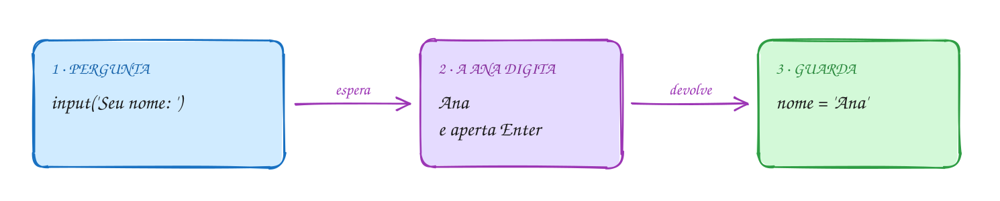

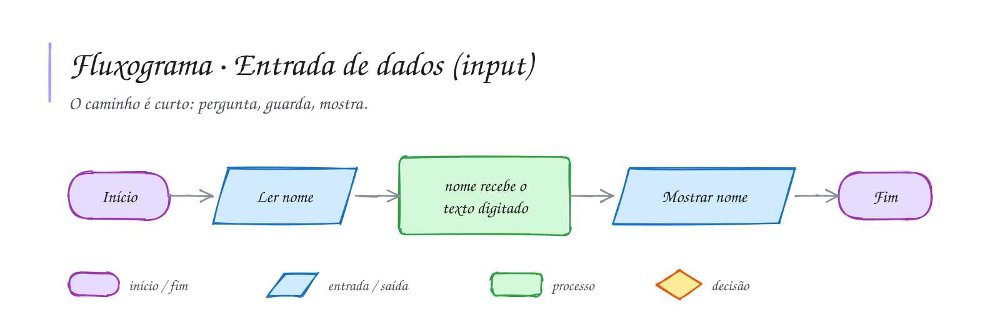

**Pratique:** a pasta [`0001-input/`](0001-input/) tem três exemplos para rodar e dois exercícios com dicas.

```bash
pnpm tsx 15102026/0001-input/exemplo-1.ts
```

## 0002 · Saída de dados (output)

> Se o programa calcula a média e não mostra, calculou para quem?

Saída é o programa mostrando alguma coisa para você. No terminal quem faz isso é
o `console.log`. Tudo que estiver entre os parênteses aparece na tela.

Para misturar texto com valores existe a **template string**. Em vez de aspas
você usa crases (`` ` ``) e coloca o valor dentro de `${ }`. É como um bilhete
com espaço em branco: `Olá, ${nome}!` vira `Olá, Ana!` quando `nome` é `'Ana'`.

A crase fica perto do Enter na maioria dos teclados, às vezes junto com o til.
Ache ela agora: você vai usar muito.

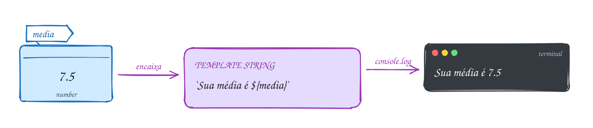

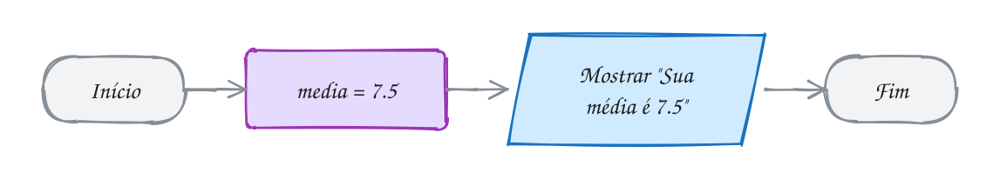

**Pratique:** a pasta [`0002-output/`](0002-output/) tem três exemplos para rodar e dois exercícios com dicas.

```bash
pnpm tsx 15102026/0002-output/exemplo-1.ts
```

## 0003 · Variáveis

> O placar do jogo muda a cada gol. Onde o programa guarda esse número enquanto
> ele vai mudando?

Pense numa caixinha com etiqueta. A etiqueta é o nome, e dentro fica um valor
guardado na memória. Com `let`, dá para tirar o valor e colocar outro quantas
vezes precisar. É assim que o placar sai de 0 para 1 e de 1 para 2.

Para trocar o valor, você escreve só o nome e o novo valor: `gols = 2`. O `let`
aparece uma vez só, quando a caixa é criada.

O TypeScript quer saber o que cabe em cada caixa. Você pode dizer
(`let idade: number = 17`, isso é **anotação de tipo**) ou deixar ele descobrir
pelo valor (`let idade = 17`, isso é **inferência**). Nos dois casos ele não
deixa colocar texto numa caixa de número.

E o `var`? É o jeito antigo, e causa bug difícil de achar. A gente não usa.

Nome de variável vai em `camelCase`: `nomeCompleto`, `notaFinal`, `golsBrasil`.

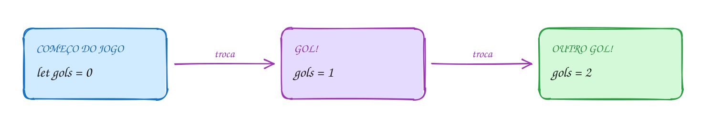

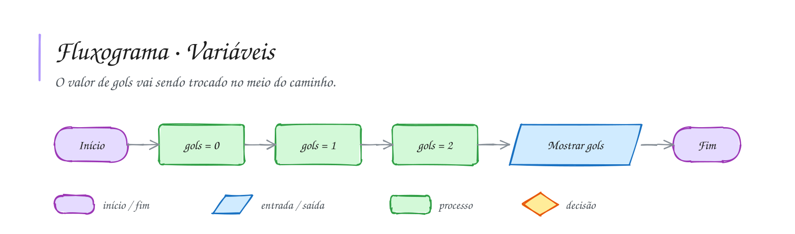

**Pratique:** a pasta [`0003-variaveis/`](0003-variaveis/) tem três exemplos para rodar e dois exercícios com dicas.

```bash
pnpm tsx 15102026/0003-variaveis/exemplo-1.ts
```

## 0004 · Constantes

> O nome da escola não muda no meio da aula. A média para passar também não.
> Como avisar o programa de que um valor é fixo?

Se a variável é uma caixa que troca de conteúdo, a constante é uma caixa
lacrada. Colocou o valor, acabou. Se alguém tentar trocar, o TypeScript avisa na
hora: `Cannot assign to 'NOME_ESCOLA' because it is a constant`.

Parece limitação, mas ajuda. Um valor que não pode mudar é um bug a menos para
caçar. Por isso a regra da turma é: na dúvida, comece com `const`. Se precisar
mudar depois, troque para `let`.

Sobre os nomes:

- valores fixos do programa vão em `UPPER_CASE`: `MEDIA_APROVACAO`,
  `NOME_ESCOLA`, `CIDADE`;
- uma `const` comum, como a resposta de um `input`, continua em `camelCase`:
  `const nome = input('Seu nome: ')`.

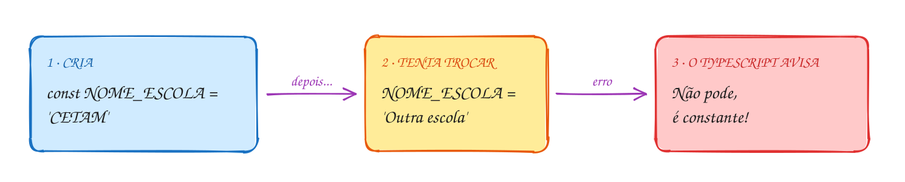

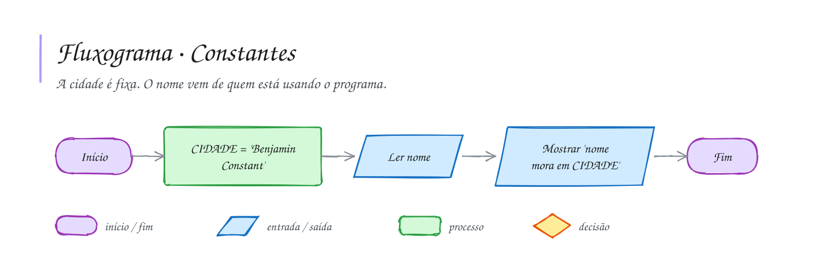

**Pratique:** a pasta [`0004-constantes/`](0004-constantes/) tem três exemplos para rodar e dois exercícios com dicas.

```bash
pnpm tsx 15102026/0004-constantes/exemplo-1.ts
```

## 0005 · Texto (string)

> Seu nome, sua senha do Wi-Fi, a legenda daquela foto no rio. Para o computador
> tudo isso é a mesma coisa: string.

`string` é o tipo para texto. Você escreve entre aspas simples `'...'`, aspas
duplas `"..."` ou crases `` `...` ``. No nosso projeto a gente prefere aspas
simples, e crase quando tem `${}` no meio.

Toda string já vem com ferramentas prontas. Pense num canivete: você não
precisa fabricar a tesoura, é só puxar.

| Uso                 | O que faz                           |
| ------------------- | ----------------------------------- |
| `texto.length`      | quantidade de caracteres            |
| `texto.toUpperCase()` | tudo em MAIÚSCULAS                |
| `texto.toLowerCase()` | tudo em minúsculas                |
| `texto.trim()`      | tira espaços do começo e do fim     |
| `texto.includes('x')` | `true` se o texto contém `'x'`    |
| `texto.split(' ')`  | quebra o texto em pedaços           |

Cuidado: com texto, o `+` não soma, ele cola. `'5' + 3` vira `'53'`.


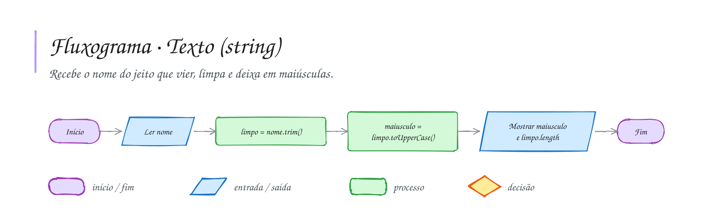

**Pratique:** a pasta [`0005-texto/`](0005-texto/) tem três exemplos para rodar e dois exercícios com dicas.

```bash
pnpm tsx 15102026/0005-texto/exemplo-1.ts
```

## 0006 · Número (number)

> Quanto custa o açaí? Quantos km até Tabatinga? Qual sua nota? Tudo isso é
> número.

`number` é o tipo para números. No TypeScript não tem um tipo para inteiro e
outro para decimal: `10`, `-3` e `7.5` são todos `number`.

Três coisas para guardar:

- O decimal usa ponto, igual à calculadora do celular: `7.5`, não `7,5`.
- `toFixed(n)` mostra o número com `n` casas depois do ponto. Bom para dinheiro.
  Ele devolve texto, pronto para mostrar.
- `NaN` quer dizer "Not a Number". Aparece quando você pede uma conta que não
  faz sentido, tipo transformar `'abc'` em número.

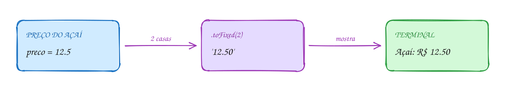

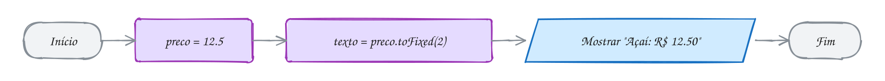

**Pratique:** a pasta [`0006-numero/`](0006-numero/) tem três exemplos para rodar e dois exercícios com dicas.

```bash
pnpm tsx 15102026/0006-numero/exemplo-1.ts
```

## 0007 · Booleano (boolean), typeof, null e undefined

> Está chovendo? Tem aula hoje? O recreio já saiu? Pergunta de sim ou não tem um
> tipo só para ela.

`boolean` é o tipo mais simples que existe: só tem dois valores, `true`
(verdadeiro) e `false` (falso). É um interruptor de luz. Ligado ou desligado,
não tem meio termo.

O `typeof` é o fofoqueiro do programa: você aponta para um valor e ele conta o
tipo, na hora em que o programa está rodando.

E tem dois valores especiais que querem dizer "nada":

- `undefined`: a caixa existe, mas ninguém colocou nada nela ainda. É a cadeira
  reservada de um aluno que ainda não chegou.
- `null`: alguém colocou "nada" de propósito. É o aluno avisando "pode marcar
  que eu não vou".

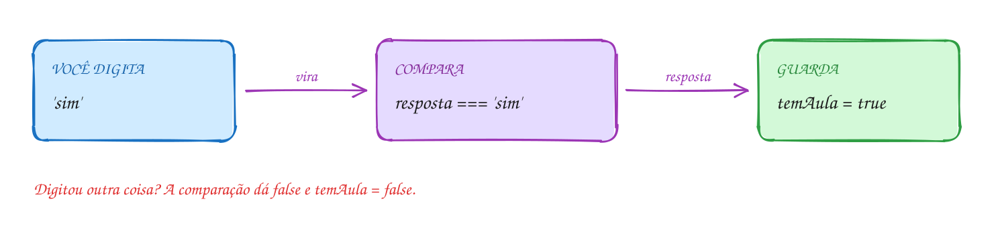

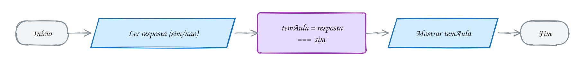

**Pratique:** a pasta [`0007-booleano/`](0007-booleano/) tem três exemplos para rodar e dois exercícios com dicas.

```bash
pnpm tsx 15102026/0007-booleano/exemplo-1.ts
```

## 0008 · Conversão de tipos

> Você digitou 17, pediu para somar 1 e o programa respondeu 171. Hoje a gente
> resolve isso de vez.

Lembra que o `input` sempre devolve texto? Para fazer conta, primeiro a gente
transforma esse texto em número. É como trocar real por peso na fronteira: o
dinheiro é o mesmo, mas agora dá para usar do outro lado.

| Função          | O que faz                                    |
| --------------- | -------------------------------------------- |
| `Number('7.5')` | texto para número (aceita decimais)          |
| `parseInt('7')` | texto para número inteiro (corta o decimal)  |
| `parseFloat('7.5')` | texto para número decimal                |
| `String(10)`    | número para texto                            |

Se a conversão não dá certo, o resultado é `NaN`. Na prática você vai usar muito
`Number(input('...'))`, tudo numa linha.

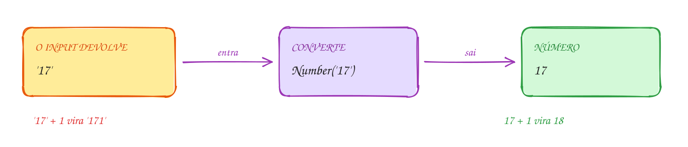

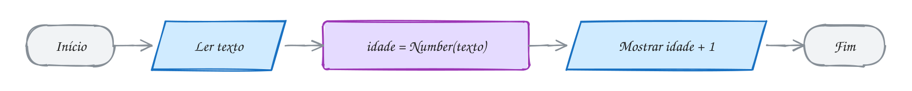

**Pratique:** a pasta [`0008-conversao/`](0008-conversao/) tem três exemplos para rodar e dois exercícios com dicas.

```bash
pnpm tsx 15102026/0008-conversao/exemplo-1.ts
```

## 0009 · Operadores de atribuição

> Você tem 100 reais de crédito no celular. Gastou 30 no pacote de dados e
> ganhou 50 de recarga. Quanto ficou? O programa precisa ir atualizando esse
> valor a cada movimento.

Quem guarda o valor na variável é o `=`. Ele não pergunta nada, ele manda: "a
partir de agora, `saldo` vale 100". Perguntar se dois valores são iguais é
trabalho do `===`, que fica para a pasta `0013`.

Muitas vezes o novo valor depende do valor antigo. Escrever `saldo = saldo + 50`
funciona, mas cansa. Por isso existe o atalho: `saldo += 50`. Lê assim: "pega o
que já tem e soma 50".

| Escrito    | É o mesmo que   |
| ---------- | --------------- |
| `x += 5`   | `x = x + 5`     |
| `x -= 5`   | `x = x - 5`     |
| `x *= 2`   | `x = x * 2`     |
| `x /= 2`   | `x = x / 2`     |
| `x %= 3`   | `x = x % 3`     |
| `x++`      | `x = x + 1`     |
| `x--`      | `x = x - 1`     |

O `x++` aparece muito sozinho na linha, contando coisas: um aluno a mais, um
gol a mais.


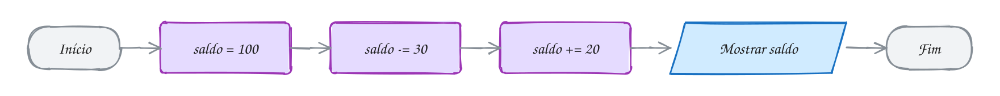

**Pratique:** a pasta [`0009-atribuicao/`](0009-atribuicao/) tem três exemplos para rodar e dois exercícios com dicas.

```bash
pnpm tsx 15102026/0009-atribuicao/exemplo-1.ts
```

## 0010 · Operadores aritméticos

> Três amigos dividiram um açaí de 25 reais. Quanto cada um paga? E quanto sobra
> se ninguém tiver moeda? São duas contas, e cada uma tem seu operador.

São as contas da escola, com dois símbolos novos. A multiplicação é `*` (o `x`
não serve, o computador acharia que é uma variável) e a divisão é `/`.

| Operador | Conta          | Exemplo  | Resultado |
| -------- | -------------- | -------- | --------- |
| `+`      | soma           | `7 + 2`  | `9`       |
| `-`      | subtração      | `7 - 2`  | `5`       |
| `*`      | multiplicação  | `7 * 2`  | `14`      |
| `/`      | divisão        | `7 / 2`  | `3.5`     |
| `%`      | resto          | `7 % 2`  | `1`       |
| `**`     | potência       | `7 ** 2` | `49`      |

O `%` não tem nada a ver com porcentagem. Ele devolve o resto da divisão: 7
alunos em duplas formam 3 duplas e sobra 1, então `7 % 2` é `1`.

A ordem é a da matemática: primeiro `**`, depois `*`, `/` e `%`, por último `+`
e `-`. Quer outra ordem? Coloque parênteses.

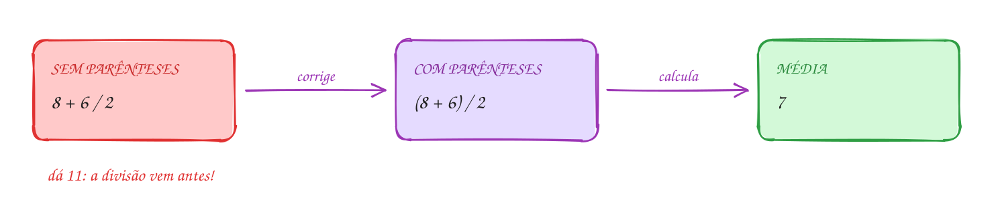

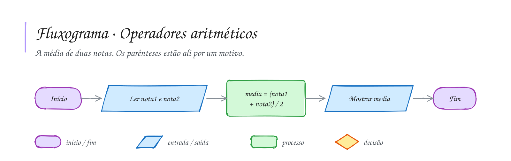

**Pratique:** a pasta [`0010-aritmetica/`](0010-aritmetica/) tem três exemplos para rodar e dois exercícios com dicas.

```bash
pnpm tsx 15102026/0010-aritmetica/exemplo-1.ts
```

## 0011 · Objeto Math

> A van da excursão leva 15 pessoas e a turma tem 32. Quantas vans? Se você
> respondeu 2,13 vans, o motorista vai querer conversar com você.

`Math` é uma caixa de ferramentas que já vem pronta no TypeScript. Não precisa
instalar nem importar nada: escreve `Math.` e o editor mostra tudo o que tem lá
dentro.

| Função              | O que faz                       | Exemplo               |
| ------------------- | ------------------------------- | --------------------- |
| `Math.round(x)`     | arredonda para o mais próximo   | `Math.round(4.6)` → 5 |
| `Math.floor(x)`     | arredonda para baixo            | `Math.floor(4.9)` → 4 |
| `Math.ceil(x)`      | arredonda para cima             | `Math.ceil(4.1)` → 5  |
| `Math.max(a, b)`    | o maior valor                   | `Math.max(3, 9)` → 9  |
| `Math.min(a, b)`    | o menor valor                   | `Math.min(3, 9)` → 3  |
| `Math.random()`     | número sorteado entre 0 e 1     | `0.7312...`           |

Para lembrar: floor é "chão" em inglês, então vai para baixo. Ceil vem de
ceiling, "teto", então vai para cima. No caso da van, `Math.ceil(32 / 15)` dá 3,
porque ninguém fica para trás.

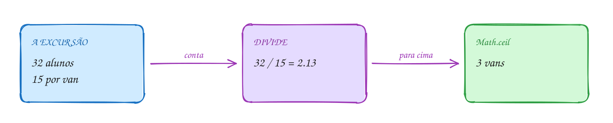

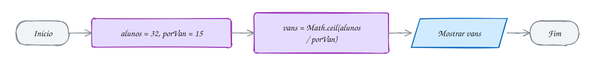

**Pratique:** a pasta [`0011-math/`](0011-math/) tem três exemplos para rodar e dois exercícios com dicas.

```bash
pnpm tsx 15102026/0011-math/exemplo-1.ts
```

## 0012 · Operadores relacionais

> Na entrada do show tem um segurança que faz uma pergunta só: "tem 18 anos ou
> mais?". A resposta é sim ou não. No código, quem faz essa pergunta é o `>=`.

Operador relacional compara dois valores e responde com um `boolean`: `true`
(verdade) ou `false` (mentira). Ele não faz conta, ele julga.

| Operador | Pergunta               | Exemplo   | Resultado |
| -------- | ---------------------- | --------- | --------- |
| `>`      | é maior que?           | `8 > 5`   | `true`    |
| `<`      | é menor que?           | `8 < 5`   | `false`   |
| `>=`     | é maior ou igual a?    | `6 >= 6`  | `true`    |
| `<=`     | é menor ou igual a?    | `4 <= 3`  | `false`   |

Truque para não confundir `>` com `<`: a boca aberta fica virada para o maior,
como um jacaré que quer comer o número grande.

A pergunta "é igual?" (`===`) e "é diferente?" (`!==`) mora na próxima pasta,
`0013-comparacao`.

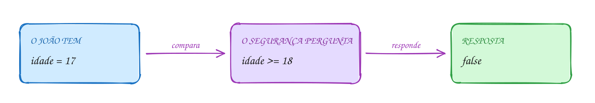

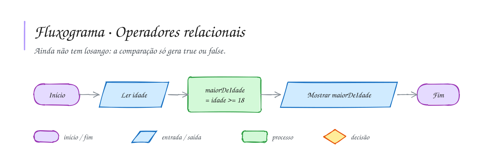

**Pratique:** a pasta [`0012-relacional/`](0012-relacional/) tem três exemplos para rodar e dois exercícios com dicas.

```bash
pnpm tsx 15102026/0012-relacional/exemplo-1.ts
```

## 0013 · Comparação de igualdade

> Você digita a senha do Wi-Fi da escola e o celular diz "senha incorreta".
> Faltou uma letra maiúscula. Para o computador, "Cetam" e "cetam" são coisas
> diferentes.

Para perguntar se dois valores são iguais ou diferentes usamos dois operadores:

| Operador | Pergunta          | Exemplo        | Resultado |
| -------- | ----------------- | -------------- | --------- |
| `===`    | é igual?          | `5 === 5`      | `true`    |
| `!==`    | é diferente?      | `5 !== 5`      | `false`   |

Por que três sinais? Existe o `==`, que converte os tipos antes de comparar: no
JavaScript, `5 == '5'` dá `true` e o erro passa batido. O `===` compara valor e
tipo, então `5 === '5'` dá `false`. Aqui é sempre `===` e `!==`.

Para não misturar:

- `=` guarda um valor ("a nota agora é 7")
- `===` pergunta ("a nota é 7?")

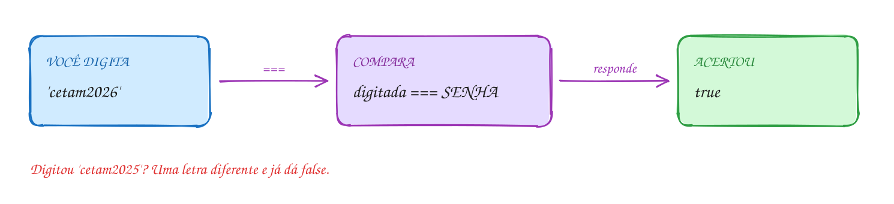

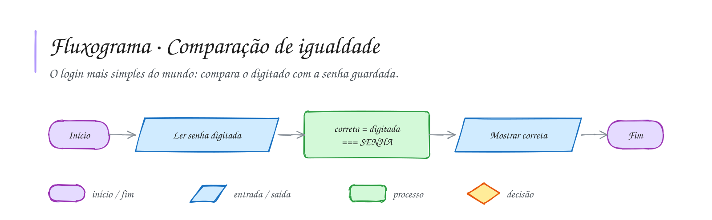

**Pratique:** a pasta [`0013-comparacao/`](0013-comparacao/) tem três exemplos para rodar e dois exercícios com dicas.

```bash
pnpm tsx 15102026/0013-comparacao/exemplo-1.ts
```

## 0014 · Operadores lógicos

> Para passar de ano não basta tirar nota boa. Também precisa ter frequência.
> Uma coisa E a outra. No código, esse E se escreve `&&`.

Os relacionais respondem uma pergunta de cada vez. Os lógicos juntam várias
respostas numa só, ou invertem uma resposta.

| Operador | Nome | Dá `true` quando...                  |
| -------- | ---- | ------------------------------------ |
| `&&`     | E    | os **dois** lados são `true`         |
| `\|\|`   | OU   | **pelo menos um** lado é `true`      |
| `!`      | NÃO  | inverte: `!true` é `false`           |

A mãe diz: "só sai se arrumar o quarto E lavar a louça". Precisa dos dois: é o
`&&`. A avó diz: "sai se arrumar o quarto OU lavar a louça". Basta um: é o `||`.
E o `!` é o irmão do contra, que sempre diz o oposto.

A tabela verdade mostra todas as combinações possíveis:

| A       | B       | A && B  | A \|\| B |
| ------- | ------- | ------- | -------- |
| `true`  | `true`  | `true`  | `true`   |
| `true`  | `false` | `false` | `true`   |
| `false` | `true`  | `false` | `true`   |
| `false` | `false` | `false` | `false`  |

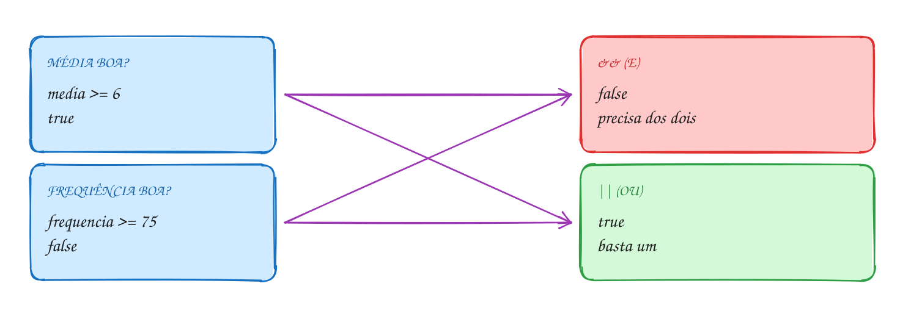

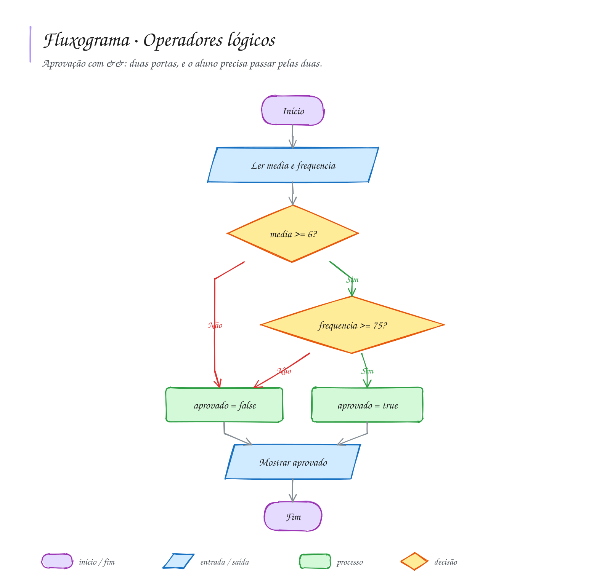

**Pratique:** a pasta [`0014-logico/`](0014-logico/) tem três exemplos para rodar e dois exercícios com dicas.

```bash
pnpm tsx 15102026/0014-logico/exemplo-1.ts
```

## 0015 · Truthy, falsy, ?? e ?.

> O aluno apertou Enter sem digitar o apelido. E agora, o programa chama ele de
> quê?

Num `if`, o TypeScript espera `true` ou `false`. Mas você pode colocar qualquer
valor ali, e ele vai "achar" se aquilo conta como verdadeiro ou falso. É o
fiscal do porto olhando a mochila: vazia, ele nem abre; com alguma coisa dentro,
ele para e confere.

Os valores que contam como falso são poucos e dá para decorar. São os **falsy**:
`false`, `0`, `''` (texto vazio), `null`, `undefined` e `NaN`. Todo o resto é
**truthy**: `'oi'`, `5`, `-1`, até `' '` (um espaço).

E quando a variável pode nem ter valor? Para isso existem dois operadores:

- `??` coloca um valor padrão quando a variável é `null` ou `undefined`.
- `?.` só acessa a propriedade se a variável existir. Se não existir, devolve
  `undefined` em vez de quebrar o programa.

No TypeScript, `string | undefined` quer dizer "pode ser texto, pode não ter
nada ainda".


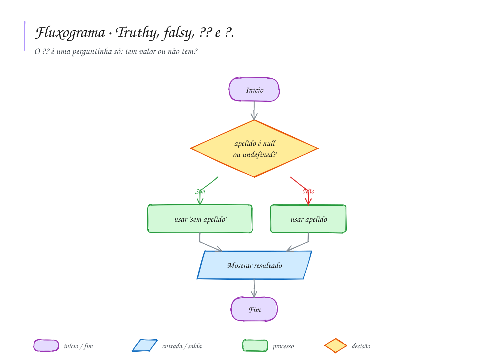

**Pratique:** a pasta [`0015-truthy-falsy/`](0015-truthy-falsy/) tem três exemplos para rodar e dois exercícios com dicas.

```bash
pnpm tsx 15102026/0015-truthy-falsy/exemplo-1.ts
```

## 0016 · Condicional simples (if)

> Você só leva o guarda-chuva se o céu estiver feio. Sol? Sai de mãos vazias.
> Seu programa também pode pensar assim.

Até agora todo programa rodava linha por linha, do começo ao fim, sem pular
nada. Com o `if` (se), ele passa a tomar decisões.

O bloco entre `{ }` só roda se a condição for verdadeira. Se for falsa, o
programa pula o bloco e segue a vida. É a catraca do ônibus: cartão válido,
passa; cartão sem saldo, nada acontece e a fila continua.

```ts
if (condição) {
  // só roda se a condição for true
}
```


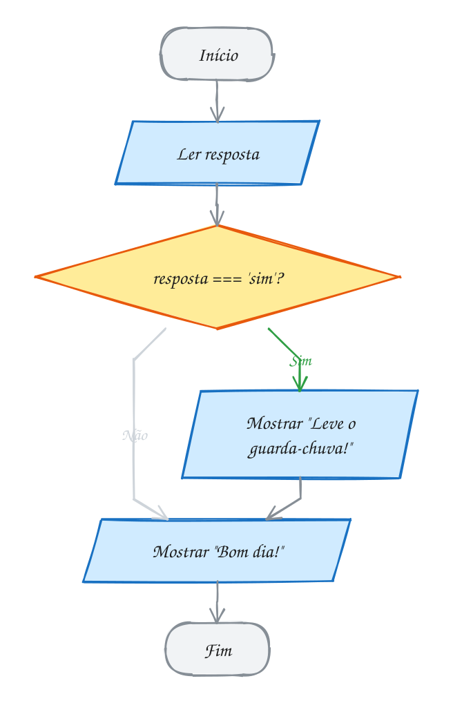

**Pratique:** a pasta [`0016-condicional-simples/`](0016-condicional-simples/) tem três exemplos para rodar e dois exercícios com dicas.

```bash
pnpm tsx 15102026/0016-condicional-simples/exemplo-1.ts
```

## 0017 · Condicional composta (if / else)

> Ou o recreio sai às 6h para Tabatinga e você está no porto, ou você fica.
> Não tem meio-termo.

O `if` sozinho só sabe fazer uma coisa extra quando a condição é verdadeira.
Com o `else` (senão), o programa ganha um plano B.

Pense numa encruzilhada: ou vai pela esquerda, ou pela direita. Sempre um dos
dois caminhos roda. Nunca os dois juntos, nunca nenhum.

```ts
if (condição) {
  // condição true
} else {
  // condição false
}
```

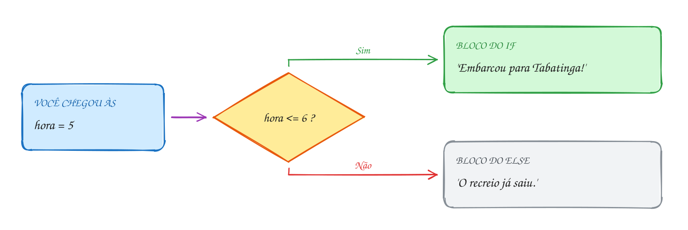

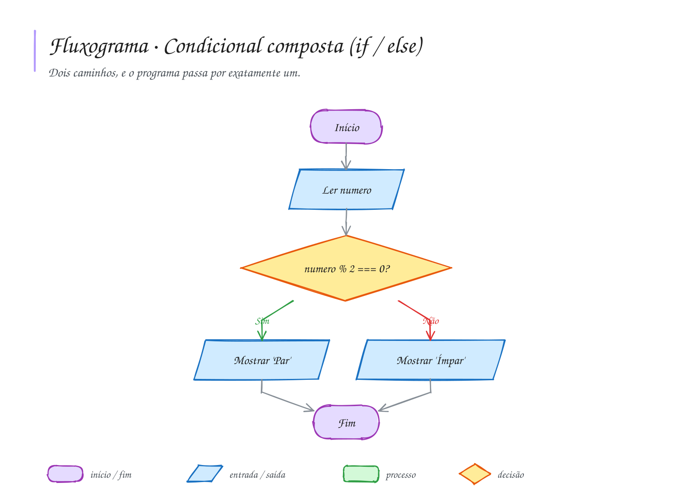

**Pratique:** a pasta [`0017-condicional-composta/`](0017-condicional-composta/) tem três exemplos para rodar e dois exercícios com dicas.

```bash
pnpm tsx 15102026/0017-condicional-composta/exemplo-1.ts
```

## 0018 · Condicional aninhada (else if e if dentro de if)

> No boletim não existe só "passou" ou "não passou". Tem a tal da recuperação no
> meio. Como o programa lida com três saídas?

Quando tem mais de dois caminhos, entra o `else if` (senão se). O programa testa
as condições de cima para baixo e para na primeira que for verdadeira. O `else`
do final pega quem sobrou.

É fila de cantina com placa: "lanche natural, lado esquerdo; salgado, no meio;
o resto, no caixa". Você entra na primeira placa que serve para você e não olha
as outras.

Também dá para colocar um `if` dentro de outro, quando uma pergunta só importa
depois da primeira. Não adianta perguntar se tem habilitação para quem tem 12
anos.


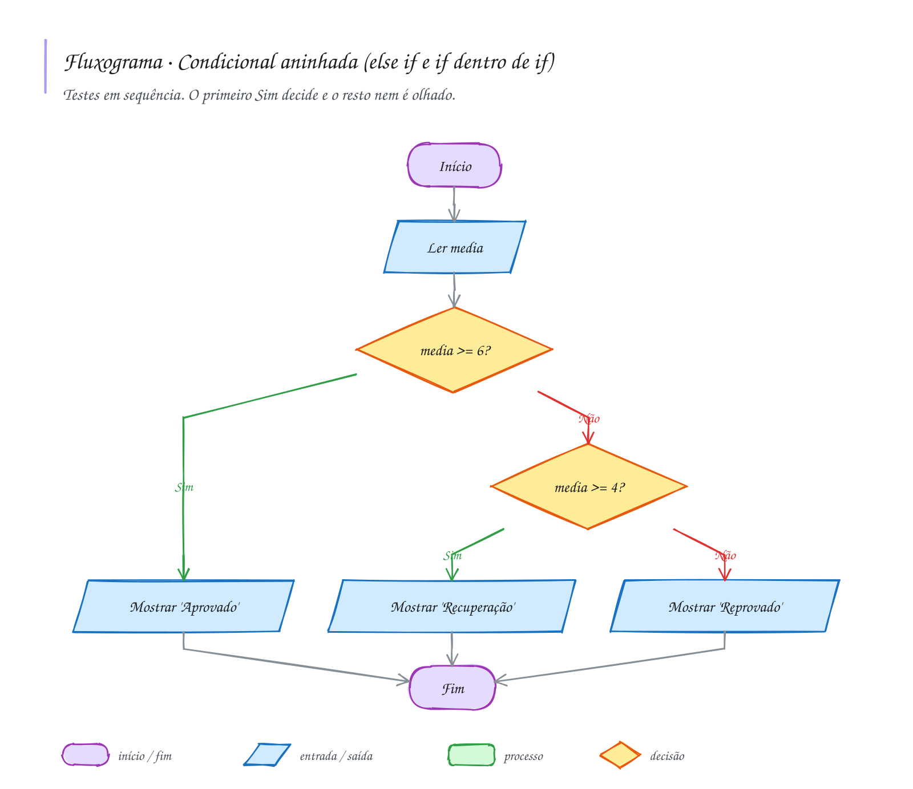

**Pratique:** a pasta [`0018-condicional-aninhada/`](0018-condicional-aninhada/) tem três exemplos para rodar e dois exercícios com dicas.

```bash
pnpm tsx 15102026/0018-condicional-aninhada/exemplo-1.ts
```

## 0019 · Operador ternário

> Dá para escrever um if/else inteiro numa linha só? Dá. E às vezes até fica
> mais bonito.

O ternário é o if/else de bolso. Ele faz uma pergunta e devolve um de dois
valores:

```ts
condição ? valorSeVerdadeiro : valorSeFalso
```

Lê assim: "a condição é verdadeira? então isso, senão aquilo". Como o ternário
vira um valor, dá para guardar numa variável ou colocar direto numa template
string.

Serve para escolhas pequenas: singular ou plural, par ou ímpar, aprovado ou
reprovado. Se a decisão tem várias etapas, volte para o `if`.

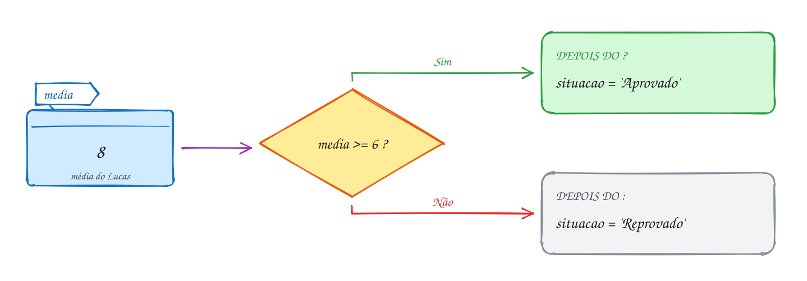

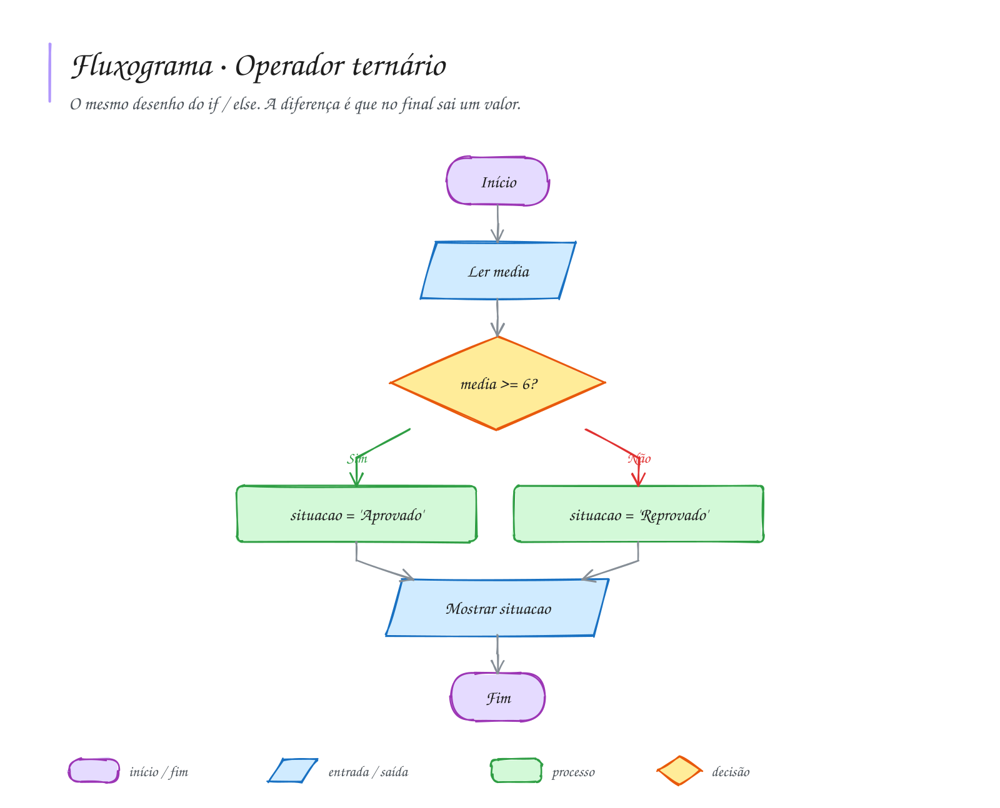

**Pratique:** a pasta [`0019-ternario/`](0019-ternario/) tem três exemplos para rodar e dois exercícios com dicas.

```bash
pnpm tsx 15102026/0019-ternario/exemplo-1.ts
```

## 0020 · Estrutura de escolha (switch)

> Caixa eletrônico: "digite 1 para saldo, 2 para depósito, 3 para sair". Quem
> programou isso provavelmente usou um `switch`.

O `switch` pega um valor e compara com uma lista de opções. Achou uma igual (com
`===`), roda o que está ali. É o cardápio da lanchonete: você fala o número do
combo e a atendente já sabe o que montar.

- `case`: uma opção do cardápio.
- `break`: "pronto, pedido feito". Sem ele, o programa continua descendo e
  executa os próximos `case` também.
- `default`: quando nenhuma opção bateu. Faz o papel do `else`.

Use `switch` quando a pergunta é "qual destes valores?". Para faixas (maior que,
menor que), o `if` / `else if` continua sendo o certo.

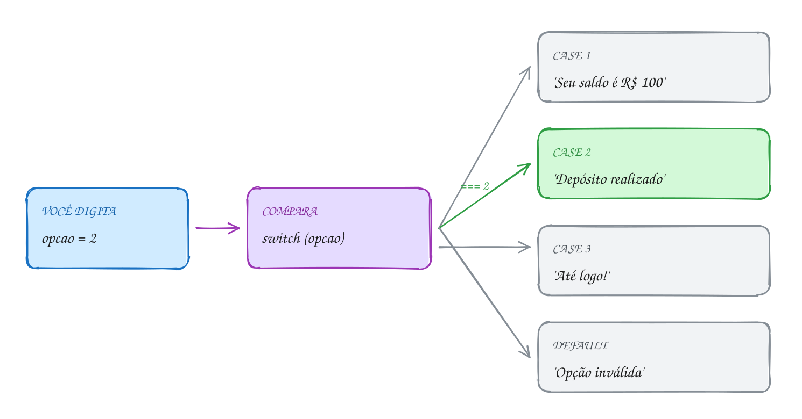

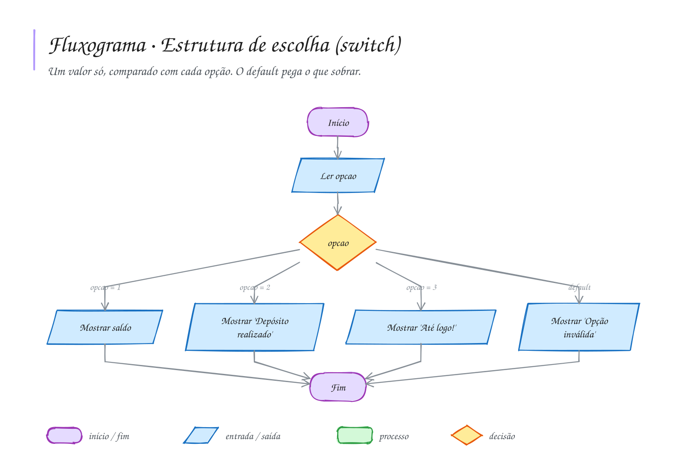

**Pratique:** a pasta [`0020-escolha/`](0020-escolha/) tem três exemplos para rodar e dois exercícios com dicas.

```bash
pnpm tsx 15102026/0020-escolha/exemplo-1.ts
```

## Para ler mais

- FORBELLONE, A. L. V.; EBERSPÄCHER, H. F. *Lógica de programação: a construção de algoritmos e estruturas de dados*. 3. ed. São Paulo: Pearson Prentice Hall, 2005.
- ISO 5807:1985. *Information processing: documentation symbols and conventions for data, program and system flowcharts, program network charts and system resources charts*. Genebra: ISO, 1985.
- MANZANO, J. A. N. G.; OLIVEIRA, J. F. *Algoritmos: lógica para desenvolvimento de programação de computadores*. São Paulo: Érica.
- HAVERBEKE, M. *Eloquent JavaScript*. 3. ed. San Francisco: No Starch Press, 2018. Disponível em: <https://eloquentjavascript.net>.
- MDN WEB DOCS. *Template strings*. Disponível em: <https://developer.mozilla.org/pt-BR/docs/Web/JavaScript/Reference/Template_literals>.
- MICROSOFT. *TypeScript Handbook*: Everyday Types. Disponível em: <https://www.typescriptlang.org/docs/handbook/2/everyday-types.html>.
- MDN WEB DOCS. *let*. Disponível em: <https://developer.mozilla.org/pt-BR/docs/Web/JavaScript/Reference/Statements/let>.
- MDN WEB DOCS. *const*. Disponível em: <https://developer.mozilla.org/pt-BR/docs/Web/JavaScript/Reference/Statements/const>.
- GOOGLE. *Google JavaScript Style Guide*. Disponível em: <https://google.github.io/styleguide/jsguide.html>.
- ECMA INTERNATIONAL. *ECMA-262: ECMAScript language specification*. Disponível em: <https://tc39.es/ecma262/>.
- MDN WEB DOCS. *String*. Disponível em: <https://developer.mozilla.org/pt-BR/docs/Web/JavaScript/Reference/Global_Objects/String>.
- GOLDBERG, D. What every computer scientist should know about floating-point arithmetic. *ACM Computing Surveys*, v. 23, n. 1, p. 5-48, 1991.
- IEEE. *IEEE standard for floating-point arithmetic*: IEEE 754-2019. New York: IEEE, 2019.
- MDN WEB DOCS. *Number*. Disponível em: <https://developer.mozilla.org/pt-BR/docs/Web/JavaScript/Reference/Global_Objects/Number>.
- BOOLE, G. *An investigation of the laws of thought*. London: Walton and Maberly, 1854.
- HOARE, T. *Null references: the billion dollar mistake*. Palestra na QCon London, 2009.
- MICROSOFT. *TypeScript Handbook*: The Basics. Disponível em: <https://www.typescriptlang.org/docs/handbook/2/basic-types.html>.
- MDN WEB DOCS. *parseInt()*. Disponível em: <https://developer.mozilla.org/pt-BR/docs/Web/JavaScript/Reference/Global_Objects/parseInt>.
- MDN WEB DOCS. *Expressões e operadores*. Disponível em: <https://developer.mozilla.org/pt-BR/docs/Web/JavaScript/Guide/Expressions_and_operators>.
- ASCENCIO, A. F. G.; CAMPOS, E. A. V. *Fundamentos da programação de computadores: algoritmos, Pascal, C/C++ e Java*. 3. ed. São Paulo: Pearson, 2012.
- MDN WEB DOCS. *Precedência de operadores*. Disponível em: <https://developer.mozilla.org/pt-BR/docs/Web/JavaScript/Reference/Operators/Operator_precedence>.
- KNUTH, D. E. *The art of computer programming*, v. 2: Seminumerical algorithms. 3. ed. Reading: Addison-Wesley, 1997.
- MDN WEB DOCS. *Math*. Disponível em: <https://developer.mozilla.org/pt-BR/docs/Web/JavaScript/Reference/Global_Objects/Math>.
- MDN WEB DOCS. *Expressões e operadores: operadores de comparação*. Disponível em: <https://developer.mozilla.org/pt-BR/docs/Web/JavaScript/Guide/Expressions_and_operators>.
- CROCKFORD, D. *JavaScript: the good parts*. Sebastopol: O'Reilly, 2008.
- MDN WEB DOCS. *Comparações de igualdade e uniformidade*. Disponível em: <https://developer.mozilla.org/pt-BR/docs/Web/JavaScript/Equality_comparisons_and_sameness>.
- MDN WEB DOCS. *Operador AND lógico (&&)*. Disponível em: <https://developer.mozilla.org/pt-BR/docs/Web/JavaScript/Reference/Operators/Logical_AND>.
- MDN WEB DOCS. *Falsy*. Disponível em: <https://developer.mozilla.org/pt-BR/docs/Glossary/Falsy>.
- MDN WEB DOCS. *Operador de coalescência nula (??)*. Disponível em: <https://developer.mozilla.org/pt-BR/docs/Web/JavaScript/Reference/Operators/Nullish_coalescing>.
- MICROSOFT. *TypeScript Handbook*: Narrowing. Disponível em: <https://www.typescriptlang.org/docs/handbook/2/narrowing.html>.
- BÖHM, C.; JACOPINI, G. Flow diagrams, Turing machines and languages with only two formation rules. *Communications of the ACM*, v. 9, n. 5, p. 366-371, 1966.
- DIJKSTRA, E. W. Go to statement considered harmful. *Communications of the ACM*, v. 11, n. 3, p. 147-148, 1968.
- MDN WEB DOCS. *if...else*. Disponível em: <https://developer.mozilla.org/pt-BR/docs/Web/JavaScript/Reference/Statements/if...else>.
- KERNIGHAN, B. W.; RITCHIE, D. M. *The C programming language*. 2. ed. Englewood Cliffs: Prentice Hall, 1988.
- MDN WEB DOCS. *Operador condicional (ternário)*. Disponível em: <https://developer.mozilla.org/pt-BR/docs/Web/JavaScript/Reference/Operators/Conditional_operator>.
- MDN WEB DOCS. *switch*. Disponível em: <https://developer.mozilla.org/pt-BR/docs/Web/JavaScript/Reference/Statements/switch>.
- MICROSOFT. *TypeScript Handbook*: TSConfig noFallthroughCasesInSwitch. Disponível em: <https://www.typescriptlang.org/tsconfig#noFallthroughCasesInSwitch>.
