<!-- Gerado por _gerador. Para mudar este arquivo, edite _gerador/aulas/16102026/ e rode: cd _gerador && npm run gerar -->

# Aula 02 · 16/10 · Revisão de lógica II

Até agora, cada linha do programa rodou uma vez só, e cada variável guardou um
valor só. Hoje isso muda.

## O que você vai aprender

- repetir um trecho de código com **laços** (`while`, `do...while`, `for`, `break` e `continue`)
- guardar vários valores numa etiqueta só com **arrays**, percorrer com `for...of`, colocar e tirar itens
- dar nome a um pedaço de código com **funções**, para usar de novo
- escrever funções curtas com **arrow functions** e passar uma função para outra (**callback**)
- consultar, transformar e organizar listas com os **métodos de array**

## Como a gente vai estudar cada assunto

1. Primeiro, o texto e o **diagrama da ideia**: é o exemplo desenhado.
2. Depois, o código. Repara que é o mesmo exemplo, com os mesmos valores.
3. Aí você segue o **fluxograma** com o dedo: é o caminho que o programa faz.
4. Hora de rodar os exemplos da pasta. Mude alguma coisa e rode de novo.
5. Por fim, os exercícios. Travou? As dicas estão no próprio arquivo.

No meio de cada assunto tem uma **Pergunta para a turma**. Tente responder
antes de rodar o código.

Nos laços, o fluxograma ganha uma seta que **volta**: é a repetição.

## As cores e as formas

Caixa azul é dado entrando ou saindo, roxa é o programa fazendo alguma coisa,
amarela é pergunta. Os arrays aparecem como uma fileira
de gavetas com o índice embaixo de cada uma, começando do 0.

<p align="center"></p>

## Antes de começar

> [!IMPORTANT]
> No nosso projeto, `notas[i]` pode ser `undefined`, porque a posição `i` pode
> não existir. Por isso o editor reclama quando você faz conta direto com um
> item do array. Para percorrer arrays, prefira o `for...of` (assunto 0025). O
> porquê está no assunto 0053 da [aula 03](../19102026/README.md).

## Os assuntos

Leia na ordem: cada assunto usa o anterior.

| # | Assunto | Pasta |
| --- | --- | --- |
| [0020](#0020--laço-while) | Laço while | [`0020-while/`](0020-while/) |
| [0021](#0021--laço-dowhile) | Laço do...while | [`0021-do-while/`](0021-do-while/) |
| [0022](#0022--laço-for) | Laço for | [`0022-for/`](0022-for/) |
| [0023](#0023--break-e-continue) | break e continue | [`0023-break-continue/`](0023-break-continue/) |
| [0024](#0024--arrays-vetores) | Arrays (vetores) | [`0024-arrays/`](0024-arrays/) |
| [0025](#0025--laço-forof) | Laço for...of | [`0025-for-of/`](0025-for-of/) |
| [0026](#0026--inserir-e-remover-push-pop-unshift-shift-splice) | Inserir e remover: push, pop, unshift, shift, splice | [`0026-inserir-remover/`](0026-inserir-remover/) |
| [0027](#0027--funções) | Funções | [`0027-funcoes/`](0027-funcoes/) |
| [0028](#0028--parâmetro-opcional-valor-padrão-e-void) | Parâmetro opcional, valor padrão e void | [`0028-parametros/`](0028-parametros/) |
| [0029](#0029--escopo-de-variáveis) | Escopo de variáveis | [`0029-escopo/`](0029-escopo/) |
| [0030](#0030--arrow-functions-e-callbacks) | Arrow functions e callbacks | [`0030-arrow-callback/`](0030-arrow-callback/) |
| [0031](#0031--consultar-indexof-includes-find-findindex-some-every) | Consultar: indexOf, includes, find, findIndex, some, every | [`0031-consultar/`](0031-consultar/) |
| [0032](#0032--transformar-map-filter-reduce-foreach) | Transformar: map, filter, reduce, forEach | [`0032-transformar/`](0032-transformar/) |
| [0033](#0033--organizar-sort-reverse-slice-join-concat) | Organizar: sort, reverse, slice, join, concat | [`0033-organizar/`](0033-organizar/) |
| [0034](#0034--juntando-tudo-as-notas-da-turma) | Juntando tudo: as notas da turma | [`0034-juntando-tudo/`](0034-juntando-tudo/) |

---

## 0020 · Laço while

Laço é um trecho de código que se **repete**. O primeiro laço da aula é o
`while` (em português, "enquanto").

Ele faz uma pergunta. Se a resposta for `true`, roda o bloco e pergunta de
novo. Quando a resposta vira `false`, o programa segue em frente.

Vamos ver na prática. Você tem R$ 20 no cartão do ônibus e a passagem custa
R$ 4,50. Quantas vezes dá para passar na catraca?

A cada volta, o laço confere se o saldo ainda paga a passagem. Se paga,
desconta R$ 4,50 e conta uma viagem. Na quinta pergunta sobram só R$ 2. A
resposta é `false` e o laço acaba:

<p align="center">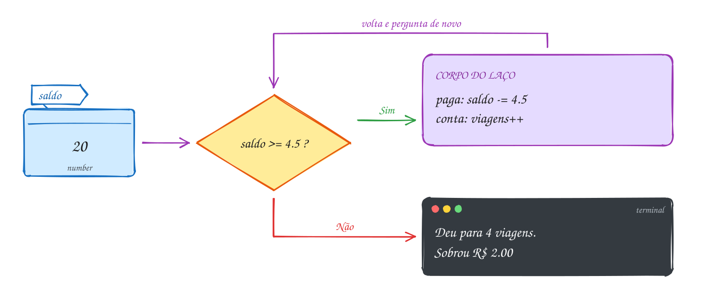</p>

```ts
let saldo = 20
let viagens = 0

while (saldo >= 4.5) {
  saldo -= 4.5 // paga a passagem
  viagens++ // conta mais uma viagem
}

console.log(`Deu para ${viagens} viagens. Sobrou R$ ${saldo.toFixed(2)}`)
// Deu para 4 viagens. Sobrou R$ 2.00
```

Repara no fluxograma: o laço é uma seta que **volta** para o losango. O caminho
dá quatro voltas antes de sair pelo Não:

<p align="center"></p>

> [!WARNING]
> Se nada dentro do bloco mudar a resposta da pergunta, o laço nunca acaba. É o
> famoso **loop infinito**. Esqueceu o `saldo -= 4.5`? O programa fica rodando
> para sempre. Para sair, aperte `Ctrl + C`.

> [!NOTE]
> **Pergunta para a turma:** se a passagem subir para R$ 5, quantas viagens dá
> e quanto sobra? Troque o `4.5` por `5` nas duas linhas e rode.

### Hora de praticar

Os arquivos ficam em [`0020-while/`](0020-while/). Os comandos funcionam de qualquer pasta do terminal. Nos exemplos, rode, mude, quebre e rode de novo. Nos exercícios, a resposta vai dentro do próprio arquivo.

**Exemplo A039 · A notícia que se espalha no grupo**

```ts
let pessoas = 1 // só quem postou sabe
let horas = 0

while (pessoas < 500) {
  pessoas *= 2 // a cada hora, quem sabe conta para mais um
  horas++
}

console.log(`Em ${horas} horas, ${pessoas} pessoas já sabiam`) // Em 9 horas, 512 pessoas já sabiam
```

```bash
tsx ~/LPPOO/16102026/0020-while/A039.ts
```

**Exemplo A040 · Contagem regressiva**

```ts
let segundos = 5

while (segundos > 0) {
  console.log(segundos)
  segundos--
}

console.log('Já!')
```

```bash
tsx ~/LPPOO/16102026/0020-while/A040.ts
```

**Exercício E039**

O cofrinho começa vazio e você guarda R$ 7 por semana. Use um `while` para
descobrir em quantas semanas o cofrinho passa de R$ 100. Mostre as semanas e o
valor final.

<details><summary>Dicas</summary>

1. Comece com `let cofrinho = 0` e `let semanas = 0`.
2. A pergunta do `while` é: o cofrinho ainda não passou de 100?
3. Dentro do laço, some 7 no cofrinho e 1 nas semanas.
4. Resposta esperada: 15 semanas, R$ 105.

</details>

```bash
tsx ~/LPPOO/16102026/0020-while/E039.ts
```

**Exercício E040**

Peça a senha do Wi-Fi com `input` e continue pedindo enquanto a pessoa
errar. A senha certa é `cetam2026`. Quando acertar, mostre "Conectado!".

<details><summary>Dicas</summary>

1. Leia a senha uma vez antes do laço.
2. A pergunta do `while` é: a senha está diferente de `'cetam2026'`?
3. Dentro do laço, peça a senha de novo.

</details>

```bash
tsx ~/LPPOO/16102026/0020-while/E040.ts
```

---

## 0021 · Laço do...while

O professor pede a nota, você digita 15 e ele diz: "de 0 a 10, por favor". Ele
pede pelo menos uma vez. Pedir de novo, só se precisar.

O `do...while` é o `while` de cabeça para baixo: primeiro **faz**, depois
**pergunta**. Por isso o bloco roda pelo menos uma vez.

Ele é ótimo para conferir o que a pessoa digita. Afinal, você só sabe se a
resposta está certa depois de pedir.

Vamos ver na prática. Você digita 15. O programa confere: 15 está fora de 0 a
10? Sim, então pede de novo. Agora você digita 8. Está fora? Não. O laço acaba
e a nota fica guardada:

<p align="center"></p>

```ts
import { input } from '#core/input.ts'

let nota // a caixa nasce vazia: o do pede a nota antes de conferir

do {
  nota = Number(input('Nota (0 a 10): ')) // você digita 15, depois 8
} while (nota < 0 || nota > 10)

console.log(`Nota registrada: ${nota}`) // Nota registrada: 8
```

Repara no fluxograma: o losango vem **depois** da leitura. No `while`, a
pergunta vinha antes:

<p align="center">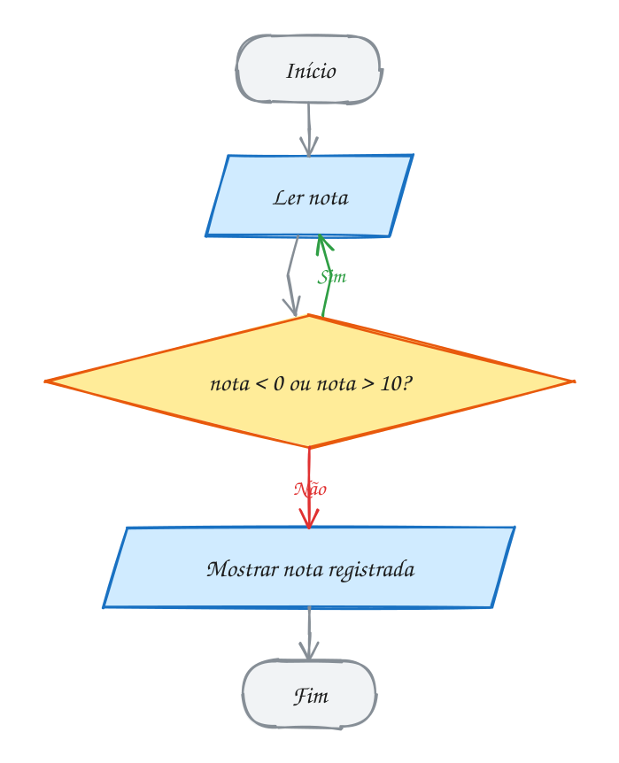</p>

> [!NOTE]
> **Pergunta para a turma:** e se você digitar exatamente `10`? O programa
> aceita ou pede de novo? Rode e confira. (Dica: leia a condição com calma,
> `nota > 10`.)

### Hora de praticar

Os arquivos ficam em [`0021-do-while/`](0021-do-while/). Os comandos funcionam de qualquer pasta do terminal. Nos exemplos, rode, mude, quebre e rode de novo. Nos exercícios, a resposta vai dentro do próprio arquivo.

**Exemplo A041 · Adivinhe o número**

```ts
import { input } from '#core/input.ts'

const segredo = 7
let chute // a caixa nasce vazia: o do pede o chute antes de conferir
let tentativas = 0

do {
  chute = Number(input('Chute de 1 a 10: ')) // digite: 3, depois 7
  tentativas++
} while (chute !== segredo)

console.log(`Acertou em ${tentativas} tentativas!`) // Acertou em 2 tentativas!
```

```bash
tsx ~/LPPOO/16102026/0021-do-while/A041.ts
```

**Exemplo A042 · Senha com do...while**

```ts
import { input } from '#core/input.ts'

let senha // a caixa nasce vazia: o do pede a senha antes de conferir

do {
  senha = input('Senha do Wi-Fi: ')
} while (senha !== 'cetam2026')

console.log('Conectado!')
```

```bash
tsx ~/LPPOO/16102026/0021-do-while/A042.ts
```

**Exercício E041**

Peça a idade da pessoa com `do...while` e só aceite valores de 0 a 120.
Quando a idade for válida, mostre "Idade registrada: X".

<details><summary>Dicas</summary>

1. Crie `let idade` (sem valor) antes do `do`.
2. A pergunta do `while` é a idade inválida: menor que 0 OU maior que 120.
3. Teste digitando 200 primeiro: o programa tem que pedir de novo.

</details>

```bash
tsx ~/LPPOO/16102026/0021-do-while/E041.ts
```

**Exercício E042**

Pergunte "Quer mais um açaí? (s/n)" até a pessoa responder `n`. Conte
quantas vezes ela respondeu `s` e mostre o total no final.

<details><summary>Dicas</summary>

1. Comece um contador em 0 antes do laço.
2. Dentro do `do`, leia a resposta e some 1 no contador se for `'s'`.
3. O laço continua enquanto a resposta for diferente de `'n'`.

</details>

```bash
tsx ~/LPPOO/16102026/0021-do-while/E042.ts
```

---

## 0022 · Laço for

A tabuada do 7 tem dez linhas quase iguais. Só um número muda de uma linha
para a outra. Escrever dez `console.log` na mão? Não precisa.

Quando você já sabe **quantas vezes** vai repetir, o `for` é o laço mais
organizado.

Ele junta numa linha só as três coisas que todo laço com contador precisa:

- onde o contador começa;
- até quando repete;
- quanto ele anda a cada volta.

Vamos ver na prática. Na tabuada do 7, o contador `i` começa em 1. O laço roda
enquanto `i <= 10`. Depois de cada linha mostrada, `i` anda mais um. Quando
`i` chega a 11, a pergunta dá `false` e o laço acaba:

<p align="center"></p>

```ts
const numero = 7

for (let i = 1; i <= 10; i++) {
  console.log(`${numero} x ${i} = ${numero * i}`)
}
// 7 x 1 = 7
// 7 x 2 = 14
// ...
// 7 x 10 = 70
```

Olha só: o fluxograma é o mesmo de um `while`. O `for` só deixa as três partes
juntas, num lugar que dá para ler de uma vez:

<p align="center"></p>

O nome `i` é tradição (vem de *índice*), mas pode ser qualquer um. E o passo
não precisa ser `i++`: o `i--`, por exemplo, conta para trás.

> [!NOTE]
> **Pergunta para a turma:** troque o `i++` por `i += 2`. Quais linhas da
> tabuada aparecem agora? Rode e confira.

### Hora de praticar

Os arquivos ficam em [`0022-for/`](0022-for/). Os comandos funcionam de qualquer pasta do terminal. Nos exemplos, rode, mude, quebre e rode de novo. Nos exercícios, a resposta vai dentro do próprio arquivo.

**Exemplo A043 · Voltas na quadra**

```ts
let distancia = 0

for (let volta = 1; volta <= 4; volta++) {
  distancia += 400
  console.log(`Volta ${volta}: ${distancia} m`) // Volta 1: 400 m ... Volta 4: 1600 m
}

console.log('Treino completo!')
```

```bash
tsx ~/LPPOO/16102026/0022-for/A043.ts
```

**Exemplo A044 · Contando para trás**

```ts
for (let i = 10; i >= 0; i--) {
  console.log(i)
}

console.log('Feliz ano novo!')
```

```bash
tsx ~/LPPOO/16102026/0022-for/A044.ts
```

**Exercício E043**

Peça um número com `input` e mostre a tabuada dele, de 1 a 10, usando `for`.

<details><summary>Dicas</summary>

1. Converta o que foi digitado com `Number`.
2. O `for` vai de `i = 1` até `i <= 10`.
3. Monte a linha com template string: `${numero} x ${i} = ${numero * i}`.

</details>

```bash
tsx ~/LPPOO/16102026/0022-for/E043.ts
```

**Exercício E044**

Mostre todos os números pares de 0 a 20 usando um `for` que anda de dois em
dois.

<details><summary>Dicas</summary>

1. Comece em `let i = 0`.
2. Troque o `i++` por `i += 2`.
3. A condição é `i <= 20`.

</details>

```bash
tsx ~/LPPOO/16102026/0022-for/E044.ts
```

---

## 0023 · break e continue

Pensa em você procurando a chave na mochila. Achou? Para de procurar. Pegou um
caderno? Deixa de lado e olha o próximo item.

Dentro de um laço, você também pode fazer isso:

- `continue` pula **o resto desta volta** e vai direto para a próxima;
- `break` **para o laço inteiro** na hora, mesmo que a condição ainda seja
  `true`.

Vamos ver na prática. O laço abaixo conta de 1 a 10. Número par? `continue`:
pula sem mostrar. Passou de 7? `break`: acabou. No fim, só aparecem 1, 3, 5 e
7:

<p align="center"></p>

```ts
for (let i = 1; i <= 10; i++) {
  if (i % 2 === 0) continue // par: pula para a próxima volta
  if (i > 7) break // passou de 7: para tudo
  console.log(i)
}
// 1, 3, 5, 7
```

Quando o bloco do `if` tem uma linha só, dá para tirar as `{ }` e escrever
tudo na mesma linha, como aqui.

Repara no fluxograma: o `continue` é um atalho de volta para o `i++`. O `break`
é uma saída direto para o fim:

<p align="center"></p>

Use com moderação: um laço cheio de `break` e `continue` fica difícil de
seguir.

> [!NOTE]
> **Pergunta para a turma:** troque o `i > 7` por `i > 4`. Quais números
> aparecem agora? Rode e confira.

### Hora de praticar

Os arquivos ficam em [`0023-break-continue/`](0023-break-continue/). Os comandos funcionam de qualquer pasta do terminal. Nos exemplos, rode, mude, quebre e rode de novo. Nos exercícios, a resposta vai dentro do próprio arquivo.

**Exemplo A045 · O ônibus até a escola**

```ts
for (let parada = 1; parada <= 10; parada++) {
  if (parada === 3) continue // parada em obra: o ônibus passa direto
  console.log(`Parada ${parada}`) // 1, 2, 4, 5, 6
  if (parada === 6) {
    console.log('Desci na escola!')
    break // não precisa ir até a 10
  }
}
```

```bash
tsx ~/LPPOO/16102026/0023-break-continue/A045.ts
```

**Exemplo A046 · O primeiro múltiplo de 7 depois de 50**

```ts
for (let i = 51; i <= 100; i++) {
  if (i % 7 === 0) {
    console.log(`Achei: ${i}`) // 56
    break
  }
}
```

```bash
tsx ~/LPPOO/16102026/0023-break-continue/A046.ts
```

**Exercício E045**

Mostre os números de 1 a 30, pulando os múltiplos de 3. Use `continue`.

<details><summary>Dicas</summary>

1. Um número é múltiplo de 3 quando `i % 3 === 0`.
2. O `continue` vem antes do `console.log`.

</details>

```bash
tsx ~/LPPOO/16102026/0023-break-continue/E045.ts
```

**Exercício E046**

Peça nomes com `input` dentro de um `while (true)`. Quando a pessoa digitar
`fim`, pare o laço com `break`. No final, mostre quantos nomes foram digitados.

<details><summary>Dicas</summary>

1. Leia o nome dentro do laço.
2. Confira o `'fim'` antes de contar o nome.
3. O contador fica fora do laço, para sobreviver depois dele.

</details>

```bash
tsx ~/LPPOO/16102026/0023-break-continue/E046.ts
```

---

## 0024 · Arrays (vetores)

Pensa na chamada da turma. É uma lista, e cada aluno tem um número. Um array é
isso: vários valores guardados com um nome só.

Imagina uma fileira de gavetas com uma etiqueta só. Cada gaveta tem um número,
o **índice**. E guarda isso: a contagem começa em **0**. A primeira gaveta é a
0, a segunda é a 1.

Vamos ver na prática. As notas da turma ficam em `notas`. Para ler uma gaveta,
use o índice entre colchetes: `notas[0]` é 8. Para trocar, atribua:
`notas[1] = 7`. E `notas.length` diz quantas gavetas existem:

<p align="center">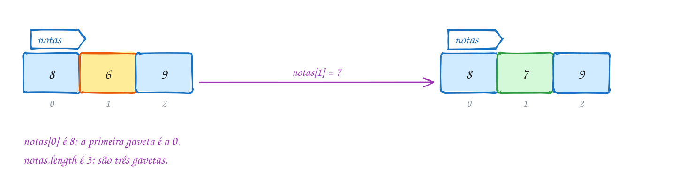</p>

```ts
const notas: number[] = [8, 6, 9]

console.log(notas[0]) // 8: a primeira gaveta é a 0
console.log(notas.length) // 3
notas[1] = 7 // troca o que está na gaveta 1
console.log(notas) // [ 8, 7, 9 ]
```

Repara no tipo escrito depois dos dois-pontos. Lembra dos tipos da
[0007](../15102026/README.md#0007--booleano-boolean-typeof-null-e-undefined)?
Com colchetes no fim, ele vira lista:

- `number[]` lê assim: "lista de números", como `[8, 6, 9]`.
- `string[]` lê assim: "lista de textos", como `['Ana', 'Bia', 'Caio']`.

E olha só: `notas` é `const` e mesmo assim deu para trocar a nota. O `const`
trava a **etiqueta**, não o que tem dentro das gavetas. O fluxograma mostra
esse caminho, passo a passo:

<p align="center">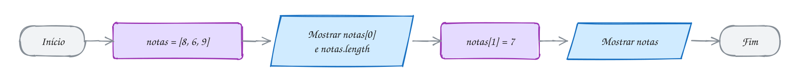</p>

> [!WARNING]
> Ler uma posição que não existe não dá erro: dá `undefined`, a caixa vazia
> que você viu na 0007. Em `[8, 7, 9]`, `notas[5]` é `undefined`. A última
> posição é sempre `notas.length - 1`.

> [!NOTE]
> **Matriz, só como noção:** um array pode guardar outros arrays. Fica uma
> tabela, com linha e coluna.
>
> ```ts
> const sala: string[][] = [
>   ['Ana', 'Bia'], // linha 0
>   ['Caio', 'Davi'], // linha 1
> ]
> console.log(sala[1]) // [ 'Caio', 'Davi' ]: a linha 1 inteira
> ```

> [!NOTE]
> **Pergunta para a turma:** o array `notas` tem 3 gavetas e a última é a
> posição 2. Numa turma de 30 alunos, qual é a posição do último? (Dica: a
> contagem começa em 0.)

### Hora de praticar

Os arquivos ficam em [`0024-arrays/`](0024-arrays/). Os comandos funcionam de qualquer pasta do terminal. Nos exemplos, rode, mude, quebre e rode de novo. Nos exercícios, a resposta vai dentro do próprio arquivo.

**Exemplo A047 · O cardápio da cantina**

```ts
const lanches: string[] = ['tapioca', 'pão com ovo', 'bolo de macaxeira']
const precos: number[] = [5, 4, 3]

console.log(lanches[2]) // bolo de macaxeira
console.log(`Hoje tem ${lanches.length} lanches`) // Hoje tem 3 lanches
precos[2] = 3.5 // o bolo ficou mais caro
console.log(precos) // [ 5, 4, 3.5 ]
```

```bash
tsx ~/LPPOO/16102026/0024-arrays/A047.ts
```

**Exemplo A048 · A primeira e a última posição**

```ts
const cidades: string[] = ['Benjamin Constant', 'Tabatinga', 'Atalaia do Norte']

console.log(`Primeira: ${cidades[0]}`)
console.log(`Última: ${cidades[cidades.length - 1]}`)
console.log(`Posição que não existe: ${cidades[10]}`) // undefined
```

```bash
tsx ~/LPPOO/16102026/0024-arrays/A048.ts
```

**Exercício E047**

Crie um array `number[]` com as temperaturas de 5 dias da semana. Mostre a
primeira, a última e quantos dias foram medidos. Depois troque a temperatura do
terceiro dia e mostre o array de novo.

<details><summary>Dicas</summary>

1. A última posição é `temperaturas.length - 1`.
2. O terceiro dia está na posição 2.
3. Mostre o array inteiro com `console.log(temperaturas)`.

</details>

```bash
tsx ~/LPPOO/16102026/0024-arrays/E047.ts
```

**Exercício E048**

Crie um `string[]` com 3 nomes da sua família. Mostre cada nome usando o
índice, numa frase: "Familiar 1: ...".

<details><summary>Dicas</summary>

1. Use `nomes[0]`, `nomes[1]` e `nomes[2]`.
2. Na frase, o número mostrado é o índice + 1.

</details>

```bash
tsx ~/LPPOO/16102026/0024-arrays/E048.ts
```

---

## 0025 · Laço for...of

Na chamada, o professor passa por cada nome da lista, um por um, do primeiro
ao último. Ele não precisa contar: a própria lista diz quando acaba.

O `for...of` é o laço feito para arrays. A cada volta, ele pega o **próximo
item** e coloca numa variável.

Olha só o que ele não tem: contador, `i`, risco de passar do fim. Nada disso.

Vamos ver na prática. A lista tem três nomes. Na primeira volta, `nome` é
`'Ana'`. Na segunda, `'Bia'`. Na terceira, `'Caio'`. Acabaram os nomes, acabou
o laço:

<p align="center"></p>

```ts
const nomes: string[] = ['Ana', 'Bia', 'Caio']

for (const nome of nomes) {
  console.log(`Presente, ${nome}!`)
}
// Presente, Ana!
// Presente, Bia!
// Presente, Caio!
```

Dá para fazer o mesmo com o `for` clássico, usando o índice:
`for (let i = 0; i < nomes.length; i++)` e `nomes[i]` lá dentro.

Mas quando você não precisa do número da posição, o `for...of` é mais curto e
mais difícil de errar.

No fluxograma, a pergunta de cada volta é uma só: ainda tem nome na lista?

<p align="center">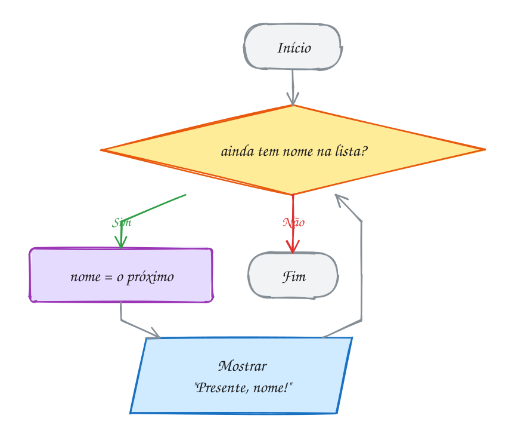</p>

> [!NOTE]
> **Pergunta para a turma:** coloque `'Davi'` no fim da lista e rode de novo.
> Precisou mexer no laço? O que aparece?

### Hora de praticar

Os arquivos ficam em [`0025-for-of/`](0025-for-of/). Os comandos funcionam de qualquer pasta do terminal. Nos exemplos, rode, mude, quebre e rode de novo. Nos exercícios, a resposta vai dentro do próprio arquivo.

**Exemplo A049 · Quantos dias choveu**

```ts
const chuvaMm: number[] = [0, 12, 30, 0, 5] // milímetros de segunda a sexta
let diasComChuva = 0

for (const mm of chuvaMm) {
  if (mm > 0) {
    diasComChuva++
  }
}

console.log(`Choveu em ${diasComChuva} dias`) // Choveu em 3 dias
```

```bash
tsx ~/LPPOO/16102026/0025-for-of/A049.ts
```

**Exemplo A050 · Somar as notas**

```ts
const notas: number[] = [8, 6, 9]
let soma = 0

for (const nota of notas) {
  soma += nota
}

console.log(`Soma: ${soma}`) // 23
console.log(`Média: ${(soma / notas.length).toFixed(1)}`) // 7.7
```

```bash
tsx ~/LPPOO/16102026/0025-for-of/A050.ts
```

**Exercício E049**

Crie um array com os preços de 5 produtos da cantina. Use `for...of` para
somar tudo e mostre o total com duas casas decimais.

<details><summary>Dicas</summary>

1. Comece `let total = 0` antes do laço.
2. Dentro do laço, some cada preço no total.
3. Use `total.toFixed(2)` para mostrar.

</details>

```bash
tsx ~/LPPOO/16102026/0025-for-of/E049.ts
```

**Exercício E050**

Crie um array com 5 nomes e mostre só os que têm mais de 4 letras.

<details><summary>Dicas</summary>

1. Use `for (const nome of nomes)`.
2. `nome.length` diz quantas letras o nome tem.
3. Dentro do laço, use um `if` para decidir se mostra.

</details>

```bash
tsx ~/LPPOO/16102026/0025-for-of/E050.ts
```

---

## 0026 · Inserir e remover: push, pop, unshift, shift, splice

Pensa na lista de compras na porta da geladeira. Alguém acrescenta no fim,
alguém risca o primeiro item, alguém troca um do meio.

Com o array é igual: ele não tem tamanho fixo. Cinco métodos colocam e tiram
itens:

| Método    | Onde mexe   | O que faz                         |
| --------- | ----------- | --------------------------------- |
| `push`    | no fim      | coloca um item                    |
| `pop`     | no fim      | tira o último e devolve esse item |
| `unshift` | no começo   | coloca um item                    |
| `shift`   | no começo   | tira o primeiro e devolve esse item |
| `splice`  | no meio     | tira e/ou coloca a partir de uma posição |

Repara no desenho: cada ponta da lista tem uma entrada e uma saída. O `splice`
é o único que mexe no meio:

<p align="center">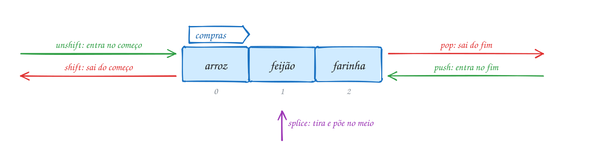</p>

```ts
const compras: string[] = ['arroz', 'feijão']

compras.push('farinha') // [arroz, feijão, farinha]
compras.unshift('café') // [café, arroz, feijão, farinha]
compras.pop() // tira farinha: [café, arroz, feijão]
compras.shift() // tira café: [arroz, feijão]
compras.splice(1, 1, 'açaí') // na posição 1, tira 1 e põe açaí

console.log(compras) // [ 'arroz', 'açaí' ]
```

O `splice(posição, quantosTirar, oQueColocar)` é o canivete: `splice(1, 1)`
só tira, `splice(1, 0, 'pão')` só coloca, e `splice(1, 1, 'açaí')` troca.

Guarda isso: os cinco **mudam o array original**. Por isso a lista vai mudando
a cada linha, sem precisar de `=`. Siga no fluxograma:

<p align="center"></p>

> [!NOTE]
> **Pergunta para a turma:** apague a linha do `splice` e rode de novo. Como
> fica a lista no final?

### Hora de praticar

Os arquivos ficam em [`0026-inserir-remover/`](0026-inserir-remover/). Os comandos funcionam de qualquer pasta do terminal. Nos exemplos, rode, mude, quebre e rode de novo. Nos exercícios, a resposta vai dentro do próprio arquivo.

**Exemplo A051 · A playlist da festa junina**

```ts
const musicas: string[] = ['toada', 'forró']

musicas.push('brega') // [toada, forró, brega]
musicas.unshift('quadrilha') // [quadrilha, toada, forró, brega]
const tirada = musicas.pop() // tira brega: [quadrilha, toada, forró]
musicas.shift() // tira quadrilha: [toada, forró]
musicas.splice(1, 0, 'carimbó') // na posição 1, não tira nada e põe carimbó

console.log(musicas) // [ 'toada', 'carimbó', 'forró' ]
console.log(`Saiu da lista: ${tirada}`) // Saiu da lista: brega
```

```bash
tsx ~/LPPOO/16102026/0026-inserir-remover/A051.ts
```

**Exemplo A052 · Fila da cantina: entra no fim, sai do começo**

```ts
const fila: string[] = []

fila.push('Ana')
fila.push('Bia')
fila.push('Caio')

const atendido = fila.shift()
console.log(`Atendido: ${atendido}`) // Ana
console.log('Ainda na fila:', fila) // [ 'Bia', 'Caio' ]
```

```bash
tsx ~/LPPOO/16102026/0026-inserir-remover/A052.ts
```

**Exercício E051**

Comece uma lista de compras vazia. Adicione 3 itens com `push`, coloque um
item urgente no começo com `unshift` e depois remova o último com `pop`. Mostre a
lista depois de cada passo.

<details><summary>Dicas</summary>

1. Lista vazia tipada: `const compras: string[] = []`.
2. Mostre com `console.log(compras)` depois de cada linha.

</details>

```bash
tsx ~/LPPOO/16102026/0026-inserir-remover/E051.ts
```

**Exercício E052**

Comece com a lista `['arroz', 'feijão', 'café']`. Peça o nome de um item com
`input` e remova esse item da lista, se ele existir. Se não existir, mostre
"Esse item não está na lista". No fim, mostre a lista.

<details><summary>Dicas</summary>

1. Percorra com `for (let i = 0; i < lista.length; i++)`.
2. Quando `lista[i] === item`, remova com `lista.splice(i, 1)`.
3. Use um `let achou = false` e troque para `true` quando remover.
4. Achou? Pode parar o laço com `break`.

</details>

```bash
tsx ~/LPPOO/16102026/0026-inserir-remover/E052.ts
```

---

## 0027 · Funções

Pensa na calculadora do celular. Você não precisa saber o que acontece lá
dentro. Digita os números, aperta o botão e recebe a resposta.

Função é isso: um pedaço de código com **nome**, que recebe valores, faz o
trabalho e devolve uma resposta. Você escreve uma vez e **chama** quantas vezes
quiser.

Vamos ver na prática. A função `calcularMedia` recebe duas notas, `8` e `6`.
Ela soma, divide por 2 e devolve `7`:

<p align="center">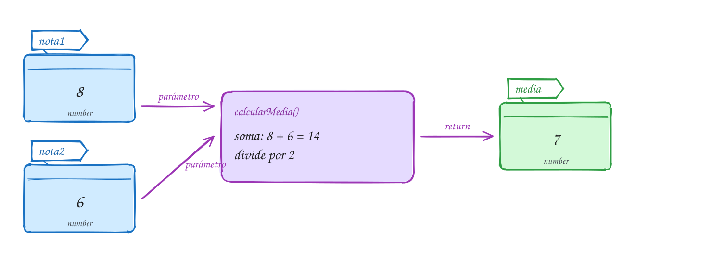</p>

```ts
function calcularMedia(nota1: number, nota2: number): number {
  return (nota1 + nota2) / 2
}

const media = calcularMedia(8, 6) // nota1 recebe 8, nota2 recebe 6
console.log(media) // 7
```

Vamos ler a primeira linha juntos:

- `function` avisa que ali começa uma função.
- `calcularMedia` é o nome dela.
- `nota1` e `nota2` são os **parâmetros**: caixinhas que recebem os valores da
  chamada. O `: number` de cada um diz que só entra número.
- o `: number` depois dos parênteses é o **tipo do retorno**: ela devolve um
  número.

Dentro das `{ }`, o `return` é a resposta. Ele devolve o valor para quem chamou
e encerra a função na hora.

Guarda isso: escrever a função não roda nada. Ela só trabalha quando alguém
**chama**, com `calcularMedia(8, 6)`.

No fluxograma, a chamada entra, a função faz a conta e o `return` devolve o
`7`, que vai para a caixinha `media`:

<p align="center"></p>

> [!NOTE]
> **Pergunta para a turma:** acrescente `console.log(calcularMedia(10, 5))` no
> final. O que aparece? Rode e confira. (Dica: a média nem sempre dá um número
> inteiro.)

### Hora de praticar

Os arquivos ficam em [`0027-funcoes/`](0027-funcoes/). Os comandos funcionam de qualquer pasta do terminal. Nos exemplos, rode, mude, quebre e rode de novo. Nos exercícios, a resposta vai dentro do próprio arquivo.

**Exemplo A053 · Quanto custa o mototáxi**

```ts
function precoCorrida(km: number): number {
  return 5 + km * 2 // R$ 5 para sair + R$ 2 por km
}

console.log(precoCorrida(3)) // 11
console.log(precoCorrida(10)) // 25
console.log(`Ida e volta: R$ ${precoCorrida(3) * 2}`) // Ida e volta: R$ 22
```

```bash
tsx ~/LPPOO/16102026/0027-funcoes/A053.ts
```

**Exemplo A054 · A área da sala**

```ts
function areaRetangulo(largura: number, altura: number): number {
  return largura * altura
}

console.log(`Área da sala: ${areaRetangulo(8, 6)} m²`) // 48 m²
```

```bash
tsx ~/LPPOO/16102026/0027-funcoes/A054.ts
```

**Exercício E053**

Escreva a função `celsiusParaFahrenheit(c: number): number`, que converte
graus Celsius para Fahrenheit. Mostre a conversão de 0, 25 e 100 graus.

<details><summary>Dicas</summary>

1. A fórmula é `c * 1.8 + 32`.
2. Teste: 100 °C tem que dar 212 °F.

</details>

```bash
tsx ~/LPPOO/16102026/0027-funcoes/E053.ts
```

**Exercício E054**

Escreva a função `maiorNota(notas: number[]): number`, que devolve a maior nota
do array.

<details><summary>Dicas</summary>

1. Comece com `let maior = 0`.
2. Percorra com `for...of` e troque `maior` quando achar uma nota maior.

</details>

```bash
tsx ~/LPPOO/16102026/0027-funcoes/E054.ts
```

---

## 0028 · Parâmetro opcional, valor padrão e void

Até agora, toda chamada mandava todos os valores. Mas tem parâmetro que pode
ficar de fora.

Pensa no pedido de pastel na cantina. O sabor você tem que dizer. Se não falar
o tamanho, vem o médio. E o suco é opcional: pede quem quer.

Com parâmetro é igual:

- **Obrigatório**: `sabor: string`. Sem ele, não tem pedido.
- **Com valor padrão**: `tamanho: string = 'médio'`. Se a chamada não mandar,
  vale `'médio'`.
- **Opcional**: `suco?: string`. O `?` diz que pode ficar de fora. Aí, dentro
  da função, ele vale `undefined`, a caixa vazia.

Os parâmetros com valor padrão e os opcionais vêm sempre **depois** dos
obrigatórios.

Olha o pedido da Ana. Ela só disse `'carne'`. O tamanho veio do padrão e o suco
ficou vazio:

<p align="center">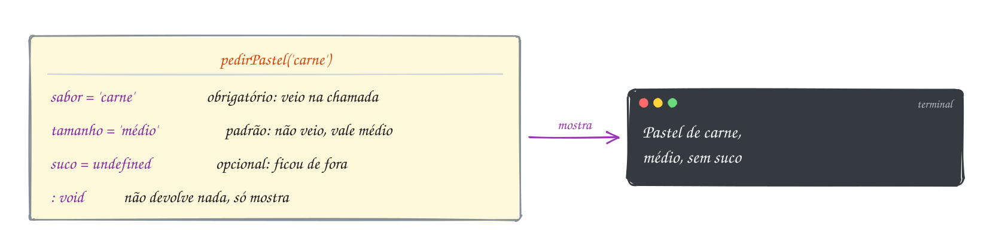</p>

```ts
function pedirPastel(
  sabor: string,
  tamanho: string = 'médio',
  suco?: string,
): void {
  const extra = suco === undefined ? 'sem suco' : `com suco de ${suco}`
  console.log(`Pastel de ${sabor}, ${tamanho}, ${extra}`)
}

pedirPastel('carne') // Pastel de carne, médio, sem suco
```

Os parâmetros ficaram um por linha só para caber na tela. Continua sendo uma
função normal.

Quem manda tudo escolhe tudo: `pedirPastel('queijo', 'grande', 'cupuaçu')`
mostra `Pastel de queijo, grande, com suco de cupuaçu`.

Como o `suco` pode não ter vindo, a função confere com `suco === undefined`
antes de usar. É o ternário que você já conhece.

E repara no `: void` depois dos parênteses. O tipo do retorno é **`void`**
(vazio): essa função não tem `return`, não devolve nada. Ela só mostra na tela.

No fluxograma, siga o pedido da Ana. As duas perguntas são o que a função
decide sozinha:

<p align="center">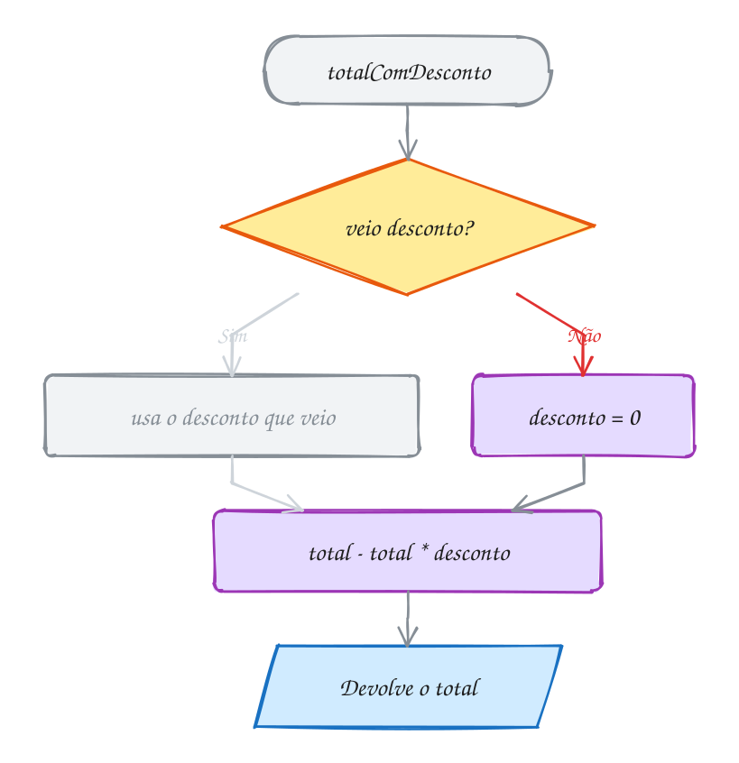</p>

> [!NOTE]
> **Pergunta para a turma:** o que aparece com `pedirPastel('frango',
> 'cupuaçu')`? Acrescente a linha e rode. (Dica: os valores entram na ordem dos
> parâmetros.)

### Hora de praticar

Os arquivos ficam em [`0028-parametros/`](0028-parametros/). Os comandos funcionam de qualquer pasta do terminal. Nos exemplos, rode, mude, quebre e rode de novo. Nos exercícios, a resposta vai dentro do próprio arquivo.

**Exemplo A055 · A conta do restaurante (valor padrão)**

```ts
function calcularConta(valor: number, gorjeta: number = 10): number {
  return valor + (valor * gorjeta) / 100 // gorjeta em porcentagem
}

console.log(calcularConta(50)) // 55 (não mandou gorjeta: vale 10)
console.log(calcularConta(50, 20)) // 60
console.log(calcularConta(50, 0)) // 50
```

```bash
tsx ~/LPPOO/16102026/0028-parametros/A055.ts
```

**Exemplo A056 · O crachá do evento (opcional e void)**

```ts
function imprimirCracha(nome: string, apelido?: string): void {
  const chamada = apelido === undefined ? nome : apelido // não veio? usa o nome
  console.log(`Olá, meu nome é ${chamada}`)
}

imprimirCracha('Ana Beatriz') // Olá, meu nome é Ana Beatriz
imprimirCracha('Francisco', 'Chico') // Olá, meu nome é Chico
```

```bash
tsx ~/LPPOO/16102026/0028-parametros/A056.ts
```

**Exercício E055**

Escreva `calcularFrete(peso: number, expresso?: boolean): number`. O frete é
R$ 2 por kg; se for expresso, soma mais R$ 10. Teste com e sem o expresso.

<details><summary>Dicas</summary>

1. Dentro da função, `expresso` pode ser `undefined`.
2. Use `if (expresso === true)`: se não veio, ele vale `undefined` e o
   `if` não entra.

</details>

```bash
tsx ~/LPPOO/16102026/0028-parametros/E055.ts
```

**Exercício E056**

Escreva `mostrarAluno(nome: string, turma: string = 'DS 2026'): void`, que
mostra "Ana - turma DS 2026". Chame uma vez sem a turma e outra com.

<details><summary>Dicas</summary>

1. Funções `void` não têm `return` com valor.
2. Use template string para montar a frase.

</details>

```bash
tsx ~/LPPOO/16102026/0028-parametros/E056.ts
```

---

## 0029 · Escopo de variáveis

Pensa no grupo da sala no celular. O que se fala lá fica lá. Quem está fora não
fica sabendo.

Variável funciona parecido. **Escopo** é o pedaço do código onde uma variável
existe.

Uma variável criada fora de tudo, solta no arquivo, é **global**: o arquivo
inteiro enxerga.

Uma variável criada dentro de uma função só existe **lá dentro**. Quando a
função termina, ela some.

A regra é de mão única: quem está dentro enxerga o que está fora, mas quem está
fora não enxerga o que está dentro.

Olha só. A função `saudar` usa a `escola`, que é global. Já a `mensagem` nasce
e morre dentro da função:

<p align="center">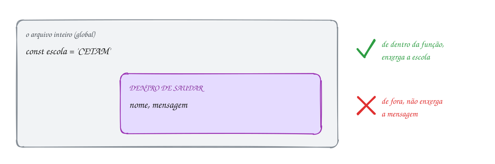</p>

```ts
const escola = 'CETAM' // global: o arquivo inteiro enxerga

function saudar(nome: string): void {
  const mensagem = `Oi, ${nome}! Bem-vinda ao ${escola}.` // só existe aqui dentro
  console.log(mensagem)
}

saudar('Ana') // Oi, Ana! Bem-vinda ao CETAM.
// console.log(mensagem) // erro: a mensagem não existe aqui fora
```

No fluxograma, repara que `nome` e `mensagem` aparecem quando a função é
chamada e somem quando ela acaba:

<p align="center"></p>

Isso vale para todo bloco entre `{ }`, como o de um `if` ou de um `for`. A
variável criada lá dentro, com `let` ou `const`, só existe lá dentro.

> [!NOTE]
> **Pergunta para a turma:** o que acontece se você tirar o `//` da última
> linha e rodar? Teste. (Dica: leia a mensagem de erro com calma.)

### Hora de praticar

Os arquivos ficam em [`0029-escopo/`](0029-escopo/). Os comandos funcionam de qualquer pasta do terminal. Nos exemplos, rode, mude, quebre e rode de novo. Nos exercícios, a resposta vai dentro do próprio arquivo.

**Exemplo A057 · Mesmo nome, caixas diferentes**

```ts
function placarDoPrimeiroA(): void {
  const gols = 3 // esta caixa só existe aqui dentro
  console.log(`1º A fez ${gols} gols`)
}

function placarDoPrimeiroB(): void {
  const gols = 1 // outra caixa, com o mesmo nome
  console.log(`1º B fez ${gols} gol`)
}

placarDoPrimeiroA() // 1º A fez 3 gols
placarDoPrimeiroB() // 1º B fez 1 gol
// console.log(gols) // tire o // e veja o erro: aqui fora não tem gols
```

```bash
tsx ~/LPPOO/16102026/0029-escopo/A057.ts
```

**Exemplo A058 · O bloco do if também tem escopo**

```ts
const nota = 8

if (nota >= 6) {
  const recado = 'Parabéns!'
  console.log(recado)
}

// console.log(recado) // erro: Cannot find name 'recado'.
```

```bash
tsx ~/LPPOO/16102026/0029-escopo/A058.ts
```

**Exercício E057**

Escreva `calcularDesconto(preco: number): void` com uma `const desconto`
dentro. Tente mostrar o `desconto` fora da função e leia o erro. Depois conserte:
troque o `void` por `number`, devolva o desconto com `return` e mostre o
resultado fora.

<details><summary>Dicas</summary>

1. Deixe a linha com erro comentada com `//` no final.
2. Para usar fora, guarde o retorno numa `const`.

</details>

```bash
tsx ~/LPPOO/16102026/0029-escopo/E057.ts
```

**Exercício E058**

Crie um `let visitas = 0` global e uma função `registrarVisita(): void` que
soma 1 nele. Chame a função 3 vezes e mostre o total de visitas.

<details><summary>Dicas</summary>

1. A função enxerga e muda a variável global.
2. O resultado esperado é 3.

</details>

```bash
tsx ~/LPPOO/16102026/0029-escopo/E058.ts
```

---

## 0030 · Arrow functions e callbacks

Até agora, toda função começou com a palavra `function`. Tem um jeito mais
curto de escrever: a **arrow function** (função seta), por causa da `=>`.

Esta você já sabe escrever:

```ts
function dobrar(n: number): number {
  return n * 2
}
```

Esta é a mesma função, escrita como arrow:

```ts
const dobrar = (n: number): number => n * 2
```

Os parâmetros continuam entre `( )`, com os tipos. Depois vem a `=>`, e o que
vem depois dela já é o `return`. A função fica guardada numa `const`, e você
chama do mesmo jeito: `dobrar(10)` dá `20`.

Agora a novidade grande: uma função pode **receber outra função** como
parâmetro. A função que você entrega se chama **callback**.

Pensa na receita de bolo. Você entrega a receita, e outra pessoa cozinha na
hora certa. Aqui, a `aplicar` é quem cozinha e a `dobrar` é a receita. Você
entrega o `10` e a `dobrar`, e volta o `20`:

<p align="center"></p>

```ts
const dobrar = (n: number): number => n * 2

function aplicar(valor: number, regra: (n: number) => number): number {
  return regra(valor) // aqui dentro, a aplicar chama a sua função
}

console.log(aplicar(10, dobrar)) // 20
```

O tipo do parâmetro `regra` é `(n: number) => number`. Quer dizer: "uma função
que recebe um número e devolve um número".

Repara: é `aplicar(10, dobrar)`, sem parênteses depois de `dobrar`. Você está
**entregando** a função, e não chamando. Quem chama é a `aplicar`, lá dentro:

<p align="center">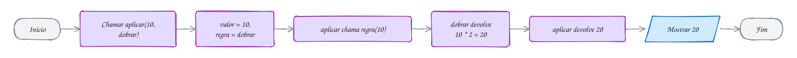</p>

Guarda isso: nos próximos assuntos, os métodos de array (`find`, `map`,
`filter`...) funcionam exatamente assim. Você entrega uma função, e o método
chama ela para cada item do array.

> [!NOTE]
> **Pergunta para a turma:** dá para escrever a arrow direto na chamada, sem
> dar nome. O que aparece com `aplicar(10, (n: number): number => n + 1)`?
> Acrescente a linha e rode.

### Hora de praticar

Os arquivos ficam em [`0030-arrow-callback/`](0030-arrow-callback/). Os comandos funcionam de qualquer pasta do terminal. Nos exemplos, rode, mude, quebre e rode de novo. Nos exercícios, a resposta vai dentro do próprio arquivo.

**Exemplo A059 · Arrow functions da cantina**

```ts
const comDesconto = (preco: number): number => preco - 2
const ehCaro = (preco: number): boolean => preco > 10
const placa = (nome: string, preco: number): string => `${nome}: R$ ${preco}`

console.log(comDesconto(8)) // 6
console.log(ehCaro(15)) // true
console.log(placa('Pastel', 7)) // Pastel: R$ 7
```

```bash
tsx ~/LPPOO/16102026/0030-arrow-callback/A059.ts
```

**Exemplo A060 · Uma função sua que chama o callback para cada nota**

```ts
function paraCadaNota(notas: number[], acao: (nota: number) => void): void {
  for (const nota of notas) {
    acao(nota) // chama a função que você entregou
  }
}

const mostrar = (nota: number): void => console.log(`Nota: ${nota}`)

paraCadaNota([7, 9], mostrar) // Nota: 7 / Nota: 9
paraCadaNota([7, 9], (nota: number): void => console.log(nota * 10)) // 70 / 90
```

```bash
tsx ~/LPPOO/16102026/0030-arrow-callback/A060.ts
```

**Exercício E059**

Escreva a arrow function `ehAprovado = (nota: number): boolean => ...`.
Teste com as notas 4, 6 e 9. Depois, percorra o array `[4, 7, 9, 5]` com
`for...of` e mostre só as notas aprovadas.

<details><summary>Dicas</summary>

1. Aprovado é nota maior ou igual a 6.
2. Dentro do laço, use `if (ehAprovado(nota))`.

</details>

```bash
tsx ~/LPPOO/16102026/0030-arrow-callback/E059.ts
```

**Exercício E060**

Escreva `repetir(vezes: number, acao: () => void): void`, que chama a `acao`
o número de vezes pedido. Teste com uma arrow que mostra "Olá!".

<details><summary>Dicas</summary>

1. Dentro de `repetir`, use um `for`.
2. Para chamar o callback, use `acao()`.
3. Teste: `repetir(3, () => console.log('Olá!'))`.

</details>

```bash
tsx ~/LPPOO/16102026/0030-arrow-callback/E060.ts
```

---

## 0031 · Consultar: indexOf, includes, find, findIndex, some, every

Você chega na cantina e olha a lista de preços do dia: R$ 6, R$ 25 e R$ 9. Na
cabeça, você faz perguntas. Tem lanche de R$ 9? Em que lugar da lista ele está?
Qual é o primeiro que passa de R$ 20?

Até agora, a gente mexia no array: colocava e tirava itens. Hoje a gente só
**pergunta**. Estes métodos olham o array e respondem, sem mudar nada nele:

<p align="center">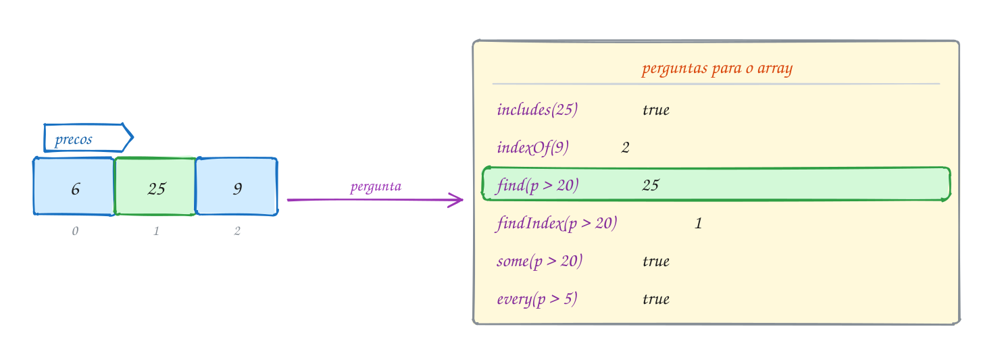</p>

```ts
const precos: number[] = [6, 25, 9]

console.log(precos.includes(9)) // true: tem lanche de R$ 9
console.log(precos.indexOf(9)) // 2: ele está na posição 2
console.log(precos.find((p) => p > 20)) // 25: o primeiro acima de R$ 20
console.log(precos.some((p) => p > 20)) // true: algum passa de R$ 20
```

O `includes` e o `indexOf` procuram um valor exato. Se o valor não está na
lista, o `indexOf` responde `-1`.

O `find` e o `some` recebem uma **regra**: `(p) => p > 20`. Lembra da arrow da
[0030](#0030--arrow-functions-e-callbacks)? É ela, passada como callback. O
método chama a regra para cada preço e vê se dá `true`.

Repara que o `p` ficou sem o `: number`. Nem precisa: como `precos` é
`number[]`, o TypeScript já sabe que cada preço é um número.

Tem mais dois da mesma família:

- `findIndex(regra)`: igual ao `find`, mas devolve a **posição**.
  `precos.findIndex((p) => p > 20)` dá `1`.
- `every(regra)`: **todos** passam? `precos.every((p) => p > 5)` dá `true`.

No fluxograma, olha o `find` por dentro. Ele olha preço por preço e para no
primeiro que passa na regra. O 6 não passa, o 25 passa, e o 9 nem é olhado:

<p align="center"></p>

> [!NOTE]
> **Pergunta para a turma:** o que o `find` devolve quando nenhum preço passa
> na regra? Troque o `p > 20` por `p > 100` e rode. (Dica: é a caixa vazia da
> 0007.)

### Hora de praticar

Os arquivos ficam em [`0031-consultar/`](0031-consultar/). Os comandos funcionam de qualquer pasta do terminal. Nos exemplos, rode, mude, quebre e rode de novo. Nos exercícios, a resposta vai dentro do próprio arquivo.

**Exemplo A061 · Os gols do time no interclasse**

```ts
const gols: number[] = [2, 0, 3, 1] // um número por jogo

console.log(gols.includes(0)) // true: teve jogo sem gol
console.log(gols.indexOf(3)) // 2
console.log(gols.indexOf(5)) // -1
console.log(gols.find((g) => g >= 3)) // 3
console.log(gols.findIndex((g) => g >= 3)) // 2
console.log(gols.some((g) => g > 4)) // false
console.log(gols.every((g) => g < 4)) // true
```

```bash
tsx ~/LPPOO/16102026/0031-consultar/A061.ts
```

**Exemplo A062 · Está na lista?**

```ts
import { input } from '#core/input.ts'

const turma: string[] = ['Ana', 'Bia', 'Caio']
const nome = input('Nome: ')

if (turma.includes(nome)) {
  console.log(`${nome} está na posição ${turma.indexOf(nome)}`)
} else {
  console.log(`${nome} não está na turma`)
}
```

```bash
tsx ~/LPPOO/16102026/0031-consultar/A062.ts
```

**Exercício E061**

Crie um array com as idades da turma. Use `some` para dizer se tem alguém
menor de 18 e `every` para dizer se todos têm mais de 15.

<details><summary>Dicas</summary>

1. `idades.some((idade) => idade < 18)`.
2. `idades.every((idade) => idade > 15)`.
3. Mostre as respostas numa frase.

</details>

```bash
tsx ~/LPPOO/16102026/0031-consultar/E061.ts
```

**Exercício E062**

Crie um array de preços e use `find` para achar o primeiro produto acima de
R$ 10. Se não tiver nenhum, mostre "Tudo barato!".

<details><summary>Dicas</summary>

1. `find` devolve `undefined` quando ninguém passa.
2. Guarde o resultado e pergunte com um `if`: `if (achado === undefined)`.

</details>

```bash
tsx ~/LPPOO/16102026/0031-consultar/E062.ts
```

---

## 0032 · Transformar: map, filter, reduce, forEach

As notas da turma saíram: 8, 4, 9 e 5. O professor quer três coisas. Dar 1
ponto de bônus para todo mundo, ver quem passou com 6 ou mais e somar tudo.

Para isso tem os métodos que passam por **todos os itens**, um por um, e
aplicam uma regra em cada:

- `map(regra)`: **transforma** cada item e devolve um array novo do mesmo
  tamanho.
- `filter(regra)`: **filtra** e devolve um array novo só com quem passa na
  regra.
- `reduce(regra, inicio)`: **junta** todos os itens num valor só, como uma
  soma.

Repara no desenho: o array `notas` entra nos três, e cada um entrega uma coisa
diferente:

<p align="center">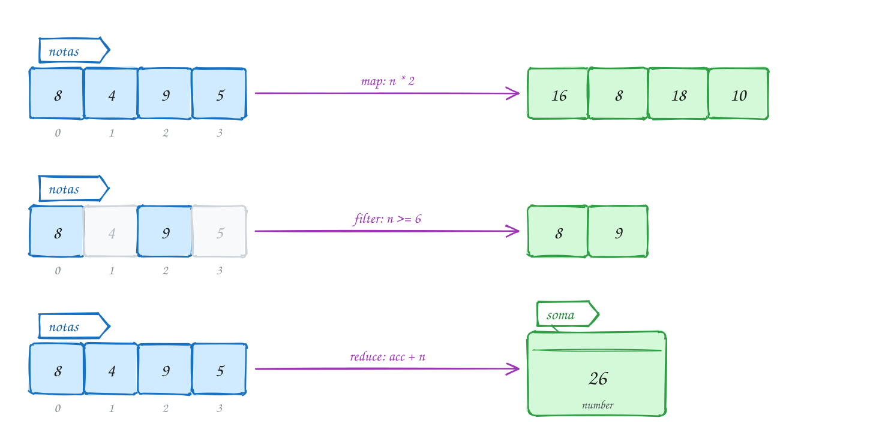</p>

```ts
const notas: number[] = [8, 4, 9, 5]

const comBonus = notas.map((n) => n + 1) // [9, 5, 10, 6]
const aprovadas = notas.filter((n) => n >= 6) // [8, 9]
const soma = notas.reduce((acc, n) => acc + n, 0) // 26

console.log(comBonus, aprovadas, soma) // [ 9, 5, 10, 6 ] [ 8, 9 ] 26
```

A regra de cada um é uma arrow, igual à da
[0030](#0030--arrow-functions-e-callbacks). O `map` chama a regra para cada
nota e guarda o que ela devolve.

O `reduce` assusta no começo. Calma. O `acc` (de acumulador) começa com o `0`
do fim. A cada nota, ele vira `acc + n`: 0 + 8 = 8, 8 + 4 = 12, 12 + 9 = 21,
21 + 5 = 26.

E tem o `forEach(regra)`: ele só **faz algo** com cada item e não devolve
nada. `notas.forEach((n) => console.log(n))` mostra uma nota por linha.

Agora olha o `map` por dentro, no fluxograma. Ele monta um array novo, nota por
nota, e não mexe no original:

<p align="center"></p>

Dá para **encadear**: o resultado de um vira a entrada do próximo.
`notas.filter((n) => n >= 6).map((n) => n + 1)` filtra e depois dá o bônus:
`[9, 10]`.

> [!NOTE]
> **Pergunta para a turma:** se você trocar o `0` do `reduce` por `10`, quanto
> dá a `soma`? Mude e rode. (Dica: o `acc` começa com esse valor.)

### Hora de praticar

Os arquivos ficam em [`0032-transformar/`](0032-transformar/). Os comandos funcionam de qualquer pasta do terminal. Nos exemplos, rode, mude, quebre e rode de novo. Nos exercícios, a resposta vai dentro do próprio arquivo.

**Exemplo A063 · Os pontos da gincana**

```ts
const pontos: number[] = [30, 15, 40, 10] // uma equipe em cada posição

const naFinal = pontos.map((p) => p * 2) // na final, cada ponto vale dois
const passaram = pontos.filter((p) => p >= 20)
const total = pontos.reduce((acc, p) => acc + p, 0)

console.log(naFinal) // [ 60, 30, 80, 20 ]
console.log(passaram) // [ 30, 40 ]
console.log(total) // 95
passaram.forEach((p) => console.log(`Equipe com ${p} pontos vai para a final`))
```

```bash
tsx ~/LPPOO/16102026/0032-transformar/A063.ts
```

**Exemplo A064 · Encadeando: só os caros, com 10% de desconto, somados**

```ts
const precos: number[] = [12, 5, 30]

const total = precos
  .filter((p) => p > 10) // [12, 30]
  .map((p) => p * 0.9) // [10.8, 27]
  .reduce((acc, p) => acc + p, 0) // 37.8

console.log(`Total: R$ ${total.toFixed(2)}`)
```

```bash
tsx ~/LPPOO/16102026/0032-transformar/A064.ts
```

**Exercício E063**

Crie um array de preços e use `map` para criar um array novo com 10% de
aumento em cada preço. Mostre os dois arrays.

<details><summary>Dicas</summary>

1. Aumento de 10% é multiplicar por 1.1.
2. O `map` devolve um array novo: guarde numa `const`.

</details>

```bash
tsx ~/LPPOO/16102026/0032-transformar/E063.ts
```

**Exercício E064**

Crie um array de notas. Use `filter` para pegar as reprovadas (abaixo de 6) e
`reduce` para calcular a média de todas as notas.

<details><summary>Dicas</summary>

1. Média é a soma (`reduce`) dividida por `notas.length`.
2. No `reduce`, não esqueça o valor inicial `0`.

</details>

```bash
tsx ~/LPPOO/16102026/0032-transformar/E064.ts
```

---

## 0033 · Organizar: sort, reverse, slice, join, concat

No diário do professor, as notas estão na ordem da chamada: 8, 10, 6 e 9. Você
quer ver as notas da menor para a maior, mas sem bagunçar o diário.

O jeito é tirar uma **foto** do diário e arrumar a foto. Quem tira a foto é o
`slice`. Quem arruma é o `sort`. E o `join` junta tudo num texto só, para
mostrar:

<p align="center">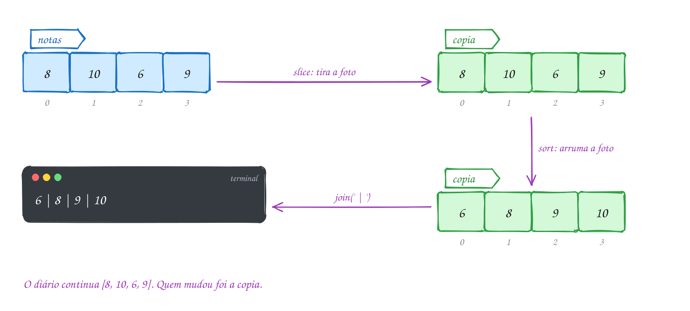</p>

```ts
const notas: number[] = [8, 10, 6, 9] // o diário

const copia = notas.slice() // tira a foto: um array novo
copia.sort((a, b) => a - b) // arruma a foto: [6, 8, 9, 10]

console.log(copia.join(' | ')) // 6 | 8 | 9 | 10
console.log(notas) // [ 8, 10, 6, 9 ]: o diário não mudou
```

A regra do `sort` é uma arrow com dois números, `a` e `b`. Lembra da
[0030](#0030--arrow-functions-e-callbacks)? O `a - b` deixa do menor para o
maior. O `b - a` deixa do maior para o menor.

O `slice` também tira foto de um **pedaço**: `notas.slice(0, 2)` dá `[8, 10]`.
Ele começa na posição 0 e para antes da posição 2.

Tem mais dois da mesma família:

- `reverse()`: **inverte** a ordem. `copia.reverse()` deixa `[10, 9, 8, 6]`.
- `concat(outro)`: **emenda** dois arrays num novo. `notas.concat([7])` dá
  `[8, 10, 6, 9, 7]`.

Guarda essa tabela. Ela separa quem mexe no original de quem devolve um novo:

| Mudam o original                         | Devolvem um novo                  |
| ---------------------------------------- | --------------------------------- |
| `push`, `pop`, `shift`, `unshift`, `splice`, `sort`, `reverse` | `map`, `filter`, `slice`, `concat` |

No fluxograma, repara que o `sort` mexe só na `copia`:

<p align="center">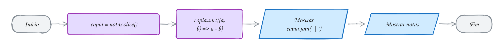</p>

> [!WARNING]
> Cuidado: o `sort` sem regra compara tudo **como texto**. Aí
> `[8, 10, 6, 9].sort()` dá `[10, 6, 8, 9]`, porque o texto `'10'` vem antes de
> `'6'`. Para números, passe sempre a regra.

> [!NOTE]
> **Pergunta para a turma:** troque `notas.slice()` por só `notas` na linha da
> `copia`. O que aparece no último `console.log`? Troque e rode. (Dica: sem o
> `slice`, não tem foto.)

### Hora de praticar

Os arquivos ficam em [`0033-organizar/`](0033-organizar/). Os comandos funcionam de qualquer pasta do terminal. Nos exemplos, rode, mude, quebre e rode de novo. Nos exercícios, a resposta vai dentro do próprio arquivo.

**Exemplo A065 · A chamada em ordem alfabética**

```ts
const alunos: string[] = ['Davi', 'Ana', 'Gabi', 'Caio']

const ordem = alunos.slice() // foto da lista
ordem.sort() // com texto, o sort sem regra funciona
console.log(ordem.join(', ')) // Ana, Caio, Davi, Gabi
console.log(ordem.reverse().join(', ')) // Gabi, Davi, Caio, Ana

const turmaNova = alunos.concat(['Bia', 'Enzo'])
console.log(turmaNova.length) // 6
console.log(alunos) // [ 'Davi', 'Ana', 'Gabi', 'Caio' ]: o original não mudou
```

```bash
tsx ~/LPPOO/16102026/0033-organizar/A065.ts
```

**Exemplo A066 · O perigo do sort sem regra**

```ts
const numeros: number[] = [8, 10, 6, 9]

console.log(numeros.slice().sort()) // [ 10, 6, 8, 9 ]: comparou como texto
console.log(numeros.slice().sort((a, b) => a - b)) // [ 6, 8, 9, 10 ]
```

```bash
tsx ~/LPPOO/16102026/0033-organizar/A066.ts
```

**Exercício E065**

Crie um array de preços e mostre os preços do menor para o maior, sem mudar
o array original. Mostre os dois arrays no final para provar.

<details><summary>Dicas</summary>

1. Primeiro faça uma cópia com `slice()`.
2. Ordene a cópia com `sort((a, b) => a - b)`.

</details>

```bash
tsx ~/LPPOO/16102026/0033-organizar/E065.ts
```

**Exercício E066**

Crie um array com 6 notas e mostre as 3 maiores separadas por " - ".

<details><summary>Dicas</summary>

1. Cópia, `sort((a, b) => b - a)` e `slice(0, 3)`.
2. Termine com `join(' - ')`.

</details>

```bash
tsx ~/LPPOO/16102026/0033-organizar/E066.ts
```

---

## 0034 · Juntando tudo: as notas da turma

Hora de juntar tudo num programa só. Esse é o fechamento da aula.

O professor digita as notas da turma, uma por uma, até responder `n`. No fim,
o programa mostra a média e as notas de 6 para cima.

Cada parte usa um assunto desta aula. Olha só:

| Parte do programa                    | Assunto                                |
| ------------------------------------ | -------------------------------------- |
| `do...while` pedindo as notas        | [0021](#0021--laço-dowhile)            |
| `notas: number[]` e `push`           | [0024](#0024--arrays-vetores) e [0026](#0026--inserir-e-remover-push-pop-unshift-shift-splice) |
| a função `calcularMedia`             | [0027](#0027--funções)                 |
| as regras `(acc, v) => acc + v` e `(n) => n >= 6` | [0030](#0030--arrow-functions-e-callbacks) |
| `reduce` e `filter`                  | [0032](#0032--transformar-map-filter-reduce-foreach) |
| `join`                               | [0033](#0033--organizar-sort-reverse-slice-join-concat) |

Vamos ver na prática. O professor digita 8, 5 e 9, e depois `n`:

<p align="center">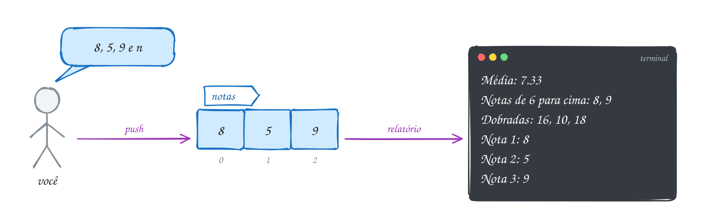</p>

```ts
import { input } from '#core/input.ts'

function calcularMedia(valores: number[]): number {
  const soma = valores.reduce((acc, v) => acc + v, 0)
  return soma / valores.length
}

const notas: number[] = []
let resposta // a caixa nasce vazia: o do pergunta antes de conferir

do {
  notas.push(Number(input('Digite uma nota: '))) // 8, depois 5, depois 9
  resposta = input('Outra nota? (s/n) ') // s, s, n
} while (resposta === 's')

const aprovadas = notas.filter((n) => n >= 6)
console.log(`Média: ${calcularMedia(notas).toFixed(2)}`) // Média: 7.33
console.log(`Notas de 6 para cima: ${aprovadas.join(', ')}`) // 8, 9
```

No fluxograma, repara nas três voltas do `do...while`. Depois delas vem o
relatório:

<p align="center">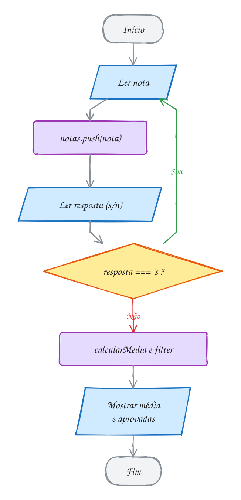</p>

> [!NOTE]
> **Pergunta para a turma:** se o professor digitar só uma nota, `4`, e
> responder `n`, o que aparece na linha "Notas de 6 para cima"? Rode e confira.
> (Dica: o `filter` pode devolver um array vazio.)

### Hora de praticar

Os arquivos ficam em [`0034-juntando-tudo/`](0034-juntando-tudo/). Os comandos funcionam de qualquer pasta do terminal. Nos exemplos, rode, mude, quebre e rode de novo. Nos exercícios, a resposta vai dentro do próprio arquivo.

**Exemplo A067 · As notas dos jurados do boi**

```ts
import { input } from '#core/input.ts'

const notas: number[] = []
let resposta // a caixa nasce vazia: o do pergunta antes de conferir

do {
  notas.push(Number(input('Nota do jurado: '))) // digite: 9.5, depois 10, depois 9
  resposta = input('Mais um jurado? (s/n) ') // digite: s, s, n
} while (resposta === 's')

const total = notas.reduce((acc, v) => acc + v, 0)
console.log(`Total do boi: ${total}`) // Total do boi: 28.5
console.log(`Notas 10: ${notas.filter((n) => n === 10).length}`) // Notas 10: 1
console.log(`Notas: ${notas.join(' | ')}`) // Notas: 9.5 | 10 | 9
```

```bash
tsx ~/LPPOO/16102026/0034-juntando-tudo/A067.ts
```

**Exemplo A068 · Os gastos da semana, numa função void com for...of**

```ts
function mostrarGastos(gastos: number[]): void {
  for (const gasto of gastos) {
    const aviso = gasto > 20 ? 'passou do limite' : 'ok'
    console.log(`R$ ${gasto.toFixed(2)} (${aviso})`)
  }
  const total = gastos.reduce((acc, g) => acc + g, 0)
  console.log(`Total: R$ ${total.toFixed(2)}`)
}

mostrarGastos([12, 25, 8.5])
// R$ 12.00 (ok) / R$ 25.00 (passou do limite) / R$ 8.50 (ok) / Total: R$ 45.50
```

```bash
tsx ~/LPPOO/16102026/0034-juntando-tudo/A068.ts
```

**Exercício E067**

Copie o programa das notas da turma, o do texto deste assunto, e acrescente
no relatório a maior e a menor nota digitada.

<details><summary>Dicas</summary>

1. Faça uma cópia ordenada com `slice().sort((a, b) => a - b)`.
2. A menor fica na posição 0 e a maior na última.

</details>

```bash
tsx ~/LPPOO/16102026/0034-juntando-tudo/E067.ts
```

**Exercício E068**

Peça nomes até a pessoa digitar `fim` e guarde num array. No final, mostre os
nomes em ordem alfabética, separados por vírgula, e quantos foram digitados.

<details><summary>Dicas</summary>

1. Use `do...while` ou `while (true)` com `break`.
2. Não guarde o `'fim'` no array.
3. Para texto, o `sort()` sem regra já ordena em ordem alfabética.

</details>

```bash
tsx ~/LPPOO/16102026/0034-juntando-tudo/E068.ts
```

---

## Prática em sala

Os enunciados estão em [`pratica/`](pratica/):

| Arquivo                                                  | O que fazer                                               |
| -------------------------------------------------------- | --------------------------------------------------------- |
| [`tabuada.ts`](pratica/tabuada.ts)                       | tabuada com `for`, e depois um `for` dentro do outro      |
| [`lista-de-compras.ts`](pratica/lista-de-compras.ts)     | adicionar, remover, buscar e listar com métodos de array  |
| [`total-com-desconto.ts`](pratica/total-com-desconto.ts) | função que soma preços com desconto opcional             |
| [`desafio-produtos.ts`](pratica/desafio-produtos.ts)     | desafio: `filter`, `map` e `reduce` encadeados            |

```bash
tsx ~/LPPOO/16102026/pratica/tabuada.ts
tsx ~/LPPOO/16102026/pratica/lista-de-compras.ts
tsx ~/LPPOO/16102026/pratica/total-com-desconto.ts
tsx ~/LPPOO/16102026/pratica/desafio-produtos.ts
```

## Para ler mais

- MDN WEB DOCS. *Laços e iterações*. Disponível em: <https://developer.mozilla.org/pt-BR/docs/Web/JavaScript/Guide/Loops_and_iteration>.
- MDN WEB DOCS. *Array*. Disponível em: <https://developer.mozilla.org/pt-BR/docs/Web/JavaScript/Reference/Global_Objects/Array>.
- MDN WEB DOCS. *Funções*. Disponível em: <https://developer.mozilla.org/pt-BR/docs/Web/JavaScript/Guide/Functions>.
- MDN WEB DOCS. *Arrow functions*. Disponível em: <https://developer.mozilla.org/pt-BR/docs/Web/JavaScript/Reference/Functions/Arrow_functions>.
- MICROSOFT. *TypeScript Handbook*: More on Functions. Disponível em: <https://www.typescriptlang.org/docs/handbook/2/functions.html>.
- MICROSOFT. *TypeScript Handbook*: Everyday Types (Arrays). Disponível em: <https://www.typescriptlang.org/docs/handbook/2/everyday-types.html#arrays>.
- MICROSOFT. *TSConfig*: noUncheckedIndexedAccess. Disponível em: <https://www.typescriptlang.org/tsconfig/#noUncheckedIndexedAccess>.
- HAVERBEKE, M. *Eloquent JavaScript*. 3. ed. San Francisco: No Starch Press, 2018. Cap. 2 a 5. Disponível em: <https://eloquentjavascript.net>.
