<!-- Gerado por _gerador. Para mudar este arquivo, edite _gerador/aulas/16102026/ e rode: cd _gerador && npm run gerar -->

# Aula 02 · 16/10 · Revisão de lógica II

Na aula 01 cada linha rodava uma vez e cada variável guardava um valor. Hoje
isso muda: os **laços** repetem, os **arrays** guardam vários valores numa
etiqueta só e as **funções** dão nome a um pedaço de código para usar de novo.
É a base de tudo que vem depois, em POO e no frontend.

Mesmo formato da aula 01: cada assunto gira em torno de um exemplo só, contado
no texto, no **diagrama da ideia**, no código e no **fluxograma**. Nos laços, o
fluxograma ganha uma seta que **volta**.

## As cores e as formas

As mesmas da aula 01. Caixa azul é dado entrando ou saindo, roxa é o programa
fazendo alguma coisa, amarela é pergunta. Os arrays aparecem como uma fileira
de gavetas com o índice embaixo de cada uma, começando do 0.

<p align="center"></p>

## O TypeScript em cada assunto

Todo assunto tem um quadro **Poder do TypeScript**. Nesta aula ele mostra
coisas que só aparecem com laços, arrays e funções: o tipo de cada item do
array, o `undefined` que pode sair de um `find` ou de um `pop`, o tipo do
retorno de uma função e a **tipagem contextual**, que faz o `n` do `map` ser
`number` sem você escrever nada.

> [!IMPORTANT]
> Este projeto liga uma opção do TypeScript chamada `noUncheckedIndexedAccess`.
> Com ela, `notas[i]` tem o tipo `number | undefined`, porque a posição `i`
> pode não existir. Por isso, para percorrer arrays, prefira o `for...of`
> (seção 0026).

## Os assuntos

Leia na ordem. Em cada um, depois de ler, abra a pasta e rode os exemplos.

| # | Assunto | Pasta |
| --- | --- | --- |
| [0021](#0021--laço-while) | Laço while | [`0021-while/`](0021-while/) |
| [0022](#0022--laço-dowhile) | Laço do...while | [`0022-do-while/`](0022-do-while/) |
| [0023](#0023--laço-for) | Laço for | [`0023-for/`](0023-for/) |
| [0024](#0024--break-e-continue) | break e continue | [`0024-break-continue/`](0024-break-continue/) |
| [0025](#0025--arrays-vetores) | Arrays (vetores) | [`0025-arrays/`](0025-arrays/) |
| [0026](#0026--laço-forof) | Laço for...of | [`0026-for-of/`](0026-for-of/) |
| [0027](#0027--inserir-e-remover-push-pop-unshift-shift-splice) | Inserir e remover: push, pop, unshift, shift, splice | [`0027-inserir-remover/`](0027-inserir-remover/) |
| [0028](#0028--consultar-indexof-includes-find-findindex-some-every) | Consultar: indexOf, includes, find, findIndex, some, every | [`0028-consultar/`](0028-consultar/) |
| [0029](#0029--transformar-map-filter-reduce-foreach) | Transformar: map, filter, reduce, forEach | [`0029-transformar/`](0029-transformar/) |
| [0030](#0030--organizar-sort-reverse-slice-join-concat) | Organizar: sort, reverse, slice, join, concat | [`0030-organizar/`](0030-organizar/) |
| [0031](#0031--funções) | Funções | [`0031-funcoes/`](0031-funcoes/) |
| [0032](#0032--parâmetro-opcional-valor-padrão-e-void) | Parâmetro opcional, valor padrão e void | [`0032-parametros/`](0032-parametros/) |
| [0033](#0033--escopo-de-variáveis) | Escopo de variáveis | [`0033-escopo/`](0033-escopo/) |
| [0034](#0034--arrow-functions-e-callbacks) | Arrow functions e callbacks | [`0034-arrow-callback/`](0034-arrow-callback/) |
| [0035](#0035--tipo-de-função-e-tipagem-contextual) | Tipo de função e tipagem contextual | [`0035-tipo-de-funcao/`](0035-tipo-de-funcao/) |
| [0036](#0036--juntando-tudo-as-notas-da-turma) | Juntando tudo: as notas da turma | [`0036-juntando-tudo/`](0036-juntando-tudo/) |

---

## 0021 · Laço while

> R$ 20 no cartão do ônibus e a passagem custa R$ 4,50. Quantas vezes dá para
> passar na catraca?

Até agora, cada linha do programa rodava uma vez só. O `while` (enquanto) faz um
bloco **repetir**: ele pergunta, e enquanto a resposta for `true`, roda o bloco
e pergunta de novo. Quando a resposta vira `false`, o programa segue em frente.

No cartão tem R$ 20. A cada volta, o laço confere se ainda dá para pagar uma
passagem, desconta R$ 4,50 e conta uma viagem. Na quinta pergunta sobram só
R$ 2, a resposta é `false` e o laço acaba:

<p align="center"></p>

```ts
let saldo = 20
let viagens = 0

while (saldo >= 4.5) {
  saldo -= 4.5 // paga a passagem
  viagens++ // conta mais uma viagem
}

console.log(`Deu para ${viagens} viagens. Sobrou R$ ${saldo.toFixed(2)}`)
// Deu para 4 viagens. Sobrou R$ 2.00
```

No fluxograma, o laço é uma seta que **volta** para o losango. O caminho dá
quatro voltas antes de sair pelo Não:

<p align="center">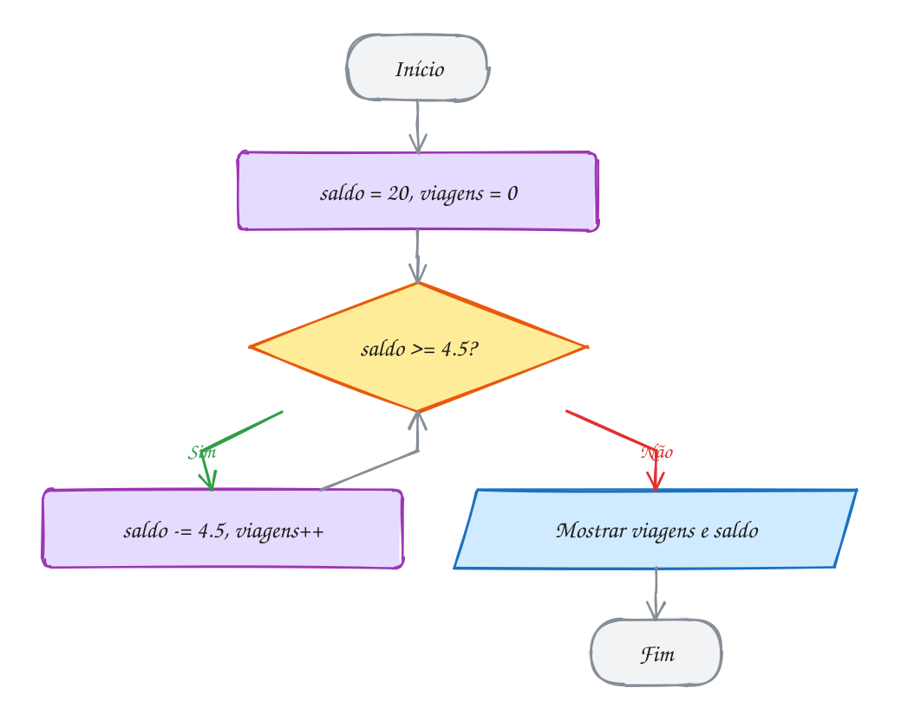</p>

> [!WARNING]
> Se nada dentro do bloco mudar a resposta da pergunta, o laço nunca acaba. É o
> famoso **loop infinito**. Esqueceu o `saldo -= 4.5`? O programa fica rodando
> para sempre. Para sair, aperte `Ctrl + C`.

> [!TIP]
> **Poder do TypeScript:** a variável que muda a cada volta precisa ser `let`.
> Se você usar `const` sem querer, o TypeScript avisa antes de rodar:
>
> ```ts
> const viagens = 0
> viagens++
> // erro: Cannot assign to 'viagens' because it is a constant.
> ```

> [!NOTE]
> **Hora de praticar:** os exemplos e os exercícios deste assunto estão em [`0021-while/`](0021-while/).
>
> ```bash
> pnpm tsx 16102026/0021-while/exemplo-1.ts
> ```

---

## 0022 · Laço do...while

> O professor pede a nota, você digita 15 e ele diz: "de 0 a 10, por favor".
> Pedir pelo menos uma vez é garantido. Repetir, só se precisar.

O `do...while` é o `while` de cabeça para baixo: primeiro **faz**, depois
**pergunta**. Por isso o bloco roda pelo menos uma vez. Ele é perfeito para
validar o que a pessoa digita: você só sabe se a resposta está certa depois de
pedir.

Você digita 15. O programa confere: 15 está fora de 0 a 10? Sim, então pede de
novo. Agora você digita 8. Está fora? Não. O laço acaba e a nota fica guardada:

<p align="center">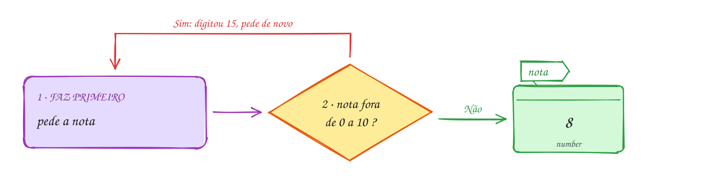</p>

```ts
import { input } from '#core/input.ts'

let nota: number

do {
  nota = Number(input('Nota (0 a 10): ')) // você digita 15, depois 8
} while (nota < 0 || nota > 10)

console.log(`Nota registrada: ${nota}`) // Nota registrada: 8
```

No fluxograma, o losango vem **depois** da leitura. Compare com o `while`, em
que a pergunta vem antes:

<p align="center"></p>

> [!TIP]
> **Poder do TypeScript:** dá para criar a variável só com o tipo, sem valor:
> `let nota: number`. O TypeScript confere se ela recebeu um valor antes de ser
> usada. Com o `do...while` ele sabe que o bloco roda, então está tudo certo.
> Sem nada que dê valor a ela, ele avisa:
>
> ```ts
> let nota: number
> console.log(nota)
> // erro: Variable 'nota' is used before being assigned.
> ```

> [!NOTE]
> **Hora de praticar:** os exemplos e os exercícios deste assunto estão em [`0022-do-while/`](0022-do-while/).
>
> ```bash
> pnpm tsx 16102026/0022-do-while/exemplo-1.ts
> ```

---

## 0023 · Laço for

> A tabuada do 7 tem dez linhas quase iguais. Só um número muda de uma linha
> para a outra.

Quando você já sabe **quantas vezes** vai repetir, o `for` é o laço mais
organizado. Ele junta numa linha só as três coisas que todo laço com contador
precisa: onde o contador começa, até quando repete e quanto ele anda a cada
volta.

Na tabuada do 7, o contador `i` começa em 1, o laço roda enquanto `i <= 10` e,
depois de cada linha mostrada, `i` anda mais um. Quando `i` chega a 11, a
pergunta dá `false` e o laço acaba:

<p align="center">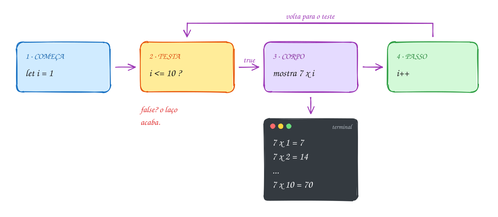</p>

```ts
const numero = 7

for (let i = 1; i <= 10; i++) {
  console.log(`${numero} x ${i} = ${numero * i}`)
}
// 7 x 1 = 7
// 7 x 2 = 14
// ...
// 7 x 10 = 70
```

O fluxograma é o mesmo de um `while`. O `for` só deixa as três partes juntas,
num lugar que dá para ler de uma vez:

<p align="center">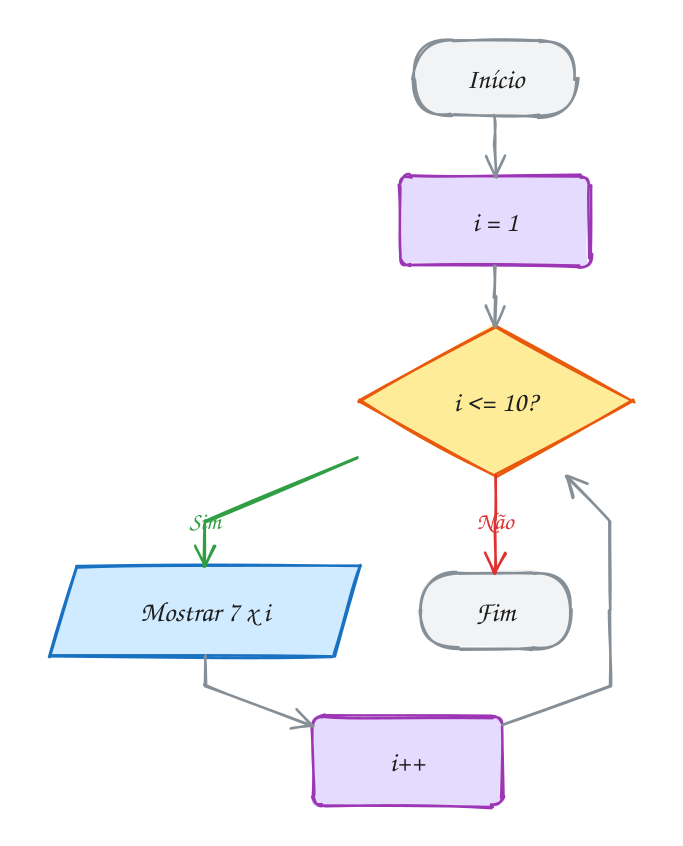</p>

> [!NOTE]
> O nome `i` é tradição (vem de *índice*), mas pode ser qualquer um. E o passo
> não precisa ser `i++`: `i += 2` anda de dois em dois, `i--` conta para trás.

> [!TIP]
> **Poder do TypeScript:** o `i` criado com `let` dentro do `for` só existe
> dentro do laço. Tentou usar depois? O TypeScript avisa antes de rodar:
>
> ```ts
> for (let i = 1; i <= 10; i++) {
>   console.log(i)
> }
> console.log(i)
> // erro: Cannot find name 'i'.
> ```

> [!NOTE]
> **Hora de praticar:** os exemplos e os exercícios deste assunto estão em [`0023-for/`](0023-for/).
>
> ```bash
> pnpm tsx 16102026/0023-for/exemplo-1.ts
> ```

---

## 0024 · break e continue

> Procurando a chave na mochila: achou, para de procurar. Pegou um caderno?
> Deixa de lado e olha o próximo item.

Às vezes você quer mexer no laço por dentro:

- `continue` pula **o resto desta volta** e vai direto para a próxima;
- `break` **para o laço inteiro** na hora, mesmo que a condição ainda seja
  `true`.

O laço abaixo conta de 1 a 10. Número par? `continue`: pula sem mostrar.
Passou de 7? `break`: acabou. No fim, só aparecem 1, 3, 5 e 7:

<p align="center">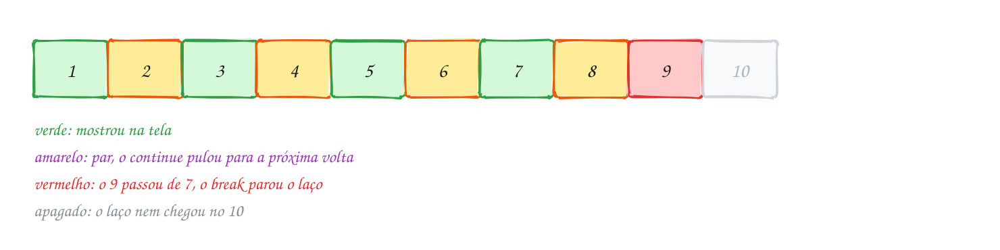</p>

```ts
for (let i = 1; i <= 10; i++) {
  if (i % 2 === 0) continue // par: pula para a próxima volta
  if (i > 7) break // passou de 7: para tudo
  console.log(i)
}
// 1, 3, 5, 7
```

No fluxograma, o `continue` é um atalho de volta para o `i++`, e o `break` é uma
saída direto para o fim:

<p align="center">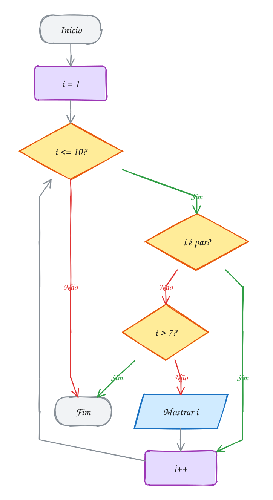</p>

> [!NOTE]
> Use com moderação. Um laço cheio de `break` e `continue` fica difícil de
> seguir. Quando der, coloque a regra na própria condição do laço.

> [!TIP]
> **Poder do TypeScript:** `break` fora de um laço (ou de um `switch`) não faz
> sentido, e o editor sublinha na hora:
>
> ```ts
> if (nota > 6) {
>   break
> }
> // erro: A 'break' statement can only be used within an enclosing
> //       iteration or switch statement.
> ```

> [!NOTE]
> **Hora de praticar:** os exemplos e os exercícios deste assunto estão em [`0024-break-continue/`](0024-break-continue/).
>
> ```bash
> pnpm tsx 16102026/0024-break-continue/exemplo-1.ts
> ```

---

## 0025 · Arrays (vetores)

> A chamada da turma é uma lista: cada aluno tem um número, começando do
> primeiro. Um array é isso.

Até agora, cada caixinha guardava um valor só. O **array** é uma fileira de
gavetas com uma etiqueta só. Cada gaveta tem um número, o **índice**, e a
contagem começa em **0**: a primeira gaveta é a 0, a segunda é a 1.

As notas da turma ficam em `notas`. Para ler uma gaveta, use o índice entre
colchetes: `notas[0]` é 8. Para trocar, atribua: `notas[1] = 7`. E
`notas.length` diz quantas gavetas existem:

<p align="center"></p>

```ts
const notas: number[] = [8, 6, 9]
const nomes: Array<string> = ['Ana', 'Bia', 'Caio']

console.log(nomes[0]) // Ana: a primeira posição é a 0
console.log(notas.length) // 3
notas[1] = 7 // troca o que está na posição 1
console.log(notas) // [ 8, 7, 9 ]
```

`number[]` e `Array<string>` são dois jeitos de escrever a mesma ideia: "array
de números" e "array de textos". Repare que `notas` é `const` e mesmo assim deu
para trocar a nota: o `const` trava a **etiqueta**, não o que tem dentro das
gavetas.

<p align="center">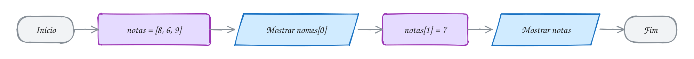</p>

> [!WARNING]
> Ler uma posição que não existe não dá erro: dá `undefined`. Em
> `[8, 7, 9]`, `notas[5]` é `undefined`. A última posição é sempre
> `notas.length - 1`.

> [!NOTE]
> **Matriz, só como noção:** um array pode guardar outros arrays. Fica uma
> tabela, com linha e coluna.
>
> ```ts
> const sala: string[][] = [
>   ['Ana', 'Bia'], // linha 0
>   ['Caio', 'Davi'], // linha 1
> ]
> console.log(sala[1]?.[0]) // Caio: linha 1, coluna 0
> ```

> [!TIP]
> **Poder do TypeScript:** um `number[]` só aceita número. Tentou colocar texto?
> O editor avisa antes de rodar:
>
> ```ts
> notas.push('dez')
> // erro: Argument of type 'string' is not assignable to parameter of type 'number'.
> ```

> [!NOTE]
> **Hora de praticar:** os exemplos e os exercícios deste assunto estão em [`0025-arrays/`](0025-arrays/).
>
> ```bash
> pnpm tsx 16102026/0025-arrays/exemplo-1.ts
> ```

---

## 0026 · Laço for...of

> Na chamada, o professor passa por cada nome da lista, um por um, do primeiro
> ao último. Não precisa contar: a lista mesmo diz quando acaba.

O `for...of` é o laço feito para arrays. A cada volta, ele pega o **próximo
item** e coloca numa variável. Não tem contador, não tem `i`, não tem risco de
passar do fim.

A lista tem três nomes. Na primeira volta, `nome` é `'Ana'`; na segunda,
`'Bia'`; na terceira, `'Caio'`. Acabaram os nomes, acabou o laço:

<p align="center">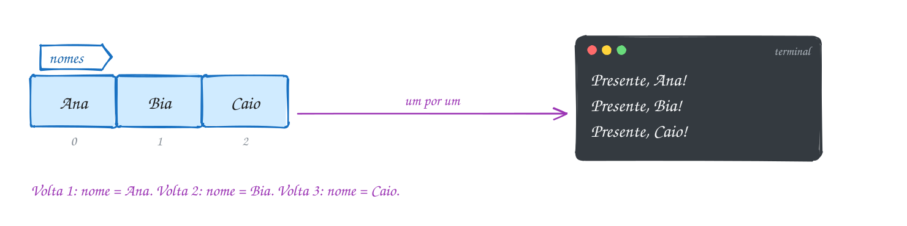</p>

```ts
const nomes: string[] = ['Ana', 'Bia', 'Caio']

for (const nome of nomes) {
  console.log(`Presente, ${nome}!`)
}
// Presente, Ana!
// Presente, Bia!
// Presente, Caio!
```

Dá para fazer o mesmo com o `for` clássico, usando o índice:
`for (let i = 0; i < nomes.length; i++)` e `nomes[i]` lá dentro. Quando você não
precisa do número da posição, o `for...of` é mais curto e mais difícil de errar.

<p align="center"></p>

> [!TIP]
> **Poder do TypeScript:** com o índice, o TypeScript não tem como saber se
> `notas[i]` existe (e se o `i` passar do fim?). Neste projeto ele exige que você
> trate isso. Com o `for...of`, ele sabe que cada item existe:
>
> ```ts
> for (let i = 0; i < notas.length; i++) {
>   soma += notas[i] // erro: Object is possibly 'undefined'.
> }
> for (const nota of notas) {
>   soma += nota // ok
> }
> ```

> [!NOTE]
> **Hora de praticar:** os exemplos e os exercícios deste assunto estão em [`0026-for-of/`](0026-for-of/).
>
> ```bash
> pnpm tsx 16102026/0026-for-of/exemplo-1.ts
> ```

---

## 0027 · Inserir e remover: push, pop, unshift, shift, splice

> A lista de compras na porta da geladeira: alguém acrescenta no fim, alguém
> risca o primeiro item, alguém troca um do meio.

Um array não tem tamanho fixo. Cinco métodos colocam e tiram itens:

| Método    | Onde mexe   | O que faz                         |
| --------- | ----------- | --------------------------------- |
| `push`    | no fim      | coloca um item                    |
| `pop`     | no fim      | tira o último e devolve ele       |
| `unshift` | no começo   | coloca um item                    |
| `shift`   | no começo   | tira o primeiro e devolve ele     |
| `splice`  | no meio     | tira e/ou coloca a partir de uma posição |

No desenho, cada ponta da lista tem uma entrada e uma saída. O `splice` é o
único que mexe no meio:

<p align="center"></p>

```ts
const compras: string[] = ['arroz', 'feijão']

compras.push('farinha') // [arroz, feijão, farinha]
compras.unshift('café') // [café, arroz, feijão, farinha]
compras.pop() // tira farinha: [café, arroz, feijão]
compras.shift() // tira café: [arroz, feijão]
compras.splice(1, 1, 'açaí') // na posição 1, tira 1 e põe açaí

console.log(compras) // [ 'arroz', 'açaí' ]
```

Os cinco **mudam o array original**. Por isso a lista vai mudando a cada linha,
sem precisar de `=`:

<p align="center">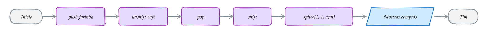</p>

> [!NOTE]
> O `splice(posição, quantosTirar, ...oQueColocar)` é o canivete: `splice(1, 1)`
> só tira, `splice(1, 0, 'pão')` só coloca, e `splice(1, 1, 'açaí')` troca.

> [!TIP]
> **Poder do TypeScript:** o `pop` devolve o item tirado, mas e se a lista
> estiver vazia? O TypeScript lembra disso: o tipo do que volta é
> `string | undefined`.
>
> ```ts
> const ultimo = compras.pop()
> ultimo.toUpperCase()
> // erro: 'ultimo' is possibly 'undefined'.
> ```

> [!NOTE]
> **Hora de praticar:** os exemplos e os exercícios deste assunto estão em [`0027-inserir-remover/`](0027-inserir-remover/).
>
> ```bash
> pnpm tsx 16102026/0027-inserir-remover/exemplo-1.ts
> ```

---

## 0028 · Consultar: indexOf, includes, find, findIndex, some, every

> Tem açaí na lista? Em que posição? Algum produto passa de R$ 20? Todos
> custam mais de R$ 5?

Estes métodos **fazem perguntas** para o array e não mudam nada nele:

- `includes(x)`: tem o `x`? Responde `true` ou `false`.
- `indexOf(x)`: em que posição está o `x`? Responde o índice, ou `-1` se não tem.
- `find(regra)`: devolve o **primeiro item** que passa na regra.
- `findIndex(regra)`: devolve a **posição** desse primeiro item.
- `some(regra)`: **algum** item passa? `true` ou `false`.
- `every(regra)`: **todos** passam? `true` ou `false`.

Os quatro últimos recebem uma **regra** escrita assim: `(p) => p > 20`. Por
enquanto, leia como "para cada preço `p`, pergunte: `p > 20`?". Na
[0034](#0034--arrow-functions-e-callbacks) a gente vê o que essa setinha é.

<p align="center"></p>

```ts
const precos: number[] = [6, 25, 9]

console.log(precos.includes(25)) // true
console.log(precos.indexOf(9)) // 2
console.log(precos.indexOf(100)) // -1: não tem
console.log(precos.find((p) => p > 20)) // 25
console.log(precos.findIndex((p) => p > 20)) // 1
console.log(precos.some((p) => p > 20)) // true
console.log(precos.every((p) => p > 5)) // true
```

O fluxograma mostra o que o `find` faz por dentro: olha item por item e para no
primeiro que passa na regra. O 6 não passa, o 25 passa, e o 9 nem é olhado:

<p align="center">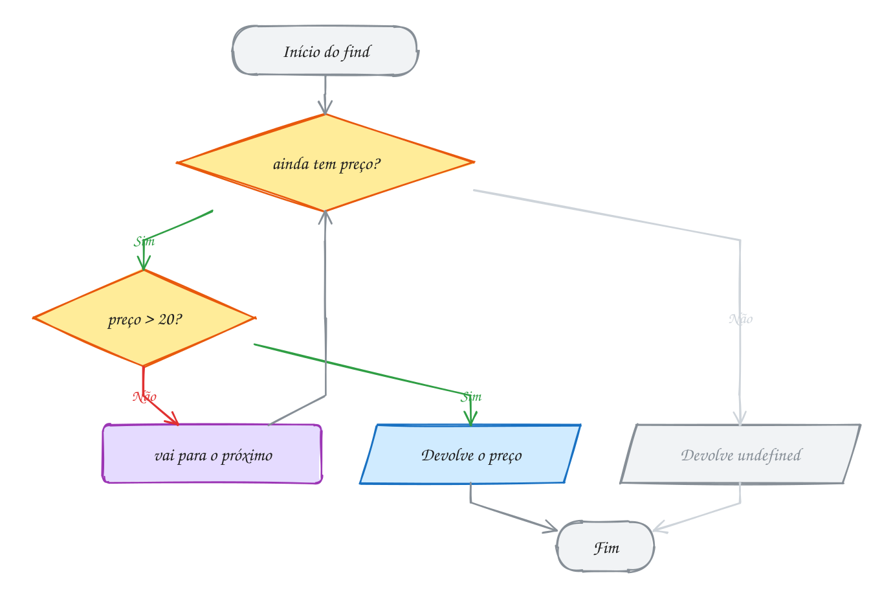</p>

> [!TIP]
> **Poder do TypeScript:** e se nenhum preço passar na regra? Aí o `find` devolve
> `undefined`, e o TypeScript não deixa você esquecer:
>
> ```ts
> const caro = precos.find((p) => p > 20)
> caro.toFixed(2)
> // erro: 'caro' is possibly 'undefined'.
> ```

> [!NOTE]
> **Hora de praticar:** os exemplos e os exercícios deste assunto estão em [`0028-consultar/`](0028-consultar/).
>
> ```bash
> pnpm tsx 16102026/0028-consultar/exemplo-1.ts
> ```

---

## 0029 · Transformar: map, filter, reduce, forEach

> Uma esteira de fábrica: entra fruta, sai suco. Os métodos desta seção são
> esteiras para arrays.

Estes quatro métodos passam por **todos os itens** do array, um por um, e
aplicam uma regra em cada:

- `map(regra)`: **transforma** cada item e devolve um array novo do mesmo
  tamanho.
- `filter(regra)`: **filtra**, devolvendo um array novo só com os itens que
  passam na regra.
- `reduce(regra, inicio)`: **junta** todos os itens num valor só, como uma soma.
- `forEach(regra)`: só **faz algo** com cada item (mostrar, por exemplo). Não
  devolve nada.

As notas da turma são `[8, 4, 9, 5]`. O `map` dobra cada uma, o `filter` deixa
só as de 6 para cima e o `reduce` soma tudo:

<p align="center"></p>

```ts
const notas: number[] = [8, 4, 9, 5]

const dobradas = notas.map((n) => n * 2) // [16, 8, 18, 10]
const aprovadas = notas.filter((n) => n >= 6) // [8, 9]
const soma = notas.reduce((acc, n) => acc + n, 0) // 26

notas.forEach((n) => console.log(`Nota: ${n}`))
```

O `reduce` assusta no começo. O `acc` (de acumulador) começa com o `0` do fim e,
a cada item, vira `acc + n`: 0 + 8 = 8, 8 + 4 = 12, 12 + 9 = 21, 21 + 5 = 26.

O fluxograma mostra o `map` por dentro. Ele monta um array novo, item por item,
e não mexe no original:

<p align="center">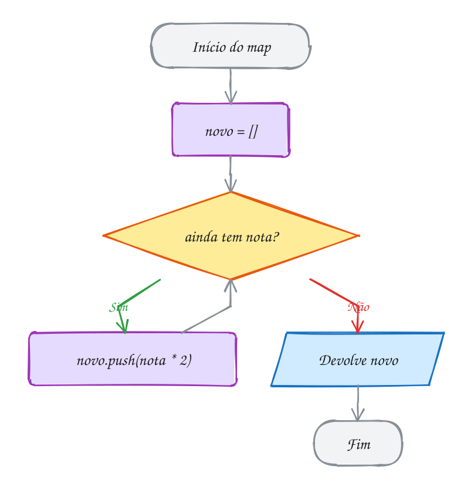</p>

> [!NOTE]
> Dá para **encadear**: o resultado de um vira a entrada do próximo.
> `notas.filter((n) => n >= 6).map((n) => n * 2)` filtra e depois dobra:
> `[16, 18]`.

> [!TIP]
> **Poder do TypeScript:** você não escreveu o tipo do `n`, e mesmo assim o
> TypeScript sabe que ele é `number`, porque `notas` é `number[]`. Isso se chama
> **tipagem contextual**. Por isso ele pega este erro:
>
> ```ts
> notas.map((n) => n.toUpperCase())
> // erro: Property 'toUpperCase' does not exist on type 'number'.
> ```

> [!NOTE]
> **Hora de praticar:** os exemplos e os exercícios deste assunto estão em [`0029-transformar/`](0029-transformar/).
>
> ```bash
> pnpm tsx 16102026/0029-transformar/exemplo-1.ts
> ```

---

## 0030 · Organizar: sort, reverse, slice, join, concat

> Arrumar a fila do recreio por altura muda a fila. Tirar uma foto da fila e
> arrumar a foto deixa a fila do jeito que estava.

Estes métodos organizam e recortam arrays:

- `sort(regra)`: **ordena**.
- `reverse()`: **inverte** a ordem.
- `slice(início, fim)`: **copia** um pedaço (ou tudo, sem argumentos).
- `join(separador)`: **junta** tudo num texto só.
- `concat(outro)`: **emenda** dois arrays num novo.

O mais importante desta seção é uma diferença: alguns métodos **mudam o array
original** e outros **devolvem um novo**, deixando o original como estava. No
desenho, o `sort` arruma a própria fila; o `slice` tira uma foto e quem muda é a
foto:

<p align="center">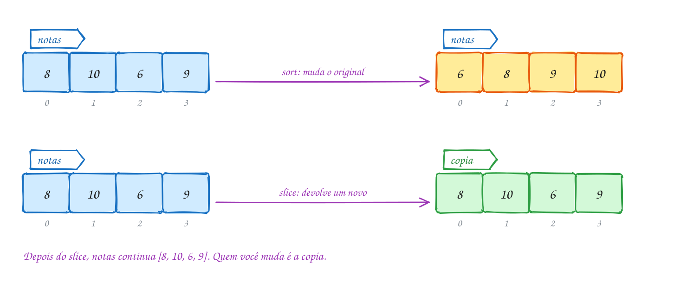</p>

```ts
const notas: number[] = [8, 10, 6, 9]

const copia = notas.slice() // cópia: um array novo
copia.sort((a, b) => a - b) // [6, 8, 9, 10]: o sort muda a cópia
copia.reverse() // [10, 9, 8, 6]

console.log(copia.join(' | ')) // 10 | 9 | 8 | 6
console.log(notas.concat([7])) // [ 8, 10, 6, 9, 7 ]: array novo
console.log(notas) // [ 8, 10, 6, 9 ]: o original não mudou
```

| Mudam o original                                  | Devolvem um novo                     |
| ------------------------------------------------- | ------------------------------------ |
| `push`, `pop`, `shift`, `unshift`, `splice`, `sort`, `reverse` | `map`, `filter`, `slice`, `concat`, `join` |

<p align="center">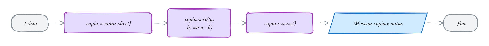</p>

> [!WARNING]
> O `sort` sem regra compara tudo **como texto**. Aí `[8, 10, 6, 9].sort()` dá
> `[10, 6, 8, 9]`, porque o texto `'10'` vem antes de `'6'`. Para números, passe
> sempre a regra `(a, b) => a - b` (do menor para o maior) ou `(a, b) => b - a`
> (do maior para o menor).

> [!TIP]
> **Poder do TypeScript:** quer garantir que ninguém mexe num array? Escreva
> `readonly`. Aí os métodos que mudam o original nem existem para ele:
>
> ```ts
> const notas: readonly number[] = [8, 10, 6, 9]
> notas.sort()
> // erro: Property 'sort' does not exist on type 'readonly number[]'.
> ```

> [!NOTE]
> **Hora de praticar:** os exemplos e os exercícios deste assunto estão em [`0030-organizar/`](0030-organizar/).
>
> ```bash
> pnpm tsx 16102026/0030-organizar/exemplo-1.ts
> ```

---

## 0031 · Funções

> Receita de bolo: você escreve uma vez e usa sempre que quiser, com os
> ingredientes que tiver na hora.

Uma **função** é um pedaço de código com nome, que você escreve uma vez e
**chama** quantas vezes quiser. Ela recebe valores (os **parâmetros**), faz o
trabalho e devolve um resultado com `return`.

`calcularMedia` recebe um array de notas, soma tudo e divide pela quantidade.
Chamada com `[8, 6, 10]`, ela devolve `8`:

<p align="center">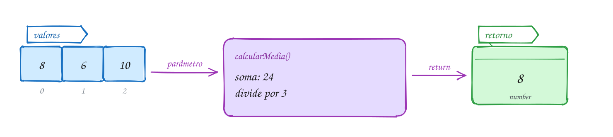</p>

```ts
function calcularMedia(valores: number[]): number {
  const soma = valores.reduce((acc, v) => acc + v, 0)
  return soma / valores.length
}

console.log(calcularMedia([8, 6, 10])) // 8
console.log(calcularMedia([5, 7])) // 6
```

Lendo a primeira linha: `function` cria a função, `calcularMedia` é o nome,
`valores: number[]` é o parâmetro com o tipo, e o `: number` depois dos
parênteses é o **tipo do retorno**, o que ela devolve.

No fluxograma, a chamada `calcularMedia([8, 6, 10])` entra, a função faz as
contas e devolve o `8`:

<p align="center"></p>

> [!NOTE]
> O `return` encerra a função na hora. O que vier depois dele, dentro da
> função, não roda.

> [!TIP]
> **Poder do TypeScript:** mesmo sem escrever o tipo do retorno, o TypeScript
> descobre olhando o `return`. Isso é **inferência do retorno**:
>
> ```ts
> function somar(a: number, b: number) {
>   return a + b // o TypeScript conclui: devolve number
> }
> const resultado: string = somar(1, 2)
> // erro: Type 'number' is not assignable to type 'string'.
> ```

> [!NOTE]
> **Hora de praticar:** os exemplos e os exercícios deste assunto estão em [`0031-funcoes/`](0031-funcoes/).
>
> ```bash
> pnpm tsx 16102026/0031-funcoes/exemplo-1.ts
> ```

---

## 0032 · Parâmetro opcional, valor padrão e void

> Pedido de açaí: o tamanho você tem que dizer. A granola é opcional. E o copo,
> se você não falar nada, vem o de sempre.

Nem todo parâmetro precisa ser informado em toda chamada:

- **Obrigatório**: `precos: number[]`. Sem ele, a função não tem com o que
  trabalhar.
- **Com valor padrão**: `desconto: number = 0`. Se a chamada não mandar, vale
  `0`.
- **Opcional**: `moeda?: string`. Pode ficar de fora, e aí dentro da função ele
  vale `undefined`.

E tem função que não devolve nada, só faz alguma coisa, como mostrar na tela. O
tipo do retorno dela é **`void`** (vazio).

<p align="center">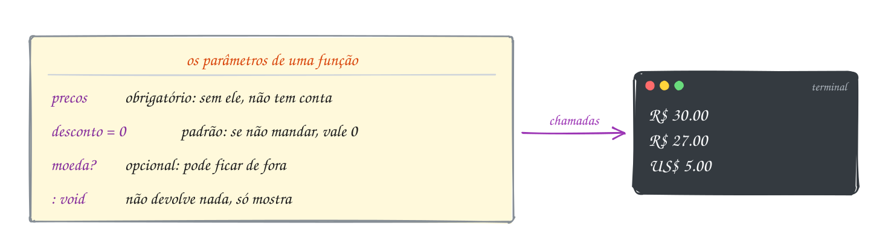</p>

```ts
function totalComDesconto(precos: number[], desconto: number = 0): number {
  const total = precos.reduce((acc, p) => acc + p, 0)
  return total - total * desconto
}

function mostrarTotal(total: number, moeda?: string): void {
  console.log(`${moeda ?? 'R

---

## Prática em sala

Os enunciados estão em [`pratica/`](pratica/):

| Arquivo                                                  | O que fazer                                               |
| -------------------------------------------------------- | --------------------------------------------------------- |
| [`tabuada.ts`](pratica/tabuada.ts)                       | tabuada com `for`, e depois um `for` dentro do outro      |
| [`lista-de-compras.ts`](pratica/lista-de-compras.ts)     | adicionar, remover, buscar e listar com métodos de array  |
| [`total-com-desconto.ts`](pratica/total-com-desconto.ts) | função que soma preços com desconto opcional             |
| [`desafio-produtos.ts`](pratica/desafio-produtos.ts)     | desafio: `filter`, `map` e `reduce` encadeados            |

## Exercícios que valem pontos

Ficam na pasta [`aula-02-logica-2/`](aula-02-logica-2/), aqui dentro da aula.
Cada questão tem um exemplo resolvido parecido, para consultar.

| Questão          | Conceito                                                  | Exemplo resolvido |
| ---------------- | --------------------------------------------------------- | ----------------- |
| `questao-10.ts`  | laço `while`                                              | `exemplo-10.ts`   |
| `questao-11.ts`  | laço `do...while`                                         | `exemplo-11.ts`   |
| `questao-12.ts`  | laço `for`                                                | `exemplo-12.ts`   |
| `questao-13.ts`  | arrays tipados e `for...of`                               | `exemplo-13.ts`   |
| `questao-14.ts`  | métodos de array para inserir, remover e buscar           | `exemplo-14.ts`   |
| `questao-15.ts`  | `map`, `filter`, `reduce`, `sort` e encadeamento          | `exemplo-15.ts`   |
| `questao-16.ts`  | funções tipadas, parâmetro opcional, valor padrão e `void`| `exemplo-16.ts`   |
| `questao-17.ts`  | arrow functions, callbacks e tipo de função               | `exemplo-17.ts`   |

```bash
pnpm tsx 16102026/aula-02-logica-2/exemplo-10.ts
```

## Para ler mais

- MDN WEB DOCS. *Laços e iterações*. Disponível em: <https://developer.mozilla.org/pt-BR/docs/Web/JavaScript/Guide/Loops_and_iteration>.
- MDN WEB DOCS. *Array*. Disponível em: <https://developer.mozilla.org/pt-BR/docs/Web/JavaScript/Reference/Global_Objects/Array>.
- MDN WEB DOCS. *Funções*. Disponível em: <https://developer.mozilla.org/pt-BR/docs/Web/JavaScript/Guide/Functions>.
- MDN WEB DOCS. *Arrow functions*. Disponível em: <https://developer.mozilla.org/pt-BR/docs/Web/JavaScript/Reference/Functions/Arrow_functions>.
- MICROSOFT. *TypeScript Handbook*: More on Functions. Disponível em: <https://www.typescriptlang.org/docs/handbook/2/functions.html>.
- MICROSOFT. *TypeScript Handbook*: Everyday Types (Arrays). Disponível em: <https://www.typescriptlang.org/docs/handbook/2/everyday-types.html#arrays>.
- MICROSOFT. *TSConfig*: noUncheckedIndexedAccess. Disponível em: <https://www.typescriptlang.org/tsconfig/#noUncheckedIndexedAccess>.
- HAVERBEKE, M. *Eloquent JavaScript*. 3. ed. San Francisco: No Starch Press, 2018. Cap. 2 a 5. Disponível em: <https://eloquentjavascript.net>.
} ${total.toFixed(2)}`)
}

mostrarTotal(totalComDesconto([10, 20])) // R$ 30.00
mostrarTotal(totalComDesconto([10, 20], 0.1)) // R$ 27.00
mostrarTotal(5, 'US

---

## Prática em sala

Os enunciados estão em [`pratica/`](pratica/):

| Arquivo                                                  | O que fazer                                               |
| -------------------------------------------------------- | --------------------------------------------------------- |
| [`tabuada.ts`](pratica/tabuada.ts)                       | tabuada com `for`, e depois um `for` dentro do outro      |
| [`lista-de-compras.ts`](pratica/lista-de-compras.ts)     | adicionar, remover, buscar e listar com métodos de array  |
| [`total-com-desconto.ts`](pratica/total-com-desconto.ts) | função que soma preços com desconto opcional             |
| [`desafio-produtos.ts`](pratica/desafio-produtos.ts)     | desafio: `filter`, `map` e `reduce` encadeados            |

## Exercícios que valem pontos

Ficam na pasta [`aula-02-logica-2/`](aula-02-logica-2/), aqui dentro da aula.
Cada questão tem um exemplo resolvido parecido, para consultar.

| Questão          | Conceito                                                  | Exemplo resolvido |
| ---------------- | --------------------------------------------------------- | ----------------- |
| `questao-10.ts`  | laço `while`                                              | `exemplo-10.ts`   |
| `questao-11.ts`  | laço `do...while`                                         | `exemplo-11.ts`   |
| `questao-12.ts`  | laço `for`                                                | `exemplo-12.ts`   |
| `questao-13.ts`  | arrays tipados e `for...of`                               | `exemplo-13.ts`   |
| `questao-14.ts`  | métodos de array para inserir, remover e buscar           | `exemplo-14.ts`   |
| `questao-15.ts`  | `map`, `filter`, `reduce`, `sort` e encadeamento          | `exemplo-15.ts`   |
| `questao-16.ts`  | funções tipadas, parâmetro opcional, valor padrão e `void`| `exemplo-16.ts`   |
| `questao-17.ts`  | arrow functions, callbacks e tipo de função               | `exemplo-17.ts`   |

```bash
pnpm tsx 16102026/aula-02-logica-2/exemplo-10.ts
```

## Para ler mais

- MDN WEB DOCS. *Laços e iterações*. Disponível em: <https://developer.mozilla.org/pt-BR/docs/Web/JavaScript/Guide/Loops_and_iteration>.
- MDN WEB DOCS. *Array*. Disponível em: <https://developer.mozilla.org/pt-BR/docs/Web/JavaScript/Reference/Global_Objects/Array>.
- MDN WEB DOCS. *Funções*. Disponível em: <https://developer.mozilla.org/pt-BR/docs/Web/JavaScript/Guide/Functions>.
- MDN WEB DOCS. *Arrow functions*. Disponível em: <https://developer.mozilla.org/pt-BR/docs/Web/JavaScript/Reference/Functions/Arrow_functions>.
- MICROSOFT. *TypeScript Handbook*: More on Functions. Disponível em: <https://www.typescriptlang.org/docs/handbook/2/functions.html>.
- MICROSOFT. *TypeScript Handbook*: Everyday Types (Arrays). Disponível em: <https://www.typescriptlang.org/docs/handbook/2/everyday-types.html#arrays>.
- MICROSOFT. *TSConfig*: noUncheckedIndexedAccess. Disponível em: <https://www.typescriptlang.org/tsconfig/#noUncheckedIndexedAccess>.
- HAVERBEKE, M. *Eloquent JavaScript*. 3. ed. San Francisco: No Starch Press, 2018. Cap. 2 a 5. Disponível em: <https://eloquentjavascript.net>.
) // US$ 5.00
```

O fluxograma mostra o que o `totalComDesconto` decide sozinho. Na primeira
chamada não veio desconto, então vale o padrão:

<p align="center"></p>

> [!NOTE]
> Parâmetros opcionais e com valor padrão vêm **depois** dos obrigatórios.

> [!TIP]
> **Poder do TypeScript:** ele confere se você mandou o que é obrigatório e
> conta até o que é opcional:
>
> ```ts
> totalComDesconto()
> // erro: Expected 1-2 arguments, but got 0.
> ```

> [!NOTE]
> **Hora de praticar:** os exemplos e os exercícios deste assunto estão em [`0032-parametros/`](0032-parametros/).
>
> ```bash
> pnpm tsx 16102026/0032-parametros/exemplo-1.ts
> ```

---

## 0033 · Escopo de variáveis

> O que se fala no grupo da sala fica no grupo da sala. Quem está fora não
> fica sabendo.

**Escopo** é o pedaço do código onde uma variável existe. Uma variável criada
fora de tudo, no arquivo, é **global**: o arquivo inteiro enxerga. Uma variável
criada dentro de uma função só existe **lá dentro**, e some quando a função
termina.

A regra é de mão única: quem está dentro enxerga o que está fora, mas quem está
fora não enxerga o que está dentro. A função `saudar` usa a `escola`, que é
global. Já a `mensagem` nasce e morre dentro da função:

<p align="center"></p>

```ts
const escola = 'CETAM' // global: o arquivo inteiro enxerga

function saudar(nome: string): void {
  const mensagem = `Oi, ${nome}! Bem-vinda ao ${escola}.` // só existe aqui dentro
  console.log(mensagem)
}

saudar('Ana') // Oi, Ana! Bem-vinda ao CETAM.
// console.log(mensagem) // erro: a mensagem não existe aqui fora
```

No fluxograma, `nome` e `mensagem` aparecem quando a função é chamada e somem
quando ela acaba:

<p align="center">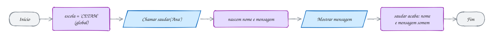</p>

> [!NOTE]
> Não é só função: todo bloco entre `{ }`, como o de um `if` ou de um `for`,
> tem o seu escopo para `let` e `const`. Foi por isso que o `i` do `for` não
> existia depois do laço, na [0023](#0023--laço-for).

> [!TIP]
> **Poder do TypeScript:** usar uma variável fora do escopo dela é erro na hora,
> sublinhado no editor, em vez de um susto com o programa rodando:
>
> ```ts
> console.log(mensagem)
> // erro: Cannot find name 'mensagem'.
> ```

> [!NOTE]
> **Hora de praticar:** os exemplos e os exercícios deste assunto estão em [`0033-escopo/`](0033-escopo/).
>
> ```bash
> pnpm tsx 16102026/0033-escopo/exemplo-1.ts
> ```

---

## 0034 · Arrow functions e callbacks

> Você entrega a receita e outra pessoa cozinha. No `map`, ele é o cozinheiro e
> a sua função é a receita.

Existe um jeito mais curto de escrever função: a **arrow function** (função
seta). Estas duas fazem a mesma coisa:

```ts
function dobrar(n: number): number {
  return n * 2
}
const triplicar = (n: number): number => n * 3 // arrow function
```

Quando a arrow tem uma linha só, o resultado depois da `=>` já é o `return`.

E dá para **passar uma função para outra função**. A que você passa se chama
**callback**: a outra função vai chamar a sua depois, na hora certa. É isso que
acontece no `map`, no `filter` e no `find`: você entrega a regra e o método
chama a regra para cada item:

<p align="center">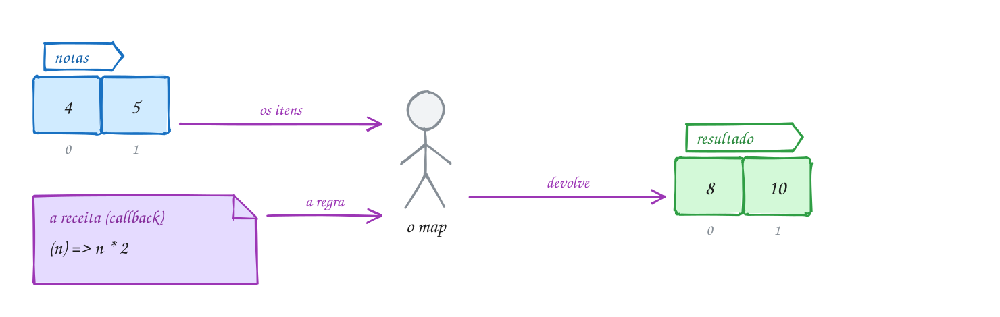</p>

```ts
const notas: number[] = [4, 5]

console.log(notas.map(dobrar)) // [ 8, 10 ]
console.log(notas.map(triplicar)) // [ 12, 15 ]
console.log(notas.map((n) => n + 1)) // [ 5, 6 ]: arrow escrita ali mesmo
```

Repare que é `notas.map(dobrar)`, sem parênteses depois de `dobrar`: você está
entregando a função, não chamando. Quem chama é o `map`, uma vez para cada nota:

<p align="center">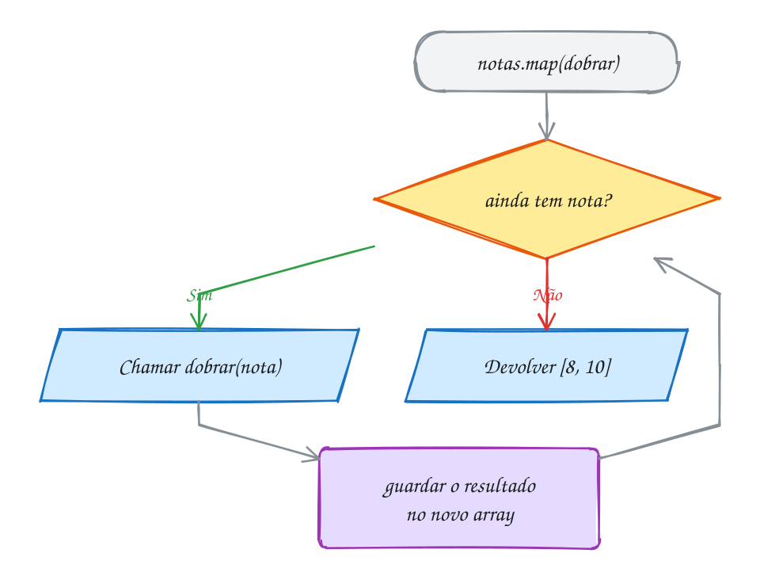</p>

> [!TIP]
> **Poder do TypeScript:** o `map` sabe que vai entregar um `number` para a sua
> regra. Se a sua regra pedir outra coisa, o TypeScript não deixa:
>
> ```ts
> notas.map((n: string) => n)
> // erro: Argument of type '(n: string) => string' is not assignable to
> //       parameter of type '(value: number, ...) => string'.
> ```

> [!NOTE]
> **Hora de praticar:** os exemplos e os exercícios deste assunto estão em [`0034-arrow-callback/`](0034-arrow-callback/).
>
> ```bash
> pnpm tsx 16102026/0034-arrow-callback/exemplo-1.ts
> ```

---

## 0035 · Tipo de função e tipagem contextual

> A tomada de três pinos aceita qualquer aparelho, desde que o plugue seja do
> formato certo.

Funções também têm tipo. O tipo de uma função diz **o que ela recebe e o que
ela devolve**, e dá para dar um nome para ele com `type`:

```ts
type Operacao = (a: number, b: number) => number
```

Lê assim: "uma `Operacao` é qualquer função que recebe dois números e devolve
um número". É a tomada. `somar` e `multiplicar` têm o plugue certo e encaixam.
Uma função que junta textos não encaixa:

<p align="center"></p>

```ts
type Operacao = (a: number, b: number) => number

const somar: Operacao = (a, b) => a + b
const multiplicar: Operacao = (a, b) => a * b

function calcular(a: number, b: number, op: Operacao): number {
  return op(a, b)
}

console.log(calcular(6, 7, somar)) // 13
console.log(calcular(6, 7, multiplicar)) // 42
```

Repare em `(a, b) => a + b`: não tem tipo nenhum escrito no `a` nem no `b`, e
mesmo assim o TypeScript sabe que são números. Ele tira do `Operacao`. Isso é a
**tipagem contextual**, a mesma que faz o `n` do `map` ser `number` sozinho.

<p align="center">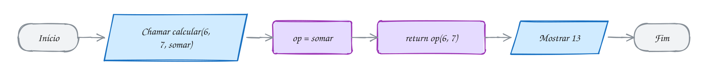</p>

> [!TIP]
> **Poder do TypeScript:** o `type` vira uma regra que o editor confere. Plugue
> errado não entra:
>
> ```ts
> const juntar: Operacao = (a: string, b: string) => a + b
> // erro: Type '(a: string, b: string) => string' is not assignable
> //       to type 'Operacao'.
> ```

> [!NOTE]
> **Hora de praticar:** os exemplos e os exercícios deste assunto estão em [`0035-tipo-de-funcao/`](0035-tipo-de-funcao/).
>
> ```bash
> pnpm tsx 16102026/0035-tipo-de-funcao/exemplo-1.ts
> ```

---

## 0036 · Juntando tudo: as notas da turma

> Tudo da aula num programa só: pedir as notas, guardar num array e usar
> funções e métodos para tirar as respostas.

O programa abaixo é o fechamento da aula. Ele pede notas até você responder
`n`, guarda tudo num array e depois mostra a média, as notas de 6 para cima, as
notas dobradas e a lista numerada. Cada linha usa uma seção desta aula:

| Parte do programa                    | Seção                                  |
| ------------------------------------ | -------------------------------------- |
| `do...while` pedindo as notas        | [0022](#0022--laço-dowhile)            |
| `notas: number[]` e `push`           | [0025](#0025--arrays-vetores) e [0027](#0027--inserir-e-remover-push-pop-unshift-shift-splice) |
| `calcularMedia` com `reduce`         | [0031](#0031--funções) e [0029](#0029--transformar-map-filter-reduce-foreach) |
| `filter`, `map` e `join`             | [0029](#0029--transformar-map-filter-reduce-foreach) e [0030](#0030--organizar-sort-reverse-slice-join-concat) |
| `for` com índice                     | [0023](#0023--laço-for)                |

Você digita 8, 5 e 9, e depois `n`:

<p align="center"></p>

```ts
import { input } from '#core/input.ts'

const notas: number[] = []
let resposta: string

do {
  const nota = Number(input('Digite uma nota: '))
  notas.push(nota)
  resposta = input('Outra nota? (s/n) ')
} while (resposta === 's')

function calcularMedia(valores: number[]): number {
  const soma = valores.reduce((acc, v) => acc + v, 0)
  return soma / valores.length
}

const aprovadas = notas.filter((n) => n >= 6)
const dobradas = notas.map((n) => n * 2)

console.log(`Média: ${calcularMedia(notas).toFixed(2)}`)
console.log(`Notas de 6 para cima: ${aprovadas.join(', ')}`)
console.log(`Dobradas: ${dobradas.join(', ')}`)

for (let i = 0; i < notas.length; i++) {
  console.log(`Nota ${i + 1}: ${notas[i]}`)
}
```

O fluxograma mostra as três voltas do `do...while` e depois o relatório:

<p align="center">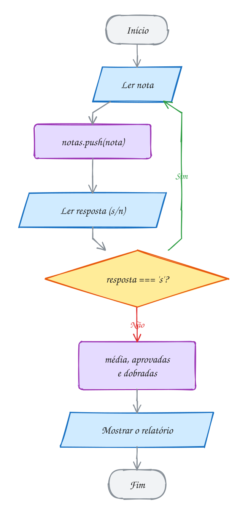</p>

> [!TIP]
> **Poder do TypeScript:** no programa inteiro, você escreveu só dois tipos:
> `number[]` e `string`. Passe o mouse em `aprovadas`, `dobradas`, `nota` e
> `calcularMedia`: o TypeScript descobriu o tipo de todo o resto sozinho, e
> confere cada um deles enquanto você digita.

> [!NOTE]
> **Hora de praticar:** os exemplos e os exercícios deste assunto estão em [`0036-juntando-tudo/`](0036-juntando-tudo/).
>
> ```bash
> pnpm tsx 16102026/0036-juntando-tudo/exemplo-1.ts
> ```

---

## Prática em sala

Os enunciados estão em [`pratica/`](pratica/):

| Arquivo                                                  | O que fazer                                               |
| -------------------------------------------------------- | --------------------------------------------------------- |
| [`tabuada.ts`](pratica/tabuada.ts)                       | tabuada com `for`, e depois um `for` dentro do outro      |
| [`lista-de-compras.ts`](pratica/lista-de-compras.ts)     | adicionar, remover, buscar e listar com métodos de array  |
| [`total-com-desconto.ts`](pratica/total-com-desconto.ts) | função que soma preços com desconto opcional             |
| [`desafio-produtos.ts`](pratica/desafio-produtos.ts)     | desafio: `filter`, `map` e `reduce` encadeados            |

## Exercícios que valem pontos

Ficam na pasta [`aula-02-logica-2/`](aula-02-logica-2/), aqui dentro da aula.
Cada questão tem um exemplo resolvido parecido, para consultar.

| Questão          | Conceito                                                  | Exemplo resolvido |
| ---------------- | --------------------------------------------------------- | ----------------- |
| `questao-10.ts`  | laço `while`                                              | `exemplo-10.ts`   |
| `questao-11.ts`  | laço `do...while`                                         | `exemplo-11.ts`   |
| `questao-12.ts`  | laço `for`                                                | `exemplo-12.ts`   |
| `questao-13.ts`  | arrays tipados e `for...of`                               | `exemplo-13.ts`   |
| `questao-14.ts`  | métodos de array para inserir, remover e buscar           | `exemplo-14.ts`   |
| `questao-15.ts`  | `map`, `filter`, `reduce`, `sort` e encadeamento          | `exemplo-15.ts`   |
| `questao-16.ts`  | funções tipadas, parâmetro opcional, valor padrão e `void`| `exemplo-16.ts`   |
| `questao-17.ts`  | arrow functions, callbacks e tipo de função               | `exemplo-17.ts`   |

```bash
pnpm tsx 16102026/aula-02-logica-2/exemplo-10.ts
```

## Para ler mais

- MDN WEB DOCS. *Laços e iterações*. Disponível em: <https://developer.mozilla.org/pt-BR/docs/Web/JavaScript/Guide/Loops_and_iteration>.
- MDN WEB DOCS. *Array*. Disponível em: <https://developer.mozilla.org/pt-BR/docs/Web/JavaScript/Reference/Global_Objects/Array>.
- MDN WEB DOCS. *Funções*. Disponível em: <https://developer.mozilla.org/pt-BR/docs/Web/JavaScript/Guide/Functions>.
- MDN WEB DOCS. *Arrow functions*. Disponível em: <https://developer.mozilla.org/pt-BR/docs/Web/JavaScript/Reference/Functions/Arrow_functions>.
- MICROSOFT. *TypeScript Handbook*: More on Functions. Disponível em: <https://www.typescriptlang.org/docs/handbook/2/functions.html>.
- MICROSOFT. *TypeScript Handbook*: Everyday Types (Arrays). Disponível em: <https://www.typescriptlang.org/docs/handbook/2/everyday-types.html#arrays>.
- MICROSOFT. *TSConfig*: noUncheckedIndexedAccess. Disponível em: <https://www.typescriptlang.org/tsconfig/#noUncheckedIndexedAccess>.
- HAVERBEKE, M. *Eloquent JavaScript*. 3. ed. San Francisco: No Starch Press, 2018. Cap. 2 a 5. Disponível em: <https://eloquentjavascript.net>.
