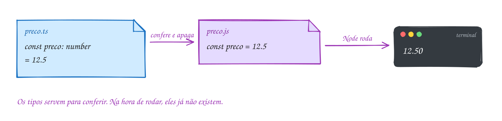
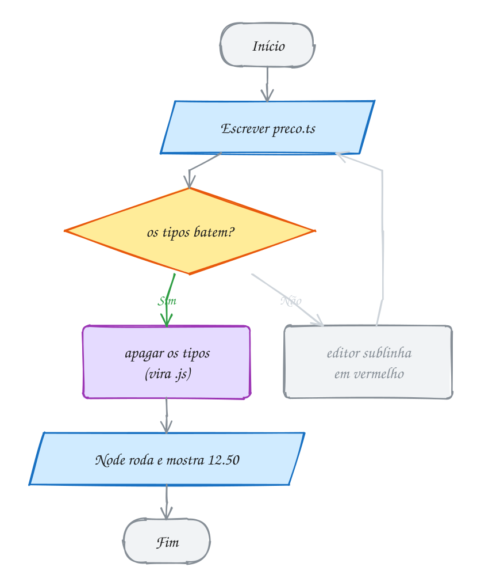
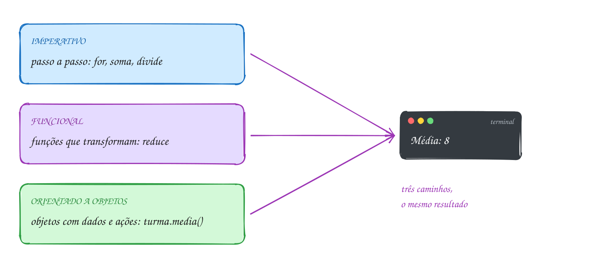
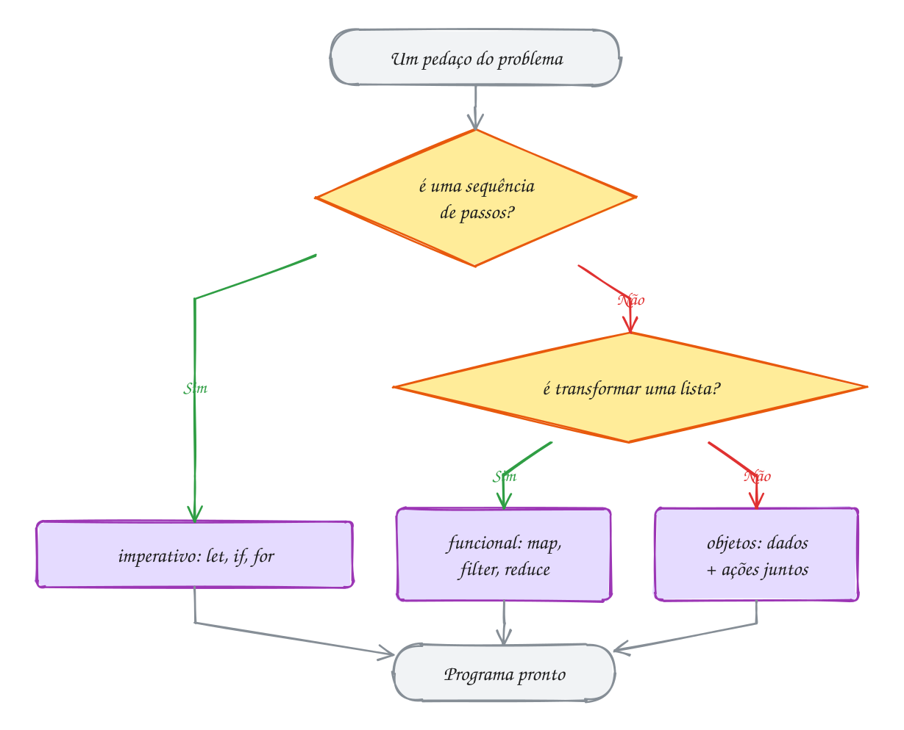
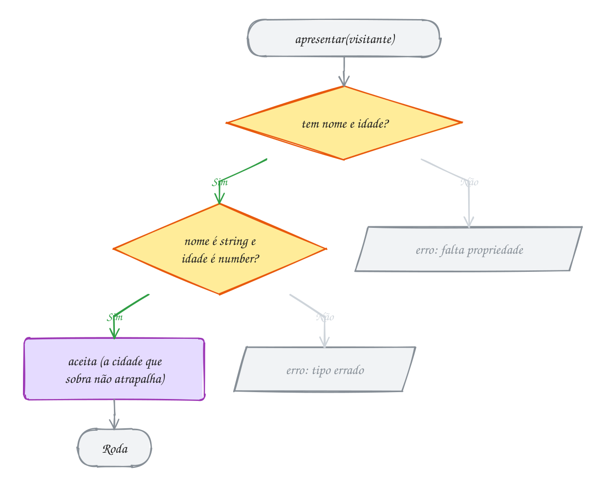
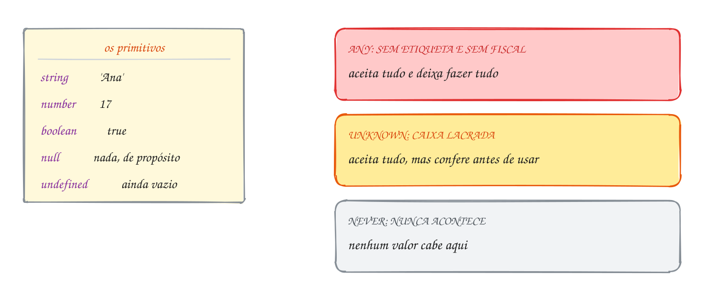
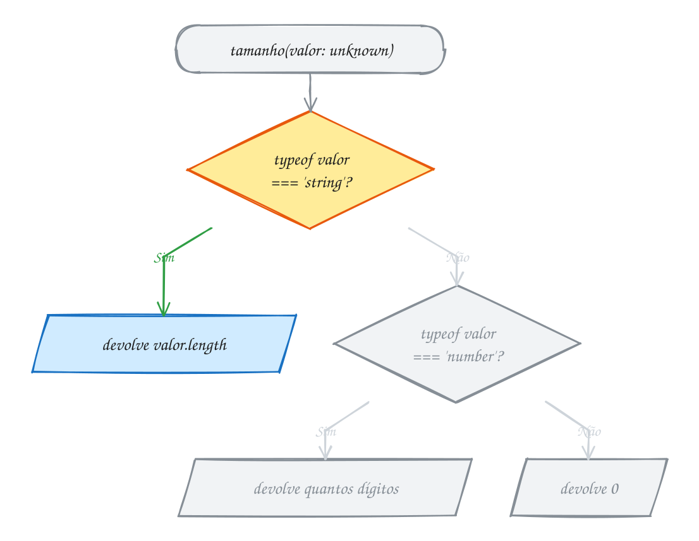
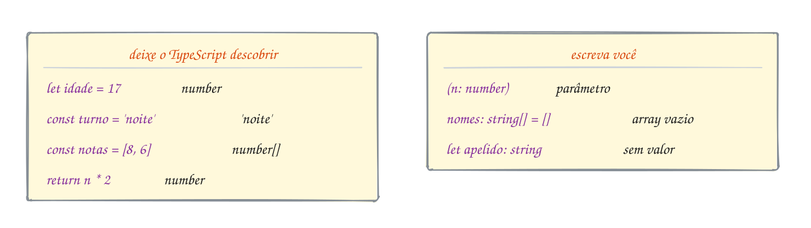
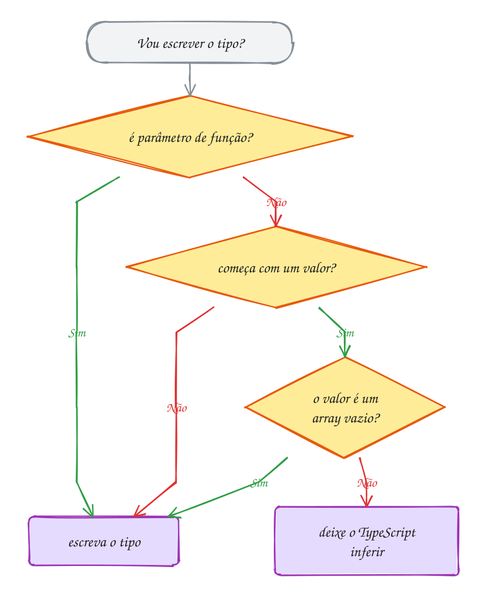
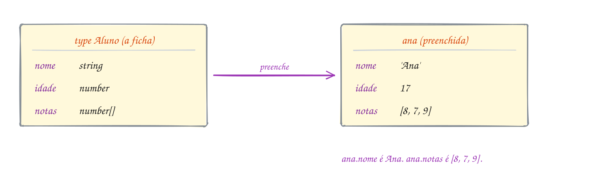

<!-- Gerado por _gerador. Para mudar este arquivo, edite _gerador/aulas/19102026/ e rode: cd _gerador && npm run gerar -->

# Aula 03 · 19/10 · TypeScript

Até aqui você escreveu TypeScript pensando na lógica. Hoje o assunto são os
**tipos**.

Tipo é o jeito de dizer ao TypeScript que formato cada dado tem. Com isso, ele
avisa o erro antes de o programa rodar.

## O que você vai aprender

- como o TypeScript funciona e por que ele foi escolhido
- descrever objetos com `type` e `interface`
- dizer "isto ou aquilo" com uniões e "isto e aquilo" com interseções
- escrever funções que servem para qualquer tipo, com generics
- criar variações de um tipo com os tipos utilitários
- ler as regras do `tsconfig.json` e conferir o projeto com o `tsc`

Quem entende os tipos lê o erro do editor e já sabe o que corrigir. E vai
precisar disso: em POO as classes seguem interfaces, e no frontend os
componentes recebem dados tipados.

## Como a gente vai estudar cada assunto

1. Primeiro, o texto e o **diagrama da ideia**: é o exemplo desenhado.
2. Depois, o código. Repara que é o mesmo exemplo, com os mesmos valores.
3. Aí você segue o **fluxograma** com o dedo: é o caminho que o programa faz.
4. Hora de rodar os exemplos da pasta. Mude alguma coisa e rode de novo.
5. Por fim, os exercícios. Travou? As dicas estão no próprio arquivo.

No meio de cada assunto tem uma **Pergunta para a turma**. Tente responder
antes de rodar o código.

## As cores e as formas

Caixa azul é dado entrando ou saindo, roxa é o
programa fazendo alguma coisa, amarela é pergunta. Os tipos de objeto aparecem
como uma **ficha**, com o nome da propriedade à esquerda e o tipo à direita.

<p align="center"></p>

## Antes de começar

> [!IMPORTANT]
> O `tsx` **roda** o arquivo, mas **não confere os tipos**. Quem confere é o
> editor (o sublinhado vermelho) e o comando `pnpm -C ~/LPPOO tsc`. Rode o
> `tsc` sempre que terminar um exercício. O assunto 0053 explica.

> [!TIP]
> Os quadros **Poder do TypeScript** mostram o erro que o TypeScript dá quando
> alguém usa o tipo errado. Copie o código do quadro para um exercício, veja o
> erro aparecer no editor e leia a mensagem com calma: ela quase sempre diz o
> que está faltando.

## Os assuntos

Leia na ordem: cada um usa o anterior.

| # | Assunto | Pasta |
| --- | --- | --- |
| [0037](#0037--como-o-typescript-funciona-e-por-que-ele) | Como o TypeScript funciona (e por que ele) | [`0037-typescript/`](0037-typescript/) |
| [0038](#0038--paradigmas-de-programação) | Paradigmas de programação | [`0038-paradigmas/`](0038-paradigmas/) |
| [0039](#0039--como-o-typescript-pensa-tipos-estruturais) | Como o TypeScript pensa: tipos estruturais | [`0039-tipagem-estrutural/`](0039-tipagem-estrutural/) |
| [0040](#0040--tipos-primitivos-any-unknown-e-never) | Tipos primitivos, any, unknown e never | [`0040-tipos-basicos/`](0040-tipos-basicos/) |
| [0041](#0041--inferência-x-anotação-quando-escrever-o-tipo) | Inferência x anotação: quando escrever o tipo | [`0041-inferencia/`](0041-inferencia/) |
| [0042](#0042--tipos-de-objeto-e-type) | Tipos de objeto e type | [`0042-tipos-de-objeto/`](0042-tipos-de-objeto/) |
| [0043](#0043--interface-e-type-x-interface) | interface (e type x interface) | [`0043-interface/`](0043-interface/) |
| [0044](#0044--propriedade-opcional-e-readonly) | Propriedade opcional e readonly | [`0044-opcional-readonly/`](0044-opcional-readonly/) |
| [0045](#0045--união--e-tipos-literais) | União (|) e tipos literais | [`0045-uniao-literais/`](0045-uniao-literais/) |
| [0046](#0046--narrowing-estreitando-o-tipo) | Narrowing: estreitando o tipo | [`0046-narrowing/`](0046-narrowing/) |
| [0047](#0047--união-discriminada) | União discriminada | [`0047-uniao-discriminada/`](0047-uniao-discriminada/) |
| [0048](#0048--interseção-) | Interseção (&) | [`0048-intersecao/`](0048-intersecao/) |
| [0049](#0049--tuplas-enum-e-as-const) | Tuplas, enum e as const | [`0049-tuplas-enum-as-const/`](0049-tuplas-enum-as-const/) |
| [0050](#0050--generics-t) | Generics (<T>) | [`0050-generics/`](0050-generics/) |
| [0051](#0051--tipos-utilitários-partial-pick-omit-record-readonly) | Tipos utilitários: Partial, Pick, Omit, Record, Readonly | [`0051-tipos-utilitarios/`](0051-tipos-utilitarios/) |
| [0052](#0052--type-guards-x-is-t-e-satisfies) | Type guards (x is T) e satisfies | [`0052-type-guards-satisfies/`](0052-type-guards-satisfies/) |
| [0053](#0053--tsconfig-strict-e-as-regras-do-projeto) | tsconfig: strict e as regras do projeto | [`0053-tsconfig/`](0053-tsconfig/) |
| [0054](#0054--juntando-tudo-cadastro-de-alunos-tipado) | Juntando tudo: cadastro de alunos tipado | [`0054-juntando-tudo/`](0054-juntando-tudo/) |

---

## 0037 · Como o TypeScript funciona (e por que ele)

O JavaScript deixa você errar à vontade. Ele só reclama com o programa rodando,
às vezes já na mão de quem está usando. O TypeScript reclama antes.

TypeScript é **JavaScript com tipos**. Você escreve o mesmo JavaScript de
sempre e, quando quiser, diz o tipo de cada coisa.

Olha só: `const preco: number = 12.5` quer dizer "preço é um número".

Só que o Node e o navegador não entendem `: number`. Eles só leem JavaScript.

Então todo arquivo `.ts` passa por duas etapas antes de rodar. Primeiro, o
TypeScript confere se os tipos batem. Depois, ele apaga os tipos e entrega
JavaScript puro para o Node.

<p align="center"></p>

```ts
const preco: number = 12.5
console.log(preco.toFixed(2)) // 12.50

// const troco: number = 'dez reais'
// erro: Type 'string' is not assignable to type 'number'.
```

E quando os tipos não batem? O caminho volta para você. O editor sublinha em
vermelho, você corrige e tenta de novo. Só código conferido segue para o Node.

<p align="center"></p>

Na hora de rodar, os tipos já sumiram. O Node recebe `const preco = 12.5` e
mais nada. Toda a proteção do TypeScript acontece antes, enquanto você escreve.

> [!IMPORTANT]
> Guarda isso: o `tsx`, que a gente usa para rodar os arquivos, **não confere
> tipos**. Ele apaga os tipos e roda. Com `const total: number = '10' + 5`, ele
> mostra `105` sem reclamar. Quem confere é o editor, enquanto você digita, e o
> `pnpm -C ~/LPPOO tsc`, que olha o projeto inteiro. Na dúvida, rode ele antes
> de entregar um exercício.

### Por que TypeScript nesta disciplina?

A orientação a objetos é a mesma em Java, C# ou TypeScript: classe, objeto,
herança, interface. O que muda é a escrita.

E por que o TypeScript? São quatro motivos:

- **É a língua do próximo semestre.** A disciplina seguinte é Web/Frontend, com
  React e Vite, e o back-end com Node também é JavaScript. Você aprende POO
  agora e chega lá falando a mesma língua.
- **Avisa o erro antes de rodar.** Errou o nome de um método ou colocou texto
  onde era número? O editor mostra na hora, sem precisar rodar o programa.
- **Tem tudo que a POO precisa.** Classes, `interface`, `private`, `abstract`
  e *generics* existem no TypeScript, e você vai usar todos eles.
- **O editor vira um ajudante.** Como ele sabe o tipo de cada coisa, o Zed
  sugere os métodos certos: escreva `preco.` e ele mostra o que um número sabe
  fazer.

> [!NOTE]
> **Pergunta para a turma:** tire o `//` da linha do `troco` e rode com o
> `tsx`. Aparece erro? E com o `pnpm -C ~/LPPOO tsc`? (Dica: releia o quadro
> sobre o `tsx`.)

> [!NOTE]
> **Hora de praticar:** os arquivos deste assunto ficam em [`0037-typescript/`](0037-typescript/). Os comandos funcionam de qualquer pasta do terminal.
>
> ```bash
> # exemplos resolvidos: rode, mude, quebre, rode de novo
> tsx ~/LPPOO/19102026/0037-typescript/A109.ts
> tsx ~/LPPOO/19102026/0037-typescript/A110.ts
> tsx ~/LPPOO/19102026/0037-typescript/A111.ts
>
> # exercícios: a resposta vai dentro do próprio arquivo
> tsx ~/LPPOO/19102026/0037-typescript/E073.ts
> tsx ~/LPPOO/19102026/0037-typescript/E074.ts
> ```

---

## 0038 · Paradigmas de programação

Imagina ensinar o caminho até a escola. Dá para falar de três jeitos: "vira à
direita, anda duas quadras", "pega a rua da praça" ou "segue a van da escola".
O destino é o mesmo.

Na programação também é assim. **Paradigma** é um jeito de organizar o
pensamento na hora de programar.

O problema é o mesmo. O que muda é como você quebra ele em partes.

Os três que mais aparecem:

- **Imperativo:** você dá as ordens passo a passo e vai mudando variáveis.
  É o que você fez nas aulas 01 e 02, com `let`, `if` e `for`.
- **Funcional:** você monta o resultado com funções que recebem valores e
  devolvem valores novos, sem mudar nada no caminho. É o `map`, o `filter` e o
  `reduce` da aula 02.
- **Orientado a objetos (POO):** você cria **objetos** que juntam dados e as
  ações sobre eles. É o jeito que você vai usar daqui em diante.

Vamos ver na prática. A média da turma, nos três estilos, dá o mesmo 8:

<p align="center"></p>

```ts
const notas: number[] = [8, 7, 9]

// imperativo: passo a passo, mudando a variável soma
let soma = 0
for (const nota of notas) soma += nota
console.log(soma / notas.length) // 8

// funcional: uma função que recebe e devolve, sem mudar nada fora dela
const media = (valores: number[]): number => valores.reduce((a, b) => a + b, 0) / valores.length
console.log(media(notas)) // 8

// orientado a objetos: a turma guarda as notas e sabe calcular a média
class Turma {
  private notas: number[]
  constructor(notas: number[]) {
    this.notas = notas
  }
  media(): number {
    return this.notas.reduce((a, b) => a + b, 0) / this.notas.length
  }
}
console.log(new Turma(notas).media()) // 8
```

O TypeScript aceita os três. E programas de verdade misturam: repara que a
`Turma` usa `reduce` lá dentro.

O fluxograma ajuda a escolher o estilo que combina com cada pedaço:

<p align="center"></p>

> [!NOTE]
> Não se preocupe ainda com `class`, `constructor` e `this`: você aprende cada um na
> aula 04. Por agora, basta saber que esse terceiro jeito existe.

> [!TIP]
> **Poder do TypeScript:** na POO, um objeto pode esconder os próprios dados. O
> `private` faz o TypeScript barrar quem tenta mexer nas notas por fora da
> turma:
>
> ```ts
> const turma = new Turma([8, 7, 9])
> console.log(turma.notas)
> // erro: Property 'notas' is private and only accessible within class 'Turma'.
> ```

> [!NOTE]
> **Pergunta para a turma:** troque as notas para `[10, 6]` e rode. Os três
> estilos continuam dando o mesmo resultado? Quanto dá?

> [!NOTE]
> **Hora de praticar:** os arquivos deste assunto ficam em [`0038-paradigmas/`](0038-paradigmas/). Os comandos funcionam de qualquer pasta do terminal.
>
> ```bash
> # exemplos resolvidos: rode, mude, quebre, rode de novo
> tsx ~/LPPOO/19102026/0038-paradigmas/A112.ts
> tsx ~/LPPOO/19102026/0038-paradigmas/A113.ts
> tsx ~/LPPOO/19102026/0038-paradigmas/A114.ts
>
> # exercícios: a resposta vai dentro do próprio arquivo
> tsx ~/LPPOO/19102026/0038-paradigmas/E075.ts
> tsx ~/LPPOO/19102026/0038-paradigmas/E076.ts
> ```

---

## 0039 · Como o TypeScript pensa: tipos estruturais

Pensa no porteiro do show. Ele não pergunta seu nome. Ele olha se você tem
pulseira e se ela é da cor certa.

Em linguagens como Java e C#, o porteiro pergunta o nome. Um valor só serve
para um tipo se ele foi **declarado** daquele tipo.

O TypeScript é o porteiro da pulseira. Ele olha o **formato**. Se o objeto tem
as propriedades que o tipo pede, com os tipos certos, ele serve.

Isso se chama **tipagem estrutural**.

Olha só. A `apresentar` pede um `Aluno`: algo com `nome` texto e `idade`
número.

A `ana` tem esse formato. O `visitante` também tem, e ainda sobra uma
`cidade`: serve mesmo assim. Já um objeto sem `idade` não tem o formato e é
barrado:

<p align="center"></p>

```ts
type Aluno = { nome: string; idade: number }

function apresentar(a: Aluno): string {
  return `${a.nome}, ${a.idade} anos`
}

const ana = { nome: 'Ana', idade: 17 }
const visitante = { nome: 'Zé', idade: 40, cidade: 'Benjamin Constant' }

console.log(apresentar(ana)) // Ana, 17 anos
console.log(apresentar(visitante)) // Zé, 40 anos: tem o formato, então serve
```

Repara: nem a `ana` nem o `visitante` foram declarados como `Aluno`. O
TypeScript compara o formato na hora da chamada, assim:

<p align="center"></p>

> [!TIP]
> **Poder do TypeScript:** sobrar propriedade numa variável tudo bem. Mas num
> objeto escrito ali mesmo, na chamada, o TypeScript desconfia de erro de
> digitação e avisa:
>
> ```ts
> apresentar({ nome: 'Ana', idade: 17, turma: 'DS' })
> // erro: Object literal may only specify known properties, and 'turma'
> //       does not exist in type 'Aluno'.
> ```

> [!NOTE]
> **Pergunta para a turma:** e se o `visitante` tiver `idade: '40'`, com aspas?
> Ele ainda passa pelo porteiro? Mude e veja o que o editor diz. (Dica: o
> formato inclui o tipo de cada propriedade.)

> [!NOTE]
> **Hora de praticar:** os arquivos deste assunto ficam em [`0039-tipagem-estrutural/`](0039-tipagem-estrutural/). Os comandos funcionam de qualquer pasta do terminal.
>
> ```bash
> # exemplos resolvidos: rode, mude, quebre, rode de novo
> tsx ~/LPPOO/19102026/0039-tipagem-estrutural/A115.ts
> tsx ~/LPPOO/19102026/0039-tipagem-estrutural/A116.ts
> tsx ~/LPPOO/19102026/0039-tipagem-estrutural/A117.ts
>
> # exercícios: a resposta vai dentro do próprio arquivo
> tsx ~/LPPOO/19102026/0039-tipagem-estrutural/E077.ts
> tsx ~/LPPOO/19102026/0039-tipagem-estrutural/E078.ts
> ```

---

## 0040 · Tipos primitivos, any, unknown e never

Pensa numa mudança. Toda caixa tem etiqueta: "pratos", "livros". Uma caixa sem
etiqueta pode ter qualquer coisa, e você só descobre quando abre.

Os **tipos primitivos** são os valores simples que você já usou: `string`,
`number`, `boolean`, `null` e `undefined`.

Além deles, o TypeScript tem três tipos especiais:

- **`any`:** "qualquer coisa, e não confere nada". Desliga o TypeScript naquele
  valor. É a caixa sem etiqueta e sem fiscal.
- **`unknown`:** "qualquer coisa, mas confere antes de usar". Aceita qualquer
  valor, só que obriga você a descobrir o tipo antes de mexer nele. É a caixa
  lacrada.
- **`never`:** "isso nunca acontece". É o tipo de uma função que nunca termina
  normalmente, como uma que sempre lança erro.

<p align="center"></p>

```ts
const nome: string = 'Ana'
const idade: number = 17
const matriculado: boolean = true

function tamanho(valor: unknown): number {
  if (typeof valor === 'string') return valor.length // aqui ele é string
  if (typeof valor === 'number') return valor.toString().length // aqui, number
  return 0
}

function falhar(mensagem: string): never {
  throw new Error(mensagem) // para o programa: nunca devolve nada
}

if (idade < 0) falhar('Idade inválida')
console.log(nome, idade, matriculado) // Ana 17 true
console.log(tamanho('Benjamin')) // 8
console.log(tamanho(2026)) // 4
```

Repara no `unknown`. Antes de usar o valor, ele obriga você a fazer as
perguntas que o fluxograma mostra:

<p align="center"></p>

> [!WARNING]
> Fuja do `any`. Com ele, o TypeScript deixa passar qualquer coisa, e o erro só
> aparece com o programa rodando. Neste projeto, o lint barra o `any` escrito na
> mão: `Unexpected any. Specify a different type.`

> [!TIP]
> **Poder do TypeScript:** com `unknown`, ele não deixa você usar o valor sem
> conferir o tipo antes:
>
> ```ts
> function gritar(valor: unknown): string {
>   return valor.toUpperCase()
>   // erro: 'valor' is of type 'unknown'.
> }
> ```

> [!NOTE]
> **Pergunta para a turma:** quanto dá `tamanho(true)`? Acrescente a linha e
> rode. (Dica: `true` não é texto nem número.)

> [!NOTE]
> **Hora de praticar:** os arquivos deste assunto ficam em [`0040-tipos-basicos/`](0040-tipos-basicos/). Os comandos funcionam de qualquer pasta do terminal.
>
> ```bash
> # exemplos resolvidos: rode, mude, quebre, rode de novo
> tsx ~/LPPOO/19102026/0040-tipos-basicos/A118.ts
> tsx ~/LPPOO/19102026/0040-tipos-basicos/A119.ts
> tsx ~/LPPOO/19102026/0040-tipos-basicos/A120.ts
>
> # exercícios: a resposta vai dentro do próprio arquivo
> tsx ~/LPPOO/19102026/0040-tipos-basicos/E079.ts
> tsx ~/LPPOO/19102026/0040-tipos-basicos/E080.ts
> ```

---

## 0041 · Inferência x anotação: quando escrever o tipo

Ninguém escreve "isto é uma cadeira" numa cadeira. Dá para ver. Mas numa caixa
fechada, a etiqueta faz falta.

Com tipo é igual. O TypeScript descobre sozinho o tipo de muita coisa, só
olhando o valor. Isso é a **inferência**.

Escrever o tipo na mão é a **anotação**.

E quando escrever? Guarda essa regra prática:

- **Deixe o TypeScript descobrir** quando a variável já começa com um valor:
  `let idade = 17` já é `number`.
- **Escreva o tipo** quando ele não tem como adivinhar: nos **parâmetros** de
  função, em **array vazio** e em variável que nasce **sem valor**.

<p align="center"></p>

```ts
let idade = 17 // infere: number
const turno = 'noite' // infere o tipo literal 'noite'
const notas = [8, 6, 9] // infere: number[]

const nomes: string[] = [] // array vazio: escreva o tipo
let apelido: string // sem valor ainda: escreva o tipo
if (idade >= 18) apelido = 'Sr. Zé'
else apelido = 'Zé'

// parâmetro: sempre escreva; o retorno (number) ele infere
function dobrar(n: number) {
  return n * 2
}

idade++
nomes.push('Ana')
console.log(idade, turno, notas, nomes, apelido, dobrar(4))
```

Repara no `turno`. Com `const`, o tipo é exatamente `'noite'`, e não `string`.
Uma constante nunca vai mudar, então o TypeScript guarda o valor exato. Com
`let`, seria `string`.

O fluxograma é a regra prática em forma de perguntas:

<p align="center"></p>

> [!NOTE]
> Escrever o tipo do retorno é opcional, mas ajuda nas funções que você mais
> usa. Se você errar o `return`, o erro aparece na própria função, e não lá na
> frente, em quem usa ela.

> [!TIP]
> **Poder do TypeScript:** parâmetro sem tipo vira `any` escondido, e este
> projeto (com `strict`) não deixa:
>
> ```ts
> function dobrar(n) {
>   return n * 2
> }
> // erro: Parameter 'n' implicitly has an 'any' type.
> ```

> [!NOTE]
> **Pergunta para a turma:** no editor, pare o mouse em cima do `turno`. Que
> tipo aparece? E se você trocar o `const` por `let`? Teste os dois.

> [!NOTE]
> **Hora de praticar:** os arquivos deste assunto ficam em [`0041-inferencia/`](0041-inferencia/). Os comandos funcionam de qualquer pasta do terminal.
>
> ```bash
> # exemplos resolvidos: rode, mude, quebre, rode de novo
> tsx ~/LPPOO/19102026/0041-inferencia/A121.ts
> tsx ~/LPPOO/19102026/0041-inferencia/A122.ts
> tsx ~/LPPOO/19102026/0041-inferencia/A123.ts
>
> # exercícios: a resposta vai dentro do próprio arquivo
> tsx ~/LPPOO/19102026/0041-inferencia/E081.ts
> tsx ~/LPPOO/19102026/0041-inferencia/E082.ts
> ```

---

## 0042 · Tipos de objeto e type

Até agora, cada variável guardava um valor só. Um número, um texto. Hoje isso
muda.

Um **objeto** junta vários valores com nome numa coisa só:
`{ nome: 'Ana', idade: 17 }`. Cada valor desses é uma **propriedade**.

Para chegar numa propriedade, você usa o ponto: `ana.nome`.

E como dizer que formato o objeto tem? Com o **`type`**. Pensa numa ficha de
matrícula em branco: ela diz quais campos existem e o que vai em cada um.

Cada aluno é uma ficha preenchida. Olha só:

<p align="center"></p>

Vamos ver na prática:

```ts
type Aluno = {
  nome: string
  idade: number
  notas: number[]
}

const ana: Aluno = { nome: 'Ana', idade: 17, notas: [8, 7, 9] }
const turma: Aluno[] = [ana, { nome: 'Bia', idade: 16, notas: [6, 9] }]

console.log(ana.nome) // Ana

for (const aluno of turma) {
  const media = aluno.notas.reduce((a, b) => a + b, 0) / aluno.notas.length
  console.log(`${aluno.nome}: ${media.toFixed(1)}`)
}
// Ana: 8.0
// Bia: 7.5
```

Repara no `turma`. Ele é `Aluno[]`, uma lista de fichas.

O fluxograma passa pela turma, ficha por ficha, e calcula a média de cada um:

<p align="center"></p>

> [!NOTE]
> O nome do `type` começa com letra maiúscula: `Aluno`, `Produto`. Ninguém te
> obriga, mas todo projeto TypeScript faz assim. Então faz também.

> [!TIP]
> **Poder do TypeScript:** escreva `ana.` e o editor mostra as propriedades da
> ficha. Errou uma letra? Ele avisa na hora:
>
> ```ts
> console.log(ana.nmoe)
> // erro: Property 'nmoe' does not exist on type 'Aluno'.
> ```

> [!NOTE]
> **Pergunta para a turma:** se a Bia tirar mais um 10 (`notas: [6, 9, 10]`),
> qual vai ser a média dela? Mude o exemplo e rode.

> [!NOTE]
> **Hora de praticar:** os arquivos deste assunto ficam em [`0042-tipos-de-objeto/`](0042-tipos-de-objeto/). Os comandos funcionam de qualquer pasta do terminal.
>
> ```bash
> # exemplos resolvidos: rode, mude, quebre, rode de novo
> tsx ~/LPPOO/19102026/0042-tipos-de-objeto/A124.ts
> tsx ~/LPPOO/19102026/0042-tipos-de-objeto/A125.ts
> tsx ~/LPPOO/19102026/0042-tipos-de-objeto/A126.ts
>
> # exercícios: a resposta vai dentro do próprio arquivo
> tsx ~/LPPOO/19102026/0042-tipos-de-objeto/E083.ts
> tsx ~/LPPOO/19102026/0042-tipos-de-objeto/E084.ts
> ```

---

## 0043 · interface (e type x interface)

A **`interface`** é outro jeito de descrever o formato de um objeto. Para
objeto simples, ela faz a mesma coisa que o `type`.

Então por que existe? Por causa do **`extends`**. Uma interface pode
**estender** outra: herda tudo dela e acrescenta o que faltar.

Pensa assim: todo aluno é uma pessoa, mas nem toda pessoa é aluno.

`Pessoa` tem nome. `Aluno` estende `Pessoa`: tem o nome e mais a matrícula.

Por isso, onde o código pede uma `Pessoa`, um `Aluno` também serve:

<p align="center"></p>

Vamos ver na prática:

```ts
interface Pessoa {
  nome: string
}

interface Aluno extends Pessoa {
  matricula: string
}

const bia: Aluno = { nome: 'Bia', matricula: 'A27' }

function apresentar(p: Pessoa): string {
  return `Olá, ${p.nome}!`
}

console.log(apresentar(bia)) // Olá, Bia!: todo Aluno também é Pessoa
console.log(bia.matricula) // A27
```

Repara: a função pede `Pessoa`, e a Bia entra numa boa.

E aí, quando usar `type` e quando usar `interface`? O fluxograma resume:

<p align="center"></p>

| Dá para fazer com...                 | `type` | `interface` |
| ------------------------------------ | :----: | :---------: |
| formato de objeto                    | sim    | sim         |
| estender outro formato               | com `&` | com `extends` |
| união (`'manhã' \| 'tarde'`)         | sim    | não         |
| tupla, função, tipo primitivo        | sim    | não         |
| ser seguida por uma classe (aula 11) | sim    | sim, o mais comum |

> [!TIP]
> **Poder do TypeScript:** quem estende herda as obrigações também. Esqueceu o
> nome num `Aluno`? O TypeScript cobra:
>
> ```ts
> const ze: Aluno = { matricula: 'A30' }
> // erro: Property 'nome' is missing in type '{ matricula: string; }'
> //       but required in type 'Aluno'.
> ```

> [!NOTE]
> **Pergunta para a turma:** dá para chamar `apresentar({ nome: 'Zé' })`, só
> com o nome e sem matrícula? Rode e veja. (Dica: o que a função pede é uma
> `Pessoa`.)

> [!NOTE]
> **Hora de praticar:** os arquivos deste assunto ficam em [`0043-interface/`](0043-interface/). Os comandos funcionam de qualquer pasta do terminal.
>
> ```bash
> # exemplos resolvidos: rode, mude, quebre, rode de novo
> tsx ~/LPPOO/19102026/0043-interface/A127.ts
> tsx ~/LPPOO/19102026/0043-interface/A128.ts
> tsx ~/LPPOO/19102026/0043-interface/A129.ts
>
> # exercícios: a resposta vai dentro do próprio arquivo
> tsx ~/LPPOO/19102026/0043-interface/E085.ts
> tsx ~/LPPOO/19102026/0043-interface/E086.ts
> ```

---

## 0044 · Propriedade opcional e readonly

Pensa na carteirinha da escola. A matrícula não muda nunca. O nome pode ser
corrigido. E o apelido? Nem todo mundo tem.

Duas marcas resolvem isso:

- **`?` (opcional):** `apelido?: string` quer dizer que a propriedade pode nem
  existir. Quando não existe, ela vale `undefined`.
- **`readonly` (só leitura):** `readonly matricula: string` pode ser lida, mas
  não pode ser trocada depois que o objeto foi criado.

<p align="center"></p>

Vamos ver na prática:

```ts
type Aluno = {
  readonly matricula: string
  nome: string
  apelido?: string
}

const ana: Aluno = { matricula: 'A01', nome: 'Ana' } // sem apelido: tudo bem
const ze: Aluno = { matricula: 'A02', nome: 'José', apelido: 'Zé' }

function chamar(a: Aluno): string {
  return a.apelido ?? a.nome // não tem apelido? usa o nome
}

console.log(chamar(ana)) // Ana
console.log(chamar(ze)) // Zé
ana.nome = 'Ana Clara' // pode: nome não é readonly
console.log(ana.nome)
```

Repara na função `chamar`. Como o apelido pode faltar, ela precisa decidir o
que fazer quando ele não vem.

É a pergunta do fluxograma:

<p align="center"></p>

> [!TIP]
> **Poder do TypeScript:** ele cobra as duas marcas. Não deixa trocar o que é
> `readonly`, e não deixa usar o opcional sem tratar o caso vazio:
>
> ```ts
> ana.matricula = 'A99'
> // erro: Cannot assign to 'matricula' because it is a read-only property.
> ana.apelido.toUpperCase()
> // erro: 'ana.apelido' is possibly 'undefined'.
> ```

> [!NOTE]
> **Pergunta para a turma:** se a Ana tiver `apelido: ''` (texto vazio), o que
> `chamar(ana)` mostra? Rode e confira. (Dica: o `??` só troca `undefined` e
> `null`.)

> [!NOTE]
> **Hora de praticar:** os arquivos deste assunto ficam em [`0044-opcional-readonly/`](0044-opcional-readonly/). Os comandos funcionam de qualquer pasta do terminal.
>
> ```bash
> # exemplos resolvidos: rode, mude, quebre, rode de novo
> tsx ~/LPPOO/19102026/0044-opcional-readonly/A130.ts
> tsx ~/LPPOO/19102026/0044-opcional-readonly/A131.ts
> tsx ~/LPPOO/19102026/0044-opcional-readonly/A132.ts
>
> # exercícios: a resposta vai dentro do próprio arquivo
> tsx ~/LPPOO/19102026/0044-opcional-readonly/E087.ts
> tsx ~/LPPOO/19102026/0044-opcional-readonly/E088.ts
> ```

---

## 0045 · União (|) e tipos literais

A **união** se escreve com `|` e quer dizer "**um ou outro**".

`number | string` é um valor que pode ser número ou texto. Um dos dois.

Agora olha só: o tipo também pode ser um **valor exato**. Esse é o tipo
**literal**.

Junta os dois e você escreve a lista do que é permitido:
`type Turno = 'manhã' | 'tarde' | 'noite'`. São três turnos. "Madrugada" não
existe, por mais que alguém digite.

Qualquer texto fora da lista é recusado:

<p align="center"></p>

Vamos ver na prática:

```ts
type Turno = 'manhã' | 'tarde' | 'noite'
type Matricula = number | string

function horario(turno: Turno): string {
  if (turno === 'manhã') return '7h às 11h'
  if (turno === 'tarde') return '13h às 17h'
  return '19h às 22h'
}

const meuTurno: Turno = 'noite'
const matricula: Matricula = 'A27' // ou 27: as duas servem

console.log(horario(meuTurno)) // 19h às 22h
console.log(matricula) // A27
```

O fluxograma mostra a conferência que o TypeScript faz antes de rodar:

<p align="center"></p>

> [!NOTE]
> Bônus: escreva `horario('` no editor e ele sugere as três opções. A lista
> vira autocompletar.

> [!TIP]
> **Poder do TypeScript:** texto fora da lista não passa:
>
> ```ts
> const turno: Turno = 'madrugada'
> // erro: Type '"madrugada"' is not assignable to type 'Turno'.
> ```

> [!NOTE]
> **Pergunta para a turma:** a `matricula` aceita `27`, sem aspas? E `true`?
> Troque o valor e veja o que o editor diz.

> [!NOTE]
> **Hora de praticar:** os arquivos deste assunto ficam em [`0045-uniao-literais/`](0045-uniao-literais/). Os comandos funcionam de qualquer pasta do terminal.
>
> ```bash
> # exemplos resolvidos: rode, mude, quebre, rode de novo
> tsx ~/LPPOO/19102026/0045-uniao-literais/A133.ts
> tsx ~/LPPOO/19102026/0045-uniao-literais/A134.ts
> tsx ~/LPPOO/19102026/0045-uniao-literais/A135.ts
>
> # exercícios: a resposta vai dentro do próprio arquivo
> tsx ~/LPPOO/19102026/0045-uniao-literais/E089.ts
> tsx ~/LPPOO/19102026/0045-uniao-literais/E090.ts
> ```

---

## 0046 · Narrowing: estreitando o tipo

Pensa num pacote que pode ser roupa ou livro. Antes de abrir, você olha a
etiqueta. Depois de olhar, já sabe o que tem dentro.

Com união é igual. Se o valor é `number | string`, o TypeScript só deixa fazer
o que serve **para os dois**.

Quer usar algo que só texto tem? Então você precisa **provar** que é texto.

Toda vez que você faz essa pergunta, o TypeScript **estreita** o tipo lá
dentro. Isso tem nome: **narrowing**.

No exemplo, a matrícula pode chegar como número (`27`) ou como texto
(`'a27'`). Um `typeof` separa os dois caminhos. Em cada um, o tipo já é um só:

<p align="center"></p>

```ts
function formatarMatricula(m: number | string): string {
  if (typeof m === 'number') {
    return `M-${m.toString().padStart(4, '0')}` // aqui m é number
  }
  return m.toUpperCase() // aqui só sobrou string
}

console.log(formatarMatricula(27)) // M-0027
console.log(formatarMatricula('a27')) // A27
```

Repara: depois do `if`, só sobrou `string`. O TypeScript percebeu sozinho.

O fluxograma mostra a pergunta que divide o tipo:

<p align="center"></p>

Essas são as perguntas que estreitam o tipo:

| Pergunta                   | Exemplo                            |
| -------------------------- | ---------------------------------- |
| `typeof`                   | `typeof m === 'number'`            |
| igualdade                  | `turno === 'noite'`                |
| verdadeiro ou falso        | `if (apelido)` tira o `undefined`  |
| `in`                       | `'nota' in aluno`                  |
| `instanceof`               | `erro instanceof Error`            |
| `Array.isArray`            | `Array.isArray(valor)`             |

> [!TIP]
> **Poder do TypeScript:** antes da pergunta, ele não deixa usar o que não
> serve para os dois tipos:
>
> ```ts
> function formatar(m: number | string): string {
>   return m.toFixed(0)
>   // erro: Property 'toFixed' does not exist on type 'string | number'.
> }
> ```

> [!NOTE]
> **Pergunta para a turma:** o que aparece com `formatarMatricula(12345)`? O
> número é cortado para caber em 4 dígitos? Rode e descubra.

> [!NOTE]
> **Hora de praticar:** os arquivos deste assunto ficam em [`0046-narrowing/`](0046-narrowing/). Os comandos funcionam de qualquer pasta do terminal.
>
> ```bash
> # exemplos resolvidos: rode, mude, quebre, rode de novo
> tsx ~/LPPOO/19102026/0046-narrowing/A136.ts
> tsx ~/LPPOO/19102026/0046-narrowing/A137.ts
> tsx ~/LPPOO/19102026/0046-narrowing/A138.ts
>
> # exercícios: a resposta vai dentro do próprio arquivo
> tsx ~/LPPOO/19102026/0046-narrowing/E091.ts
> tsx ~/LPPOO/19102026/0046-narrowing/E092.ts
> ```

---

## 0047 · União discriminada

Pensa na cantina. O pagamento pode ser no Pix, no cartão ou em dinheiro. E
cada um pede uma informação diferente: o Pix tem chave, o cartão tem parcelas,
o dinheiro tem troco.

Quando cada opção da união tem um formato diferente, faz assim: coloca em
todas uma propriedade com o **mesmo nome** e um **valor literal diferente**.
Por exemplo, `tipo: 'pix'`.

Essa propriedade é o **discriminante**. Olhando para ela, o TypeScript já sabe
qual é o formato.

Isso é a **união discriminada**.

Agora repara no `switch` no `tipo`. Ele funciona como o cardápio da aula 01:
cada `case` já recebe o formato certo, com as propriedades certas:

<p align="center"></p>

```ts
type Pagamento =
  | { tipo: 'pix'; chave: string }
  | { tipo: 'cartao'; parcelas: number }
  | { tipo: 'dinheiro'; recebido: number; total: number }

function descrever(p: Pagamento): string {
  switch (p.tipo) {
    case 'pix':
      return `Pix para ${p.chave}` // aqui p tem chave
    case 'cartao':
      return `Cartão em ${p.parcelas}x` // aqui p tem parcelas
    case 'dinheiro':
      return `Troco: R$ ${(p.recebido - p.total).toFixed(2)}`
  }
}

console.log(descrever({ tipo: 'pix', chave: 'cantina@cetam' })) // Pix para cantina@cetam
console.log(descrever({ tipo: 'cartao', parcelas: 3 })) // Cartão em 3x
console.log(descrever({ tipo: 'dinheiro', recebido: 20, total: 15 })) // Troco: R$ 5.00
```

<p align="center"></p>

> [!TIP]
> **Poder do TypeScript:** coloque um `default` que guarda o valor num
> `never`. Aí, se alguém criar um tipo novo de pagamento e esquecer de tratar,
> o TypeScript avisa:
>
> ```ts
> // acrescentaram | { tipo: 'boleto' } no Pagamento...
> default: {
>   const esquecido: never = p
>   // erro: Type '{ tipo: "boleto"; }' is not assignable to type 'never'.
> }
> ```

> [!NOTE]
> **Pergunta para a turma:** e se o cliente der `recebido: 15` para um
> `total: 20`? O que aparece? Rode e veja. (Dica: o TypeScript confere o
> tipo, não a conta.)

> [!NOTE]
> **Hora de praticar:** os arquivos deste assunto ficam em [`0047-uniao-discriminada/`](0047-uniao-discriminada/). Os comandos funcionam de qualquer pasta do terminal.
>
> ```bash
> # exemplos resolvidos: rode, mude, quebre, rode de novo
> tsx ~/LPPOO/19102026/0047-uniao-discriminada/A139.ts
> tsx ~/LPPOO/19102026/0047-uniao-discriminada/A140.ts
> tsx ~/LPPOO/19102026/0047-uniao-discriminada/A141.ts
>
> # exercícios: a resposta vai dentro do próprio arquivo
> tsx ~/LPPOO/19102026/0047-uniao-discriminada/E093.ts
> tsx ~/LPPOO/19102026/0047-uniao-discriminada/E094.ts
> ```

---

## 0048 · Interseção (&)

Lembra da união (`|`), do assunto 0045? Ela quer dizer "**um ou outro**".

A **interseção** (`&`) é o contrário: quer dizer "**os dois ao mesmo
tempo**". `A & B` tem tudo que `A` tem e tudo que `B` tem.

Pensa no crachá de um evento. Tem o seu nome e a sua idade, como na
identidade, e mais o número da inscrição.

Assim você monta um tipo grande juntando pedaços pequenos. `Aluno` tem nome e
idade. `ComId` tem só o id. E `Aluno & ComId` precisa das três coisas:

<p align="center"></p>

```ts
type Aluno = { nome: string; idade: number }
type ComId = { id: number }

type AlunoComId = Aluno & ComId

const bia: AlunoComId = { id: 1, nome: 'Bia', idade: 16 }

console.log(`#${bia.id} ${bia.nome}, ${bia.idade} anos`) // #1 Bia, 16 anos
```

Na hora de aceitar o objeto, o TypeScript confere as duas partes. Faltou
qualquer pedaço, não passa:

<p align="center"></p>

> [!NOTE]
> Com objetos, o `&` faz o mesmo papel do `extends` da interface (assunto
> 0043). `interface AlunoComId extends Aluno, ComId {}` dá no mesmo. Use o que
> combinar com o resto do código.

> [!TIP]
> **Poder do TypeScript:** esqueceu o id? O erro mostra que o objeto não serve
> para a interseção:
>
> ```ts
> const ze: Aluno & ComId = { nome: 'Zé', idade: 17 }
> // erro: Type '{ nome: string; idade: number; }' is not assignable
> //       to type 'Aluno & ComId'.
> ```

> [!NOTE]
> **Pergunta para a turma:** e se você escrever `id: '1'`, com aspas? O
> TypeScript aceita? Troque no exemplo e leia o erro.

> [!NOTE]
> **Hora de praticar:** os arquivos deste assunto ficam em [`0048-intersecao/`](0048-intersecao/). Os comandos funcionam de qualquer pasta do terminal.
>
> ```bash
> # exemplos resolvidos: rode, mude, quebre, rode de novo
> tsx ~/LPPOO/19102026/0048-intersecao/A142.ts
> tsx ~/LPPOO/19102026/0048-intersecao/A143.ts
> tsx ~/LPPOO/19102026/0048-intersecao/A144.ts
>
> # exercícios: a resposta vai dentro do próprio arquivo
> tsx ~/LPPOO/19102026/0048-intersecao/E095.ts
> tsx ~/LPPOO/19102026/0048-intersecao/E096.ts
> ```

---

## 0049 · Tuplas, enum e as const

Pensa numa coordenada no mapa. Vem sempre na mesma ordem: primeiro a
latitude, depois a longitude. Duas posições, nem mais nem menos.

Hoje você vai ver três jeitos de dizer "isso aqui é fixo":

- **Tupla:** um array de **tamanho fixo** em que **cada posição tem seu tipo**.
  `[string, number]` é "um texto e depois um número".
- **`enum`:** dá **nomes** a um conjunto fixo de valores. `Turno.Noite` vale
  `'noite'`.
- **`as const`:** congela um valor. O array vira uma lista só de leitura, e
  cada item vira um literal. Dá até para tirar uma união dela.

<p align="center"></p>

Vamos ver os três na prática:

```ts
const nota: [string, number] = ['Ana', 8]
const [nome, valor] = nota
console.log(`${nome} tirou ${valor}`) // Ana tirou 8

enum Turno {
  Manha = 'manhã',
  Tarde = 'tarde',
  Noite = 'noite',
}
const meuTurno: Turno = Turno.Noite
console.log(meuTurno) // noite

const DIAS = ['seg', 'ter', 'qua'] as const
type Dia = (typeof DIAS)[number] // 'seg' | 'ter' | 'qua'
const hoje: Dia = 'ter'
console.log(hoje, DIAS.length) // ter 3
```

E qual dos três usar? Depende do que é fixo:

<p align="center"></p>

> [!NOTE]
> O `enum` é um dos poucos pedaços do TypeScript que **continua existindo**
> quando o código vira JavaScript. Ele vira um objeto. Por isso muita gente
> prefere `as const` ou união de literais. Mas os três aparecem em projeto de
> verdade, então guarda os três.

> [!TIP]
> **Poder do TypeScript:** na tupla, a ordem conta. Trocou as posições, ele
> aponta:
>
> ```ts
> const nota: [string, number] = [8, 'Ana']
> // erro: Type 'number' is not assignable to type 'string'.
> ```

> [!NOTE]
> **Pergunta para a turma:** dá para fazer `DIAS.push('qui')`? Escreva a linha
> e veja o que o editor diz. (Dica: o `as const` congelou a lista.)

> [!NOTE]
> **Hora de praticar:** os arquivos deste assunto ficam em [`0049-tuplas-enum-as-const/`](0049-tuplas-enum-as-const/). Os comandos funcionam de qualquer pasta do terminal.
>
> ```bash
> # exemplos resolvidos: rode, mude, quebre, rode de novo
> tsx ~/LPPOO/19102026/0049-tuplas-enum-as-const/A145.ts
> tsx ~/LPPOO/19102026/0049-tuplas-enum-as-const/A146.ts
> tsx ~/LPPOO/19102026/0049-tuplas-enum-as-const/A147.ts
>
> # exercícios: a resposta vai dentro do próprio arquivo
> tsx ~/LPPOO/19102026/0049-tuplas-enum-as-const/E097.ts
> tsx ~/LPPOO/19102026/0049-tuplas-enum-as-const/E098.ts
> ```

---

## 0050 · Generics (<T>)

Às vezes uma função faz a mesma coisa com qualquer tipo.

Pegar o primeiro item de uma lista, por exemplo. Funciona com lista de
número, de texto, de aluno...

Escrever uma função para cada tipo? Repetição. Usar `any`? Aí você joga o
TypeScript fora.

A saída é o **generic**. Ele é um **tipo de mentira**, o `T`, que vira o tipo
de verdade na hora do uso.

Pensa na caixa da mudança. A caixa é a mesma para livros, pratos ou roupas. O
que muda é a etiqueta. O `T` é essa etiqueta.

Chamou com números? Recebe número de volta. Chamou com textos? Recebe texto:

<p align="center">)" width="858"></p>

```ts
function primeiro<T>(lista: T[]): T | undefined {
  return lista[0]
}

const nota = primeiro([8, 10, 6]) // aqui T = number
const nome = primeiro(['Ana', 'Bia']) // aqui T = string

console.log(nota, nome) // 8 Ana
```

O `T` também serve em tipos: `type Caixa<T> = { etiqueta: string; conteudo: T }`.

E olha só: você já usou generics sem saber. `Array<string>` (aula 02) é um
tipo genérico.

<p align="center">)" width="1086"></p>

> [!TIP]
> **Poder do TypeScript:** com generics, o tipo não se perde no caminho.
> Passou textos, voltou texto. E ele não deixa guardar como número:
>
> ```ts
> const n: number | undefined = primeiro(['Ana'])
> // erro: Type 'string | undefined' is not assignable
> //       to type 'number | undefined'.
> ```

> [!NOTE]
> **Pergunta para a turma:** o que `primeiro([])` devolve, com a lista vazia?
> Rode e confira. (Dica: olhe o tipo de retorno da função.)

> [!NOTE]
> **Hora de praticar:** os arquivos deste assunto ficam em [`0050-generics/`](0050-generics/). Os comandos funcionam de qualquer pasta do terminal.
>
> ```bash
> # exemplos resolvidos: rode, mude, quebre, rode de novo
> tsx ~/LPPOO/19102026/0050-generics/A148.ts
> tsx ~/LPPOO/19102026/0050-generics/A149.ts
> tsx ~/LPPOO/19102026/0050-generics/A150.ts
>
> # exercícios: a resposta vai dentro do próprio arquivo
> tsx ~/LPPOO/19102026/0050-generics/E099.ts
> tsx ~/LPPOO/19102026/0050-generics/E100.ts
> ```

---

## 0051 · Tipos utilitários: Partial, Pick, Omit, Record, Readonly

Pensa numa receita de bolo. Com ela você faz o bolo sem cobertura, só a
cobertura ou meia receita. A receita é uma só.

O TypeScript já vem com alguns **tipos utilitários** que fazem isso com
tipos. Eles pegam um tipo que já existe e criam uma **variação** dele. Você não
copia nada.

E repara: todos são generics (assunto 0050).

| Utilitário            | O que faz                                   |
| --------------------- | ------------------------------------------- |
| `Partial<Aluno>`      | todas as propriedades viram opcionais       |
| `Pick<Aluno, 'nome'>` | fica só com as propriedades escolhidas      |
| `Omit<Aluno, 'id'>`   | fica com todas, menos as escolhidas         |
| `Readonly<Aluno>`     | todas viram só leitura                      |
| `Record<Turno, number>` | um objeto com uma chave para cada turno   |

<p align="center"></p>

Vamos ver na prática:

```ts
type Turno = 'manhã' | 'tarde' | 'noite'
type Aluno = { matricula: string; nome: string; idade: number }

type AlunoNovo = Omit<Aluno, 'matricula'> // a escola é que gera a matrícula
type Ficha = Pick<Aluno, 'nome'> // só o nome
type Mudanca = Partial<Aluno> // pode mudar qualquer coisa, ou nada

const novo: AlunoNovo = { nome: 'Bia', idade: 16 }
const mudanca: Mudanca = { idade: 17 }
const bia: Aluno = { matricula: 'A27', ...novo, ...mudanca }
const ficha: Ficha = { nome: bia.nome }

const vagas: Record<Turno, number> = { manhã: 30, tarde: 25, noite: 40 }

console.log(bia) // { matricula: 'A27', nome: 'Bia', idade: 17 }
console.log(ficha.nome, vagas.noite) // Bia 40
```

Para escolher o utilitário, pergunte: o que eu quero guardar do tipo
original?

<p align="center"></p>

> [!TIP]
> **Poder do TypeScript:** `Record<Turno, number>` exige **uma chave para cada
> turno**. Esqueceu a noite? Ele lembra você:
>
> ```ts
> const vagas: Record<Turno, number> = { manhã: 30, tarde: 25 }
> // erro: Property 'noite' is missing in type '{ manhã: number; tarde: number; }'
> //       but required in type 'Record<Turno, number>'.
> ```

> [!NOTE]
> **Pergunta para a turma:** se a `mudanca` for `{}`, vazia, o TypeScript
> aceita? E qual idade a Bia fica? Mude e rode. (Dica: no `Partial`, tudo é
> opcional.)

> [!NOTE]
> **Hora de praticar:** os arquivos deste assunto ficam em [`0051-tipos-utilitarios/`](0051-tipos-utilitarios/). Os comandos funcionam de qualquer pasta do terminal.
>
> ```bash
> # exemplos resolvidos: rode, mude, quebre, rode de novo
> tsx ~/LPPOO/19102026/0051-tipos-utilitarios/A151.ts
> tsx ~/LPPOO/19102026/0051-tipos-utilitarios/A152.ts
> tsx ~/LPPOO/19102026/0051-tipos-utilitarios/A153.ts
>
> # exercícios: a resposta vai dentro do próprio arquivo
> tsx ~/LPPOO/19102026/0051-tipos-utilitarios/E101.ts
> tsx ~/LPPOO/19102026/0051-tipos-utilitarios/E102.ts
> ```

---

## 0052 · Type guards (x is T) e satisfies

No assunto 0046, o `if` com `typeof` e `in` já estreitava o tipo.

Mas e quando a conferência fica comprida? Você coloca ela numa função.

Só que tem um detalhe. Para o TypeScript entender que a função é uma
conferência, o retorno precisa ser **`p is Aluno`**, e não `boolean`.

Essa função se chama **type guard**. Pensa no porteiro que confere a
carteirinha. Passou na conferência, lá dentro todo mundo sabe que você é
aluno.

Aqui é igual: se a função devolve `true`, dentro do `if` o `p` é `Aluno`.

<p align="center"></p>

```ts
type Aluno = { nome: string; matricula: string }
type Visitante = { nome: string; motivo: string }

function ehAluno(p: Aluno | Visitante): p is Aluno {
  return 'matricula' in p
}

function entrada(p: Aluno | Visitante): string {
  if (ehAluno(p)) return `${p.nome}, matrícula ${p.matricula}` // aqui p é Aluno
  return `${p.nome}, visitante: ${p.motivo}` // aqui p é Visitante
}

console.log(entrada({ nome: 'Bia', matricula: 'A27' })) // Bia, matrícula A27
console.log(entrada({ nome: 'Seu João', motivo: 'reunião' })) // Seu João, visitante: reunião
```

<p align="center"></p>

Agora o **`satisfies`**. Ele também é uma conferência, mas de valor.

`valor satisfies Tipo` confere se o valor cabe no tipo, **sem trocar** o tipo
que o TypeScript descobriu sozinho.

Compare os dois:

```ts
const precos1: Record<string, number> = { acai: 15, tapioca: 8 }
precos1.acai // number | undefined: com a anotação, ele esquece quais chaves existem

const precos2 = { acai: 15, tapioca: 8 } satisfies Record<string, number>
precos2.acai // number: conferiu e lembrou das chaves
```

> [!TIP]
> **Poder do TypeScript:** o `satisfies` pega erro de digitação no nome da
> propriedade e ainda sugere o certo:
>
> ```ts
> type Configuracao = { escola: string; vagas: number }
> const config = { escola: 'CETAM', vagass: 30 } satisfies Configuracao
> // erro: Object literal may only specify known properties, but 'vagass'
> //       does not exist in type 'Configuracao'. Did you mean to write 'vagas'?
> ```

> [!NOTE]
> **Pergunta para a turma:** troque o retorno `p is Aluno` por `boolean`. O
> `p.matricula` dentro do `if` continua funcionando? Faça a troca e veja o que
> o editor diz.

> [!NOTE]
> **Hora de praticar:** os arquivos deste assunto ficam em [`0052-type-guards-satisfies/`](0052-type-guards-satisfies/). Os comandos funcionam de qualquer pasta do terminal.
>
> ```bash
> # exemplos resolvidos: rode, mude, quebre, rode de novo
> tsx ~/LPPOO/19102026/0052-type-guards-satisfies/A154.ts
> tsx ~/LPPOO/19102026/0052-type-guards-satisfies/A155.ts
> tsx ~/LPPOO/19102026/0052-type-guards-satisfies/A156.ts
>
> # exercícios: a resposta vai dentro do próprio arquivo
> tsx ~/LPPOO/19102026/0052-type-guards-satisfies/E103.ts
> tsx ~/LPPOO/19102026/0052-type-guards-satisfies/E104.ts
> ```

---

## 0053 · tsconfig: strict e as regras do projeto

Pensa no regulamento da escola. Ele diz o que pode e o que não pode. O
coordenador não inventa regra: ele aplica o regulamento.

No projeto, o regulamento é o arquivo **`tsconfig.json`**, na raiz. Ele diz
ao TypeScript **o quanto ele deve ser exigente**.

O nosso liga as regras mais rígidas:

| Opção                         | O que ela cobra                                         |
| ----------------------------- | ------------------------------------------------------- |
| `strict`                      | o pacote principal: `null`/`undefined` tratados, nada de `any` escondido |
| `noUncheckedIndexedAccess`    | `lista[i]` pode ser `undefined` (aula 02)               |
| `noUnusedLocals`              | variável criada e nunca usada                           |
| `noUnusedParameters`          | parâmetro que a função não usa                          |
| `noImplicitReturns`           | função que esquece o `return` em algum caminho          |
| `noFallthroughCasesInSwitch`  | `case` sem `break` que cai no próximo                   |

Agora guarda isso: o **`tsx` só roda**. Ele **não confere tipos**.

Quem confere é o **`tsc`**, o compilador. Rode `pnpm -C ~/LPPOO tsc` (de
qualquer pasta) e ele lista os erros do projeto inteiro, com o arquivo e a
linha:

<p align="center"></p>

```ts
const notas = [8, 10, 6]

const primeira = notas[0] // number | undefined, por causa do noUncheckedIndexedAccess
if (primeira !== undefined) {
  console.log(primeira.toFixed(1)) // 8.0
}

function situacao(nota: number): string {
  if (nota >= 7) return 'aprovado'
  return 'recuperação' // sem esta linha: erro do noImplicitReturns
}

console.log(situacao(6)) // recuperação
```

O ciclo do dia a dia é este:

<p align="center"></p>

> [!IMPORTANT]
> O `tsc` confere **todos** os arquivos. Aquele exercício pela metade em outra
> pasta também aparece na lista. Então leia o caminho do arquivo no começo de
> cada erro.

> [!TIP]
> **Poder do TypeScript:** esqueceu uma variável sem usar? Vira aviso, e o
> código fica limpo:
>
> ```ts
> const naoUsada = 1
> // erro: 'naoUsada' is declared but its value is never read.
> ```

> [!NOTE]
> **Pergunta para a turma:** apague a linha `return 'recuperação'` e rode com
> o `tsx`. O que aparece? E o `tsc`, o que ele diz? (Dica: só um dos dois
> confere tipos.)

> [!NOTE]
> **Hora de praticar:** os arquivos deste assunto ficam em [`0053-tsconfig/`](0053-tsconfig/). Os comandos funcionam de qualquer pasta do terminal.
>
> ```bash
> # exemplos resolvidos: rode, mude, quebre, rode de novo
> tsx ~/LPPOO/19102026/0053-tsconfig/A157.ts
> tsx ~/LPPOO/19102026/0053-tsconfig/A158.ts
> tsx ~/LPPOO/19102026/0053-tsconfig/A159.ts
>
> # exercícios: a resposta vai dentro do próprio arquivo
> tsx ~/LPPOO/19102026/0053-tsconfig/E105.ts
> tsx ~/LPPOO/19102026/0053-tsconfig/E106.ts
> ```

---

## 0054 · Juntando tudo: cadastro de alunos tipado

Hora de juntar as peças num programa só: um pequeno cadastro de alunos, como
a ficha da secretaria.

Repara que cada parte usa um assunto da aula:

- `Turno`: **união de literais** (0045);
- `Aluno`: **interface** com **readonly** e **opcional** (0043, 0044);
- `AlunoNovo`: **Omit** (0051), porque a matrícula quem gera é o cadastro;
- `Situacao`: **união discriminada** (0047), aprovado tem média, recuperação
  tem quanto falta;
- `vagas`: **Record** (0051), uma chave por turno.

<p align="center"></p>

Vamos ver tudo junto:

```ts
type Turno = 'manhã' | 'tarde' | 'noite'

interface Aluno {
  readonly matricula: string
  nome: string
  nota: number
  turno: Turno
  apelido?: string
}

type AlunoNovo = Omit<Aluno, 'matricula'>
type Situacao = { status: 'aprovado'; media: number } | { status: 'recuperação'; falta: number }

let contador = 0
function cadastrar(dados: AlunoNovo): Aluno {
  contador++
  return { matricula: `A${String(contador).padStart(2, '0')}`, ...dados }
}

function situacao(a: Aluno): Situacao {
  if (a.nota >= 7) return { status: 'aprovado', media: a.nota }
  return { status: 'recuperação', falta: 7 - a.nota }
}

const turma = [
  cadastrar({ nome: 'Ana', nota: 8, turno: 'manhã' }),
  cadastrar({ nome: 'José', nota: 5, turno: 'noite', apelido: 'Zé' }),
]

for (const a of turma) {
  const s = situacao(a)
  const detalhe = s.status === 'aprovado' ? `média ${s.media}` : `faltam ${s.falta}`
  console.log(`${a.matricula} ${a.apelido ?? a.nome}: ${s.status} (${detalhe})`)
}
// A01 Ana: aprovado (média 8)
// A02 Zé: recuperação (faltam 2)
```

Olha o caminho de um aluno pelo cadastro:

<p align="center"></p>

> [!TIP]
> Faça o teste: tente `turma[0].matricula = 'X'`, `turno: 'madrugada'` ou
> `s.media` fora do `if`. Cada peça barra um erro diferente. Foi para isso que
> você aprendeu cada uma.

> [!NOTE]
> **Pergunta para a turma:** se o José tirar 7 em vez de 5, o que aparece na
> segunda linha? Mude a nota e rode. (Dica: olhe o `>=` da função
> `situacao`.)

> [!NOTE]
> **Hora de praticar:** os arquivos deste assunto ficam em [`0054-juntando-tudo/`](0054-juntando-tudo/). Os comandos funcionam de qualquer pasta do terminal.
>
> ```bash
> # exemplos resolvidos: rode, mude, quebre, rode de novo
> tsx ~/LPPOO/19102026/0054-juntando-tudo/A160.ts
> tsx ~/LPPOO/19102026/0054-juntando-tudo/A161.ts
> tsx ~/LPPOO/19102026/0054-juntando-tudo/A162.ts
>
> # exercícios: a resposta vai dentro do próprio arquivo
> tsx ~/LPPOO/19102026/0054-juntando-tudo/E107.ts
> tsx ~/LPPOO/19102026/0054-juntando-tudo/E108.ts
> ```

---

## Prática em sala

Os enunciados estão em [`pratica/`](pratica/):

| Arquivo | O que fazer |
| --- | --- |
| [`modelar-cantina.ts`](pratica/modelar-cantina.ts) | modelar a cantina só com tipos: união, interface, opcional, readonly |
| [`turnos.ts`](pratica/turnos.ts) | turnos com união de literais e `Record` |
| [`pagamento.ts`](pratica/pagamento.ts) | pagamento com união discriminada e `never` |
| [`desafio-funcao-generica.ts`](pratica/desafio-funcao-generica.ts) | desafio: `agrupar<T>` devolvendo um `Record` |

```bash
tsx ~/LPPOO/19102026/pratica/modelar-cantina.ts
tsx ~/LPPOO/19102026/pratica/turnos.ts
tsx ~/LPPOO/19102026/pratica/pagamento.ts
tsx ~/LPPOO/19102026/pratica/desafio-funcao-generica.ts
```

## Exercícios que valem pontos

Ficam na pasta [`aula-03-typescript/`](aula-03-typescript/), aqui dentro da
aula. Cada questão tem um exemplo resolvido parecido, para consultar. Além de
rodar, a questão precisa **passar no `tsc` sem erros**.

| Questão | Conceito | Exemplo resolvido |
| --- | --- | --- |
| `questao-18.ts` | type e interface | `exemplo-18.ts` |
| `questao-19.ts` | propriedade opcional e readonly | `exemplo-19.ts` |
| `questao-20.ts` | união, literais e narrowing | `exemplo-20.ts` |
| `questao-21.ts` | união discriminada | `exemplo-21.ts` |
| `questao-22.ts` | interseção, tuplas e as const | `exemplo-22.ts` |
| `questao-23.ts` | generics | `exemplo-23.ts` |
| `questao-24.ts` | tipos utilitários | `exemplo-24.ts` |
| `questao-25.ts` | type guards e satisfies | `exemplo-25.ts` |

```bash
# exemplos resolvidos
tsx ~/LPPOO/19102026/aula-03-typescript/exemplo-18.ts
tsx ~/LPPOO/19102026/aula-03-typescript/exemplo-19.ts
tsx ~/LPPOO/19102026/aula-03-typescript/exemplo-20.ts
tsx ~/LPPOO/19102026/aula-03-typescript/exemplo-21.ts
tsx ~/LPPOO/19102026/aula-03-typescript/exemplo-22.ts
tsx ~/LPPOO/19102026/aula-03-typescript/exemplo-23.ts
tsx ~/LPPOO/19102026/aula-03-typescript/exemplo-24.ts
tsx ~/LPPOO/19102026/aula-03-typescript/exemplo-25.ts

# questões: a resposta vai dentro do próprio arquivo
tsx ~/LPPOO/19102026/aula-03-typescript/questao-18.ts
tsx ~/LPPOO/19102026/aula-03-typescript/questao-19.ts
tsx ~/LPPOO/19102026/aula-03-typescript/questao-20.ts
tsx ~/LPPOO/19102026/aula-03-typescript/questao-21.ts
tsx ~/LPPOO/19102026/aula-03-typescript/questao-22.ts
tsx ~/LPPOO/19102026/aula-03-typescript/questao-23.ts
tsx ~/LPPOO/19102026/aula-03-typescript/questao-24.ts
tsx ~/LPPOO/19102026/aula-03-typescript/questao-25.ts

# conferir os tipos do projeto inteiro
pnpm -C ~/LPPOO tsc
```

## Para ler mais

- MICROSOFT. *TypeScript Handbook*. Disponível em: <https://www.typescriptlang.org/docs/handbook/intro.html>.
- MICROSOFT. *TypeScript Handbook*: Everyday Types. Disponível em: <https://www.typescriptlang.org/docs/handbook/2/everyday-types.html>.
- MICROSOFT. *TypeScript Handbook*: Narrowing. Disponível em: <https://www.typescriptlang.org/docs/handbook/2/narrowing.html>.
- MICROSOFT. *TypeScript Handbook*: Object Types. Disponível em: <https://www.typescriptlang.org/docs/handbook/2/objects.html>.
- MICROSOFT. *TypeScript Handbook*: Generics. Disponível em: <https://www.typescriptlang.org/docs/handbook/2/generics.html>.
- MICROSOFT. *Utility Types*. Disponível em: <https://www.typescriptlang.org/docs/handbook/utility-types.html>.
- MICROSOFT. *TSConfig Reference*. Disponível em: <https://www.typescriptlang.org/tsconfig/>.
- BASARAT, A. S. *TypeScript Deep Dive*. Disponível em: <https://basarat.gitbook.io/typescript/>.
