<!-- Gerado por _gerador. Para mudar este arquivo, edite _gerador/aulas/19102026/ e rode: cd _gerador && npm run gerar -->

# Aula 03 · 19/10 · TypeScript

Até aqui você escreveu TypeScript pensando na lógica. Hoje o assunto são os
**tipos**.

Tipo é o jeito de dizer ao TypeScript que formato cada dado tem. Com isso, ele
avisa o erro antes de o programa rodar.

## O que você vai aprender

- como o TypeScript funciona e o que é **tipagem estática**
- os tipos básicos e quando vale a pena escrever o tipo
- quais valores contam como verdadeiro ou falso, e os atalhos `??` e `?.`
- dar tipo para uma função inteira
- criar objetos e descrever o formato deles com `type` e `interface`
- dizer "isto ou aquilo" com uniões e "isto e aquilo" com interseções
- escrever funções que servem para qualquer tipo, com generics
- criar variações de um tipo com os tipos utilitários
- ler as regras do `tsconfig.json` e conferir o projeto com o `tsc`

Quem entende os tipos lê o erro do editor e já sabe o que corrigir. E vai
precisar disso no frontend, onde os componentes recebem dados tipados.

## Como a gente vai estudar cada assunto

1. Primeiro, o texto e o **diagrama da ideia**: é o exemplo desenhado.
2. Depois, o código. Repara que é o mesmo exemplo, com os mesmos valores.
3. Aí você segue o **fluxograma** com o dedo: é o caminho que o programa faz.
4. Hora de rodar os exemplos da pasta. Mude alguma coisa e rode de novo.
5. Por fim, os exercícios. Travou? As dicas estão no próprio arquivo.

No meio de cada assunto tem uma **Pergunta para a turma**. Tente responder
antes de rodar o código.

## As cores e as formas

Caixa azul é dado entrando ou saindo, roxa é o programa fazendo alguma coisa,
amarela é pergunta. Os tipos de objeto aparecem
como uma **ficha**, com o nome da propriedade à esquerda e o tipo à direita.

<p align="center"></p>

## Antes de começar

> [!IMPORTANT]
> O `tsx` **roda** o arquivo, mas **não confere os tipos**. Quem confere é o
> editor (o sublinhado vermelho) e o comando `pnpm -C ~/LPPOO tsc`. Rode o
> `tsc` sempre que terminar um exercício. O assunto 0053 explica.

> [!TIP]
> Os quadros **Poder do TypeScript** mostram o erro que o TypeScript dá quando
> alguém usa o tipo errado. Copie o código do quadro para um exercício, veja o
> erro aparecer no editor e leia a mensagem com calma: ela quase sempre diz o
> que está faltando.

## Os assuntos

Leia na ordem: cada um usa o anterior.

| # | Assunto | Pasta |
| --- | --- | --- |
| [0035](#0035--como-o-typescript-funciona-e-por-que-ele) | Como o TypeScript funciona (e por que ele) | [`0035-typescript/`](0035-typescript/) |
| [0036](#0036--tipos-primitivos-any-unknown-e-never) | Tipos primitivos, any, unknown e never | [`0036-tipos-basicos/`](0036-tipos-basicos/) |
| [0037](#0037--truthy-falsy--e-) | Truthy, falsy, ?? e ?. | [`0037-truthy-falsy/`](0037-truthy-falsy/) |
| [0038](#0038--inferência-x-anotação-quando-escrever-o-tipo) | Inferência x anotação: quando escrever o tipo | [`0038-inferencia/`](0038-inferencia/) |
| [0039](#0039--tipo-de-função-e-tipagem-contextual) | Tipo de função e tipagem contextual | [`0039-tipo-de-funcao/`](0039-tipo-de-funcao/) |
| [0040](#0040--objetos) | Objetos | [`0040-objetos/`](0040-objetos/) |
| [0041](#0041--tipos-de-objeto-e-type) | Tipos de objeto e type | [`0041-tipos-de-objeto/`](0041-tipos-de-objeto/) |
| [0042](#0042--como-o-typescript-pensa-tipos-estruturais) | Como o TypeScript pensa: tipos estruturais | [`0042-tipagem-estrutural/`](0042-tipagem-estrutural/) |
| [0043](#0043--interface-e-type-x-interface) | interface (e type x interface) | [`0043-interface/`](0043-interface/) |
| [0044](#0044--propriedade-opcional-e-readonly) | Propriedade opcional e readonly | [`0044-opcional-readonly/`](0044-opcional-readonly/) |
| [0045](#0045--união--e-tipos-literais) | União (\|) e tipos literais | [`0045-uniao-literais/`](0045-uniao-literais/) |
| [0046](#0046--narrowing-estreitando-o-tipo) | Narrowing: estreitando o tipo | [`0046-narrowing/`](0046-narrowing/) |
| [0047](#0047--união-discriminada) | União discriminada | [`0047-uniao-discriminada/`](0047-uniao-discriminada/) |
| [0048](#0048--interseção-) | Interseção (&) | [`0048-intersecao/`](0048-intersecao/) |
| [0049](#0049--tuplas-enum-e-as-const) | Tuplas, enum e as const | [`0049-tuplas-enum-as-const/`](0049-tuplas-enum-as-const/) |
| [0050](#0050--generics-t) | Generics (<T>) | [`0050-generics/`](0050-generics/) |
| [0051](#0051--tipos-utilitários-partial-pick-omit-record-readonly) | Tipos utilitários: Partial, Pick, Omit, Record, Readonly | [`0051-tipos-utilitarios/`](0051-tipos-utilitarios/) |
| [0052](#0052--type-guards-x-is-t-e-satisfies) | Type guards (x is T) e satisfies | [`0052-type-guards-satisfies/`](0052-type-guards-satisfies/) |
| [0053](#0053--tsconfig-strict-e-as-regras-do-projeto) | tsconfig: strict e as regras do projeto | [`0053-tsconfig/`](0053-tsconfig/) |
| [0054](#0054--juntando-tudo-cadastro-de-alunos-tipado) | Juntando tudo: cadastro de alunos tipado | [`0054-juntando-tudo/`](0054-juntando-tudo/) |

---

## 0035 · Como o TypeScript funciona (e por que ele)

O JavaScript deixa você errar à vontade. Ele só reclama com o programa rodando,
às vezes já na mão de quem está usando. O TypeScript reclama antes.

TypeScript é **JavaScript com tipos**. Você escreve o JavaScript de sempre e,
quando quiser, diz o tipo de cada coisa. Os arquivos `.ts` das aulas 01 e 02
já eram TypeScript.

Olha só: `const preco: number = 12.5` quer dizer "preço é um número".

Só que o Node e o navegador não entendem o `: number`. Eles só leem
JavaScript.

Então o caminho de um arquivo `.ts` tem duas etapas. Primeiro, o TypeScript
confere se os tipos batem. Depois, os tipos são apagados e o Node recebe
JavaScript puro.

<p align="center"></p>

```ts
const preco: number = 12.5
console.log(preco.toFixed(2)) // 12.50

// const troco: number = 'dez reais'
// erro: Type 'string' is not assignable to type 'number'.
```

E quando os tipos não batem? O caminho volta para você. O editor sublinha em
vermelho, você corrige e tenta de novo. Só código conferido segue para o Node.

<p align="center"></p>

Na hora de rodar, os tipos já sumiram. O Node recebe `const preco = 12.5` e
mais nada. Toda a proteção do TypeScript acontece antes, enquanto você escreve.

> [!IMPORTANT]
> Guarda isso: o `tsx`, que a gente usa para rodar os arquivos, **não confere
> tipos**. Ele apaga os tipos e roda. Com `const total: number = '10' + 5`, ele
> mostra `105` sem reclamar.
>
> Quem confere é o editor, enquanto você digita, e o `pnpm -C ~/LPPOO tsc`, que
> olha o projeto inteiro. Rode o `tsc` antes de entregar um exercício.

### Por que TypeScript nesta disciplina?

São três motivos:

- **É a língua da web.** A disciplina seguinte é Web/Frontend, com React e
  Vite, e o back-end com Node também é JavaScript. Você chega lá falando a
  mesma língua.
- **Avisa o erro antes de rodar.** Errou o nome de uma variável ou colocou
  texto onde era número? O editor mostra na hora, sem precisar rodar o
  programa. Isso é a **tipagem estática**: o tipo é conferido enquanto você
  escreve, e não com o programa rodando.
- **O editor vira um ajudante.** Como ele sabe o tipo de cada coisa, o Zed
  sugere os métodos certos: escreva `preco.` e ele mostra o que um número sabe
  fazer.

> [!NOTE]
> **Pergunta para a turma:** tire o `//` da linha do `troco` e rode com o
> `tsx`. Aparece erro? E com o `pnpm -C ~/LPPOO tsc`? (Dica: releia o quadro
> sobre o `tsx`.)

### Hora de praticar

Os arquivos ficam em [`0035-typescript/`](0035-typescript/). Os comandos funcionam de qualquer pasta do terminal. Nos exemplos, rode, mude, quebre e rode de novo. Nos exercícios, a resposta vai dentro do próprio arquivo.

**Exemplo A069 · O erro aparece no editor, não no ônibus**

```ts
const passagem: number = 4.5
const viagensNaSemana: number = 10
console.log(`Gasto: R$ ${(passagem * viagensNaSemana).toFixed(2)}`) // Gasto: R$ 45.00

const linha: string = 'Centro'
console.log(linha.toUpperCase()) // CENTRO

// Tire o // de uma das linhas abaixo e veja o editor sublinhar em vermelho.
// const lotacao: number = 'cheio'
// erro: Type 'string' is not assignable to type 'number'.
// console.log(linha.toFixed(2))
// erro: Property 'toFixed' does not exist on type 'string'. Did you mean 'fixed'?
```

```bash
tsx ~/LPPOO/19102026/0035-typescript/A069.ts
```

**Exemplo A070 · Os tipos somem na hora de rodar**

```ts
const nome: string = 'Ana'
const idade: number = 17

console.log(nome, idade) // Ana 17
console.log(typeof nome, typeof idade) // string number

// O Node não entende ": string" nem ": number". Antes de rodar, o TypeScript
// apaga os tipos, e o que o Node recebe é isto:
//
// const nome = 'Ana'
// const idade = 17
```

```bash
tsx ~/LPPOO/19102026/0035-typescript/A070.ts
```

**Exercício E069**

Crie `const idade: number = 17` e mostre com `console.log`. Depois troque o
17 por '17', com aspas, leia o erro do editor e desfaça a troca.

<details><summary>Dicas</summary>

1. O tipo vem depois do nome, com dois pontos.
2. Passe o mouse em cima do sublinhado vermelho para ler a mensagem.

</details>

```bash
tsx ~/LPPOO/19102026/0035-typescript/E069.ts
```

**Exercício E070**

Tire o // da linha do fim, rode com `tsx` e depois com `pnpm -C ~/LPPOO tsc`.
Escreva num comentário qual dos dois reclamou:

```ts
const total: number = '10' + 5
```

<details><summary>Dicas</summary>

1. O `tsx` apaga os tipos e roda. Quem confere é o `tsc`.

</details>

```bash
tsx ~/LPPOO/19102026/0035-typescript/E070.ts
```

---

## 0036 · Tipos primitivos, any, unknown e never

Pensa numa mudança. Toda caixa tem etiqueta: "pratos", "livros". Uma caixa sem
etiqueta pode ter qualquer coisa, e você só descobre quando abre.

Os **tipos primitivos** são os valores simples que você já usou: `string`,
`number`, `boolean`, `null` e `undefined`.

Além deles, o TypeScript tem três tipos especiais:

- **`any`:** "qualquer coisa, e não confere nada". Desliga o TypeScript naquele
  valor. É a caixa sem etiqueta e sem fiscal.
- **`unknown`:** "qualquer coisa, mas confere antes de usar". Aceita qualquer
  valor, só que obriga você a descobrir o tipo antes de mexer nele. É a caixa
  lacrada.
- **`never`:** "isso nunca acontece". É o tipo de uma função que nunca chega
  ao fim, como uma que sempre para o programa com erro.

<p align="center"></p>

```ts
const idade: number = 17

function tamanho(valor: unknown): number {
  if (typeof valor === 'string') return valor.length // aqui ele é string
  return 0
}

function falhar(mensagem: string): never {
  throw new Error(mensagem) // para o programa: nunca devolve nada
}

if (idade < 0) falhar('Idade inválida') // 17 não é menor que 0: segue
console.log(tamanho('Benjamin')) // 8
```

O `throw new Error(mensagem)` é novo: ele para o programa e mostra a mensagem
de erro. Por isso a `falhar` nunca devolve nada, e o tipo dela é `never`.

Agora repara no `unknown`. Antes de usar o valor, ele obriga você a fazer as
perguntas que o fluxograma mostra. Com `'Benjamin'`, a primeira já dá Sim:

<p align="center">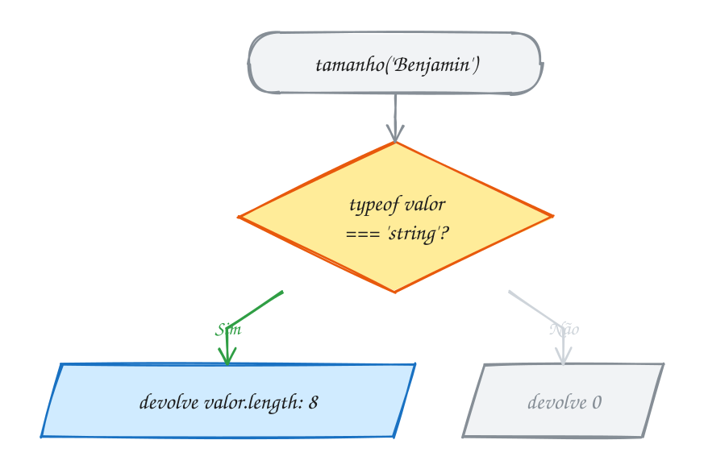</p>

> [!WARNING]
> Fuja do `any`. Com ele, o TypeScript deixa passar qualquer coisa, e o erro só
> aparece com o programa rodando. Neste projeto, o lint barra o `any` escrito na
> mão: `Unexpected any. Specify a different type`.

> [!TIP]
> **Poder do TypeScript:** com `unknown`, ele não deixa você usar o valor sem
> conferir o tipo antes:
>
> ```ts
> function gritar(valor: unknown): string {
>   return valor.toUpperCase()
>   // erro: 'valor' is of type 'unknown'.
> }
> ```

> [!NOTE]
> **Pergunta para a turma:** quanto dá `tamanho(2026)`? Acrescente a linha e
> rode. (Dica: o `if` só pergunta por texto.)

### Hora de praticar

Os arquivos ficam em [`0036-tipos-basicos/`](0036-tipos-basicos/). Os comandos funcionam de qualquer pasta do terminal. Nos exemplos, rode, mude, quebre e rode de novo. Nos exercícios, a resposta vai dentro do próprio arquivo.

**Exemplo A071 · O código do livro na biblioteca**

```ts
// o código pode chegar como texto ou como número
function lerCodigo(codigo: unknown): string {
  if (typeof codigo === 'string') return `código ${codigo.toUpperCase()}` // aqui é string
  if (typeof codigo === 'number') return `código ${codigo + 1000}` // aqui é number
  return 'código inválido'
}

console.log(lerCodigo('lit-12')) // código LIT-12
console.log(lerCodigo(42)) // código 1042
console.log(lerCodigo(true)) // código inválido
```

```bash
tsx ~/LPPOO/19102026/0036-tipos-basicos/A071.ts
```

**Exemplo A072 · O perigo do any**

```ts
// eslint-disable-next-line @typescript-eslint/no-explicit-any -- só para mostrar o perigo
const qualquer: any = 'dez'
console.log(qualquer * 2) // NaN: o TypeScript deixou passar a conta com texto

const texto: string = 'dez'
console.log(texto.length) // 3

// Com o tipo certo, ele barra a mesma conta. Tire o // e veja:
// console.log(texto * 2)
// erro: The left-hand side of an arithmetic operation must be of type 'any',
//       'number', 'bigint' or an enum type.
```

```bash
tsx ~/LPPOO/19102026/0036-tipos-basicos/A072.ts
```

**Exercício E071**

Escreva `ehTexto(valor: unknown): string`, que devolve 'texto' se o valor for
string e 'outra coisa' se não for. Teste com 'Ana' e 42.

<details><summary>Dicas</summary>

1. Use `typeof valor === 'string'`.

</details>

```bash
tsx ~/LPPOO/19102026/0036-tipos-basicos/E071.ts
```

**Exercício E072**

Escreva `gritar(valor: unknown): string`, que devolve o texto em maiúsculas se
o valor for string, e '?' se não for. Teste com 'oi' e 7.

<details><summary>Dicas</summary>

1. Confira com typeof antes de usar `valor.toUpperCase()`.

</details>

```bash
tsx ~/LPPOO/19102026/0036-tipos-basicos/E072.ts
```

---

## 0037 · Truthy, falsy, ?? e ?.

O aluno apertou Enter sem digitar o apelido. E agora, o programa chama ele de
quê?

Num `if` ou num `||`, o esperado é `true` ou `false`. Mas o JavaScript (e o
TypeScript, que vem dele) deixa você colocar qualquer valor ali, e decide se
aquilo conta como verdadeiro ou falso.

Pensa no fiscal do porto olhando a mochila. Vazia, ele nem abre. Com alguma
coisa dentro, ele confere.

Os que contam como falso são só seis, e dá para decorar: `false`, `0`, `''`
(texto vazio), `null`, `undefined` e `NaN`. Esses são os **falsy**.

Todo o resto é **truthy**.

Olha só o exemplo. O aluno apertou Enter direto, então `apelido` é `''`, um
texto vazio. Ou seja, falsy. O `||` percebe isso e usa o valor padrão:

<p align="center">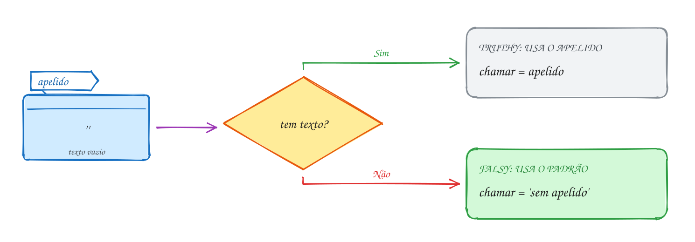</p>

```ts
import { input } from '#core/input.ts'

const apelido = input('Seu apelido: ') // o aluno só aperta Enter: ''
const chamar = apelido || 'sem apelido' // '' é falsy, então usa o padrão
console.log(`Oi, ${chamar}!`) // Oi, sem apelido!
```

No fluxograma, o losango amarelo é a pergunta "tem texto?":

<p align="center">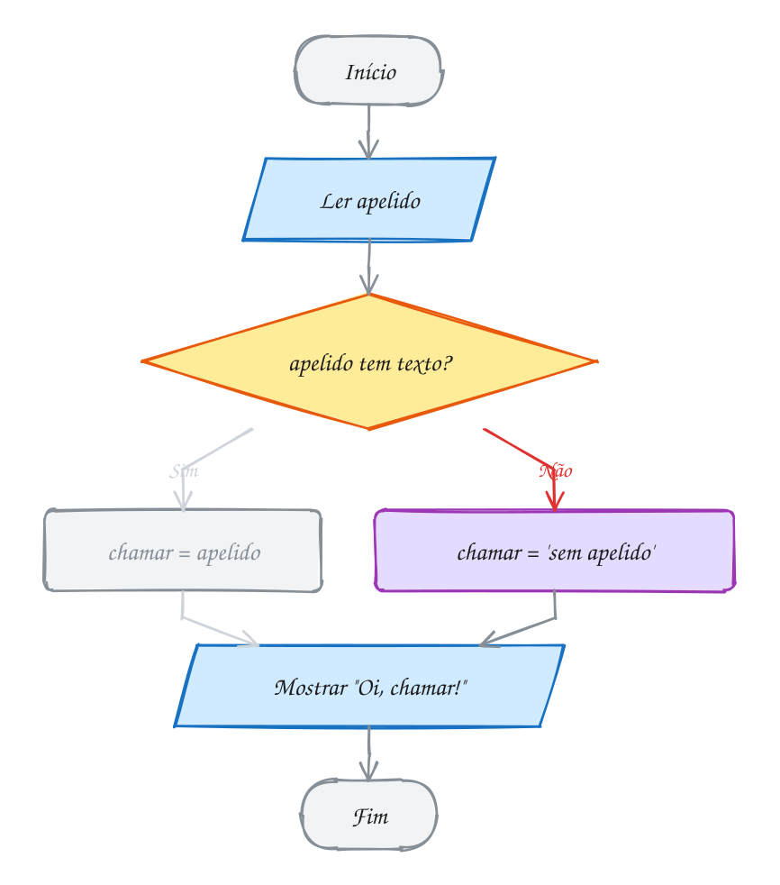</p>

Agora, os dois atalhos do título.

O `??` é parecido com o `||`, mas só troca quando o valor é `null` ou
`undefined`. Com texto vazio ele não faz nada: `'' ?? 'sem apelido'` continua
`''`.

O `?.` é o ponto com cuidado. Se o valor for `null` ou `undefined`, ele para
ali e devolve `undefined`, em vez de quebrar o programa.

> [!TIP]
> **Poder do TypeScript:** uma posição que não existe no array dá `undefined`.
> O TypeScript avisa antes e o `?.` resolve:
>
> ```ts
> const nomes = ['Ana', 'Bia']
> console.log(nomes[5].toUpperCase())
> // erro: Object is possibly 'undefined'.
> console.log(nomes[5]?.toUpperCase()) // undefined
> ```

> [!NOTE]
> **Pergunta para a turma:** e se o aluno digitar `0` como apelido? Aparece
> `Oi, 0!` ou `Oi, sem apelido!`? Rode e confira. (Dica: o `input` sempre
> devolve texto.)

### Hora de praticar

Os arquivos ficam em [`0037-truthy-falsy/`](0037-truthy-falsy/). Os comandos funcionam de qualquer pasta do terminal. Nos exemplos, rode, mude, quebre e rode de novo. Nos exercícios, a resposta vai dentro do próprio arquivo.

**Exemplo A073 · Convertendo para boolean**

```ts
console.log(Boolean('')) // false
console.log(Boolean('Ana')) // true
console.log(Boolean(0)) // false
console.log(Boolean(10)) // true
```

```bash
tsx ~/LPPOO/19102026/0037-truthy-falsy/A073.ts
```

**Exemplo A074 · Os atalhos ?? e ?.**

```ts
let apelido = undefined // ainda sem apelido

console.log(apelido ?? 'sem apelido') // sem apelido

apelido = 'Juju'
console.log(apelido ?? 'sem apelido') // Juju

// a chamada tem dois nomes: a posição 2 não existe
const chamada = ['Ana', 'Caio']
console.log(chamada[0]?.toUpperCase()) // ANA
console.log(chamada[2]?.toUpperCase() ?? 'ninguém') // ninguém
```

```bash
tsx ~/LPPOO/19102026/0037-truthy-falsy/A074.ts
```

**Exercício E073**

Chute num comentário se `'0'`, `0` e `''` são truthy ou falsy. Depois confira
com `console.log(Boolean(...))`.

<details><summary>Dicas</summary>

1. `'0'` é texto, e texto só é falsy quando está vazio.

</details>

```bash
tsx ~/LPPOO/19102026/0037-truthy-falsy/E073.ts
```

**Exercício E074**

Crie `let cidade = undefined` e mostre `cidade ?? 'Não informada'`. Depois
coloque `cidade = 'Tabatinga'` e mostre de novo.

<details><summary>Dicas</summary>

1. O `??` só usa o padrão quando o valor é `null` ou `undefined`.

</details>

```bash
tsx ~/LPPOO/19102026/0037-truthy-falsy/E074.ts
```

---

## 0038 · Inferência x anotação: quando escrever o tipo

Ninguém escreve "isto é uma cadeira" numa cadeira. Dá para ver. Mas numa caixa
fechada, a etiqueta faz falta.

Com tipo é igual. O TypeScript descobre sozinho o tipo de muita coisa, só
olhando o valor. Isso é a **inferência**.

Escrever o tipo na mão é a **anotação**.

E quando escrever? Guarda essa regra prática:

- **Deixe o TypeScript descobrir** quando a variável já começa com um valor:
  `const notas = [8, 6, 9]` já é `number[]`.
- **Escreva o tipo** quando ele não tem como adivinhar: nos **parâmetros** de
  função, em **array vazio** e em variável que nasce **sem valor**.

<p align="center">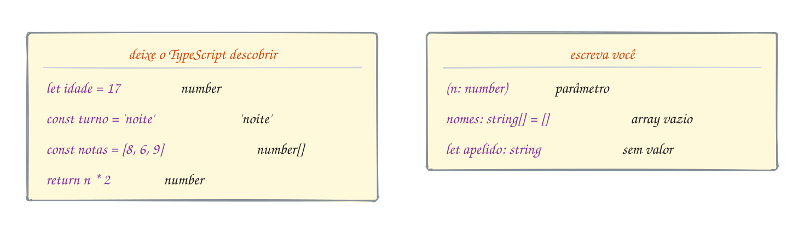</p>

```ts
const turno = 'noite' // infere: 'noite'
const notas = [8, 6, 9] // infere: number[]
const nomes: string[] = [] // array vazio: escreva o tipo
let apelido: string // sem valor ainda: escreva o tipo

// parâmetro: escreva sempre; o retorno (number) ele infere
function dobrar(n: number) {
  return n * 2
}

apelido = 'Zé'
console.log(turno, notas, nomes, apelido, dobrar(4)) // noite [ 8, 6, 9 ] [] Zé 8
```

Repara no `turno`. Com `const`, o tipo é exatamente `'noite'`, e não `string`.
Uma constante nunca vai mudar, então o TypeScript guarda o valor exato. Com
`let`, seria `string`.

O fluxograma é a regra prática em forma de perguntas:

<p align="center"></p>

E o retorno da função? Escrever é opcional. Mas, se você escrever e errar o
`return`, o erro aparece na própria função, e não lá na frente, em quem usa
ela.

> [!TIP]
> **Poder do TypeScript:** parâmetro sem tipo vira `any` escondido, e este
> projeto (com `strict`) não deixa:
>
> ```ts
> function dobrar(n) {
>   return n * 2
> }
> // erro: Parameter 'n' implicitly has an 'any' type.
> ```

> [!NOTE]
> **Pergunta para a turma:** no editor, pare o mouse em cima do `turno`. Que
> tipo aparece? E se você trocar o `const` por `let`? Teste os dois.

### Hora de praticar

Os arquivos ficam em [`0038-inferencia/`](0038-inferencia/). Os comandos funcionam de qualquer pasta do terminal. Nos exemplos, rode, mude, quebre e rode de novo. Nos exercícios, a resposta vai dentro do próprio arquivo.

**Exemplo A075 · O placar do futsal**

```ts
const time = 'Onças' // infere o tipo literal 'Onças'
const gols = [2, 1] // infere: number[]
const artilheiros: string[] = [] // array vazio: escreva o tipo
artilheiros.push('Caio', 'Lia')

// o parâmetro precisa de tipo; o retorno (number) ele descobre sozinho
function somar(lista: number[]) {
  return lista.reduce((a, b) => a + b, 0)
}

console.log(`${time}: ${somar(gols)} gols de ${artilheiros.join(' e ')}`)
// Onças: 3 gols de Caio e Lia
```

```bash
tsx ~/LPPOO/19102026/0038-inferencia/A075.ts
```

**Exemplo A076 · const e let inferem coisas diferentes**

```ts
const turnoFixo = 'noite' // tipo: 'noite'
let turnoQueMuda = 'noite' // tipo: string

console.log(turnoFixo, turnoQueMuda)
turnoQueMuda = 'manhã' // pode: é string
console.log(turnoQueMuda)
// Passe o mouse em cima das duas variáveis no editor e compare os tipos.
```

```bash
tsx ~/LPPOO/19102026/0038-inferencia/A076.ts
```

**Exercício E075**

Copie as linhas abaixo deixando o tipo só onde o TypeScript não adivinha:
`const cidade: string = 'Tabatinga'` e `const lista: string[] = []`.

<details><summary>Dicas</summary>

1. Variável que começa com valor não precisa de tipo. Array vazio precisa.

</details>

```bash
tsx ~/LPPOO/19102026/0038-inferencia/E075.ts
```

**Exercício E076**

Escreva `dobro(n: number)` sem anotar o retorno. Pare o mouse no nome da
função e anote num comentário o tipo de retorno que o TypeScript descobriu.

<details><summary>Dicas</summary>

1. O tipo aparece no editor quando você para o mouse em cima.

</details>

```bash
tsx ~/LPPOO/19102026/0038-inferencia/E076.ts
```

---

## 0039 · Tipo de função e tipagem contextual

Na aula 02 você escreveu funções e arrow functions. Agora olha para elas com
os olhos do TypeScript: variável tem tipo. E função? Também tem.

O tipo de uma função diz **o que ela recebe e o que ela devolve**. E dá para
dar um nome para esse tipo. Quem faz isso é a palavra `type`: ela cria um
apelido para um tipo.

```ts
type Operacao = (a: number, b: number) => number
```

Lê assim: "uma `Operacao` é qualquer função que recebe dois números e devolve
um número".

Pensa numa tomada de três pinos. Ela aceita qualquer aparelho, desde que o
plugue seja do formato certo.

O `Operacao` é a tomada. `somar` e `multiplicar` têm o plugue certo e encaixam.
Uma função que junta textos não encaixa:

<p align="center">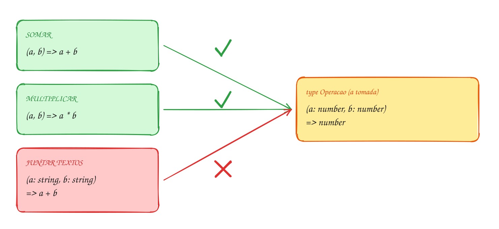</p>

```ts
type Operacao = (a: number, b: number) => number

const somar: Operacao = (a, b) => a + b
const multiplicar: Operacao = (a, b) => a * b

function calcular(a: number, b: number, op: Operacao): number {
  return op(a, b)
}

console.log(calcular(6, 7, somar)) // 13
console.log(calcular(6, 7, multiplicar)) // 42
```

Repara em `(a, b) => a + b`. Não tem tipo nenhum escrito no `a` nem no `b`. E
mesmo assim o TypeScript sabe que são números.

Ele tira essa informação do `Operacao`. Isso se chama **tipagem contextual**. É
a mesma coisa que faz o `n` do `map` ser `number` sozinho.

<p align="center"></p>

> [!NOTE]
> **Pergunta para a turma:** crie `const subtrair: Operacao = (a, b) => a - b`.
> Quanto dá `calcular(6, 7, subtrair)`? Rode e confira. (Dica: pode dar número
> negativo.)

### Hora de praticar

Os arquivos ficam em [`0039-tipo-de-funcao/`](0039-tipo-de-funcao/). Os comandos funcionam de qualquer pasta do terminal. Nos exemplos, rode, mude, quebre e rode de novo. Nos exercícios, a resposta vai dentro do próprio arquivo.

**Exemplo A077 · type Pontuacao para os modos do jogo**

```ts
type Pontuacao = (acertos: number) => number

const modoFacil: Pontuacao = (acertos) => acertos * 10
const modoDificil: Pontuacao = (acertos) => acertos * 25

function mostrarPontos(acertos: number, modo: Pontuacao): void {
  console.log(`${acertos} acertos: ${modo(acertos)} pontos`)
}

mostrarPontos(4, modoFacil) // 4 acertos: 40 pontos
mostrarPontos(4, modoDificil) // 4 acertos: 100 pontos
```

```bash
tsx ~/LPPOO/19102026/0039-tipo-de-funcao/A077.ts
```

**Exemplo A078 · Um tipo para regras de filtro**

```ts
type Regra = (n: number) => boolean

const aprovado: Regra = (n) => n >= 6
const par: Regra = (n) => n % 2 === 0

const notas: number[] = [8, 5, 6, 4]
console.log(notas.filter(aprovado)) // [ 8, 6 ]
console.log(notas.filter(par)) // [ 8, 6, 4 ]
```

```bash
tsx ~/LPPOO/19102026/0039-tipo-de-funcao/A078.ts
```

**Exercício E077**

Crie `type Conversor = (valor: number) => number` e
`const paraDolar: Conversor`, que divide por 5.4. Mostre `paraDolar(100)`.

<details><summary>Dicas</summary>

1. É uma arrow: `(v) => v / 5.4`. O `v` já é number pelo contexto.

</details>

```bash
tsx ~/LPPOO/19102026/0039-tipo-de-funcao/E077.ts
```

**Exercício E078**

Crie `type Mensagem = (nome: string) => string` e uma `const saudar: Mensagem`
que devolve "Oi, Ana!". Use com `map` em `['Ana', 'Caio']` e mostre.

<details><summary>Dicas</summary>

1. `['Ana', 'Caio'].map(saudar)`.

</details>

```bash
tsx ~/LPPOO/19102026/0039-tipo-de-funcao/E078.ts
```

---

## 0040 · Objetos

Pensa na carteirinha da escola. Num cartão só, tem o nome, a idade e o turno
do aluno. Cada informação tem um rótulo.

Até agora, cada caixinha guardou um valor só, ou uma lista. O **objeto** junta
várias informações sobre a mesma coisa, cada uma com o seu nome.

Esses nomes se chamam **propriedades**. O objeto é escrito entre chaves, com
`nome: valor` separados por vírgula.

Vamos ver na prática. A carteirinha da Bia tem nome, idade e turno:

<p align="center">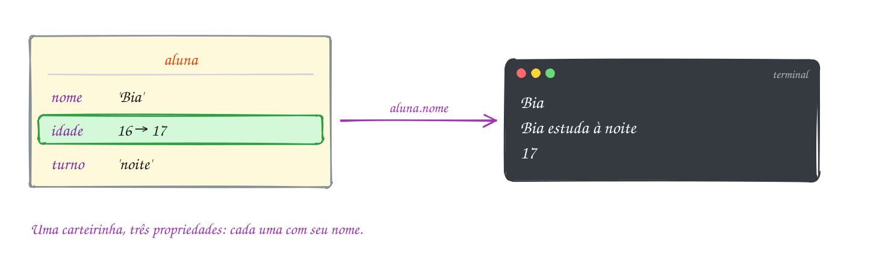</p>

```ts
const aluna = { nome: 'Bia', idade: 16, turno: 'noite' }

console.log(aluna.nome) // Bia
console.log(`${aluna.nome} estuda à ${aluna.turno}`) // Bia estuda à noite

aluna.idade = 17 // fez aniversário
console.log(aluna.idade) // 17
```

Para ler uma propriedade, use o **ponto**: `aluna.nome`. Para trocar, é igual
a uma variável: `aluna.idade = 17`.

Repara: `aluna` é `const` e mesmo assim a idade mudou. É a mesma coisa do array
na aula 02: o `const` trava a etiqueta, não o que tem dentro.

O fluxograma mostra o caminho: cria, lê, troca e lê de novo.

<p align="center">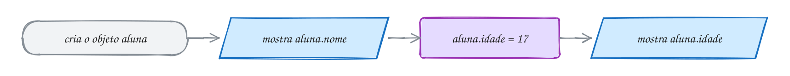</p>

> [!TIP]
> **Poder do TypeScript:** você não escreveu tipo nenhum, mas ele já sabe que
> `idade` é número e que não existe `email` na carteirinha:
>
> ```ts
> aluna.idade = 'dezessete'
> // erro: Type 'string' is not assignable to type 'number'.
> console.log(aluna.email)
> // erro: Property 'email' does not exist on type
> //       '{ nome: string; idade: number; turno: string; }'.
> ```

> [!NOTE]
> **Pergunta para a turma:** o que aparece com `console.log(aluna)`, assim, sem
> ponto nenhum? Rode e confira.

### Hora de praticar

Os arquivos ficam em [`0040-objetos/`](0040-objetos/). Os comandos funcionam de qualquer pasta do terminal. Nos exemplos, rode, mude, quebre e rode de novo. Nos exercícios, a resposta vai dentro do próprio arquivo.

**Exemplo A079 · O cardápio da cantina: uma lista de objetos**

```ts
const cardapio = [
  { nome: 'açaí', preco: 15 },
  { nome: 'tapioca', preco: 8 },
  { nome: 'suco de cupuaçu', preco: 6 },
]

for (const item of cardapio) {
  console.log(`${item.nome}: R$ ${item.preco.toFixed(2)}`)
}
// açaí: R$ 15.00
// tapioca: R$ 8.00
// suco de cupuaçu: R$ 6.00
```

```bash
tsx ~/LPPOO/19102026/0040-objetos/A079.ts
```

**Exemplo A080 · O time do interclasse: um objeto com uma lista dentro**

```ts
const time = { nome: 'Tubarões', gols: 0, jogadores: ['Ana', 'Caio'] }

time.gols += 2 // dois gols no primeiro tempo
time.jogadores.push('Davi') // entrou mais um

console.log(`${time.nome}: ${time.gols} gols`) // Tubarões: 2 gols
console.log(time.jogadores.length) // 3
```

```bash
tsx ~/LPPOO/19102026/0040-objetos/A080.ts
```

**Exercício E079**

Crie o objeto `celular` com `marca` e `bateria` (número). A bateria cai 15:
diminua e mostre a bateria nova.

<details><summary>Dicas</summary>

1. Para ler e trocar, use o ponto: `celular.bateria -= 15`.

</details>

```bash
tsx ~/LPPOO/19102026/0040-objetos/E079.ts
```

**Exercício E080**

Crie uma lista com 3 objetos `{ nome, nota }`. Com `for...of` e `if`, mostre
só o nome de quem tirou 6 ou mais.

<details><summary>Dicas</summary>

1. Dentro do laço, cada item é um objeto: `aluno.nota`.

</details>

```bash
tsx ~/LPPOO/19102026/0040-objetos/E080.ts
```

---

## 0041 · Tipos de objeto e type

Na [0040](#0040--objetos) você criou objetos e o TypeScript descobriu o
formato sozinho. Agora é a sua vez de **escrever** esse formato.

Por que escrever? Para todos os alunos da turma terem a mesma ficha, com os
mesmos campos.

E como dizer que formato o objeto tem? Com o mesmo **`type`** da
[0039](#0039--tipo-de-função-e-tipagem-contextual). Lá ele deu nome a um tipo de
função. Aqui ele dá nome a um formato de objeto.

Pensa numa ficha de matrícula em branco: ela diz quais campos existem e o que
vai em cada um. Cada aluno é uma ficha preenchida:

<p align="center"></p>

Em código, cada campo vai numa linha, com o nome e o tipo:

```ts
type Aluno = {
  nome: string
  notas: number[]
}

const ana: Aluno = { nome: 'Ana', notas: [8, 7, 9] }
const turma: Aluno[] = [ana, { nome: 'Bia', notas: [6, 9] }]

for (const aluno of turma) {
  const media = aluno.notas.reduce((a, b) => a + b, 0) / aluno.notas.length
  console.log(`${aluno.nome}: ${media.toFixed(1)}`) // Ana: 8.0, depois Bia: 7.5
}
```

Repara no `turma`. Ele é `Aluno[]`, uma lista de fichas.

Se o `type` couber numa linha só, separe os campos com `;`:
`type Ponto = { x: number; y: number }`.

O fluxograma passa pela turma, ficha por ficha, e calcula a média de cada um:

<p align="center">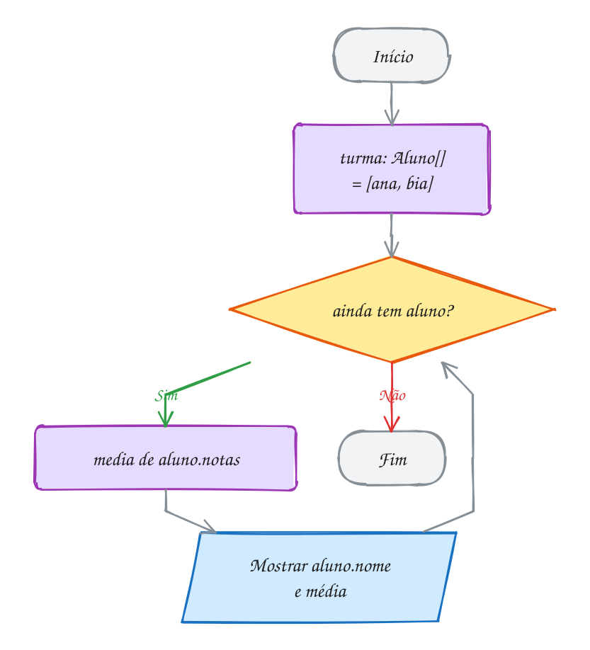</p>

> [!NOTE]
> O nome do `type` começa com letra maiúscula: `Aluno`, `Produto`. Ninguém te
> obriga, mas todo projeto TypeScript faz assim. Então faz também.

> [!TIP]
> **Poder do TypeScript:** escreva `ana.` e o editor mostra as propriedades da
> ficha. Errou uma letra? Ele avisa na hora:
>
> ```ts
> console.log(ana.nmoe)
> // erro: Property 'nmoe' does not exist on type 'Aluno'.
> ```

> [!NOTE]
> **Pergunta para a turma:** se a Bia tirar mais um 10 (`notas: [6, 9, 10]`),
> qual vai ser a média dela? Mude o exemplo e rode.

### Hora de praticar

Os arquivos ficam em [`0041-tipos-de-objeto/`](0041-tipos-de-objeto/). Os comandos funcionam de qualquer pasta do terminal. Nos exemplos, rode, mude, quebre e rode de novo. Nos exercícios, a resposta vai dentro do próprio arquivo.

**Exemplo A081 · O cardápio da cantina**

```ts
type Lanche = { nome: string; preco: number }

const caboquinho: Lanche = { nome: 'X-Caboquinho', preco: 12 }
const cardapio: Lanche[] = [caboquinho, { nome: 'Tapioca', preco: 8 }]

let total = 0
for (const lanche of cardapio) total += lanche.preco
console.log(`Um de cada: R$ ${total.toFixed(2)}`) // Um de cada: R$ 20.00

// console.log(caboquinho.prco)
// erro: Property 'prco' does not exist on type 'Lanche'. Did you mean 'preco'?
```

```bash
tsx ~/LPPOO/19102026/0041-tipos-de-objeto/A081.ts
```

**Exemplo A082 · Objeto dentro de objeto**

```ts
type Endereco = { cidade: string; bairro: string }
type Escola = { nome: string; endereco: Endereco }

const cetam: Escola = {
  nome: 'CETAM',
  endereco: { cidade: 'Benjamin Constant', bairro: 'Centro' },
}

console.log(`${cetam.nome} fica em ${cetam.endereco.cidade}`) // CETAM fica em Benjamin Constant
```

```bash
tsx ~/LPPOO/19102026/0041-tipos-de-objeto/A082.ts
```

**Exercício E081**

Crie `type Produto = { nome: string; preco: number }` e um produto da cantina
com esse tipo. Mostre "açaí: R$ 15.00".

<details><summary>Dicas</summary>

1. `const acai: Produto = { ... }` e `preco.toFixed(2)`.

</details>

```bash
tsx ~/LPPOO/19102026/0041-tipos-de-objeto/E081.ts
```

**Exercício E082**

Crie `type Endereco = { cidade: string }` e `type Pessoa = { nome: string;
endereco: Endereco }`. Monte uma pessoa e mostre a cidade dela.

<details><summary>Dicas</summary>

1. Acesse com `pessoa.endereco.cidade`.

</details>

```bash
tsx ~/LPPOO/19102026/0041-tipos-de-objeto/E082.ts
```

---

## 0042 · Como o TypeScript pensa: tipos estruturais

Pensa no porteiro do show. Ele não pergunta seu nome. Ele olha se você tem
pulseira e se ela é da cor certa.

O TypeScript é esse porteiro. Ele olha o **formato**: se o objeto tem as
propriedades que o tipo pede, com os tipos certos, o objeto serve.

Isso se chama **tipagem estrutural**.

Olha só. A `apresentar` pede um `Aluno`: algo com `nome` texto e `idade`
número.

A `ana` tem esse formato. O `visitante` também tem, e ainda sobra uma
`cidade`: serve mesmo assim. Já a Bia, sem `idade`, não tem o formato e é
barrada:

<p align="center">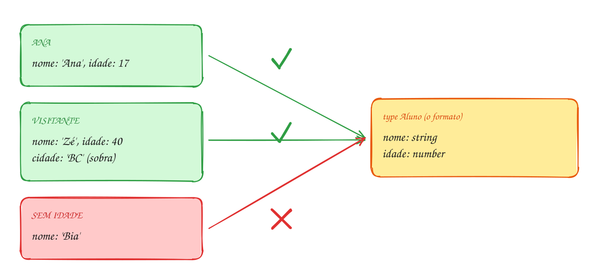</p>

```ts
type Aluno = { nome: string; idade: number }

function apresentar(a: Aluno): string {
  return `${a.nome}, ${a.idade} anos`
}

const ana = { nome: 'Ana', idade: 17 }
const visitante = { nome: 'Zé', idade: 40, cidade: 'Benjamin Constant' }

console.log(apresentar(ana)) // Ana, 17 anos
console.log(apresentar(visitante)) // Zé, 40 anos (a cidade sobra, e tudo bem)
```

Repara: nem a `ana` nem o `visitante` foram declarados como `Aluno`. O
TypeScript compara o formato na hora da chamada, assim:

<p align="center"></p>

> [!TIP]
> **Poder do TypeScript:** sobrar propriedade numa variável tudo bem. Mas num
> objeto escrito ali mesmo, na chamada, o TypeScript desconfia de erro de
> digitação e avisa:
>
> ```ts
> apresentar({ nome: 'Ana', idade: 17, turma: 'DS' })
> // erro: Object literal may only specify known properties, and 'turma'
> //       does not exist in type 'Aluno'.
> ```

> [!NOTE]
> **Pergunta para a turma:** e se o `visitante` tiver `idade: '40'`, com aspas?
> Ele ainda passa pelo porteiro? Mude e veja o que o editor diz. (Dica: o
> formato inclui o tipo de cada propriedade.)

### Hora de praticar

Os arquivos ficam em [`0042-tipagem-estrutural/`](0042-tipagem-estrutural/). Os comandos funcionam de qualquer pasta do terminal. Nos exemplos, rode, mude, quebre e rode de novo. Nos exercícios, a resposta vai dentro do próprio arquivo.

**Exemplo A083 · A catraca só olha o saldo**

```ts
type Cartao = { saldo: number }

function passar(c: Cartao): string {
  return c.saldo >= 4.5 ? 'Catraca liberada' : 'Saldo insuficiente'
}

const estudante = { saldo: 10, nome: 'Caio', escola: 'CETAM' }
console.log(passar(estudante)) // Catraca liberada: tem saldo, o resto não importa

// Sem saldo, não tem o formato de Cartao. Tire o // e veja:
// const turista = { nome: 'Lia' }
// passar(turista)
// erro: Property 'saldo' is missing in type '{ nome: string; }'
//       but required in type 'Cartao'.
```

```bash
tsx ~/LPPOO/19102026/0042-tipagem-estrutural/A083.ts
```

**Exemplo A084 · Dois tipos com nomes diferentes e o mesmo formato**

```ts
type Ponto = { x: number; y: number }
type Coordenada = { x: number; y: number }

function distanciaDaOrigem(p: Ponto): number {
  return Math.sqrt(p.x ** 2 + p.y ** 2)
}

const escola: Coordenada = { x: 3, y: 4 }
console.log(distanciaDaOrigem(escola)) // 5: Coordenada serve onde pede Ponto
```

```bash
tsx ~/LPPOO/19102026/0042-tipagem-estrutural/A084.ts
```

**Exercício E083**

Crie `type Produto = { nome: string }` e `etiqueta(p: Produto): string`.
Chame com uma variável que tem `nome` e também `estoque`. Funciona?

<details><summary>Dicas</summary>

1. Crie o objeto numa const antes de chamar.

</details>

```bash
tsx ~/LPPOO/19102026/0042-tipagem-estrutural/E083.ts
```

**Exercício E084**

Agora chame a `etiqueta` do E083 com o objeto escrito ali mesmo, com `estoque`
dentro. Leia o erro e deixe a linha comentada.

<details><summary>Dicas</summary>

1. Objeto escrito na chamada não pode ter propriedade sobrando.

</details>

```bash
tsx ~/LPPOO/19102026/0042-tipagem-estrutural/E084.ts
```

---

## 0043 · interface (e type x interface)

A **`interface`** é outro jeito de descrever o formato de um objeto. Para
objeto simples, ela faz a mesma coisa que o `type`.

Então por que existe? Por causa do **`extends`**. Uma interface pode
**estender** outra: pega tudo o que a outra tem e acrescenta o que faltar.

Pensa assim: todo aluno é uma pessoa, mas nem toda pessoa é aluno.

`Pessoa` tem nome. `Aluno` estende `Pessoa`: tem o nome e mais a matrícula.

Por isso, onde o código pede uma `Pessoa`, um `Aluno` também serve:

<p align="center">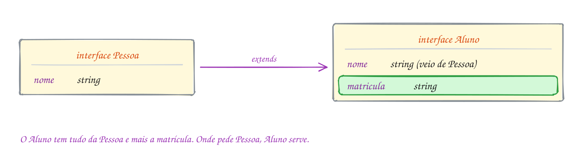</p>

Vamos ver na prática:

```ts
interface Pessoa {
  nome: string
}

interface Aluno extends Pessoa {
  matricula: string
}

const bia: Aluno = { nome: 'Bia', matricula: 'A27' }
const apresentar = (p: Pessoa): string => `Olá, ${p.nome}!`

console.log(apresentar(bia)) // Olá, Bia! (todo Aluno também é Pessoa)
console.log(bia.matricula) // A27
```

Repara: a função pede `Pessoa`, e a Bia entra numa boa.

E aí, quando usar `type` e quando usar `interface`? O fluxograma resume:

<p align="center">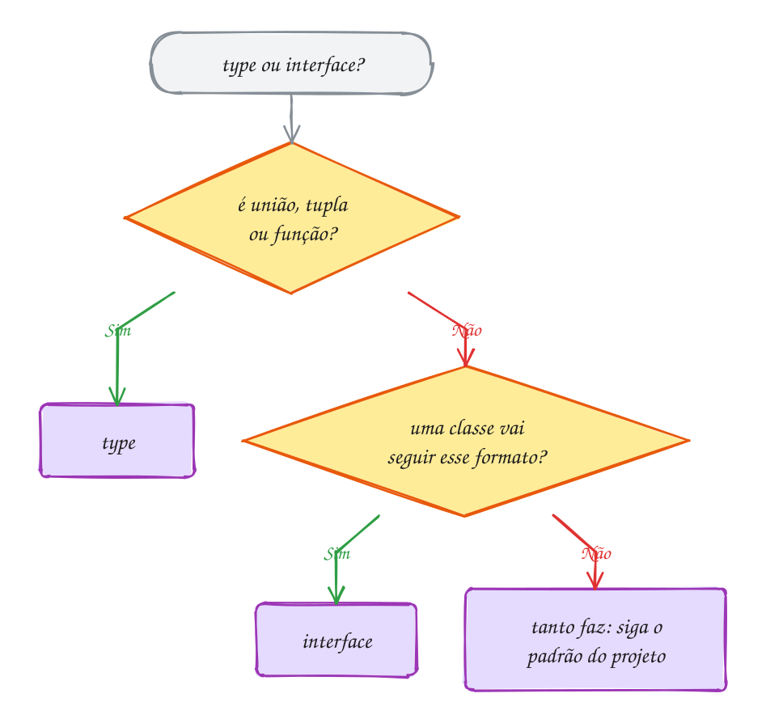</p>

| Dá para fazer com...                       | `type`               | `interface`         |
| ------------------------------------------ | :------------------: | :-----------------: |
| formato de objeto                          | sim                  | sim                 |
| estender outro formato                     | sim, com `&` (0048)  | sim, com `extends`  |
| dar nome a outro tipo: `type Idade = number` | sim                | não                 |

> [!TIP]
> **Poder do TypeScript:** quem estende leva as obrigações junto. Esqueceu o
> nome num `Aluno`? O TypeScript cobra:
>
> ```ts
> const ze: Aluno = { matricula: 'A30' }
> // erro: Property 'nome' is missing in type '{ matricula: string; }'
> //       but required in type 'Aluno'.
> ```

> [!NOTE]
> **Pergunta para a turma:** dá para chamar `apresentar({ nome: 'Zé' })`, só
> com o nome e sem matrícula? Rode e veja. (Dica: o que a função pede é uma
> `Pessoa`.)

### Hora de praticar

Os arquivos ficam em [`0043-interface/`](0043-interface/). Os comandos funcionam de qualquer pasta do terminal. Nos exemplos, rode, mude, quebre e rode de novo. Nos exercícios, a resposta vai dentro do próprio arquivo.

**Exemplo A085 · Todo ônibus é um veículo**

```ts
interface Veiculo { placa: string }
interface Onibus extends Veiculo { linha: string }

const circular: Onibus = { placa: 'PHX-2B19', linha: 'Centro-Colônia' }
const moto: Veiculo = { placa: 'QZA-7C21' }
const vistoria = (v: Veiculo): string => `Placa ${v.placa} conferida`

console.log(vistoria(circular)) // Placa PHX-2B19 conferida (todo Onibus é Veiculo)
console.log(vistoria(moto)) // Placa QZA-7C21 conferida

// O contrário não vale: nem todo Veiculo tem linha.
// console.log(moto.linha)
// erro: Property 'linha' does not exist on type 'Veiculo'.
```

```bash
tsx ~/LPPOO/19102026/0043-interface/A085.ts
```

**Exemplo A086 · Interface com uma função dentro**

```ts
interface Botao {
  texto: string
  aoClicar: () => string // o tipo de função da 0039
}

const enviar: Botao = {
  texto: 'Enviar',
  aoClicar: () => 'Mensagem enviada!',
}

console.log(`[ ${enviar.texto} ]`) // [ Enviar ]
console.log(enviar.aoClicar()) // Mensagem enviada!
```

```bash
tsx ~/LPPOO/19102026/0043-interface/A086.ts
```

**Exercício E085**

Crie `interface Produto { nome: string }` e `interface Bebida extends Produto`,
com `ml: number`. Monte uma bebida e mostre o nome e os ml.

<details><summary>Dicas</summary>

1. A Bebida precisa ter as duas propriedades.

</details>

```bash
tsx ~/LPPOO/19102026/0043-interface/E085.ts
```

**Exercício E086**

Reescreva como interface: `type Escola = { nome: string; cidade: string }`.
Monte uma escola e mostre a cidade dela.

<details><summary>Dicas</summary>

1. `interface Escola { ... }`, sem o sinal de igual.

</details>

```bash
tsx ~/LPPOO/19102026/0043-interface/E086.ts
```

---

## 0044 · Propriedade opcional e readonly

Pensa na carteirinha da escola. A matrícula não muda nunca. O nome pode ser
corrigido. E o apelido? Nem todo mundo tem.

Duas marcas resolvem isso:

- **`?` (opcional):** `apelido?: string` quer dizer que a propriedade pode nem
  existir. Quando não existe, ela vale `undefined`.
- **`readonly` (só leitura):** `readonly matricula: string` pode ser lida, mas
  não pode ser trocada depois que o objeto foi criado.

<p align="center">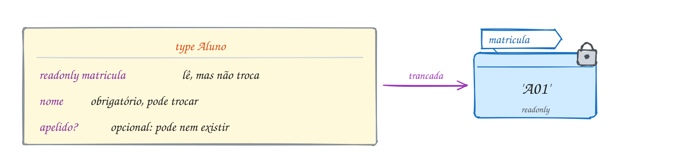</p>

Vamos ver na prática:

```ts
type Aluno = {
  readonly matricula: string
  nome: string
  apelido?: string
}

const ana: Aluno = { matricula: 'A01', nome: 'Ana' } // sem apelido: tudo bem
const ze: Aluno = { matricula: 'A02', nome: 'José', apelido: 'Zé' }
const chamar = (a: Aluno): string => a.apelido ?? a.nome // sem apelido? usa o nome

console.log(chamar(ana)) // Ana
console.log(chamar(ze)) // Zé
```

Repara na função `chamar`. Como o apelido pode faltar, ela precisa decidir o
que fazer quando ele não vem. É a pergunta do fluxograma. A Ana não tem
apelido, então sai o nome:

<p align="center">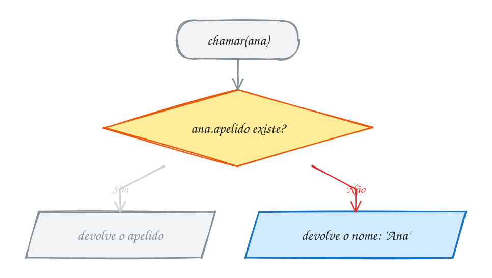</p>

> [!TIP]
> **Poder do TypeScript:** ele cobra as duas marcas. Não deixa trocar o que é
> `readonly`, e não deixa usar o opcional sem tratar o caso vazio:
>
> ```ts
> ana.matricula = 'A99'
> // erro: Cannot assign to 'matricula' because it is a read-only property.
> ana.apelido.toUpperCase()
> // erro: 'ana.apelido' is possibly 'undefined'.
> ```
>
> A saída é tratar o caso vazio, com o `??` ou o `?.` da
> [0037](#0037--truthy-falsy--e-): `ana.apelido?.toUpperCase()`.

> [!NOTE]
> **Pergunta para a turma:** se a Ana tiver `apelido: ''` (texto vazio), o que
> `chamar(ana)` mostra? Rode e confira. (Dica: o `??` só troca `undefined` e
> `null`.)

### Hora de praticar

Os arquivos ficam em [`0044-opcional-readonly/`](0044-opcional-readonly/). Os comandos funcionam de qualquer pasta do terminal. Nos exemplos, rode, mude, quebre e rode de novo. Nos exercícios, a resposta vai dentro do próprio arquivo.

**Exemplo A087 · O pedido de açaí**

```ts
type Pedido = { readonly numero: number; tamanho: string; cobertura?: string }

const pedido: Pedido = { numero: 101, tamanho: '500 ml' } // sem cobertura: tudo bem
const etiqueta = (p: Pedido): string => `#${p.numero} ${p.tamanho}, ${p.cobertura ?? 'puro'}`

console.log(etiqueta(pedido)) // #101 500 ml, puro
pedido.tamanho = '700 ml' // pode: o cliente mudou de ideia
pedido.cobertura = 'granola' // pode: o opcional pode chegar depois
console.log(etiqueta(pedido)) // #101 700 ml, granola

// pedido.numero = 999
// erro: Cannot assign to 'numero' because it is a read-only property.
```

```bash
tsx ~/LPPOO/19102026/0044-opcional-readonly/A087.ts
```

**Exemplo A088 · Array que não pode ser mexido**

```ts
const TURNOS: readonly string[] = ['manhã', 'tarde', 'noite']

console.log(TURNOS.join(', ')) // manhã, tarde, noite (ler pode)
console.log(TURNOS.includes('noite')) // true

// Mexer não pode. Tire o // e veja:
// TURNOS.push('madrugada')
// erro: Property 'push' does not exist on type 'readonly string[]'.
```

```bash
tsx ~/LPPOO/19102026/0044-opcional-readonly/A088.ts
```

**Exercício E087**

Crie `type Produto = { nome: string; descricao?: string }` e um produto sem
descrição. Mostre a descrição dele, com 'sem descrição' no lugar.

<details><summary>Dicas</summary>

1. Use `p.descricao ?? 'sem descrição'`.

</details>

```bash
tsx ~/LPPOO/19102026/0044-opcional-readonly/E087.ts
```

**Exercício E088**

Crie um produto com `readonly codigo` e tente trocar o código. Leia o erro e
deixe a linha comentada.

<details><summary>Dicas</summary>

1. A mensagem fala em read-only property.

</details>

```bash
tsx ~/LPPOO/19102026/0044-opcional-readonly/E088.ts
```

---

## 0045 · União (|) e tipos literais

A **união** se escreve com `|` e quer dizer "**um ou outro**".

`number | string` é um valor que pode ser número ou texto. Um dos dois.

Agora olha só: o tipo também pode ser um **valor exato**. Esse é o tipo
**literal**. O tipo `'noite'` só aceita o texto `'noite'`.

Junta os dois e você escreve a lista do que é permitido:
`type Turno = 'manhã' | 'tarde' | 'noite'`. São três turnos. "Madrugada" não
existe, por mais que alguém digite.

Qualquer texto fora da lista é recusado:

<p align="center">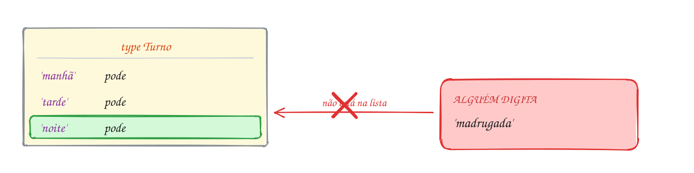</p>

Vamos ver na prática:

```ts
type Turno = 'manhã' | 'tarde' | 'noite'
type Matricula = number | string

function horario(turno: Turno): string {
  if (turno === 'manhã') return '7h às 11h'
  if (turno === 'tarde') return '13h às 17h'
  return '19h às 22h'
}

const matricula: Matricula = 'A27' // ou 27: as duas servem
console.log(horario('noite'), matricula) // 19h às 22h A27
```

Bônus: escreva `horario('` no editor e ele sugere as três opções. A lista
vira autocompletar.

O fluxograma mostra a conferência que o TypeScript faz antes de rodar:

<p align="center">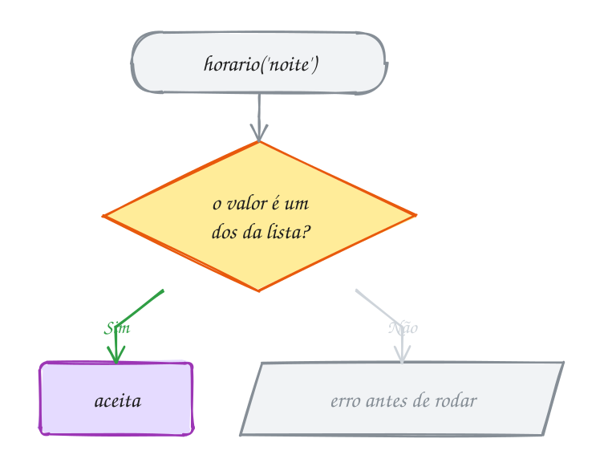</p>

> [!TIP]
> **Poder do TypeScript:** texto fora da lista não passa:
>
> ```ts
> const turno: Turno = 'madrugada'
> // erro: Type '"madrugada"' is not assignable to type 'Turno'.
> ```

> [!NOTE]
> **Pergunta para a turma:** a `matricula` aceita `27`, sem aspas? E `true`?
> Troque o valor e veja o que o editor diz.

### Hora de praticar

Os arquivos ficam em [`0045-uniao-literais/`](0045-uniao-literais/). Os comandos funcionam de qualquer pasta do terminal. Nos exemplos, rode, mude, quebre e rode de novo. Nos exercícios, a resposta vai dentro do próprio arquivo.

**Exemplo A089 · A dificuldade do jogo**

```ts
type Dificuldade = 'fácil' | 'médio' | 'difícil'

function vidas(nivel: Dificuldade): number {
  if (nivel === 'fácil') return 5
  if (nivel === 'médio') return 3
  return 1
}

console.log(`No médio, você começa com ${vidas('médio')} vidas`) // No médio, você começa com 3 vidas

// vidas('impossível')
// erro: Argument of type '"impossível"' is not assignable to parameter of type 'Dificuldade'.
```

```bash
tsx ~/LPPOO/19102026/0045-uniao-literais/A089.ts
```

**Exemplo A090 · Número ou texto**

```ts
function mostrarNota(nota: number | string): string {
  return `Nota: ${nota}`
}

console.log(mostrarNota(8)) // Nota: 8
console.log(mostrarNota('A')) // Nota: A
```

```bash
tsx ~/LPPOO/19102026/0045-uniao-literais/A090.ts
```

**Exercício E089**

Crie type Tamanho = 'P' | 'M' | 'G' e a função precoDoAcai(t: Tamanho):
number, que devolve 10, 15 ou 20. Teste os três tamanhos.

<details><summary>Dicas</summary>

1. Um if por tamanho, ou um switch.
2. Tente chamar com 'GG' e leia o erro (depois comente a linha).

</details>

```bash
tsx ~/LPPOO/19102026/0045-uniao-literais/E089.ts
```

**Exercício E090**

Crie type Resposta = 'sim' | 'nao' e a função traduzir(r: Resposta): boolean,
que transforma a resposta em true ou false.

<details><summary>Dicas</summary>

1. return r === 'sim' já resolve.
2. Repare no autocompletar quando você escreve traduzir('.

</details>

```bash
tsx ~/LPPOO/19102026/0045-uniao-literais/E090.ts
```

---

## 0046 · Narrowing: estreitando o tipo

Pensa num pacote que pode ser roupa ou livro. Antes de abrir, você olha a
etiqueta. Depois de olhar, já sabe o que tem dentro.

Com união é igual. Se o valor é `number | string`, o TypeScript só deixa fazer
o que serve **para os dois**.

Quer usar algo que só texto tem? Então você precisa **provar** que é texto.

Toda vez que você faz essa pergunta, o TypeScript **estreita** o tipo lá
dentro. Isso tem nome: **narrowing**.

No exemplo, a matrícula pode chegar como número (`27`) ou como texto
(`'a27'`). Um `typeof` separa os dois caminhos. Em cada um, o tipo já é um só:

<p align="center">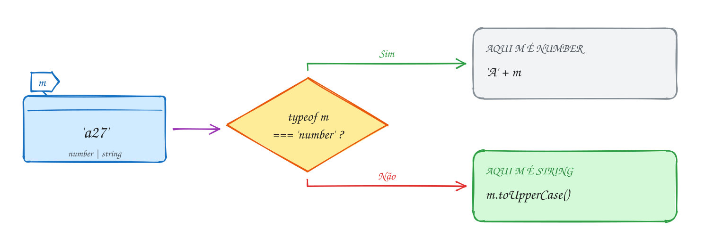</p>

```ts
function formatarMatricula(m: number | string): string {
  if (typeof m === 'number') {
    return `A${m}` // aqui m é number
  }
  return m.toUpperCase() // aqui só sobrou string
}

console.log(formatarMatricula(27)) // A27
console.log(formatarMatricula('a27')) // A27
```

Repara: depois do `if`, só sobrou `string`. O TypeScript percebeu sozinho.

O fluxograma mostra a pergunta que divide o tipo:

<p align="center">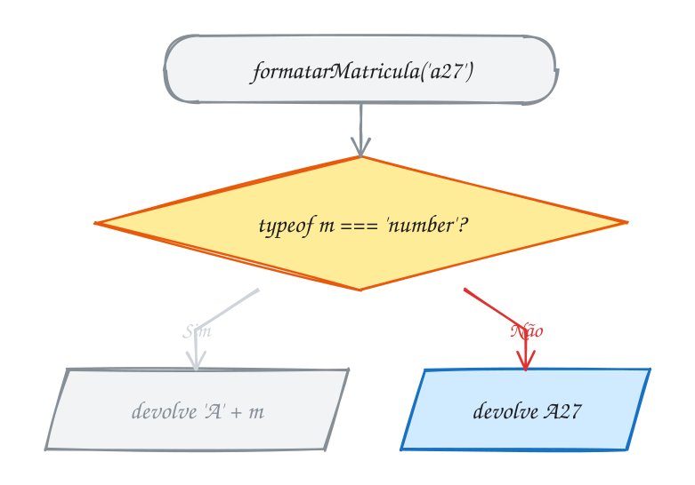</p>

Estas são as perguntas que estreitam o tipo:

| Pergunta            | Exemplo                           | O que ela confere                 |
| ------------------- | --------------------------------- | --------------------------------- |
| `typeof`            | `typeof m === 'number'`           | o tipo do valor                   |
| igualdade           | `turno === 'noite'`               | um valor exato                    |
| verdadeiro ou falso | `if (apelido)`                    | tira o `undefined` e o `''`       |
| `in`                | `'nota' in aluno`                 | se o objeto tem a propriedade     |
| `Array.isArray`     | `Array.isArray(valor)`            | se o valor é uma lista            |

> [!TIP]
> **Poder do TypeScript:** antes da pergunta, ele não deixa usar o que não
> serve para os dois tipos:
>
> ```ts
> function formatar(m: number | string): string {
>   return m.toFixed(0)
>   // erro: Property 'toFixed' does not exist on type 'string | number'.
> }
> ```

> [!NOTE]
> **Pergunta para a turma:** o que aparece com `formatarMatricula('27')`, com
> aspas? Qual caminho ele segue? Rode e descubra. (Dica: o `typeof` olha o
> tipo, não a cara do valor.)

### Hora de praticar

Os arquivos ficam em [`0046-narrowing/`](0046-narrowing/). Os comandos funcionam de qualquer pasta do terminal. Nos exemplos, rode, mude, quebre e rode de novo. Nos exercícios, a resposta vai dentro do próprio arquivo.

**Exemplo A091 · Preço em número ou em texto**

```ts
function paraReais(preco: number | string): string {
  if (typeof preco === 'string') return `R$ ${Number(preco.trim()).toFixed(2)}` // aqui é string
  return `R$ ${preco.toFixed(2)}` // aqui só sobrou number
}

console.log(paraReais(5)) // R$ 5.00
console.log(paraReais(' 3.50 ')) // R$ 3.50

// Antes do typeof, não dá: número não tem trim.
// preco.trim()
// erro: Property 'trim' does not exist on type 'string | number'.
```

```bash
tsx ~/LPPOO/19102026/0046-narrowing/A091.ts
```

**Exemplo A092 · Igualdade e verdadeiro/falso também estreitam**

```ts
function chamar(nome: string, apelido?: string): string {
  if (apelido) return apelido // aqui apelido é string: o undefined ficou de fora
  return nome
}

type Turno = 'manhã' | 'tarde' | 'noite'
function temIntervalo(turno: Turno): boolean {
  if (turno === 'noite') return false // aqui turno é 'noite'
  return true // aqui sobrou 'manhã' | 'tarde'
}

console.log(chamar('José', 'Zé'), chamar('Ana'), temIntervalo('noite')) // Zé Ana false
```

```bash
tsx ~/LPPOO/19102026/0046-narrowing/A092.ts
```

**Exercício E091**

Escreva dobrarOuRepetir(v: number | string), que dobra se for número (4 vira
8) e repete se for texto ('oi' vira 'oioi').

<details><summary>Dicas</summary>

1. Use typeof v === 'number'.
2. Para repetir: v.repeat(2).

</details>

```bash
tsx ~/LPPOO/19102026/0046-narrowing/E091.ts
```

**Exercício E092**

Escreva contar(v: string | string[]): number, que devolve quantas letras tem
o texto, ou quantos itens tem a lista.

<details><summary>Dicas</summary>

1. Array.isArray(v) separa os dois casos.
2. Nos dois casos dá para usar .length, mas faça o narrowing mesmo assim, para treinar.

</details>

```bash
tsx ~/LPPOO/19102026/0046-narrowing/E092.ts
```

---

## 0047 · União discriminada

Pensa na cantina. O pagamento pode ser no Pix ou no cartão. E cada um pede
uma informação diferente: o Pix tem chave, o cartão tem parcelas.

Quando cada opção da união tem um formato diferente, faz assim: coloca em
todas uma propriedade com o **mesmo nome** e um **valor literal diferente**.
Por exemplo, `tipo: 'pix'`.

Essa propriedade é o **discriminante**. Olhando para ela, o TypeScript já sabe
qual é o formato.

Isso é a **união discriminada**.

Na prática, quem olha o discriminante é um `switch (p.tipo)`. É o cardápio
da aula 01: cada `case` é uma opção, e dentro dele o `p` já tem as
propriedades certas:

<p align="center">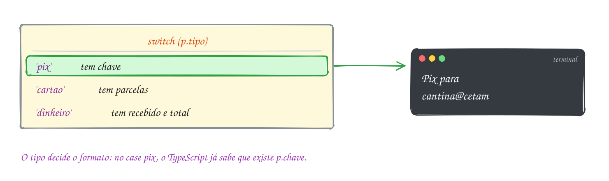</p>

```ts
type Pagamento = { tipo: 'pix'; chave: string } | { tipo: 'cartao'; parcelas: number }

function descrever(p: Pagamento): string {
  switch (p.tipo) {
    case 'pix':
      return `Pix para ${p.chave}` // aqui p tem chave
    case 'cartao':
      return `Cartão em ${p.parcelas}x` // aqui p tem parcelas
  }
}

console.log(descrever({ tipo: 'pix', chave: 'cantina@cetam' })) // Pix para cantina@cetam
```

No fluxograma, o `switch` abre um caminho para cada tipo. O exemplo do Pix
segue o caminho marcado:

<p align="center">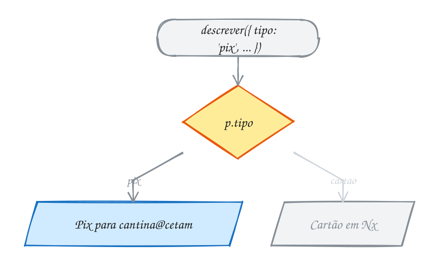</p>

> [!TIP]
> **Poder do TypeScript:** coloque um `default` que guarda o valor num
> `never` (o tipo do "isso nunca acontece", do assunto 0036). Se alguém criar
> um tipo novo de pagamento e esquecer de tratar, o TypeScript avisa:
>
> ```ts
> // acrescentaram | { tipo: 'boleto' } no Pagamento...
> default: {
>   const esquecido: never = p
>   // erro: Type '{ tipo: "boleto"; }' is not assignable to type 'never'.
> }
> ```

> [!NOTE]
> **Pergunta para a turma:** no `case 'pix'`, troque `p.chave` por
> `p.parcelas`. O editor deixa? Leia a mensagem. (Dica: Pix não tem parcelas.)

### Hora de praticar

Os arquivos ficam em [`0047-uniao-discriminada/`](0047-uniao-discriminada/). Os comandos funcionam de qualquer pasta do terminal. Nos exemplos, rode, mude, quebre e rode de novo. Nos exercícios, a resposta vai dentro do próprio arquivo.

**Exemplo A093 · Como cada aluno chega à escola**

```ts
type Trajeto = { meio: 'ônibus'; linha: string } | { meio: 'barco'; horas: number }

function contar(t: Trajeto): string {
  switch (t.meio) {
    case 'ônibus':
      return `Pega o ônibus ${t.linha}` // aqui t tem linha
    case 'barco':
      return `Vem de barco: ${t.horas}h de rio` // aqui t tem horas
  }
}

console.log(contar({ meio: 'barco', horas: 2 })) // Vem de barco: 2h de rio
```

```bash
tsx ~/LPPOO/19102026/0047-uniao-discriminada/A093.ts
```

**Exemplo A094 · O never vigia os casos esquecidos**

```ts
type Forma = { tipo: 'quadrado'; lado: number } | { tipo: 'circulo'; raio: number }

function area(f: Forma): number {
  if (f.tipo === 'quadrado') return f.lado ** 2
  if (f.tipo === 'circulo') return 3.14 * f.raio ** 2
  const esquecido: never = f // se surgir um tipo novo, o erro aparece aqui
  return esquecido
}

console.log(area({ tipo: 'quadrado', lado: 3 })) // 9
console.log(area({ tipo: 'circulo', raio: 1 })) // 3.14
```

```bash
tsx ~/LPPOO/19102026/0047-uniao-discriminada/A094.ts
```

**Exercício E093**

Crie type Forma = { tipo: 'retangulo'; largura: number; altura: number } |
{ tipo: 'triangulo'; base: number; altura: number }. Escreva area(f: Forma):
number com switch e teste as duas.

<details><summary>Dicas</summary>

1. Retângulo: largura * altura.
2. Triângulo: base * altura / 2.

</details>

```bash
tsx ~/LPPOO/19102026/0047-uniao-discriminada/E093.ts
```

**Exercício E094**

Copie o Pagamento e a função descrever do texto do assunto. Acrescente
{ tipo: 'boleto'; vencimento: string } e coloque o default com never. Veja o
erro aparecer e depois trate o boleto no switch para ele sumir.

<details><summary>Dicas</summary>

1. O erro aparece no default, não em quem chama.
2. Depois de criar o case 'boleto', o never volta a ficar feliz.

</details>

```bash
tsx ~/LPPOO/19102026/0047-uniao-discriminada/E094.ts
```

---

## 0048 · Interseção (&)

Lembra da união (`|`), do assunto 0045? Ela quer dizer "**um ou outro**".

A **interseção** (`&`) é o contrário: quer dizer "**os dois ao mesmo
tempo**". `A & B` tem tudo que `A` tem e tudo que `B` tem.

Pensa no crachá de um evento. Tem o seu nome e a sua idade, como na
identidade, e mais o número da inscrição.

Assim você monta um tipo grande juntando pedaços pequenos. `Aluno` tem nome e
idade. `ComId` tem só o id. E `Aluno & ComId` precisa das três coisas:

<p align="center">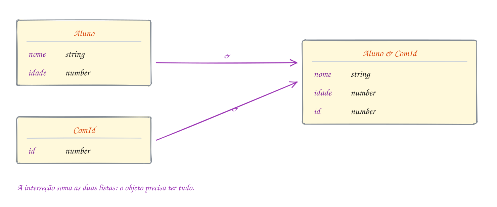</p>

```ts
type Aluno = { nome: string; idade: number }
type ComId = { id: number }

type AlunoComId = Aluno & ComId

const bia: AlunoComId = { id: 1, nome: 'Bia', idade: 16 }

console.log(`#${bia.id} ${bia.nome}, ${bia.idade} anos`) // #1 Bia, 16 anos
```

Na hora de aceitar o objeto, o TypeScript confere as duas partes. Faltou
qualquer pedaço, não passa:

<p align="center">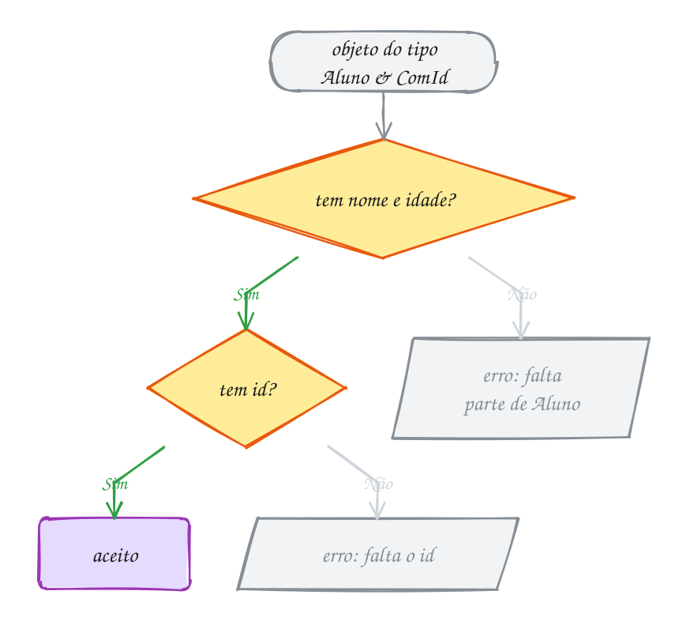</p>

> [!NOTE]
> Com objetos, o `&` faz o mesmo papel do `extends` da interface (assunto
> 0043). `interface AlunoComId extends Aluno, ComId {}` dá no mesmo. Use o que
> combinar com o resto do código.

> [!TIP]
> **Poder do TypeScript:** esqueceu o id? O erro diz até de qual parte ele
> faltou:
>
> ```ts
> const ze: Aluno & ComId = { nome: 'Zé', idade: 17 }
> // erro: Type '{ nome: string; idade: number; }' is not assignable
> //       to type 'Aluno & ComId'.
> //   Property 'id' is missing in type '{ nome: string; idade: number; }'
> //   but required in type 'ComId'.
> ```

> [!NOTE]
> **Pergunta para a turma:** e se você escrever `id: '1'`, com aspas? O
> TypeScript aceita? Troque no exemplo e leia o erro.

### Hora de praticar

Os arquivos ficam em [`0048-intersecao/`](0048-intersecao/). Os comandos funcionam de qualquer pasta do terminal. Nos exemplos, rode, mude, quebre e rode de novo. Nos exercícios, a resposta vai dentro do próprio arquivo.

**Exemplo A095 · Livro emprestado**

```ts
type Livro = { titulo: string; autor: string }
type Emprestimo = { aluno: string; dias: number }

const guarani: Livro & Emprestimo = { titulo: 'O Guarani', autor: 'José de Alencar', aluno: 'Caio', dias: 7 }

console.log(`${guarani.aluno} devolve "${guarani.titulo}" em ${guarani.dias} dias`)
// Caio devolve "O Guarani" em 7 dias

// Faltou a parte do Emprestimo:
// const semDono: Livro & Emprestimo = { titulo: 'Iracema', autor: 'José de Alencar' }
// erro: ... is missing the following properties from type 'Emprestimo': aluno, dias
```

```bash
tsx ~/LPPOO/19102026/0048-intersecao/A095.ts
```

**Exemplo A096 · Produto em promoção**

```ts
type Produto = { nome: string; preco: number }
type EmPromocao = { desconto: number } // 0.1 = 10%

function precoFinal(p: Produto & EmPromocao): number {
  return p.preco - p.preco * p.desconto
}

const acai = { nome: 'açaí', preco: 15, desconto: 0.2 }

console.log(`${acai.nome}: R$ ${precoFinal(acai).toFixed(2)}`) // açaí: R$ 12.00
```

```bash
tsx ~/LPPOO/19102026/0048-intersecao/A096.ts
```

**Exercício E095**

Crie type Endereco = { cidade: string; bairro: string } e type Contato =
{ telefone: string }. Monte type Pessoa = { nome: string } & Endereco & Contato,
crie uma pessoa e mostre uma frase com tudo.

<details><summary>Dicas</summary>

1. Dá para juntar mais de dois tipos: A & B & C.
2. Se faltar uma propriedade, o erro aparece na hora.

</details>

```bash
tsx ~/LPPOO/19102026/0048-intersecao/E095.ts
```

**Exercício E096**

Crie type Aluno = { nome: string } e type Avaliado = { nota: number }.
Escreva aprovado(a: Aluno & Avaliado): string que devolve "Ana: aprovada" ou
"Ana: recuperação" (nota mínima 7). Teste com dois alunos.

<details><summary>Dicas</summary>

1. O parâmetro já é a interseção: a.nome e a.nota existem.
2. Use if ou o ternário.

</details>

```bash
tsx ~/LPPOO/19102026/0048-intersecao/E096.ts
```

---

## 0049 · Tuplas, enum e as const

Pensa numa coordenada no mapa. Vem sempre na mesma ordem: primeiro a
latitude, depois a longitude. Duas posições, nem mais nem menos.

Hoje você vai ver três jeitos de dizer "isso aqui é fixo":

- **Tupla:** um array de **tamanho fixo** em que **cada posição tem seu tipo**.
  `[string, number]` é "um texto e depois um número".
- **`enum`:** dá **nomes** a um conjunto fixo de valores. `Turno.Noite` vale
  `'noite'`.
- **`as const`:** congela um array. Ele vira só de leitura, e cada item vira um
  literal. Dá até para tirar uma união dele.

<p align="center">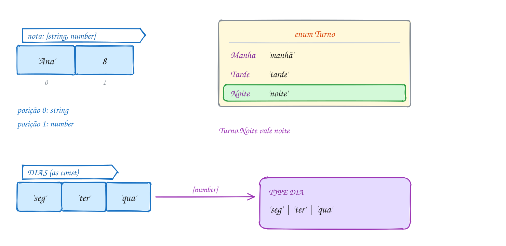</p>

Vamos ver os três na prática:

```ts
const nota: [string, number] = ['Ana', 8]
const [nome, valor] = nota // tira cada posição para uma variável
console.log(`${nome} tirou ${valor}`) // Ana tirou 8

enum Turno { Manha = 'manhã', Tarde = 'tarde', Noite = 'noite' }
console.log(Turno.Noite) // noite

const DIAS = ['seg', 'ter', 'qua'] as const
type Dia = (typeof DIAS)[number] // 'seg' | 'ter' | 'qua'
const hoje: Dia = 'ter'
```

A linha `const [nome, valor] = nota` se chama **desestruturação**. Ela abre a
tupla e guarda a posição 0 em `nome` e a posição 1 em `valor`.

E o `(typeof DIAS)[number]`? Leia de dentro para fora. `typeof DIAS` é o tipo
da lista. O `[number]` pega o tipo de um item qualquer dela. Resultado: a
união `'seg' | 'ter' | 'qua'`.

E qual dos três usar? Depende do que é fixo:

<p align="center">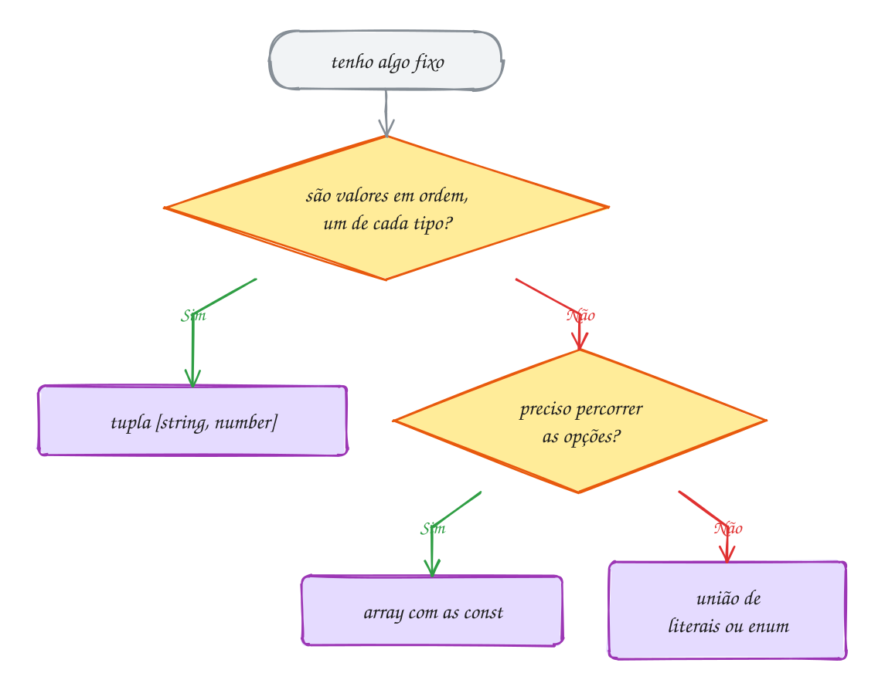</p>

> [!NOTE]
> O `enum` é um dos poucos pedaços do TypeScript que **continua existindo**
> quando o código vira JavaScript. Ele vira um objeto. Por isso muita gente
> prefere `as const` ou união de literais. Mas os três aparecem em projeto de
> verdade, então guarda os três.

> [!TIP]
> **Poder do TypeScript:** na tupla, a ordem conta. Trocou as posições, ele
> aponta:
>
> ```ts
> const nota: [string, number] = [8, 'Ana']
> // erro: Type 'number' is not assignable to type 'string'.
> ```

> [!NOTE]
> **Pergunta para a turma:** dá para fazer `DIAS.push('qui')`? Escreva a linha
> e veja o que o editor diz. (Dica: o `as const` congelou a lista.)

### Hora de praticar

Os arquivos ficam em [`0049-tuplas-enum-as-const/`](0049-tuplas-enum-as-const/). Os comandos funcionam de qualquer pasta do terminal. Nos exemplos, rode, mude, quebre e rode de novo. Nos exercícios, a resposta vai dentro do próprio arquivo.

**Exemplo A097 · Uma lista de tuplas: o ranking da turma**

```ts
const ranking: [string, number][] = [['Bia', 10], ['Caio', 9], ['Ana', 8]]

for (const [aluno, nota] of ranking) {
  console.log(`${aluno}: ${nota}`)
}
// Bia: 10
// Caio: 9
// Ana: 8
```

```bash
tsx ~/LPPOO/19102026/0049-tuplas-enum-as-const/A097.ts
```

**Exemplo A098 · enum Nivel: o nível do curso de inglês**

```ts
enum Nivel {
  Basico = 'básico',
  Avancado = 'avançado',
}

function aulasPorSemana(n: Nivel): number {
  return n === Nivel.Basico ? 3 : 1
}

console.log(`Nível ${Nivel.Avancado}: ${aulasPorSemana(Nivel.Avancado)} aula por semana`) // Nível avançado: 1 aula por semana
```

```bash
tsx ~/LPPOO/19102026/0049-tuplas-enum-as-const/A098.ts
```

**Exercício E097**

Crie type Coordenada = [number, number] (x e y). Escreva distancia(a:
Coordenada, b: Coordenada): number, que devolve a distância entre os dois
pontos, e teste com [0, 0] e [3, 4] (resposta: 5).

<details><summary>Dicas</summary>

1. Desestruture: const [x1, y1] = a.
2. Distância: Math.sqrt((x2 - x1) ** 2 + (y2 - y1) ** 2). O sqrt é a raiz quadrada.

</details>

```bash
tsx ~/LPPOO/19102026/0049-tuplas-enum-as-const/E097.ts
```

**Exercício E098**

Crie const FORMAS = ['pix', 'cartao', 'dinheiro'] as const e o type Forma
tirado dele. Peça ao usuário a forma de pagamento e diga se a cantina aceita
ou não.

<details><summary>Dicas</summary>

1. type Forma = (typeof FORMAS)[number].
2. Para saber se a resposta está na lista: FORMAS.some((f) => f === resposta).

</details>

```bash
tsx ~/LPPOO/19102026/0049-tuplas-enum-as-const/E098.ts
```

---

## 0050 · Generics (<T>)

Às vezes uma função faz a mesma coisa com qualquer tipo.

Pegar o primeiro item de uma lista, por exemplo. Funciona com lista de
número, de texto, de aluno...

Escrever uma função para cada tipo? Repetição. Usar `any`? Aí você joga o
TypeScript fora.

A saída é o **generic**. Ele é um **tipo coringa**, o `T`, que vira o tipo de
verdade na hora do uso.

Pensa na caixa da mudança. A caixa é a mesma para livros, pratos ou roupas. O
que muda é a etiqueta. O `T` é essa etiqueta.

Chamou com números? Recebe número de volta. Chamou com textos? Recebe texto:

<p align="center">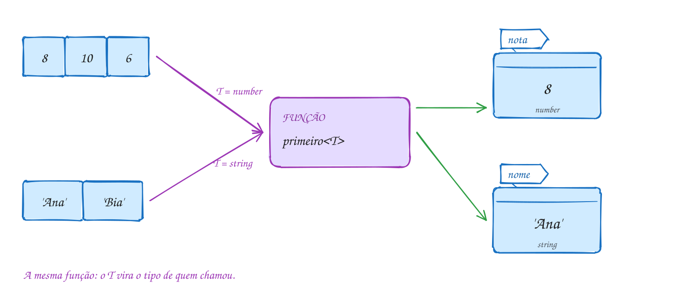)" width="858"></p>

```ts
function primeiro<T>(lista: T[]): T | undefined {
  return lista[0]
}

const nota = primeiro([8, 10, 6]) // aqui T = number
const nome = primeiro(['Ana', 'Bia']) // aqui T = string

console.log(nota, nome) // 8 Ana
```

Por que `T | undefined`? Porque a lista pode estar vazia, e aí não existe
primeiro item.

O `T` também serve em tipos: `type Caixa<T> = { etiqueta: string; conteudo: T }`.
E olha só: `string[]` também se escreve `Array<string>`. É um tipo genérico que
já vem pronto.

O fluxograma mostra o que o TypeScript faz na chamada com números:

<p align="center">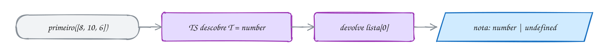)" width="1086"></p>

> [!TIP]
> **Poder do TypeScript:** com generics, o tipo não se perde no caminho.
> Passou textos, voltou texto. E ele não deixa guardar como número:
>
> ```ts
> const n: number | undefined = primeiro(['Ana'])
> // erro: Type 'string | undefined' is not assignable
> //       to type 'number | undefined'.
> ```

> [!NOTE]
> **Pergunta para a turma:** o que `primeiro([])` devolve, com a lista vazia?
> Rode e confira. (Dica: olhe o tipo de retorno da função.)

### Hora de praticar

Os arquivos ficam em [`0050-generics/`](0050-generics/). Os comandos funcionam de qualquer pasta do terminal. Nos exemplos, rode, mude, quebre e rode de novo. Nos exercícios, a resposta vai dentro do próprio arquivo.

**Exemplo A099 · Quem é o último da fila?**

```ts
function ultimo<T>(fila: T[]): T | undefined {
  return fila[fila.length - 1]
}

const nome = ultimo(['Ana', 'Caio', 'Lia']) // aqui T = string
const senha = ultimo([41, 42, 43]) // aqui T = number
console.log(nome, senha) // Lia 43

// const errado: string | undefined = ultimo([41, 42, 43])
// erro: Type 'number | undefined' is not assignable to type 'string | undefined'.
```

```bash
tsx ~/LPPOO/19102026/0050-generics/A099.ts
```

**Exemplo A100 · Um tipo genérico: Caixa<T>**

```ts
type Caixa<T> = { etiqueta: string; conteudo: T[] }

const livros: Caixa<string> = { etiqueta: 'livros', conteudo: ['Dom Casmurro', 'Iracema'] }
const pesos: Caixa<number> = { etiqueta: 'pesos (kg)', conteudo: [2, 5, 3] }

function descrever<T>(c: Caixa<T>): string {
  return `Caixa de ${c.etiqueta} com ${c.conteudo.length} itens`
}

console.log(descrever(livros))
console.log(descrever(pesos))
```

```bash
tsx ~/LPPOO/19102026/0050-generics/A100.ts
```

**Exercício E099**

Escreva sortear<T>(lista: T[]): T | undefined, que devolve um item
qualquer da lista. Teste com uma lista de nomes e com uma lista de números e
passe o mouse em cima dos resultados para ver o tipo.

<details><summary>Dicas</summary>

1. Índice sorteado: Math.floor(Math.random() * lista.length).
2. lista[i] já é T | undefined: a lista pode estar vazia.

</details>

```bash
tsx ~/LPPOO/19102026/0050-generics/E099.ts
```

**Exercício E100**

Crie type Par<A, B> = { primeiro: A; segundo: B } e a função
trocar<A, B>(p: Par<A, B>): Par<B, A>, que inverte as posições. Teste com
{ primeiro: 'Ana', segundo: 8 }.

<details><summary>Dicas</summary>

1. Um generic pode ter mais de uma letra: <A, B>.
2. Devolva { primeiro: p.segundo, segundo: p.primeiro }.

</details>

```bash
tsx ~/LPPOO/19102026/0050-generics/E100.ts
```

---

## 0051 · Tipos utilitários: Partial, Pick, Omit, Record, Readonly

Pensa numa receita de bolo. Com ela você faz o bolo sem cobertura, só a
cobertura ou meia receita. A receita é uma só.

O TypeScript já vem com alguns **tipos utilitários** que fazem isso com
tipos. Eles pegam um tipo que já existe e criam uma **variação** dele. Você não
copia nada.

E repara: todos são generics (assunto 0050).

| Utilitário            | O que faz                                   |
| --------------------- | ------------------------------------------- |
| `Partial<Aluno>`      | todas as propriedades viram opcionais       |
| `Pick<Aluno, 'nome'>` | fica só com as propriedades escolhidas      |
| `Omit<Aluno, 'id'>`   | fica com todas, menos as escolhidas         |
| `Readonly<Aluno>`     | todas viram só leitura                      |
| `Record<Turno, number>` | um objeto com uma chave para cada turno   |

<p align="center">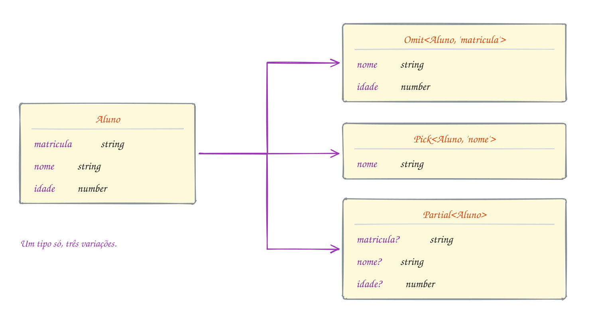</p>

Vamos ver na prática:

```ts
type Turno = 'manhã' | 'tarde' | 'noite'
type Aluno = { matricula: string; nome: string; idade: number }

const novo: Omit<Aluno, 'matricula'> = { nome: 'Bia', idade: 16 } // a escola gera a matrícula
const mudanca: Partial<Aluno> = { idade: 17 } // pode mudar qualquer coisa, ou nada
const bia: Aluno = { matricula: 'A27', ...novo, ...mudanca }
const ficha: Pick<Aluno, 'nome'> = { nome: bia.nome } // só o nome
const vagas: Record<Turno, number> = { manhã: 30, tarde: 25, noite: 40 }

console.log(bia) // { matricula: 'A27', nome: 'Bia', idade: 17 }
console.log(ficha.nome, vagas.noite) // Bia 40
```

Repara nos três pontinhos: `...novo` copia as propriedades do `novo` para
dentro do objeto da Bia. Se a mesma propriedade aparece duas vezes, vale a
última. Por isso a idade ficou 17, a da `mudanca`.

Para escolher o utilitário, pergunte: o que eu quero guardar do tipo
original?

<p align="center">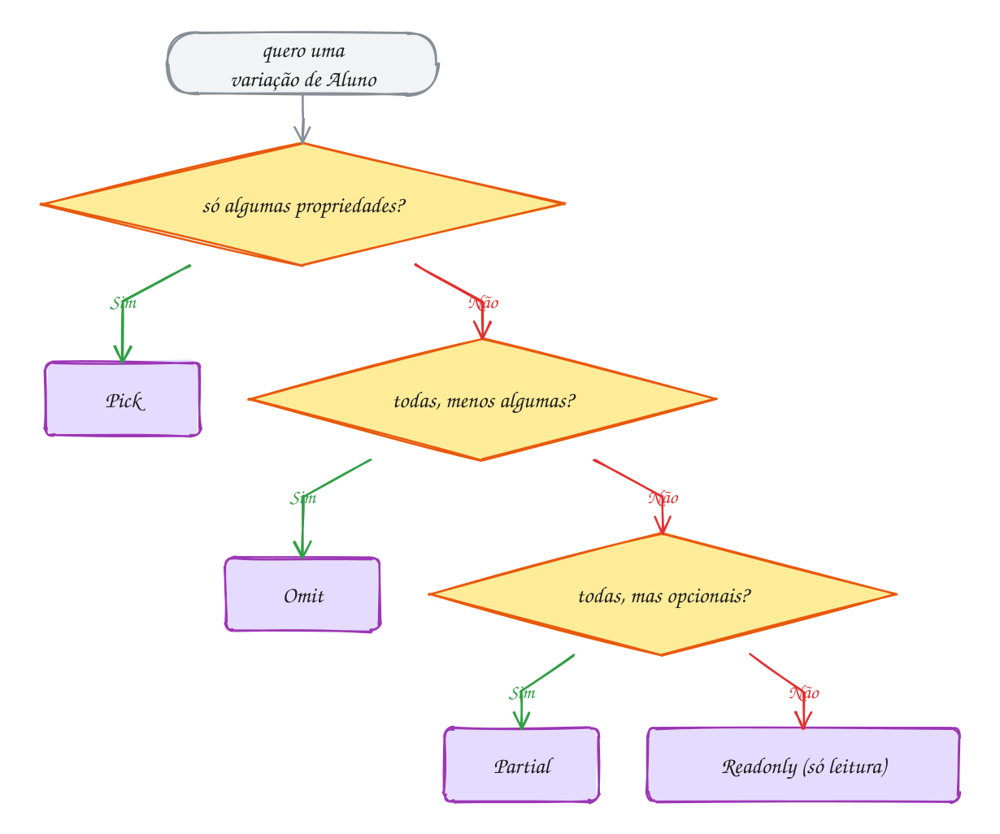</p>

> [!TIP]
> **Poder do TypeScript:** `Record<Turno, number>` exige **uma chave para cada
> turno**. Esqueceu a noite? Ele lembra você:
>
> ```ts
> const vagas: Record<Turno, number> = { manhã: 30, tarde: 25 }
> // erro: Property 'noite' is missing in type '{ manhã: number; tarde: number; }'
> //       but required in type 'Record<Turno, number>'.
> ```

> [!NOTE]
> **Pergunta para a turma:** se a `mudanca` for `{}`, vazia, o TypeScript
> aceita? E qual idade a Bia fica? Mude e rode. (Dica: no `Partial`, tudo é
> opcional.)

### Hora de praticar

Os arquivos ficam em [`0051-tipos-utilitarios/`](0051-tipos-utilitarios/). Os comandos funcionam de qualquer pasta do terminal. Nos exemplos, rode, mude, quebre e rode de novo. Nos exercícios, a resposta vai dentro do próprio arquivo.

**Exemplo A101 · Os produtos da banca na feira**

```ts
type Produto = { codigo: number; nome: string; preco: number }

function etiqueta(p: Pick<Produto, 'nome' | 'preco'>): string {
  return `${p.nome}: R$ ${p.preco.toFixed(2)}`
}

const cupuacu: Produto = { codigo: 1, nome: 'cupuaçu', preco: 6 }
const mudanca: Partial<Produto> = { preco: 5 }

console.log(etiqueta(cupuacu)) // cupuaçu: R$ 6.00
console.log(etiqueta({ ...cupuacu, ...mudanca })) // cupuaçu: R$ 5.00
console.log(etiqueta({ nome: 'tucumã', preco: 3 })) // tucumã: R$ 3.00: o Pick só pede nome e preço
```

```bash
tsx ~/LPPOO/19102026/0051-tipos-utilitarios/A101.ts
```

**Exemplo A102 · Record: uma nota para cada matéria**

```ts
type Materia = 'português' | 'matemática' | 'história'

const notas: Record<Materia, number> = { português: 8, matemática: 6, história: 10 }
const materias: Materia[] = ['português', 'matemática', 'história']

for (const m of materias) {
  console.log(`${m}: ${notas[m]}`)
}
// português: 8
// matemática: 6
// história: 10
```

```bash
tsx ~/LPPOO/19102026/0051-tipos-utilitarios/A102.ts
```

**Exercício E101**

Crie type Produto = { codigo: number; nome: string; preco: number;
estoque: number }. Use Pick para criar ItemDoCardapio (só nome e preço),
monte uma lista de ItemDoCardapio e mostre cada um.

<details><summary>Dicas</summary>

1. Pick aceita várias chaves: Pick<Produto, 'nome' | 'preco'>.
2. Um for...of resolve a listagem.

</details>

```bash
tsx ~/LPPOO/19102026/0051-tipos-utilitarios/E101.ts
```

**Exercício E102**

Crie type Dia = 'seg' | 'ter' | 'qua' e um Record<Dia, string> com o lanche
de cada dia. Mostre o lanche de terça.

<details><summary>Dicas</summary>

1. O Record exige uma chave para cada dia.
2. Para ler: cardapio.ter.

</details>

```bash
tsx ~/LPPOO/19102026/0051-tipos-utilitarios/E102.ts
```

---

## 0052 · Type guards (x is T) e satisfies

No assunto 0046, o `if` com `typeof` e `in` já estreitava o tipo.

Mas e quando a conferência fica comprida? Você coloca ela numa função.

Só que tem um detalhe. Para o TypeScript entender que a função é uma
conferência, o retorno precisa ser **`p is Aluno`**, e não `boolean`.

Essa função se chama **type guard**. Pensa no porteiro que confere a
carteirinha. Passou na conferência, lá dentro todo mundo sabe que você é
aluno.

Aqui é igual: se a função devolve `true`, dentro do `if` o `p` é `Aluno`.

<p align="center">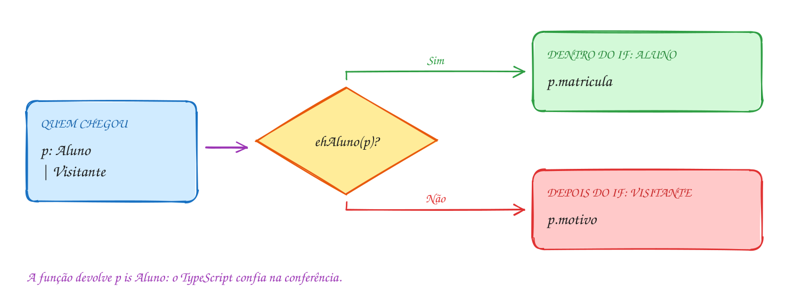</p>

```ts
type Aluno = { nome: string; matricula: string }
type Visitante = { nome: string; motivo: string }

function ehAluno(p: Aluno | Visitante): p is Aluno {
  return 'matricula' in p
}

function entrada(p: Aluno | Visitante): string {
  if (ehAluno(p)) return `${p.nome}, matrícula ${p.matricula}` // aqui p é Aluno
  return `${p.nome}, visitante: ${p.motivo}` // aqui p é Visitante
}

console.log(entrada({ nome: 'Bia', matricula: 'A27' })) // Bia, matrícula A27
```

O `'matricula' in p` pergunta se o objeto tem a propriedade `matricula`. Só o
aluno tem.

No fluxograma, a Bia passa na conferência e segue pelo Sim:

<p align="center">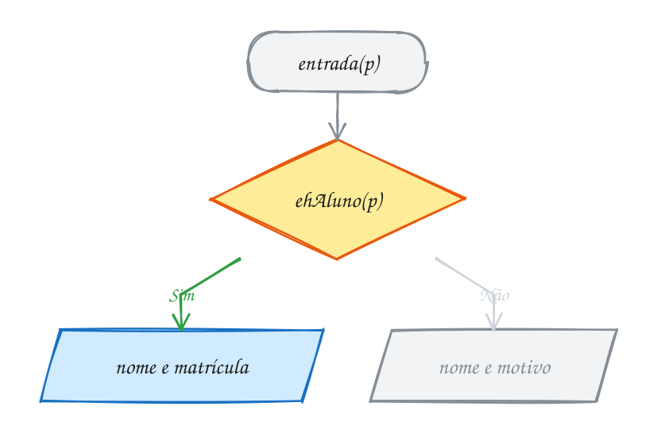</p>

Agora o **`satisfies`**. Ele também é uma conferência, mas de valor.

`valor satisfies Tipo` confere se o valor cabe no tipo, **sem trocar** o tipo
que o TypeScript descobriu sozinho.

Compare os dois:

```ts
const precos1: Record<string, number> = { acai: 15, tapioca: 8 }
precos1.acai // number | undefined: com a anotação, ele esquece quais chaves existem

const precos2 = { acai: 15, tapioca: 8 } satisfies Record<string, number>
precos2.acai // number: conferiu e lembrou das chaves
```

> [!TIP]
> **Poder do TypeScript:** o `satisfies` pega erro de digitação no nome da
> propriedade e ainda sugere o certo:
>
> ```ts
> type Configuracao = { escola: string; vagas: number }
> const config = { escola: 'CETAM', vagass: 30 } satisfies Configuracao
> // erro: Object literal may only specify known properties, but 'vagass'
> //       does not exist in type 'Configuracao'. Did you mean to write 'vagas'?
> ```

> [!NOTE]
> **Pergunta para a turma:** troque o retorno `p is Aluno` por `boolean`. O
> `p.matricula` dentro do `if` continua funcionando? Faça a troca e veja o que
> o editor diz.

### Hora de praticar

Os arquivos ficam em [`0052-type-guards-satisfies/`](0052-type-guards-satisfies/). Os comandos funcionam de qualquer pasta do terminal. Nos exemplos, rode, mude, quebre e rode de novo. Nos exercícios, a resposta vai dentro do próprio arquivo.

**Exemplo A103 · Type guard no filter**

```ts
function ehNumero(x: unknown): x is number {
  return typeof x === 'number'
}

const misturado: unknown[] = [8, 'dez', 6, null, 9]
const notas: number[] = misturado.filter(ehNumero) // sem o "x is number", seria unknown[]

console.log(notas) // [ 8, 6, 9 ]
```

```bash
tsx ~/LPPOO/19102026/0052-type-guards-satisfies/A103.ts
```

**Exemplo A104 · satisfies: confere o valor e lembra das chaves**

```ts
const precos = { suco: 5, pastel: 7 } satisfies Record<string, number>
console.log(precos.suco + precos.pastel) // 12

// Com a anotação no lugar do satisfies, as chaves são esquecidas:
// const precos2: Record<string, number> = { suco: 5, pastel: 7 }
// console.log(precos2.suco + precos2.pastel)
// erro: 'precos2.suco' is possibly 'undefined'.
```

```bash
tsx ~/LPPOO/19102026/0052-type-guards-satisfies/A104.ts
```

**Exercício E103**

Crie type Cachorro = { nome: string; latir(): string } e type Gato =
{ nome: string; miar(): string }. Escreva o type guard ehCachorro e a função
falar(bicho: Cachorro | Gato), que chama latir ou miar.

<details><summary>Dicas</summary>

1. O guard pode usar 'latir' in bicho.
2. O retorno do guard é bicho is Cachorro.

</details>

```bash
tsx ~/LPPOO/19102026/0052-type-guards-satisfies/E103.ts
```

**Exercício E104**

Crie const horarios = { manha: '07:00', noite: '19:00' } satisfies
Record<string, string>. Passe o mouse em horarios.noite. Depois troque o
satisfies por uma anotação (: Record<string, string>) e compare o tipo.

<details><summary>Dicas</summary>

1. Com o satisfies, o tipo é string.
2. Com a anotação, aparece o | undefined.

</details>

```bash
tsx ~/LPPOO/19102026/0052-type-guards-satisfies/E104.ts
```

---

## 0053 · tsconfig: strict e as regras do projeto

Pensa no regulamento da escola. Ele diz o que pode e o que não pode. O
coordenador não inventa regra: ele aplica o regulamento.

No projeto, o regulamento é o arquivo **`tsconfig.json`**, na raiz. Ele diz
ao TypeScript **o quanto ele deve ser exigente**.

O nosso liga as regras mais rígidas:

| Opção                         | O que ela cobra                                         |
| ----------------------------- | ------------------------------------------------------- |
| `strict`                      | o pacote principal: `null`/`undefined` tratados, nada de `any` escondido |
| `noUncheckedIndexedAccess`    | `lista[i]` pode ser `undefined`: a posição pode não existir |
| `noUnusedLocals`              | variável criada e nunca usada                           |
| `noUnusedParameters`          | parâmetro que a função não usa                          |
| `noImplicitReturns`           | função que esquece o `return` em algum caminho          |
| `noFallthroughCasesInSwitch`  | `case` sem `break` que cai no próximo                   |

Agora guarda isso: o **`tsx` só roda**. Ele **não confere tipos**.

Quem confere é o **`tsc`**, o compilador. Rode `pnpm -C ~/LPPOO tsc` (de
qualquer pasta) e ele lista os erros do projeto inteiro, com o arquivo e a
linha:

<p align="center">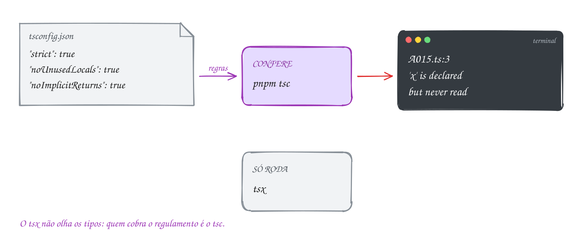</p>

```ts
const notas = [8, 10, 6]

const primeira = notas[0] // number | undefined: a posição pode não existir
if (primeira !== undefined) {
  console.log(primeira.toFixed(1)) // 8.0
}

function situacao(nota: number): string {
  if (nota >= 7) return 'aprovado'
  return 'recuperação' // sem esta linha, o tsc reclama: falta um return
}

console.log(situacao(6)) // recuperação
```

O ciclo do dia a dia é este:

<p align="center">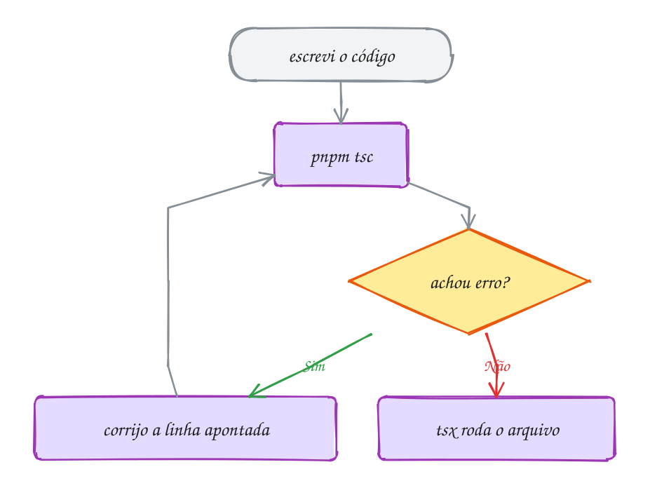</p>

> [!IMPORTANT]
> O `tsc` confere **todos** os arquivos. Aquele exercício pela metade em outra
> pasta também aparece na lista. Então leia o caminho do arquivo no começo de
> cada erro.

> [!TIP]
> **Poder do TypeScript:** esqueceu uma variável sem usar? Vira erro, e o
> código fica limpo:
>
> ```ts
> const naoUsada = 1
> // erro: 'naoUsada' is declared but its value is never read.
> ```

> [!NOTE]
> **Pergunta para a turma:** apague a linha `return 'recuperação'` e rode com
> o `tsx`. O que aparece? E o `tsc`, o que ele diz? (Dica: só um dos dois
> confere tipos.)

### Hora de praticar

Os arquivos ficam em [`0053-tsconfig/`](0053-tsconfig/). Os comandos funcionam de qualquer pasta do terminal. Nos exemplos, rode, mude, quebre e rode de novo. Nos exercícios, a resposta vai dentro do próprio arquivo.

**Exemplo A105 · noUncheckedIndexedAccess: a posição pode estar vazia**

```ts
const fila = ['Ana', 'Bia', 'Caio']

console.log(fila[2]?.toUpperCase() ?? 'ninguém') // CAIO
console.log(fila[4]?.toUpperCase() ?? 'ninguém') // ninguém

// Sem o ?., o tsc reclama, porque fila[2] é string | undefined:
// fila[2].toUpperCase()
// erro: Object is possibly 'undefined'.
```

```bash
tsx ~/LPPOO/19102026/0053-tsconfig/A105.ts
```

**Exemplo A106 · noFallthroughCasesInSwitch: o break esquecido**

```ts
function avisar(codigo: number): void {
  switch (codigo) {
    case 1:
      console.log('Turno da manhã')
      break // apague este break e rode pnpm tsc: Fallthrough case in switch.
    case 2:
      console.log('Turno da tarde')
  }
}

avisar(1) // Turno da manhã
```

```bash
tsx ~/LPPOO/19102026/0053-tsconfig/A106.ts
```

**Exercício E105**

Crie de propósito uma variável que nunca é usada e rode pnpm -C ~/LPPOO tsc.
Copie a mensagem do erro para um comentário e depois corrija o código.

<details><summary>Dicas</summary>

1. A mensagem começa com o arquivo e a linha: procure E105.
2. Para corrigir, use a variável num console.log ou apague a linha.

</details>

```bash
tsx ~/LPPOO/19102026/0053-tsconfig/E105.ts
```

**Exercício E106**

Escolha uma opção da tabela do assunto 0053. Escreva, comentado, um código
que ela barra e, embaixo, o mesmo código do jeito certo.

<details><summary>Dicas</summary>

1. Uma boa escolha: noUnusedParameters (função com parâmetro que não é usado).
2. Comente o código errado com // na frente de cada linha.

</details>

```bash
tsx ~/LPPOO/19102026/0053-tsconfig/E106.ts
```

---

## 0054 · Juntando tudo: cadastro de alunos tipado

Hora de juntar as peças num programa só: um pequeno cadastro de alunos, como
a ficha da secretaria.

Repara que cada parte usa um assunto da aula:

- `Turno`: **união de literais** (0045);
- `Aluno`: **interface** com **readonly** e **opcional** (0043, 0044);
- `AlunoNovo`: **Omit** (0051), porque a matrícula quem gera é o cadastro;
- `Situacao`: **união discriminada** (0047), aprovado tem média, recuperação
  tem quanto falta;
- `vagas`: **Record** (0051), uma chave por turno.

<p align="center">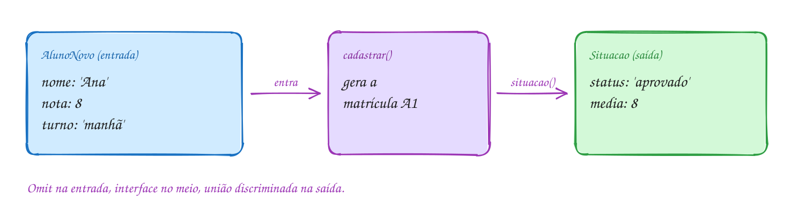</p>

Vamos ver tudo junto:

```ts
type Turno = 'manhã' | 'tarde' | 'noite'

interface Aluno {
  readonly matricula: string
  nome: string
  nota: number
  turno: Turno
  apelido?: string
}

type AlunoNovo = Omit<Aluno, 'matricula'>
type Situacao = { status: 'aprovado'; media: number } | { status: 'recuperação'; falta: number }

let contador = 0
function cadastrar(dados: AlunoNovo): Aluno {
  contador++
  return { matricula: `A${String(contador).padStart(2, '0')}`, ...dados }
}

function situacao(a: Aluno): Situacao {
  if (a.nota >= 7) return { status: 'aprovado', media: a.nota }
  return { status: 'recuperação', falta: 7 - a.nota }
}

const turma = [
  cadastrar({ nome: 'Ana', nota: 8, turno: 'manhã' }),
  cadastrar({ nome: 'José', nota: 5, turno: 'noite', apelido: 'Zé' }),
]

for (const a of turma) {
  const s = situacao(a)
  const detalhe = s.status === 'aprovado' ? `média ${s.media}` : `faltam ${s.falta}`
  console.log(`${a.matricula} ${a.apelido ?? a.nome}: ${s.status} (${detalhe})`)
}
// A01 Ana: aprovado (média 8)
// A02 Zé: recuperação (faltam 2)
```

Olha o caminho de um aluno pelo cadastro:

<p align="center">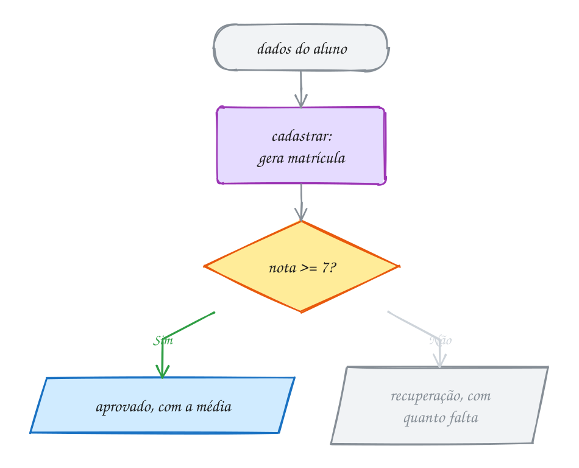</p>

> [!TIP]
> Faça o teste: tente `turma[0].matricula = 'X'`, `turno: 'madrugada'` ou
> `s.media` fora do `if`. Cada peça barra um erro diferente. Foi para isso que
> você aprendeu cada uma.

> [!NOTE]
> **Pergunta para a turma:** se o José tirar 7 em vez de 5, o que aparece na
> segunda linha? Mude a nota e rode. (Dica: olhe o `>=` da função
> `situacao`.)

### Hora de praticar

Os arquivos ficam em [`0054-juntando-tudo/`](0054-juntando-tudo/). Os comandos funcionam de qualquer pasta do terminal. Nos exemplos, rode, mude, quebre e rode de novo. Nos exercícios, a resposta vai dentro do próprio arquivo.

**Exemplo A107 · A biblioteca da escola**

```ts
type Genero = 'romance' | 'poesia' | 'quadrinhos'

interface Livro {
  readonly codigo: string
  titulo: string
  genero: Genero
  dias?: number // só existe se o livro estiver com um aluno
}

type Situacao = { tipo: 'na estante' } | { tipo: 'emprestado'; dias: number } | { tipo: 'atrasado'; multa: number }

function situacao(l: Livro): Situacao {
  if (l.dias === undefined) return { tipo: 'na estante' }
  if (l.dias <= 7) return { tipo: 'emprestado', dias: l.dias }
  return { tipo: 'atrasado', multa: (l.dias - 7) * 0.5 }
}

const acervo: Livro[] = [
  { codigo: 'L01', titulo: 'O Guarani', genero: 'romance' },
  { codigo: 'L02', titulo: 'Turma da Mônica', genero: 'quadrinhos', dias: 3 },
  { codigo: 'L03', titulo: 'Poemas do Rio', genero: 'poesia', dias: 11 },
]

for (const l of acervo) {
  const s = situacao(l)
  if (s.tipo === 'atrasado') console.log(`${l.codigo} ${l.titulo}: multa de R$ ${s.multa.toFixed(2)}`)
  else if (s.tipo === 'emprestado') console.log(`${l.codigo} ${l.titulo}: volta em ${7 - s.dias} dias`)
  else console.log(`${l.codigo} ${l.titulo}: disponível na estante de ${l.genero}`)
}
// L01 O Guarani: disponível na estante de romance
// L02 Turma da Mônica: volta em 4 dias
// L03 Poemas do Rio: multa de R$ 2.00
```

```bash
tsx ~/LPPOO/19102026/0054-juntando-tudo/A107.ts
```

**Exemplo A108 · Cadastro pelo teclado, com type guard no turno**

```ts
import { input } from '#core/input.ts'

const TURNOS = ['manhã', 'tarde', 'noite'] as const
type Turno = (typeof TURNOS)[number]

function ehTurno(texto: string): texto is Turno {
  return (TURNOS as readonly string[]).includes(texto)
}

const nome = input('Nome: ')
const nota = Number(input('Nota: '))
const turnoDigitado = input('Turno (manhã, tarde ou noite): ')

if (!ehTurno(turnoDigitado)) {
  console.log(`Turno "${turnoDigitado}" não existe.`)
} else if (Number.isNaN(nota)) {
  console.log('A nota precisa ser um número.')
} else {
  const situacao = nota >= 7 ? 'aprovado' : 'recuperação'
  console.log(`${nome}, turno da ${turnoDigitado}: ${situacao}`)
}
```

```bash
tsx ~/LPPOO/19102026/0054-juntando-tudo/A108.ts
```

**Exercício E107**

Crie type Situacao = { tipo: 'preparando' } | { tipo: 'pronto'; balcao: number }
e interface Pedido { readonly numero: number; situacao: Situacao }. Escreva
avisar(p: Pedido): string e teste com um pedido de cada tipo.

<details><summary>Dicas</summary>

1. Pergunte se p.situacao.tipo === 'pronto'.
2. Só dentro desse if existe p.situacao.balcao.

</details>

```bash
tsx ~/LPPOO/19102026/0054-juntando-tudo/E107.ts
```

**Exercício E108**

Crie type Categoria = 'lanche' | 'bebida' | 'doce' e o type guard
ehCategoria(texto: string): texto is Categoria. Peça uma categoria ao usuário
e diga se a cantina tem essa categoria.

<details><summary>Dicas</summary>

1. Copie a ideia do ehTurno do segundo exemplo (A108).
2. Guarde as categorias numa lista com as const e use .some().

</details>

```bash
tsx ~/LPPOO/19102026/0054-juntando-tudo/E108.ts
```

---

## Prática em sala

Os enunciados estão em [`pratica/`](pratica/):

| Arquivo | O que fazer |
| --- | --- |
| [`modelar-cantina.ts`](pratica/modelar-cantina.ts) | modelar a cantina só com tipos: união, interface, opcional, readonly |
| [`turnos.ts`](pratica/turnos.ts) | turnos com união de literais e `Record` |
| [`pagamento.ts`](pratica/pagamento.ts) | pagamento com união discriminada e `never` |
| [`desafio-funcao-generica.ts`](pratica/desafio-funcao-generica.ts) | desafio: `agrupar<T>` devolvendo um `Record` |

```bash
tsx ~/LPPOO/19102026/pratica/modelar-cantina.ts
tsx ~/LPPOO/19102026/pratica/turnos.ts
tsx ~/LPPOO/19102026/pratica/pagamento.ts
tsx ~/LPPOO/19102026/pratica/desafio-funcao-generica.ts
```

## Para ler mais

- MICROSOFT. *TypeScript Handbook*. Disponível em: <https://www.typescriptlang.org/docs/handbook/intro.html>.
- MICROSOFT. *TypeScript Handbook*: Everyday Types. Disponível em: <https://www.typescriptlang.org/docs/handbook/2/everyday-types.html>.
- MDN WEB DOCS. *Falsy*. Disponível em: <https://developer.mozilla.org/pt-BR/docs/Glossary/Falsy>.
- MDN WEB DOCS. *Operador de coalescência nula (??)*. Disponível em: <https://developer.mozilla.org/pt-BR/docs/Web/JavaScript/Reference/Operators/Nullish_coalescing>.
- MICROSOFT. *TypeScript Handbook*: Narrowing. Disponível em: <https://www.typescriptlang.org/docs/handbook/2/narrowing.html>.
- MICROSOFT. *TypeScript Handbook*: Object Types. Disponível em: <https://www.typescriptlang.org/docs/handbook/2/objects.html>.
- MICROSOFT. *TypeScript Handbook*: Generics. Disponível em: <https://www.typescriptlang.org/docs/handbook/2/generics.html>.
- MICROSOFT. *Utility Types*. Disponível em: <https://www.typescriptlang.org/docs/handbook/utility-types.html>.
- MICROSOFT. *TSConfig Reference*. Disponível em: <https://www.typescriptlang.org/tsconfig/>.
- BASARAT, A. S. *TypeScript Deep Dive*. Disponível em: <https://basarat.gitbook.io/typescript/>.
